# Quiz teoria — Patente AM (ciclomotori)

- **Fonte ufficiale:** Ministero delle Infrastrutture e dei Trasporti — [Il Portale dell'Automobilista, "Quiz per le patenti AM, B, superiori e CQC"](https://www.ilportaledellautomobilista.it/web/portale-automobilista/-/quiz-per-le-patenti-am-b-superiori-e-cqc)
- **File originale (PDF):** https://www.ilportaledellautomobilista.it/documents/56611/57321/Domande+AM+italiano+04+04+2025/ad547e38-92c7-4f92-850d-487be020ccc3
- **Scaricato:** 2026-10-17 (listato in vigore, valido per il 2026)
- **Ambito:** Patente AM — esame di teoria
- **Domande:** 2035 (1044 VERO / 991 FALSO), 10 sezioni, 138 figure

Ogni domanda: `numero` — testo → risposta corretta. Le figure si trovano in `images/`.

## Indice

1. [Pannelli integrativi, segnali di indicazione, segnali luminosi, segnali orizzontali](#sezione-1) (276)
2. [Norme sulla precedenza](#sezione-2) (119)
3. [Segnali di pericolo](#sezione-3) (252)
4. [Segnali di divieto, segnali di obbligo, segnali di precedenza](#sezione-4) (333)
5. [Velocità, distanza di sicurezza, sorpasso, svolta, cambio di corsia, cambio di direzione](#sezione-5) (180)
6. [Fermata, sosta, definizioni stradali](#sezione-6) (101)
7. [Cause di incidenti, assicurazione](#sezione-7) (200)
8. [Elementi del ciclomotore e loro uso, casco](#sezione-8) (169)
9. [Comportamenti alla guida del ciclomotore](#sezione-9) (187)
10. [Educazione alla legalità](#sezione-10) (218)

## 1. Pannelli integrativi, segnali di indicazione, segnali luminosi, segnali orizzontali

- **26067** — Il pannello integrativo raffigurato indica da che ora a che ora vale la prescrizione nei giorni lavorativi → **✅ VERO**
   
- **26068** — Il pannello integrativo raffigurato, posto sotto il segnale DIVIETO DI SOSTA, indica che la sosta è consentita nei giorni festivi → **✅ VERO**
   
- **26069** — Il pannello integrativo raffigurato, posto sotto il segnale PARCHEGGIO, ne indica l'orario e la limitazione ai giorni feriali → **✅ VERO**
   
- **26070** — Il pannello integrativo raffigurato indica l'orario lavorativo di un cantiere stradale → **❌ FALSO**
   
- **26071** — Il pannello integrativo raffigurato indica la fascia oraria di validità del segnale nei giorni festivi → **❌ FALSO**
   
- **26072** — Il pannello integrativo raffigurato preavvisa la presenza di un'officina → **❌ FALSO**
   
- **26043** — Ciascuno dei pannelli integrativi raffigurati indica la distanza tra il segnale di pericolo sotto cui è posto ed il punto d'inizio del pericolo → **✅ VERO**
   
- **26044** — Ciascuno dei pannelli integrativi raffigurati indica la distanza dal punto di inizio del pericolo → **✅ VERO**
   
- **26045** — Ciascuno dei pannelli integrativi raffigurati indica la distanza alla quale inizia il pericolo indicato nel segnale sovrastante → **✅ VERO**
   
- **26046** — Ciascuno dei pannelli integrativi raffigurati indica la lunghezza del tratto di strada pericoloso → **❌ FALSO**
   
- **26047** — Ciascuno dei pannelli integrativi raffigurati indica la mancanza di segnaletica orizzontale → **❌ FALSO**
   
- **26048** — Ciascuno dei pannelli integrativi raffigurati indica il punto dove finisce il pericolo raffigurato dal segnale → **❌ FALSO**
   
- **26049** — Ciascuno dei pannelli integrativi raffigurati indica la lunghezza del tratto stradale nel quale si applica la prescrizione → **✅ VERO**
   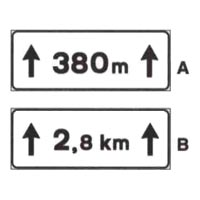
- **26050** — Ciascuno dei pannelli integrativi raffigurati integra l'indicazione di pericolo del segnale sotto cui è posto → **✅ VERO**
   
- **26051** — Ciascuno dei pannelli integrativi raffigurati indica l'inizio della prescrizione specificata dal segnale, precisandone l'estensione → **✅ VERO**
   
- **26052** — Ciascuno dei pannelli integrativi raffigurati, posto sotto un segnale di pericolo, indica la distanza dall'inizio del pericolo → **❌ FALSO**
   
- **26053** — Ciascuno dei pannelli integrativi raffigurati esprime in metri o chilometri la distanza dal punto indicato dal segnale → **❌ FALSO**
   
- **26054** — Ciascuno dei pannelli integrativi raffigurati indica la distanza di sicurezza da mantenere tra due veicoli → **❌ FALSO**
   
- **26055** — Il pannello integrativo mostrato in figura B, posto sotto il segnale DIVIETO DI SOSTA, indica la fascia oraria di validità del divieto → **✅ VERO**
   
- **26056** — Il pannello integrativo mostrato in figura B, posto sotto il segnale DIVIETO DI TRANSITO, indica la fascia oraria in cui vale il divieto → **✅ VERO**
   
- **26057** — Il pannello integrativo mostrato in figura B, indica le ore durante le quali vale la prescrizione → **✅ VERO**
   
- **26058** — Ciascuno dei pannelli integrativi raffigurati vale solo nei giorni feriali → **❌ FALSO**
   
- **26059** — Il pannello integrativo mostrato in figura A, indica la lunghezza del tratto di strada nel quale vale il divieto → **❌ FALSO**
   
- **26060** — Il pannello integrativo mostrato in figura A, indica i giorni del mese in cui è valido il segnale sotto cui è posto → **❌ FALSO**
   
- **26079** — Ciascuno dei pannelli integrativi raffigurati, posto sotto il segnale DIVIETO DI SOSTA, indica la continuazione del divieto → **✅ VERO**
   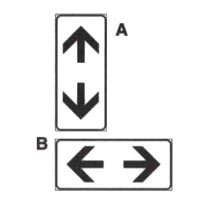
- **26080** — Ciascuno dei pannelli integrativi raffigurati, posto sotto il segnale DIVIETO DI SORPASSO, indica la continuazione del divieto → **✅ VERO**
   
- **26081** — Ciascuno dei pannelli integrativi raffigurati, posto sotto un segnale di pericolo, ne indica la continuazione → **✅ VERO**
   
- **26082** — Ciascuno dei pannelli integrativi raffigurati indica le direzioni permesse → **❌ FALSO**
   
- **26083** — Ciascuno dei pannelli integrativi raffigurati indica la fine del senso unico e l'inizio del doppio senso di circolazione → **❌ FALSO**
   
- **26084** — Ciascuno dei pannelli integrativi raffigurati indica la corsia riservata agli autobus → **❌ FALSO**
   
- **26091** — Il pannello integrativo raffigurato indica il rallentamento della circolazione a causa di un incidente → **✅ VERO**
   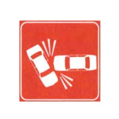
- **26092** — Il pannello integrativo raffigurato consiglia, dove possibile, la scelta di un percorso alternativo → **✅ VERO**
   
- **26093** — Il pannello integrativo raffigurato segnala un incidente stradale e la necessità di moderare la velocità → **✅ VERO**
   
- **26094** — Il pannello integrativo raffigurato indica una strada di notevole pericolosità → **❌ FALSO**
   
- **26095** — Il pannello integrativo raffigurato indica il pericolo di scontro con veicoli provenienti da destra → **❌ FALSO**
   
- **26096** — Il pannello integrativo raffigurato preavvisa un tratto di strada con elevata probabilità di provocare incidenti → **❌ FALSO**
   
- **26109** — Il segnale raffigurato indica corsia di destra chiusa per lavori in corso → **✅ VERO**
   
- **26110** — Il segnale raffigurato indica riduzione da due a una corsia di marcia → **✅ VERO**
   
- **26111** — Il segnale raffigurato è posto in prossimità di un cantiere stradale → **✅ VERO**
   
- **26112** — Il segnale raffigurato obbliga ad effettuare l'inversione di marcia → **❌ FALSO**
   
- **26113** — Il segnale raffigurato obbliga a dare la precedenza ai veicoli provenienti dalla corsia di destra → **❌ FALSO**
   
- **26114** — Il segnale raffigurato preavvisa un cambio di carreggiata → **❌ FALSO**
   
- **26133** — Ciascuno dei segnali raffigurati indica che la circolazione nel tratto di strada in cui è posto il segnale è a senso unico → **✅ VERO**
   
- **26134** — Ciascuno dei segnali raffigurati indica che non è permesso marciare in senso opposto al segnale nel tratto di strada in cui è posto → **✅ VERO**
   
- **26135** — Ciascuno dei segnali raffigurati indica l'obbligo di percorrere il tratto di strada in cui è posto, secondo il senso della freccia → **✅ VERO**
   
- **26136** — Il segnale mostrato in figura A indica che è obbligatorio svoltare a sinistra → **❌ FALSO**
   
- **26137** — Ciascuno dei segnali raffigurati indica l'obbligo di svoltare nel senso della freccia → **❌ FALSO**
   
- **26138** — I segnali raffigurati, disposti in coppia, indicano che non si può girare né a destra né a sinistra dopo di loro → **❌ FALSO**
   
- **26139** — Il segnale raffigurato è installato sui veicoli per lavori stradali, fermi o in movimento → **✅ VERO**
   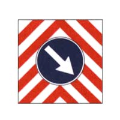
- **26140** — Il segnale raffigurato indica il lato dal quale il veicolo su cui è applicato deve essere sorpassato → **✅ VERO**
   
- **26141** — Il segnale raffigurato è posto su macchinari per la manutenzione stradale in sosta sulla carreggiata → **✅ VERO**
   
- **26142** — Il segnale raffigurato indica circolazione rotatoria → **❌ FALSO**
   
- **26143** — Il segnale raffigurato indica l'obbligo di svolta a destra → **❌ FALSO**
   
- **26144** — Il segnale raffigurato obbliga a sorpassare l'ostacolo sulla sinistra → **❌ FALSO**
   
- **26145** — Il segnale raffigurato indica l'inizio di una zona riservata alla circolazione dei pedoni, delle biciclette e dei veicoli di emergenza → **✅ VERO**
   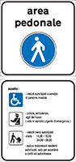
- **26146** — Il segnale raffigurato, nel pannello integrativo, contiene particolari limitazioni o eccezioni → **✅ VERO**
   
- **26147** — Il segnale raffigurato, nel pannello integrativo, contiene eccezioni per la circolazione di veicoli per il carico e lo scarico merci → **✅ VERO**
   
- **26148** — Il segnale raffigurato indica una zona residenziale fuori dai centri urbani → **❌ FALSO**
   
- **26149** — Il segnale raffigurato indica una pista ciclabile → **❌ FALSO**
   
- **26150** — Il segnale raffigurato permette il transito dei ciclomotori → **❌ FALSO**
   
- **26151** — Il segnale raffigurato indica l'inizio di una zona a traffico limitato → **✅ VERO**
   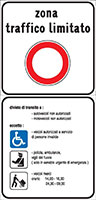
- **26152** — Il segnale raffigurato indica l'inizio dell'area in cui la circolazione può essere limitata → **✅ VERO**
   
- **26153** — Il segnale raffigurato indica l'inizio dell'area dove possono circolare solo particolari categorie di veicoli → **✅ VERO**
   
- **26154** — Il segnale raffigurato preavvisa una zona pedonale → **❌ FALSO**
   
- **26155** — Il segnale raffigurato indica una pista ciclabile → **❌ FALSO**
   
- **26156** — Il segnale raffigurato comporta il divieto di inversione di marcia → **❌ FALSO**
   
- **26157** — Il segnale raffigurato indica un attraversamento pedonale non regolato da semaforo → **✅ VERO**
   
- **26158** — Il segnale raffigurato si trova in corrispondenza di un attraversamento pedonale → **✅ VERO**
   
- **26159** — Il segnale raffigurato comporta di moderare la velocità e di fermarsi se necessario → **✅ VERO**
   
- **26160** — Il segnale raffigurato preavvisa un viale pedonale → **❌ FALSO**
   
- **26161** — Il segnale raffigurato impone di usare i segnali acustici per avvertire i pedoni → **❌ FALSO**
   
- **26162** — Il segnale raffigurato vieta il transito ai pedoni → **❌ FALSO**
   
- **26163** — Il segnale raffigurato indica l'inizio di una strada riservata alla circolazione dei veicoli a motore → **✅ VERO**
   
- **26164** — Il segnale raffigurato viene posto all'inizio di una strada riservata alla circolazione dei veicoli a motore → **✅ VERO**
   
- **26165** — Il segnale raffigurato indica una corsia riservata alle autovetture → **❌ FALSO**
   
- **26166** — Il segnale raffigurato non permette il transito dei quadricicli a motore → **❌ FALSO**
   
- **26167** — Il segnale raffigurato obbliga i veicoli a motore a disporsi in un'unica fila → **❌ FALSO**
   
- **26168** — Il segnale raffigurato indica che una pista ciclabile attraversa la carreggiata → **✅ VERO**
   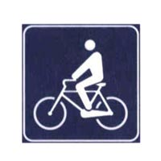
- **26169** — Il segnale raffigurato è abbinato alle strisce di attraversamento ciclabile → **✅ VERO**
   
- **26170** — Il segnale raffigurato invita ad usare prudenza perché possiamo trovare ciclisti che attraversano la carreggiata → **✅ VERO**
   
- **26171** — Il segnale raffigurato indica l'inizio di una pista ciclabile → **❌ FALSO**
   
- **26172** — Il segnale raffigurato indica una zona esclusa al transito di veicoli a motore → **❌ FALSO**
   
- **26173** — Il segnale raffigurato indica una pista ciclabile vicina al marciapiede → **❌ FALSO**
   
- **26174** — Il segnale raffigurato indica come devono essere utilizzate le corsie costituenti la carreggiata → **✅ VERO**
   
- **26175** — Il segnale raffigurato riserva la corsia di destra agli autobus dei servizi pubblici urbani → **✅ VERO**
   
- **26176** — Il segnale raffigurato indica che le corsie di sinistra sono destinate al transito normale → **✅ VERO**
   
- **26177** — Il segnale raffigurato permette ai taxi di percorrere la corsia di destra → **❌ FALSO**
   
- **26178** — Il segnale raffigurato delimita, con la striscia gialla, una pista ciclabile → **❌ FALSO**
   
- **26179** — Il segnale raffigurato prescrive sempre la marcia per file parallele → **❌ FALSO**
   
- **26186** — Quando il semaforo emette luce verde nella nostra direzione possiamo svoltare a sinistra, ma dando la precedenza ai veicoli provenienti di fronte → **✅ VERO**
   
- **26187** — Quando il semaforo emette luce verde nella nostra direzione, svoltando a destra dobbiamo dare la precedenza ai pedoni che attraversano → **✅ VERO**
   
- **26188** — Quando il semaforo emette luce verde nella nostra direzione possiamo attraversare l'incrocio, usando comunque prudenza → **✅ VERO**
   
- **26189** — Quando il semaforo emette luce verde nella nostra direzione possiamo svoltare a sinistra solo quando compare il giallo → **❌ FALSO**
   
- **26190** — Quando il semaforo emette luce verde nella nostra direzione possiamo svoltare solo se la strada è divisa in corsie → **❌ FALSO**
   
- **26191** — Quando il semaforo emette luce verde nella nostra direzione è obbligatorio fermarsi → **❌ FALSO**
   
- **26192** — Nei semafori raffigurati le frecce accese indicano, se verdi, le direzioni verso le quali si può proseguire → **✅ VERO**
   
- **26193** — Nei semafori raffigurati le frecce accese indicano, se rosse, che non possiamo proseguire in quelle direzioni → **✅ VERO**
   
- **26194** — Nei semafori raffigurati le frecce accese indicano, se gialle fisse, di sgomberare l'incrocio o di fermarsi in condizioni di sicurezza → **✅ VERO**
   
- **26195** — Nei semafori raffigurati le frecce accese indicano, se gialle lampeggianti, di fermarci in ogni caso → **❌ FALSO**
   
- **26196** — Nei semafori raffigurati le frecce accese indicano, se verdi e rivolte verso l'alto, che si può proseguire in tutte le direzioni → **❌ FALSO**
   
- **26197** — Nei semafori raffigurati le frecce accese indicano, se rosse, di svoltare a destra ma con prudenza → **❌ FALSO**
   
- **26204** — Incontrando il semaforo a tre luci di figura, è permesso il passaggio quando si accende il giallo, se non ci si può fermare in condizioni di sicurezza prima dell'incrocio → **✅ VERO**
   
- **26205** — Incontrando il semaforo a tre luci di figura, è permesso il passaggio quando è acceso il giallo lampeggiante, usando però la massima prudenza e rallentando → **✅ VERO**
   
- **26206** — Incontrando il semaforo a tre luci di figura, è permesso il passaggio quando il semaforo è spento, usando la massima prudenza → **✅ VERO**
   
- **26207** — Incontrando il semaforo a tre luci di figura, è permesso il passaggio quando è accesa la luce rossa, ma nessun veicolo sta attraversando l'incrocio → **❌ FALSO**
   
- **26208** — Incontrando il semaforo a tre luci di figura, è permesso il passaggio quando si accende la luce rossa per tutte le direzioni → **❌ FALSO**
   
- **26209** — Incontrando il semaforo a tre luci di figura, è permesso il passaggio quando, pur essendo acceso la luce rossa, non sopraggiungano altri veicoli → **❌ FALSO**
   
- **26260** — Con la segnaletica orizzontale raffigurata, le tre corsie consentono tutte di proseguire diritto → **✅ VERO**
   
- **26261** — Con la segnaletica orizzontale raffigurata, la corsia di sinistra permette di proseguire diritto o svoltare a sinistra → **✅ VERO**
   
- **26262** — Con la segnaletica orizzontale raffigurata, la corsia di mezzo permette solo di proseguire diritto → **✅ VERO**
   
- **26263** — Con la segnaletica orizzontale raffigurata, la corsia di destra permette solo di svoltare a destra → **❌ FALSO**
   
- **26264** — Con la segnaletica orizzontale raffigurata, è possibile cambiare corsia se occorre valicare la striscia continua → **❌ FALSO**
   
- **26265** — Con la segnaletica orizzontale raffigurata, le tre corsie consentono tutte indifferentemente di proseguire diritto o di svoltare → **❌ FALSO**
   
- **26266** — Con la segnaletica orizzontale raffigurata, la corsia A permette solo la svolta a sinistra → **✅ VERO**
   
- **26267** — Con la segnaletica orizzontale raffigurata, la corsia B permette di proseguire diritto o di svoltare a sinistra → **✅ VERO**
   
- **26268** — Con la segnaletica orizzontale raffigurata, solo la corsia C permette di effettuare la svolta a destra → **✅ VERO**
   
- **26269** — Con la segnaletica orizzontale raffigurata, le corsie A, B e C consentono tutte di proseguire diritto → **❌ FALSO**
   
- **26270** — Con la segnaletica orizzontale raffigurata, solo la corsia A permette di effettuare la svolta a sinistra → **❌ FALSO**
   
- **26271** — Con la segnaletica orizzontale raffigurata, la corsia C permette solo la svolta a destra → **❌ FALSO**
   
- **26296** — La striscia bianca continua raffigurata non permette l'inversione di marcia → **✅ VERO**
   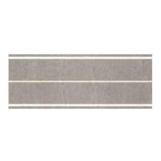
- **26297** — La striscia bianca continua raffigurata non può essere oltrepassata → **✅ VERO**
   
- **26298** — La striscia bianca continua raffigurata permette la manovra di sorpasso senza oltrepassarla → **✅ VERO**
   
- **26299** — La striscia bianca continua raffigurata delimita una pista ciclabile → **❌ FALSO**
   
- **26300** — La striscia bianca continua raffigurata permette di marciarvi a cavallo → **❌ FALSO**
   
- **26301** — La striscia bianca continua raffigurata, nelle strade a doppio senso, permette l'inversione di marcia → **❌ FALSO**
   
- **26061** — Il pannello integrativo raffigurato indica che il segnale posto sopra vale nei giorni festivi e durante le ore indicate → **✅ VERO**
   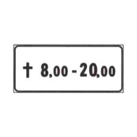
- **26062** — Il pannello integrativo raffigurato posto sotto il DIVIETO DI SOSTA indica che esso vale solo nei giorni festivi e nelle ore indicate → **✅ VERO**
   
- **26063** — Il pannello integrativo raffigurato posto sotto il DIVIETO DI TRANSITO vieta il transito nei soli giorni festivi e nelle ore indicate → **✅ VERO**
   
- **26064** — Il pannello integrativo raffigurato indica le ore di validità del segnale in ogni giorno → **❌ FALSO**
   
- **26065** — Il pannello integrativo raffigurato indica l'orario delle funzioni religiose nei giorni festivi → **❌ FALSO**
   
- **26066** — Il pannello integrativo raffigurato indica la fascia oraria di validità del segnale nei giorni feriali → **❌ FALSO**
   
- **26085** — Ciascuno dei pannelli integrativi raffigurati, posto ad integrazione del segnale DIVIETO DI SOSTA, indica il punto dove termina il divieto → **✅ VERO**
   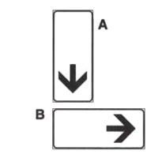
- **26086** — Ciascuno dei pannelli integrativi raffigurati ,posto sotto il segnale LAVORI, indica la fine del cantiere stradale → **✅ VERO**
   
- **26087** — Ciascuno dei pannelli integrativi raffigurati ,posto sotto il segnale STRADA SDRUCCIOLEVOLE, indica il punto dove termina il pericolo → **✅ VERO**
   
- **26088** — Ciascuno dei pannelli integrativi raffigurati indica una corsia riservata → **❌ FALSO**
   
- **26089** — Ciascuno dei pannelli integrativi raffigurati, posto sotto il segnale DIVIETO DI TRANSITO, indica la corsia consigliata → **❌ FALSO**
   
- **26090** — Ciascuno dei pannelli integrativi raffigurati indica l'unica direzione consentita → **❌ FALSO**
   
- **26127** — Il segnale raffigurato indica la fine di un doppio senso di circolazione → **✅ VERO**
   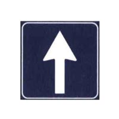
- **26128** — Il segnale raffigurato indica che la strada può essere percorsa solo nel senso indicato dal segnale → **✅ VERO**
   
- **26129** — Il segnale raffigurato indica l'inizio di una strada a senso unico → **✅ VERO**
   
- **26130** — Il segnale raffigurato indica che si ha la precedenza rispetto a chi viene in senso contrario → **❌ FALSO**
   
- **26131** — Il segnale raffigurato indica il divieto di svoltare a destra o a sinistra → **❌ FALSO**
   
- **26132** — Il segnale raffigurato indica un senso unico alternato → **❌ FALSO**
   
- **26121** — Il delineatore raffigurato, se bianco e rosso, indica una deviazione temporanea con curva a sinistra → **✅ VERO**
   
- **26122** — Il delineatore raffigurato è usato per segnalare l'andamento di particolari curve → **✅ VERO**
   
- **26123** — Il delineatore raffigurato invita il conducente ad affrontare la curva con particolare attenzione → **✅ VERO**
   
- **26124** — Il delineatore raffigurato delimita un cantiere stradale → **❌ FALSO**
   
- **26125** — Il delineatore raffigurato indica gli ostacoli sporgenti sulla carreggiata → **❌ FALSO**
   
- **26126** — Il delineatore raffigurato, se a fondo giallo, segnala una deviazione brusca in prossimità di cantieri stradali → **❌ FALSO**
   
- **26098** — Il pannello integrativo raffigurato può indicare che, in caso di violenti acquazzoni, la strada si può allagare → **✅ VERO**
   
- **26099** — Il pannello integrativo raffigurato può indicare il pericolo di allagamento della strada per mareggiate → **✅ VERO**
   
- **26100** — Il pannello integrativo raffigurato può indicare una località marina → **❌ FALSO**
   
- **26101** — Il pannello integrativo raffigurato può indicare, nelle località di montagna, la presenza di laghi naturali → **❌ FALSO**
   
- **26102** — Il pannello integrativo raffigurato può indicare un tratto di strada con neve → **❌ FALSO**
   
- **26103** — Il pannello integrativo raffigurato invita, in caso di pioggia, ad aumentare la distanza di sicurezza → **✅ VERO**
   
- **26104** — Il pannello integrativo raffigurato segnala un tratto di strada scivoloso in caso di pioggia → **✅ VERO**
   
- **26105** — Il pannello integrativo raffigurato invita a moderare la velocità in caso di pioggia perché la strada diventa scivolosa → **✅ VERO**
   
- **26106** — Il pannello integrativo raffigurato indica un tratto di strada dove spesso piove con intensità → **❌ FALSO**
   
- **26107** — Il pannello integrativo raffigurato segnala un tratto di strada pericoloso per la presenza di venti laterali → **❌ FALSO**
   
- **26108** — Il pannello integrativo raffigurato sulle strade di montagna indica una zona dove spesso scoppiano temporali → **❌ FALSO**
   
- **26073** — Ciascuno dei pannelli integrativi raffigurati indica il punto di inizio della prescrizione imposta dal segnale → **✅ VERO**
   
- **26074** — Ciascuno dei pannelli integrativi raffigurati, posto sotto il segnale DIVIETO DI SOSTA, indica che il divieto ha inizio in quel punto → **✅ VERO**
   
- **26075** — Ciascuno dei pannelli integrativi raffigurati, posto sotto il segnale CADUTA MASSI, indica il punto d'inizio del pericolo → **✅ VERO**
   
- **26076** — Ciascuno dei pannelli integrativi raffigurati, posto sul bordo della strada, indica di proseguire diritto → **❌ FALSO**
   
- **26077** — Ciascuno dei pannelli integrativi raffigurati indica la direzione obbligatoria → **❌ FALSO**
   
- **26078** — Ciascuno dei pannelli integrativi raffigurati indica l'inizio del senso unico → **❌ FALSO**
   
- **26210** — Il dispositivo raffigurato si può trovare subito prima di passaggi a livello con semibarriere → **✅ VERO**
   
- **26211** — Il dispositivo raffigurato quando è in funzione vieta il passaggio di veicoli e pedoni → **✅ VERO**
   
- **26212** — Il dispositivo raffigurato entra in funzione poco prima dell'arrivo del treno e continua fino alla fine del suo passaggio → **✅ VERO**
   
- **26213** — Il dispositivo raffigurato quando lampeggia alternativamente invita ad attraversare rapidamente il passaggio a livello → **❌ FALSO**
   
- **26214** — Il dispositivo raffigurato se è in funzione, permette l'attraversamento rapido dei veicoli ad un passaggio a livello → **❌ FALSO**
   
- **26215** — Il dispositivo raffigurato si può trovare in prossimità di un passaggio a livello con barriere → **❌ FALSO**
   
- **26115** — Le barriere del tipo in figura delimitano un'area in cui si stanno svolgendo lavori → **✅ VERO**
   
- **26116** — Le barriere del tipo in figura delimitano l'area interessata da lavori stradali → **✅ VERO**
   
- **26117** — I cavalletti del tipo in figura, nei passaggi a livello, sostituiscono le barriere se queste sono guaste → **✅ VERO**
   
- **26118** — Le barriere del tipo in figura vietano la sosta lungo i margini delle strade dove sono poste → **❌ FALSO**
   
- **26119** — Le barriere del tipo in figura segnalano una curva pericolosa → **❌ FALSO**
   
- **26120** — Le barriere del tipo in figura segnalano una strada con pavimentazione deformata → **❌ FALSO**
   
- **26272** — Quando, su una strada a doppio senso di circolazione, è presente la segnaletica raffigurata, è possibile effettuare un sorpasso anche superando la striscia con tutto il veicolo → **✅ VERO**
   
- **26273** — Quando, su una strada a doppio senso di circolazione, è presente la segnaletica raffigurata, è possibile invertire il senso di marcia → **✅ VERO**
   
- **26274** — Quando, su una strada a doppio senso di circolazione, è presente la segnaletica raffigurata, è possibile svoltare a sinistra → **✅ VERO**
   
- **26275** — Quando, su una strada a doppio senso di circolazione, è presente la segnaletica raffigurata, è possibile sorpassare in qualunque condizione di visibilità e di traffico → **❌ FALSO**
   
- **26276** — Quando, su una strada a doppio senso di circolazione, è presente la segnaletica raffigurata, è possibile sorpassare anche in curva, ma solo in città → **❌ FALSO**
   
- **26277** — Quando, su una strada a doppio senso di circolazione, è presente la segnaletica raffigurata, è possibile oltrepassare la striscia solo nei tratti in cui è interrotta → **❌ FALSO**
   
- **26290** — La striscia bianca discontinua raffigurata permette l'occupazione momentanea della opposta corsia di marcia in caso di sorpasso → **✅ VERO**
   
- **26291** — La striscia bianca discontinua raffigurata può essere oltrepassata → **✅ VERO**
   
- **26292** — Nelle strade a doppio senso di circolazione, la striscia bianca discontinua raffigurata delimita i sensi di marcia → **✅ VERO**
   
- **26293** — La striscia bianca discontinua raffigurata divide la strada in due carreggiate → **❌ FALSO**
   
- **26294** — La striscia bianca discontinua raffigurata permette di marciarvi a cavallo → **❌ FALSO**
   
- **26295** — La striscia bianca discontinua raffigurata, nelle strade a senso unico, permette l'inversione di marcia → **❌ FALSO**
   
- **26302** — La segnaletica orizzontale raffigurata indica la vicinanza di un passaggio a livello → **✅ VERO**
   
- **26303** — La segnaletica orizzontale raffigurata invita i conducenti ad usare la massima prudenza → **✅ VERO**
   
- **26304** — La segnaletica orizzontale raffigurata vieta di spostarsi nella parte sinistra della strada → **✅ VERO**
   
- **26305** — La segnaletica orizzontale raffigurata indica un passaggio a livello a 150 m → **❌ FALSO**
   
- **26306** — La segnaletica orizzontale raffigurata è usata soltanto per indicare passaggi a livello senza barriere → **❌ FALSO**
   
- **26307** — La segnaletica orizzontale raffigurata preavvisa un incrocio tra due strade → **❌ FALSO**
   
- **26229** — La doppia striscia longitudinale continua raffigurata non può essere superata → **✅ VERO**
   
- **26230** — La doppia striscia longitudinale continua raffigurata permette il sorpasso, se consentito, senza oltrepassarla → **✅ VERO**
   
- **26231** — La doppia striscia longitudinale continua raffigurata non permette l'inversione del senso di marcia → **✅ VERO**
   
- **26232** — La doppia striscia longitudinale continua raffigurata non può essere oltrepassata per svoltare a sinistra → **✅ VERO**
   
- **26233** — La doppia striscia longitudinale continua raffigurata delimita le corsie nelle strade a senso unico → **❌ FALSO**
   
- **26234** — La doppia striscia longitudinale continua raffigurata può essere superata, sempre che siano rispettate tutte le altre norme di circolazione → **❌ FALSO**
   
- **26284** — La segnaletica orizzontale raffigurata, indica un attraversamento pedonale → **✅ VERO**
   
- **26285** — La segnaletica orizzontale raffigurata, obbliga a rallentare e a dare la precedenza ai pedoni che attraversano → **✅ VERO**
   
- **26286** — La segnaletica orizzontale raffigurata, può essere preceduta, sulla destra, da una striscia gialla a zig zag → **✅ VERO**
   
- **26287** — La segnaletica orizzontale raffigurata, delimita la zona esclusa alla circolazione dei veicoli → **❌ FALSO**
   
- **26288** — La segnaletica orizzontale raffigurata, serve a delimitare le zone escluse al transito dei pedoni → **❌ FALSO**
   
- **26289** — La segnaletica orizzontale raffigurata, indica un attraversamento ciclabile → **❌ FALSO**
   
- **26314** — La segnaletica raffigurata obbliga i conducenti a dare precedenza ai ciclisti che hanno iniziato l'attraversamento → **✅ VERO**
   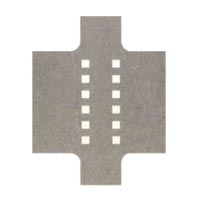
- **26315** — La segnaletica raffigurata delimita un attraversamento ciclabile → **✅ VERO**
   
- **26316** — La segnaletica raffigurata delimita una zona in cui i ciclisti hanno precedenza sui veicoli in assenza di semaforo o vigile → **✅ VERO**
   
- **26317** — La segnaletica raffigurata indica un attraversamento per motocicli e ciclomotori → **❌ FALSO**
   
- **26318** — La segnaletica raffigurata serve a delimitare le zone escluse dal transito pedonale → **❌ FALSO**
   
- **26319** — La segnaletica raffigurata indica un attraversamento pedonale in un centro abitato → **❌ FALSO**
   
- **26235** — Le frecce direzionali raffigurate, segnate sulla carreggiata, invitano i conducenti a occupare la corsia con freccia rivolta verso la direzione da seguire → **✅ VERO**
   
- **26236** — Le frecce direzionali raffigurate, segnate sulla carreggiata, permettono di scegliere la corsia, se le strisce sono tratteggiate → **✅ VERO**
   
- **26237** — Le frecce direzionali raffigurate, segnate sulla carreggiata, segnalano le direzioni permesse → **✅ VERO**
   
- **26238** — Le frecce direzionali raffigurate, segnate sulla carreggiata, impongono di seguire la direzione indicata anche se le strisce di corsia sono tratteggiate → **❌ FALSO**
   
- **26239** — Le frecce direzionali raffigurate, segnate sulla carreggiata, comprendono la sola freccia diritta quando è possibile svoltare anche a destra e sinistra → **❌ FALSO**
   
- **26240** — Le frecce direzionali raffigurate, segnate sulla carreggiata, permettono di scegliere la corsia di preselezione se le strisce di corsia sono continue → **❌ FALSO**
   
- **26253** — La segnaletica orizzontale raffigurata indica una zona per la fermata degli autobus in servizio pubblico → **✅ VERO**
   
- **26254** — La segnaletica orizzontale raffigurata serve agli autobus, nelle parti con striscia a zig zag, per accostare e per ripartire → **✅ VERO**
   
- **26255** — La segnaletica orizzontale raffigurata vieta la sosta anche nelle parti con striscia gialla a zig zag → **✅ VERO**
   
- **26256** — La segnaletica orizzontale raffigurata consente ai veicoli la fermata ma non la sosta → **✅ VERO**
   
- **26257** — La segnaletica orizzontale raffigurata delimita aree dove è vietato il transito dei ciclomotori → **❌ FALSO**
   
- **26258** — La segnaletica orizzontale raffigurata vieta la sosta da 15 m prima a 15 m dopo i suoi limiti → **❌ FALSO**
   
- **26259** — La segnaletica orizzontale raffigurata indica una zona nella quale i ciclomotori possono sostare → **❌ FALSO**
   
- **26278** — In una strada del tipo raffigurato, si può sorpassare anche in curva → **✅ VERO**
   
- **26279** — In una strada del tipo raffigurato, le corsie centrali sono di norma riservate al sorpasso → **✅ VERO**
   
- **26280** — In una strada del tipo raffigurato, non è consentita l'inversione del senso di marcia → **✅ VERO**
   
- **26281** — In una strada del tipo raffigurato, si può sorpassare solo da destra → **❌ FALSO**
   
- **26282** — In una strada del tipo raffigurato, si può iniziare il sorpasso anche se il conducente che segue ha iniziato la stessa manovra → **❌ FALSO**
   
- **26283** — In una strada del tipo raffigurato, si può circolare con il ciclomotore anche senza casco → **❌ FALSO**
   
- **26308** — La striscia trasversale continua sulla pavimentazione stradale mostrata in figura, indica il punto in cui i conducenti debbono fermarsi per effetto di una segnalazione di arresto → **✅ VERO**
   
- **26309** — La striscia trasversale continua sulla pavimentazione stradale mostrata in figura, indica il punto in cui bisogna fermarsi ad un incrocio regolato da semaforo con luce rossa → **✅ VERO**
   
- **26310** — La striscia trasversale continua sulla pavimentazione stradale mostrata in figura, se integrata con l'iscrizione STOP e il relativo segnale verticale, indica il punto di arresto → **✅ VERO**
   
- **26311** — La striscia trasversale continua sulla pavimentazione stradale mostrata in figura, indica il punto in cui dobbiamo fermarci ad un incrocio, anche se non regolato → **❌ FALSO**
   
- **26312** — La striscia trasversale continua sulla pavimentazione stradale mostrata in figura, indica l'obbligo di dare la precedenza ai veicoli provenienti da destra e da sinistra → **❌ FALSO**
   
- **26313** — La striscia trasversale continua sulla pavimentazione stradale mostrata in figura, indica che siamo in prossimità di un incrocio dove è presente il segnale di DARE PRECEDENZA → **❌ FALSO**
   
- **26247** — I segni gialli e neri raffigurati indicano il divieto di sosta → **✅ VERO**
   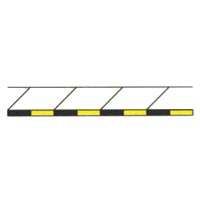
- **26248** — I segni gialli e neri raffigurati sono dipinti lungo il bordo del marciapiede → **✅ VERO**
   
- **26249** — I segni gialli e neri raffigurati indicano tratti di strada lungo i quali la sosta è vietata → **✅ VERO**
   
- **26250** — I segni gialli e neri raffigurati indicano sosta riservata ai mezzi pubblici → **❌ FALSO**
   
- **26251** — I segni gialli e neri raffigurati segnalano un ostacolo sul margine della strada → **❌ FALSO**
   
- **26252** — I segni gialli e neri raffigurati indicano il divieto di fermata → **❌ FALSO**
   
- **26180** — In un incrocio regolato dal semaforo, la luce rossa accesa vieta il passaggio ai veicoli verso la quale è rivolta → **✅ VERO**
- **26181** — In un incrocio regolato dal semaforo, la luce rossa accesa obbliga a fermarsi prima della striscia trasversale d'arresto → **✅ VERO**
- **26182** — In un incrocio regolato dal semaforo, la luce rossa accesa prescrive di arrestarsi all'incrocio → **✅ VERO**
- **26183** — In un incrocio regolato dal semaforo, la luce rossa accesa permette di svoltare a destra con prudenza → **❌ FALSO**
- **26184** — In un incrocio regolato dal semaforo, la luce rossa accesa permette di ripartire quando appare il giallo per la strada che si incrocia → **❌ FALSO**
- **26185** — In un incrocio regolato dal semaforo, la luce rossa accesa permette l'attraversamento purché l'incrocio sia libero → **❌ FALSO**
- **26198** — E’ possibile trovare una luce circolare gialla lampeggiante nei semafori, quando il verde e il rosso sono spenti → **✅ VERO**
- **26199** — E’ possibile trovare una luce circolare gialla lampeggiante nei semafori, per prescrivere di usare prudenza e diminuire la velocità → **✅ VERO**
- **26200** — E’ possibile trovare una luce circolare gialla lampeggiante in punti pericolosi della strada, che invita a rallentare → **✅ VERO**
- **26201** — E’ possibile trovare una luce circolare gialla lampeggiante nei semafori, per indicare di fermarsi sempre all'incrocio → **❌ FALSO**
- **26202** — E’ possibile trovare una luce circolare gialla lampeggiante nei semafori insieme al rosso per indicare pericolo → **❌ FALSO**
- **26203** — E’ possibile trovare una luce circolare gialla lampeggiante nei semafori, che segnala di liberare velocemente l'incrocio → **❌ FALSO**
- **26216** — Le strisce bianche longitudinali tratteggiate possono essere superate, sempre che siano rispettate tutte le altre norme di circolazione → **✅ VERO**
- **26217** — Le strisce bianche longitudinali tratteggiate consentono, in caso di sorpasso, l'occupazione momentanea dell'opposta corsia di marcia → **✅ VERO**
- **26218** — Le strisce bianche longitudinali tratteggiate consentono l'inversione di marcia, purché in condizioni di sicurezza → **✅ VERO**
- **26219** — Le strisce bianche longitudinali tratteggiate consentono di marciarvi a cavallo → **❌ FALSO**
- **26220** — Le strisce bianche longitudinali tratteggiate delimitano le piste ciclabili → **❌ FALSO**
- **26221** — Le strisce bianche longitudinali tratteggiate sono poste a separazione delle strade a quattro corsie, due per ogni senso di marcia → **❌ FALSO**
- **26222** — Le strisce lungo l'asse della carreggiata possono essere oltrepassate se tratteggiate → **✅ VERO**
- **26223** — Le strisce lungo l'asse della carreggiata non debbono essere oltrepassate se continue → **✅ VERO**
- **26224** — Le strisce continue lungo l'asse della carreggiata consentono il sorpasso senza oltrepassarle, purché non vi siano altri motivi che lo vietino → **✅ VERO**
- **26225** — Le strisce lungo l'asse della carreggiata non possono essere oltrepassate se continue, ma si può procedere a cavallo di esse → **❌ FALSO**
- **26226** — Le strisce lungo l'asse della carreggiata possono essere bianche o azzurre → **❌ FALSO**
- **26227** — Le strisce lungo l'asse della carreggiata continue, permettono la svolta a sinistra → **❌ FALSO**
- **26228** — Le strisce lungo l'asse della carreggiata possono essere integrate o sostituite con una serie di chiodi o catadiottri, se tratteggiate → **❌ FALSO**
- **26241** — Le zebrature sulla pavimentazione stradale, se oblique, indicano zone della carreggiata escluse al transito ed alla sosta dei veicoli → **✅ VERO**
- **26242** — Le zebrature sulla pavimentazione stradale bianche e oblique indicano un'isola di traffico → **✅ VERO**
- **26243** — Le zebrature sulla pavimentazione stradale, se oblique, indicano parti della strada su cui non si può passare → **✅ VERO**
- **26244** — Le zebrature sulla pavimentazione stradale consistono nella pittura della carreggiata con strisce azzurre trasversali → **❌ FALSO**
- **26245** — Le zebrature sulla pavimentazione stradale possono contraddistinguere zone destinate alla sosta dei veicoli → **❌ FALSO**
- **26246** — Le zebrature sulla pavimentazione stradale, se oblique, indicano zone della carreggiata sulle quali si deve rallentare la marcia → **❌ FALSO**

## 2. Norme sulla precedenza

- **26434** — Nella situazione raffigurata, il tram passa per primo → **✅ VERO**
   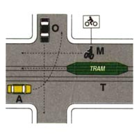
- **26435** — Nella situazione raffigurata, il tram ha la precedenza rispetto agli altri veicoli → **✅ VERO**
   
- **26436** — Nella situazione raffigurata, il veicolo M attende il transito del veicolo O → **✅ VERO**
   
- **26437** — Nella situazione raffigurata, il veicolo M attraversa l'incrocio insieme al tram → **❌ FALSO**
   
- **26438** — Nella situazione raffigurata, il veicolo O attende il transito di tutti gli altri veicoli → **❌ FALSO**
   
- **26439** — Nella situazione raffigurata, il veicolo A dà la precedenza al tram ma non al veicolo M → **❌ FALSO**
   
- **26320** — Nella situazione raffigurata il veicolo B ha il diritto di precedenza → **✅ VERO**
   
- **26321** — Nella situazione raffigurata il veicolo H passa per secondo → **✅ VERO**
   
- **26323** — Nella situazione raffigurata il veicolo B passa per primo → **✅ VERO**
   
- **26324** — Nella situazione raffigurata il veicolo C dà la precedenza al veicolo H → **✅ VERO**
   
- **26325** — Nella situazione raffigurata il veicolo H passa per primo → **❌ FALSO**
   
- **26326** — Nella situazione raffigurata i veicoli B e C passano per primi → **❌ FALSO**
   
- **26327** — Nella situazione raffigurata il veicolo H ha la precedenza perché è un autobus → **❌ FALSO**
   
- **26328** — Nella situazione raffigurata il veicolo C passa per primo → **❌ FALSO**
   
- **26329** — Secondo le norme di precedenza, nell'incrocio raffigurato il veicolo N passa per ultimo → **✅ VERO**
   
- **26330** — Secondo le norme di precedenza, nell'incrocio raffigurato il veicolo B passa dopo il veicolo P → **✅ VERO**
   
- **26331** — Secondo le norme di precedenza, nell'incrocio raffigurato il veicolo D passa prima degli altri veicoli → **✅ VERO**
   
- **26332** — Secondo le norme di precedenza, nell'incrocio raffigurato il veicolo P passa prima del veicolo B → **✅ VERO**
   
- **26333** — Secondo le norme di precedenza, nell'incrocio raffigurato i veicoli D e N passano contemporaneamente → **❌ FALSO**
   
- **26334** — Secondo le norme di precedenza, nell'incrocio raffigurato i veicoli D e B passano contemporaneamente → **❌ FALSO**
   
- **26335** — Secondo le norme di precedenza, nell'incrocio raffigurato i veicoli B e D passano per primi → **❌ FALSO**
   
- **26336** — Nell'incrocio raffigurato il veicolo A ha la destra occupata in relazione alla sua direzione → **✅ VERO**
   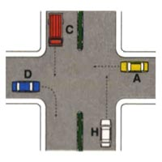
- **26337** — Nell'incrocio raffigurato il veicolo H ha la destra occupata → **✅ VERO**
   
- **26338** — Nell'incrocio raffigurato il veicolo C ha la destra occupata → **✅ VERO**
   
- **26339** — Nell'incrocio raffigurato il veicolo D ha diritto di precedenza sul veicolo C → **✅ VERO**
   
- **26340** — Nell'incrocio raffigurato il veicolo D è il primo ad attraversare l'incrocio → **✅ VERO**
   
- **26341** — Nell'incrocio raffigurato il veicolo D dà la precedenza al veicolo C → **❌ FALSO**
   
- **26342** — Nell'incrocio raffigurato il veicolo C attraversa per primo → **❌ FALSO**
   
- **26343** — Nell'incrocio raffigurato il veicolo A attraversa l'incrocio prima del veicolo C → **❌ FALSO**
   
- **26344** — Nell'incrocio raffigurato i veicoli C e H passano per primi → **❌ FALSO**
   
- **26345** — Nell'attraversare l'incrocio raffigurato il veicolo L passa per primo → **✅ VERO**
   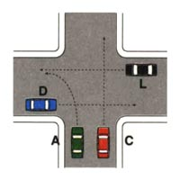
- **26346** — Nell'attraversare l'incrocio raffigurato il veicolo A ha diritto di precedenza sul veicolo D → **✅ VERO**
   
- **26347** — Nell'attraversare l'incrocio raffigurato il veicolo L ha la destra libera → **✅ VERO**
   
- **26348** — Nell'attraversare l'incrocio raffigurato il veicolo C ha la destra occupata → **✅ VERO**
   
- **26349** — Nell'attraversare l'incrocio raffigurato il veicolo A passa per ultimo → **❌ FALSO**
   
- **26350** — Nell'attraversare l'incrocio raffigurato il veicolo A ha la destra libera → **❌ FALSO**
   
- **26351** — Nell'attraversare l'incrocio raffigurato i veicoli A e C passano per primi → **❌ FALSO**
   
- **26352** — Secondo le norme di precedenza, nell'incrocio raffigurato i veicoli L e H passano contemporaneamente per primi → **✅ VERO**
   
- **26353** — Secondo le norme di precedenza, nell'incrocio raffigurato i veicoli L e H hanno diritto di precedenza → **✅ VERO**
   
- **26354** — Secondo le norme di precedenza, nell'incrocio raffigurato il veicolo B transita dopo il veicolo L → **✅ VERO**
   
- **26355** — Secondo le norme di precedenza, nell'incrocio raffigurato il veicolo O dà la precedenza a tutti gli altri veicoli → **✅ VERO**
   
- **26356** — Secondo le norme di precedenza, nell'incrocio raffigurato il veicolo B transita per primo → **❌ FALSO**
   
- **26357** — Secondo le norme di precedenza, nell'incrocio raffigurato il veicolo H transita dopo il veicolo O → **❌ FALSO**
   
- **26358** — Secondo le norme di precedenza, nell'incrocio raffigurato il veicolo T transita per primo → **✅ VERO**
   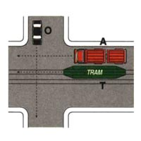
- **26359** — Secondo le norme di precedenza, nell'incrocio raffigurato il veicolo A dà la precedenza al veicolo O → **✅ VERO**
   
- **26360** — Secondo le norme di precedenza, nell'incrocio raffigurato il veicolo O dà la precedenza al veicolo T → **✅ VERO**
   
- **26361** — Secondo le norme di precedenza, nell'incrocio raffigurato il veicolo O passa prima del veicolo A → **✅ VERO**
   
- **26362** — Secondo le norme di precedenza, nell'incrocio raffigurato il veicolo T dà la precedenza al veicolo O → **❌ FALSO**
   
- **26363** — Secondo le norme di precedenza, nell'incrocio raffigurato il veicolo O dà la precedenza al veicolo A → **❌ FALSO**
   
- **26364** — Secondo le norme di precedenza, nell'incrocio raffigurato il veicolo T dà la precedenza al veicolo A → **❌ FALSO**
   
- **26365** — Secondo le norme di precedenza, nell'incrocio raffigurato i veicoli A e T passano per primi → **❌ FALSO**
   
- **26366** — Secondo le norme di precedenza, nell'incrocio raffigurato il veicolo N dà la precedenza al veicolo E → **✅ VERO**
   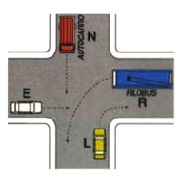
- **26367** — Secondo le norme di precedenza, nell'incrocio raffigurato il veicolo E dà la precedenza al veicolo L → **✅ VERO**
   
- **26368** — Secondo le norme di precedenza, nell'incrocio raffigurato il veicolo R dà la precedenza ai veicoli E ed N → **✅ VERO**
   
- **26369** — Secondo le norme di precedenza, nell'incrocio raffigurato il veicolo R (filobus) ha la precedenza sugli altri veicoli → **❌ FALSO**
   
- **26370** — Secondo le norme di precedenza, nell'incrocio raffigurato il veicolo E dà la precedenza al veicolo R → **❌ FALSO**
   
- **26371** — Secondo le norme di precedenza, nell'incrocio raffigurato il veicolo L dà la precedenza al veicolo R → **❌ FALSO**
   
- **26372** — Secondo le norme di precedenza, nell'incrocio raffigurato il veicolo E dà la precedenza al veicolo N → **❌ FALSO**
   
- **26373** — Nell'incrocio raffigurato il veicolo T passa per ultimo → **✅ VERO**
   
- **26374** — Nell'incrocio raffigurato il veicolo R passa per primo → **✅ VERO**
   
- **26375** — Nell'incrocio raffigurato il veicolo A dà la precedenza al veicolo R → **✅ VERO**
   
- **26376** — Nell'incrocio raffigurato il veicolo T dà la precedenza ai veicoli R ed A → **✅ VERO**
   
- **26377** — Nell'incrocio raffigurato il veicolo T passa prima del veicolo R → **❌ FALSO**
   
- **26378** — Nell'incrocio raffigurato i veicoli transitano nell'ordine: R, T, A → **❌ FALSO**
   
- **26379** — Nell'incrocio raffigurato il veicolo T passa prima degli altri veicoli → **❌ FALSO**
   
- **26380** — Nell'incrocio raffigurato vale la regola generale della precedenza ai veicoli provenienti da destra → **✅ VERO**
   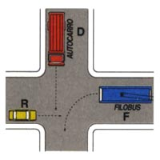
- **26381** — Nell'incrocio raffigurato l'ordine di passaggio dei veicoli è: R, D, F → **✅ VERO**
   
- **26382** — Nell'incrocio raffigurato il conducente che ha la precedenza deve assicurarsi che gli altri siano disposti a dargliela → **✅ VERO**
   
- **26383** — Nell'incrocio raffigurato tutti i conducenti devono moderare la velocità avvicinandosi all'area di incrocio → **✅ VERO**
   
- **26384** — Nell'incrocio raffigurato il filobus passa per primo → **❌ FALSO**
   
- **26385** — Nell'incrocio raffigurato l'ordine di passaggio dei veicoli è: F, R, D → **❌ FALSO**
   
- **26386** — Nell'incrocio raffigurato se i veicoli rispettano i limiti di velocità non hanno l'obbligo di moderare la velocità → **❌ FALSO**
   
- **26387** — Nell'incrocio raffigurato l'ordine di precedenza è stabilito dalla velocità con cui i veicoli giungono all'incrocio → **❌ FALSO**
   
- **26388** — Nell'intersezione raffigurata l'ordine di passaggio dei veicoli è: N, A, R → **✅ VERO**
   
- **26389** — Nell'intersezione raffigurata tutti i veicoli devono usare la massima prudenza → **✅ VERO**
   
- **26390** — Nell'intersezione raffigurata i veicoli A ed R devono, se necessario, fermarsi → **✅ VERO**
   
- **26391** — Nell'intersezione raffigurata il veicolo N deve, comunque, usare prudenza → **✅ VERO**
   
- **26392** — Nell'intersezione raffigurata il veicolo N non ha l'obbligo di moderare la velocità e di usare prudenza → **❌ FALSO**
   
- **26393** — Nell'intersezione raffigurata l'ordine di precedenza dei veicoli è: R, A, N → **❌ FALSO**
   
- **26394** — Nell'intersezione raffigurata se A non dà la precedenza, N deve suonare e procedere ugualmente → **❌ FALSO**
   
- **26395** — Nell'intersezione raffigurata l'ordine di precedenza dei veicoli è: N, R, A → **❌ FALSO**
   
- **26404** — Dovendo attraversare l'incrocio raffigurato, il veicolo T passa per primo perché circola su rotaie → **✅ VERO**
   
- **26405** — Dovendo attraversare l'incrocio raffigurato, il veicolo A passa subito dopo il veicolo T → **✅ VERO**
   
- **26406** — Dovendo attraversare l'incrocio raffigurato, il veicolo S attende il passaggio dei veicoli T e A → **✅ VERO**
   
- **26407** — Dovendo attraversare l'incrocio raffigurato, i veicoli passano nel seguente ordine: T, A, S → **✅ VERO**
   
- **26408** — Dovendo attraversare l'incrocio raffigurato, il veicolo A passa per primo → **❌ FALSO**
   
- **26409** — Dovendo attraversare l'incrocio raffigurato, i veicoli passano nel seguente ordine: A, T, S → **❌ FALSO**
   
- **26410** — Dovendo attraversare l'incrocio raffigurato, il veicolo S passa subito dopo il veicolo T → **❌ FALSO**
   
- **26411** — Dovendo attraversare l'incrocio raffigurato, i veicoli A e S passano contemporaneamente dopo il passaggio del veicolo T → **❌ FALSO**
   
- **26412** — Nell'incrocio raffigurato, il veicolo B ha il diritto di precedenza → **✅ VERO**
   
- **26413** — Nell'incrocio raffigurato, i veicoli passano nel seguente ordine: B, T, S → **✅ VERO**
   
- **26414** — Nell'incrocio raffigurato, il veicolo S passa per ultimo → **✅ VERO**
   
- **26415** — Nell'incrocio raffigurato, tutti i conducenti hanno l'obbligo di essere prudenti per evitare incidenti → **✅ VERO**
   
- **26416** — Nell'incrocio raffigurato, i veicoli passano nel seguente ordine: S, B, T → **❌ FALSO**
   
- **26417** — Nell'incrocio raffigurato, il veicolo B dà la precedenza al veicolo T → **❌ FALSO**
   
- **26418** — Nell'incrocio raffigurato, nessuno dei veicoli deve moderare la velocità → **❌ FALSO**
   
- **26419** — Nell'incrocio raffigurato, i veicoli B e S passano contemporaneamente → **❌ FALSO**
   
- **26420** — Giungendo all'incrocio raffigurato, il veicolo P passa per primo → **✅ VERO**
   
- **26421** — Giungendo all'incrocio raffigurato, il veicolo D dà la precedenza al veicolo P → **✅ VERO**
   
- **26422** — Giungendo all'incrocio raffigurato, il veicolo B attende che siano passati i veicoli P e D → **✅ VERO**
   
- **26423** — Giungendo all'incrocio raffigurato, il veicolo L dà la precedenza al veicolo B → **✅ VERO**
   
- **26424** — Giungendo all'incrocio raffigurato, il veicolo P attende che siano transitati i veicoli D e B → **❌ FALSO**
   
- **26425** — Giungendo all'incrocio raffigurato, il veicolo P attende il passaggio degli altri tre veicoli → **❌ FALSO**
   
- **26426** — Giungendo all'incrocio raffigurato, il veicolo P ha la destra occupata in relazione alla sua direzione → **❌ FALSO**
   
- **26427** — Giungendo all'incrocio raffigurato, i veicoli D e L passano per primi → **❌ FALSO**
   
- **26428** — Dovendo attraversare l'incrocio raffigurato, il veicolo E passa per primo → **✅ VERO**
   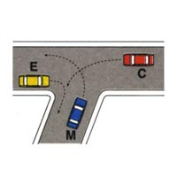
- **26429** — Dovendo attraversare l'incrocio raffigurato, il veicolo C passa subito dopo il veicolo E → **✅ VERO**
   
- **26430** — Dovendo attraversare l'incrocio raffigurato, i veicoli passano nel seguente ordine: E, C, M → **✅ VERO**
   
- **26431** — Dovendo attraversare l'incrocio raffigurato, il veicolo M ha la destra libera → **❌ FALSO**
   
- **26432** — Dovendo attraversare l'incrocio raffigurato, il veicolo C attende il transito del veicolo M → **❌ FALSO**
   
- **26433** — Dovendo attraversare l'incrocio raffigurato, i veicoli M e E passano contemporaneamente → **❌ FALSO**
   
- **26396** — Nell'incrocio raffigurato il veicolo N passa per primo → **✅ VERO**
   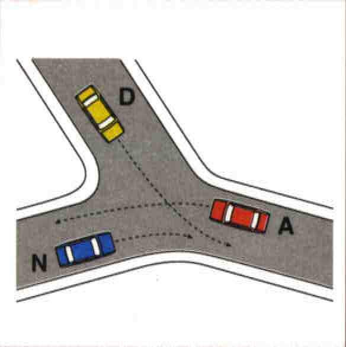
- **26397** — Nell'incrocio raffigurato il veicolo D ha la destra occupata → **✅ VERO**
   
- **26398** — Nell'incrocio raffigurato il veicolo A ha la destra occupata → **✅ VERO**
   
- **26399** — Nell'incrocio raffigurato i veicoli passano nel seguente ordine: N, D, A → **✅ VERO**
   
- **26400** — Nell'incrocio raffigurato il veicolo D passa prima del veicolo N → **❌ FALSO**
   
- **26401** — Nell'incrocio raffigurato i veicoli passano nel seguente ordine: D, A, N → **❌ FALSO**
   
- **26402** — Nell'incrocio raffigurato ogni veicolo ha la destra occupata → **❌ FALSO**
   
- **26403** — Nell'incrocio raffigurato i veicoli A e N passano contemporaneamente → **❌ FALSO**
   

## 3. Segnali di pericolo

- **25491** — Il segnale raffigurato preavvisa una curva pericolosa a destra → **✅ VERO**
   
- **25492** — Il segnale raffigurato preavvisa un tratto di strada con visibilità limitata → **✅ VERO**
   
- **25493** — Il segnale raffigurato richiede di moderare la velocità → **✅ VERO**
   
- **25494** — Il segnale raffigurato è un divieto di svolta a destra → **❌ FALSO**
   
- **25495** — Il segnale raffigurato preavvisa un incrocio con obbligo di svolta a destra → **❌ FALSO**
   
- **25496** — Il segnale raffigurato preavvisa un cambio di corsia → **❌ FALSO**
   
- **25497** — In presenza del segnale raffigurato è necessario percorrere la curva con più attenzione se la strada è bagnata → **✅ VERO**
   
- **25498** — In presenza del segnale raffigurato è vietato sorpassare se la strada ha una corsia per ogni senso di marcia → **✅ VERO**
   
- **25499** — In presenza del segnale raffigurato è necessario regolare la velocità in relazione alla visibilità e al raggio della curva → **✅ VERO**
   
- **25500** — In presenza del segnale raffigurato si deve circolare il più possibile vicino alla linea che separa i sensi di marcia → **❌ FALSO**
   
- **25501** — In presenza del segnale raffigurato è permesso percorrere la curva a velocità elevata → **❌ FALSO**
   
- **25502** — In presenza del segnale raffigurato è permesso effettuare l'inversione di marcia → **❌ FALSO**
   
- **25503** — Il segnale raffigurato preavvisa una curva pericolosa a sinistra → **✅ VERO**
   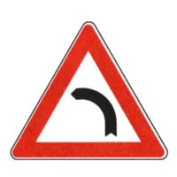
- **25504** — Il segnale raffigurato preavvisa un tratto di strada con visibilità limitata → **✅ VERO**
   
- **25505** — Il segnale raffigurato preavvisa a 150 m una curva pericolosa → **✅ VERO**
   
- **25506** — Il segnale raffigurato preavvisa un ostacolo da aggirare a sinistra → **❌ FALSO**
   
- **25507** — Il segnale raffigurato è un divieto di svoltare a sinistra → **❌ FALSO**
   
- **25508** — Il segnale raffigurato preavvisa un incrocio con obbligo di svolta a sinistra → **❌ FALSO**
   
- **25509** — Il segnale raffigurato preavvisa una doppia curva, la prima a destra → **✅ VERO**
   
- **25510** — Il segnale raffigurato preavvisa a 150 m una doppia curva pericolosa → **✅ VERO**
   
- **25511** — Il segnale raffigurato richiede di moderare la velocità → **✅ VERO**
   
- **25512** — Il segnale raffigurato vieta la svolta a destra → **❌ FALSO**
   
- **25513** — Il segnale raffigurato preavvisa una discesa pericolosa → **❌ FALSO**
   
- **25514** — Il segnale raffigurato preavvisa un tratto di strada con superficie sdrucciolevole → **❌ FALSO**
   
- **25515** — In presenza del segnale raffigurato si deve mantenere la destra → **✅ VERO**
   
- **25516** — In presenza del segnale raffigurato è necessario regolare la velocità in relazione alla visibilità e al raggio delle curve → **✅ VERO**
   
- **25517** — In presenza del segnale raffigurato è vietato sorpassare se la strada ha una corsia per ogni senso di marcia → **✅ VERO**
   
- **25518** — In presenza del segnale raffigurato è consentita l'inversione di marcia → **❌ FALSO**
   
- **25519** — In presenza del segnale raffigurato è necessario tenere una velocità moderata solo nella prima curva → **❌ FALSO**
   
- **25520** — In presenza del segnale raffigurato è sempre permesso fermarsi o sostare → **❌ FALSO**
   
- **25521** — Il segnale raffigurato preavvisa una doppia curva, la prima a sinistra → **✅ VERO**
   
- **25522** — Il segnale raffigurato preavvisa di norma a 150 m una doppia curva pericolosa → **✅ VERO**
   
- **25523** — Il segnale raffigurato richiede di moderare la velocità → **✅ VERO**
   
- **25524** — Il segnale raffigurato preavvisa una strettoia → **❌ FALSO**
   
- **25525** — Il segnale raffigurato preavvisa un tratto di carreggiata sdrucciolevole → **❌ FALSO**
   
- **25526** — Il segnale raffigurato è un divieto di svolta a sinistra → **❌ FALSO**
   
- **25527** — Il segnale raffigurato preavvisa un passaggio a livello con barriere → **✅ VERO**
   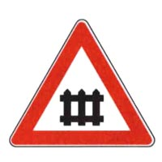
- **25528** — Il segnale raffigurato precede una luce rossa fissa o due luci rosse lampeggianti → **✅ VERO**
   
- **25529** — Il segnale raffigurato può essere seguito da un segnale acustico per avvertire della chiusura delle barriere → **✅ VERO**
   
- **25530** — Il segnale raffigurato preavvisa una strada senza uscita → **❌ FALSO**
   
- **25531** — Il segnale raffigurato indica una deviazione obbligatoria → **❌ FALSO**
   
- **25532** — Il segnale raffigurato permette di passare tra una barra e l'altra se le semibarriere sono chiuse → **❌ FALSO**
   
- **25533** — In presenza del segnale raffigurato è necessario moderare la velocità per essere pronti a fermarsi se le barriere sono chiuse → **✅ VERO**
   
- **25534** — In presenza del segnale raffigurato è necessario fermarsi se sono in funzione le due luci rosse lampeggianti → **✅ VERO**
   
- **25535** — In presenza del segnale raffigurato è necessario fermarsi se è in funzione il segnale acustico → **✅ VERO**
   
- **25536** — In presenza del segnale raffigurato è possibile passare tra una barra e l'altra se le semibarriere sono chiuse → **❌ FALSO**
   
- **25537** — In presenza del segnale raffigurato è permesso sostare in prossimità o in corrispondenza dei binari → **❌ FALSO**
   
- **25538** — In presenza del segnale raffigurato è possibile attraversare i binari anche se sbarrati da cavalletti a strisce bianche e rosse → **❌ FALSO**
   
- **25539** — Il segnale raffigurato preavvisa un passaggio a livello senza barriere → **✅ VERO**
   
- **25540** — Il segnale raffigurato richiede di usare la massima prudenza → **✅ VERO**
   
- **25541** — Il segnale raffigurato deve essere seguito dal segnale CROCE DI S. ANDREA → **✅ VERO**
   
- **25542** — Il segnale raffigurato preavvisa una fermata del tram → **❌ FALSO**
   
- **25543** — Il segnale raffigurato preavvisa un passaggio a livello con barriere → **❌ FALSO**
   
- **25544** — Il segnale raffigurato preavvisa la presenza di binari del tram → **❌ FALSO**
   
- **25545** — In presenza del segnale raffigurato è necessario rallentare per poter arrestare il veicolo prima dell'attraversamento ferroviario → **✅ VERO**
   
- **25546** — In presenza del segnale raffigurato è necessario assicurarsi che non ci siano treni in arrivo sia da destra che da sinistra → **✅ VERO**
   
- **25547** — In presenza del segnale raffigurato non è permesso sostare o fermarsi in prossimità e in corrispondenza dei binari → **✅ VERO**
   
- **25548** — In presenza del segnale raffigurato è necessario rallentare solo in caso di nebbia → **❌ FALSO**
   
- **25549** — In presenza del segnale raffigurato è sempre obbligatorio fermarsi prima dei binari → **❌ FALSO**
   
- **25550** — In presenza del segnale raffigurato è possibile attraversare i binari anche se sbarrati da cavalletti a strisce bianche e rosse → **❌ FALSO**
   
- **25551** — Il segnale CROCE DI S. ANDREA è posto in prossimità di un passaggio a livello → **✅ VERO**
   
- **25552** — Il segnale CROCE DI S. ANDREA è posto nelle immediate vicinanze del binario → **✅ VERO**
   
- **25553** — Il segnale CROCE DI S. ANDREA è posto sulla strada dopo il segnale PASSAGGIO A LIVELLO SENZA BARRIERE → **✅ VERO**
   
- **25554** — Il segnale CROCE DI S. ANDREA preavvisa una sede ferroviaria con più binari → **❌ FALSO**
   
- **25555** — Il segnale CROCE DI S. ANDREA ha due luci rosse che si accendono alternativamente se il passaggio a livello è con semibarriere → **❌ FALSO**
   
- **25556** — Il segnale CROCE DI S. ANDREA è integrato con una luce verde e una rossa → **❌ FALSO**
   
- **25557** — Il segnale DOPPIA CROCE DI S. ANDREA impone di fermarsi alla striscia di arresto se è in arrivo il treno → **✅ VERO**
   
- **25558** — Il segnale DOPPIA CROCE DI S. ANDREA segnala che la linea ferroviaria ha più di un binario → **✅ VERO**
   
- **25559** — Il segnale DOPPIA CROCE DI S. ANDREA invita a fare attenzione perché potrebbe arrivare un altro treno su un altro binario → **✅ VERO**
   
- **25560** — Il segnale DOPPIA CROCE DI S. ANDREA è posto a 150 metri dal passaggio a livello → **❌ FALSO**
   
- **25561** — Il segnale DOPPIA CROCE DI S. ANDREA indica che la linea ferroviaria ha soltanto un binario → **❌ FALSO**
   
- **25562** — Il segnale DOPPIA CROCE DI S. ANDREA può essere posto subito prima di un attraversamento ferroviario con semibarriere → **❌ FALSO**
   
- **25563** — I pannelli raffigurati sono posti prima di qualsiasi tipo di passaggio a livello → **✅ VERO**
   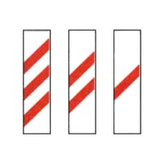
- **25564** — I pannelli raffigurati sono posti, rispettivamente, a circa 150, 100 e 50 metri dall'attraversamento ferroviario → **✅ VERO**
   
- **25565** — I pannelli raffigurati servono ad indicare il progressivo avvicinarsi al passaggio a livello → **✅ VERO**
   
- **25566** — I pannelli raffigurati si possono trovare solo se il passaggio a livello è con barriere o semibarriere → **❌ FALSO**
   
- **25567** — I pannelli raffigurati indicano lavori in corso → **❌ FALSO**
   
- **25568** — I pannelli raffigurati hanno tante strisce rosse quanti sono i binari del passaggio a livello → **❌ FALSO**
   
- **25569** — In presenza del segnale raffigurato si deve tenere conto della riduzione di spazio dovuta alla circolazione dei tram → **✅ VERO**
   
- **25570** — In presenza del segnale raffigurato si deve fare attenzione agli eventuali pedoni presenti alla fermata del tram → **✅ VERO**
   
- **25571** — In presenza del segnale raffigurato non si deve ostacolare la marcia del tram → **✅ VERO**
   
- **25572** — In presenza del segnale raffigurato è sempre vietato il sorpasso dei tram → **❌ FALSO**
   
- **25573** — In presenza del segnale raffigurato è vietata la marcia sopra i binari del tram → **❌ FALSO**
   
- **25574** — In presenza del segnale raffigurato, è sempre possibile sorpassare a destra un tram fermo per la salita o discesa dei passeggeri → **❌ FALSO**
   
- **25575** — Il segnale raffigurato preavvisa un attraversamento pedonale → **✅ VERO**
   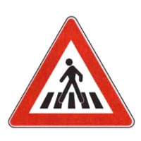
- **25576** — Il segnale raffigurato comporta di fermarsi e dare la precedenza ai pedoni che attraversano sulle strisce → **✅ VERO**
   
- **25577** — Il segnale raffigurato non permette di sorpassare un veicolo fermatosi per far attraversare i pedoni → **✅ VERO**
   
- **25578** — Il segnale raffigurato preavvisa un viale pedonale → **❌ FALSO**
   
- **25579** — Il segnale raffigurato impone di usare i segnali acustici per avvertire i pedoni → **❌ FALSO**
   
- **25580** — Il segnale raffigurato permette la fermata dei veicoli sulle strisce purché rimanga spazio sufficiente per i pedoni → **❌ FALSO**
   
- **25581** — In presenza del segnale raffigurato non è consentito sorpassare i veicoli che si fermano per far attraversare i pedoni → **✅ VERO**
   
- **25582** — In presenza del segnale raffigurato è necessario rallentare per essere pronti a fermarsi per dare la precedenza ai pedoni → **✅ VERO**
   
- **25583** — In presenza del segnale raffigurato è necessario non sostare o fermarsi sopra le strisce pedonali → **✅ VERO**
   
- **25584** — In presenza del segnale raffigurato è necessario suonare se vi sono pedoni che attraversano sulle strisce → **❌ FALSO**
   
- **25585** — In presenza del segnale raffigurato è necessario rallentare solo se vi sono bambini che attraversano sulle strisce → **❌ FALSO**
   
- **25586** — In presenza del segnale raffigurato è necessario tenere presente che i pedoni debbono dare la precedenza ai veicoli → **❌ FALSO**
   
- **25587** — Il segnale raffigurato preavvisa un attraversamento ciclabile → **✅ VERO**
   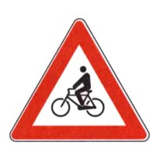
- **25588** — Il segnale raffigurato di norma è posto 150 metri prima di un attraversamento ciclabile → **✅ VERO**
   
- **25589** — Il segnale raffigurato comporta di regolare la velocità in modo da non costituire pericolo per la sicurezza dei ciclisti → **✅ VERO**
   
- **25590** — Il segnale raffigurato è posto dopo ogni attraversamento ciclabile → **❌ FALSO**
   
- **25591** — Il segnale raffigurato vieta il transito ai ciclisti → **❌ FALSO**
   
- **25592** — Il segnale raffigurato preavvisa l'inizio di una pista ciclabile → **❌ FALSO**
   
- **25593** — In presenza del segnale raffigurato è necessario regolare la velocità in modo da non costituire pericolo per la sicurezza dei ciclisti → **✅ VERO**
   
- **25594** — In presenza del segnale raffigurato è necessario rallentare per essere pronti a fermarsi per dare la precedenza ai ciclisti → **✅ VERO**
   
- **25595** — In presenza del segnale raffigurato è necessario non sorpassare veicoli che si sono fermati per far attraversare la strada ai ciclisti → **✅ VERO**
   
- **25596** — In presenza del segnale raffigurato è necessario suonare se vi sono ciclisti che stanno per iniziare l'attraversamento delle strisce → **❌ FALSO**
   
- **25597** — In presenza del segnale raffigurato è necessario tenere presente che i ciclisti devono dare la precedenza ai veicoli → **❌ FALSO**
   
- **25598** — In presenza del segnale raffigurato è necessario dare la precedenza solo ai ciclisti che attraversano da destra → **❌ FALSO**
   
- **25604** — Il segnale raffigurato preavvisa una salita pericolosa → **❌ FALSO**
   
- **25599** — Il segnale raffigurato è posto prima di una discesa pericolosa → **✅ VERO**
   
- **25600** — Il segnale raffigurato richiede di tenere una maggiore distanza di sicurezza dal veicolo che precede → **✅ VERO**
   
- **25601** — Il segnale raffigurato comporta di moderare la velocità → **✅ VERO**
   
- **25602** — Il segnale raffigurato preavvisa un tratto di strada pericoloso per il fondo dissestato → **❌ FALSO**
   
- **25603** — Il segnale raffigurato indica l'entità della pendenza di una salita ripida → **❌ FALSO**
   
- **25606** — In presenza del segnale raffigurato è necessario evitare l'uso prolungato dei freni per non surriscaldarli → **✅ VERO**
   
- **25605** — In presenza del segnale raffigurato è necessario moderare la velocità → **✅ VERO**
   
- **25607** — In presenza del segnale raffigurato è necessario aumentare la distanza di sicurezza dal veicolo che precede → **✅ VERO**
   
- **25608** — In presenza del segnale raffigurato è necessario usare molta prudenza con strada bagnata → **✅ VERO**
   
- **25609** — In presenza del segnale raffigurato è necessario tenere presente che diminuisce lo spazio di frenatura → **❌ FALSO**
   
- **25610** — In presenza del segnale raffigurato è necessario ridurre la distanza di sicurezza dal veicolo che precede → **❌ FALSO**
   
- **25611** — Il segnale raffigurato è posto prima di una salita ripida → **✅ VERO**
   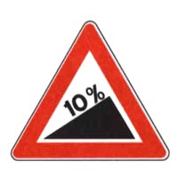
- **25612** — Il segnale raffigurato preavvisa una salita che comporta un pericolo → **✅ VERO**
   
- **25613** — Il segnale raffigurato indica la pendenza di una salita ripida → **✅ VERO**
   
- **25614** — Il segnale raffigurato preavvisa un tratto di strada dove aumenta lo spazio di frenatura del ciclomotore → **❌ FALSO**
   
- **25615** — Il segnale raffigurato preavvisa un tratto di strada pericoloso per curve strette → **❌ FALSO**
   
- **25616** — Il segnale raffigurato preavvisa una discesa la cui pendenza è indicata sul segnale → **❌ FALSO**
   
- **25617** — Il segnale raffigurato preavvisa un restringimento della strada → **✅ VERO**
   
- **25618** — Il segnale raffigurato preavvisa probabili difficoltà di incrocio con veicoli provenienti dal senso opposto → **✅ VERO**
   
- **25619** — Il segnale raffigurato comporta di moderare la velocità → **✅ VERO**
   
- **25620** — Il segnale raffigurato preavvisa che i veicoli provenienti dall'altro senso devono dare la precedenza → **❌ FALSO**
   
- **25621** — Il segnale raffigurato preavvisa un allargamento della strada → **❌ FALSO**
   
- **25622** — Il segnale raffigurato preavvisa una galleria → **❌ FALSO**
   
- **25623** — Il segnale raffigurato preavvisa che la strada si restringe pericolosamente a sinistra → **✅ VERO**
   
- **25624** — Il segnale raffigurato preavvisa probabile difficoltà di incrocio con veicoli provenienti dal senso opposto → **✅ VERO**
   
- **25625** — Il segnale raffigurato impone di moderare la velocità e, se occorre, di fermarsi → **✅ VERO**
   
- **25626** — Il segnale raffigurato preavvisa una confluenza da sinistra → **❌ FALSO**
   
- **25627** — Il segnale raffigurato preavvisa un cavalcavia → **❌ FALSO**
   
- **25628** — Il segnale raffigurato preavvisa un restringimento della carreggiata sul lato destro → **❌ FALSO**
   
- **25629** — Il segnale raffigurato preavvisa che la strada si restringe pericolosamente → **✅ VERO**
   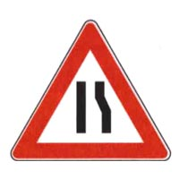
- **25630** — Il segnale raffigurato preavvisa il restringimento della carreggiata dovuto a muretti o altro sul lato destro → **✅ VERO**
   
- **25631** — Il segnale raffigurato può trovarsi su una carreggiata a doppio senso di circolazione → **✅ VERO**
   
- **25632** — Il segnale raffigurato preavvisa la fine del doppio senso di circolazione → **❌ FALSO**
   
- **25633** — Il segnale raffigurato preavvisa sempre un senso unico alternato → **❌ FALSO**
   
- **25634** — Il segnale raffigurato preavvisa l'inizio di un senso unico → **❌ FALSO**
   
- **25635** — Il segnale raffigurato, con gli opportuni pannelli integrativi, può preavvisare una strada che può diventare particolarmente scivolosa → **✅ VERO**
   
- **25636** — Il segnale raffigurato, con gli opportuni pannelli integrativi, obbliga il conducente a rallentare se la strada è in cattive condizioni → **✅ VERO**
   
- **25637** — Il segnale raffigurato, con gli opportuni pannelli integrativi, impone di procedere a velocità moderata e di evitare manovre brusche → **✅ VERO**
   
- **25638** — Il segnale raffigurato, con gli opportuni pannelli integrativi, preavvisa una strettoia → **❌ FALSO**
   
- **25639** — Il segnale raffigurato, con gli opportuni pannelli integrativi, preavvisa che su quella strada per fermarsi occorre meno spazio → **❌ FALSO**
   
- **25640** — Il segnale raffigurato, con gli opportuni pannelli integrativi, invita a ridurre la distanza di sicurezza → **❌ FALSO**
   
- **25641** — In presenza del segnale raffigurato, opportunamente integrato, è necessario regolare la velocità in relazione alle particolari condizioni della strada → **✅ VERO**
   
- **25642** — In presenza del segnale raffigurato, opportunamente integrato, è necessario, in caso di pioggia, rallentare ed evitare frenate brusche → **✅ VERO**
   
- **25643** — In presenza del segnale raffigurato, opportunamente integrato, è necessario, in caso di pioggia, rallentare ed evitare sterzate brusche → **✅ VERO**
   
- **25644** — In presenza del segnale raffigurato, opportunamente integrato, è necessario tenere presente che in caso di pioggia lo spazio di frenatura è minore → **❌ FALSO**
   
- **25645** — In presenza del segnale raffigurato, opportunamente integrato, è necessario, in caso di pioggia, diminuire la distanza di sicurezza dal veicolo che precede → **❌ FALSO**
   
- **25646** — In presenza del segnale raffigurato, opportunamente integrato, è necessario, in caso di pioggia, accelerare bruscamente → **❌ FALSO**
   
- **25647** — Il segnale raffigurato preavvisa luoghi frequentati da bambini → **✅ VERO**
   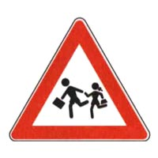
- **25648** — Il segnale raffigurato è posto nelle vicinanze di una scuola frequentata da bambini → **✅ VERO**
   
- **25649** — Il segnale raffigurato impone di fare attenzione per la possibile presenza di bambini → **✅ VERO**
   
- **25650** — Il segnale raffigurato vieta l'inversione di marcia → **❌ FALSO**
   
- **25651** — Il segnale raffigurato indica la fine del viale riservato ai bambini → **❌ FALSO**
   
- **25652** — Il segnale raffigurato vieta il passaggio ai veicoli a motore durante l'orario di uscita dei bambini dalla scuola → **❌ FALSO**
   
- **25653** — In presenza del segnale raffigurato è necessario rallentare e fare attenzione anche ai bambini che si trovano sui marciapiedi → **✅ VERO**
   
- **25654** — In presenza del segnale raffigurato è necessario fare particolare attenzione ai movimenti improvvisi dei bambini → **✅ VERO**
   
- **25655** — In presenza del segnale raffigurato è necessario non sorpassare veicoli che si sono fermati per fare attraversare la strada ai bambini → **✅ VERO**
   
- **25656** — In presenza del segnale raffigurato è necessario fare attenzione ai bambini sulla carreggiata e non a quelli sul marciapiede → **❌ FALSO**
   
- **25657** — In presenza del segnale raffigurato è necessario tenere presente che è vietato effettuare la sosta → **❌ FALSO**
   
- **25658** — In presenza del segnale raffigurato è necessario non passare durante l'orario di uscita dei bambini da scuola → **❌ FALSO**
   
- **25659** — Il segnale raffigurato preavvisa che una strada a senso unico diventa a doppio senso di marcia → **✅ VERO**
   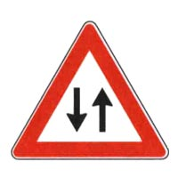
- **25660** — Il segnale raffigurato preavvisa che si possono incontrare veicoli che provengono dal senso opposto → **✅ VERO**
   
- **25661** — Il segnale raffigurato avvisa che termina il senso unico di circolazione → **✅ VERO**
   
- **25662** — Il segnale raffigurato preavvisa che la circolazione diventa a senso unico → **❌ FALSO**
   
- **25663** — Il segnale raffigurato impone di dare la precedenza ai veicoli che provengono dal senso opposto → **❌ FALSO**
   
- **25664** — Il segnale raffigurato indica che bisogna ritornare indietro → **❌ FALSO**
   
- **25665** — Il segnale raffigurato preavvisa un tratto di strada dove è possibile slittare → **✅ VERO**
   
- **25666** — Il segnale raffigurato consiglia di procedere con cautela in presenza di pedoni → **✅ VERO**
   
- **25667** — Il segnale raffigurato preavvisa il pericolo di trovare sassi sulla strada → **✅ VERO**
   
- **25668** — Il segnale raffigurato obbliga a circolare al centro della strada → **❌ FALSO**
   
- **25669** — Il segnale raffigurato consiglia di accelerare per aumentare l'aderenza dei pneumatici sull'asfalto → **❌ FALSO**
   
- **25670** — Il segnale raffigurato preavvisa un tratto di strada dove esiste il pericolo di caduta di massi → **❌ FALSO**
   
- **25671** — Il segnale raffigurato preavvisa il pericolo di caduta di massi dalla parete rocciosa → **✅ VERO**
   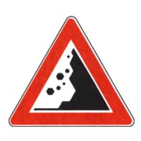
- **25672** — Il segnale raffigurato preavvisa un tratto di strada dove potrebbero essere presenti pietre → **✅ VERO**
   
- **25673** — Il segnale raffigurato consiglia di rallentare per evitare l'urto con massi caduti sulla strada → **✅ VERO**
   
- **25674** — Il segnale raffigurato preavvisa un tratto di strada scivolosa → **❌ FALSO**
   
- **25675** — Il segnale raffigurato segnala l'opportunità di lampeggiare con i fari → **❌ FALSO**
   
- **25676** — Il segnale raffigurato preavvisa un tratto di strada non asfaltato → **❌ FALSO**
   
- **25677** — Il segnale raffigurato preavvisa un semaforo → **✅ VERO**
   
- **25678** — Il segnale raffigurato può avere una luce gialla lampeggiante → **✅ VERO**
   
- **25679** — Il segnale raffigurato indica che bisogna rallentare per potersi fermare in caso di necessità → **✅ VERO**
   
- **25680** — Il segnale raffigurato preavvisa un attraversamento ferroviario senza barriere → **❌ FALSO**
   
- **25681** — Il segnale raffigurato può preavvisare un passaggio a livello con semibarriere → **❌ FALSO**
   
- **25682** — Il segnale raffigurato preavvisa la presenza di un segnale di STOP → **❌ FALSO**
   
- **25683** — Il segnale raffigurato preavvisa un tratto di strada soggetto a forti raffiche di vento laterale → **✅ VERO**
   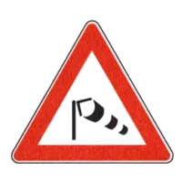
- **25684** — Il segnale raffigurato preavvisa zone soggette a forti raffiche di vento improvvise → **✅ VERO**
   
- **25685** — Il segnale raffigurato raccomanda di procedere con prudenza tenendo ben saldo il manubrio → **✅ VERO**
   
- **25686** — Il segnale raffigurato preavvisa la presenza di aeroplani a bassa quota → **❌ FALSO**
   
- **25687** — Il segnale raffigurato preavvisa un tratto di strada vicino ad un aeroporto → **❌ FALSO**
   
- **25688** — Il segnale raffigurato preavvisa l'ingresso di una galleria → **❌ FALSO**
   
- **25689** — Il segnale raffigurato, in caso di forte vento, comporta un pericolo maggiore per i veicoli che passano su viadotti → **✅ VERO**
   
- **25690** — Il segnale raffigurato, in caso di forte vento, comporta il pericolo di sbandamento dei veicoli → **✅ VERO**
   
- **25691** — Il segnale raffigurato, in caso di forte vento, comporta un pericolo maggiore all'uscita delle gallerie → **✅ VERO**
   
- **25692** — Il segnale raffigurato, in caso di forte vento, comporta l'obbligo di accostarsi maggiormente al veicolo che si sorpassa → **❌ FALSO**
   
- **25693** — Il segnale raffigurato, in caso di forte vento, comporta il divieto di sorpasso per tutti i veicoli → **❌ FALSO**
   
- **25694** — Il segnale raffigurato, in caso di forte vento, comporta l'obbligo, per tutti i veicoli, di fermarsi → **❌ FALSO**
   
- **25695** — Il segnale raffigurato può preavvisare un tratto di strada cedevole lateralmente → **✅ VERO**
   
- **25696** — Il segnale raffigurato può preavvisare pericolo di caduta nella cunetta laterale → **✅ VERO**
   
- **25697** — Il segnale raffigurato può preavvisare un tratto di strada con banchina pericolosa → **✅ VERO**
   
- **25698** — Il segnale raffigurato preavvisa il divieto di percorrere quella strada → **❌ FALSO**
   
- **25699** — Il segnale raffigurato preavvisa un'area di sosta → **❌ FALSO**
   
- **25700** — Il segnale raffigurato preavvisa la presenza di pietrisco sulla strada → **❌ FALSO**
   
- **25701** — Il segnale raffigurato preavvisa lavori in corso → **✅ VERO**
   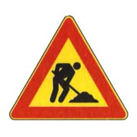
- **25702** — Il segnale raffigurato preavvisa cantieri di lavoro → **✅ VERO**
   
- **25703** — Il segnale raffigurato preavvisa l'eventuale presenza di operai sulla strada → **✅ VERO**
   
- **25704** — Il segnale raffigurato impone di fermarsi in corrispondenza del cantiere → **❌ FALSO**
   
- **25705** — Il segnale raffigurato preavvisa l'obbligo di dare la precedenza ai veicoli che provengono in senso opposto → **❌ FALSO**
   
- **25706** — Il segnale raffigurato obbliga a invertire il senso di marcia nelle ore di lavoro degli operai → **❌ FALSO**
   
- **25455** — Il segnale raffigurato preavvisa un tratto di strada con pavimentazione irregolare → **✅ VERO**
   
- **25456** — Il segnale raffigurato preavvisa un tratto di strada in cattivo stato → **✅ VERO**
   
- **25457** — Il segnale raffigurato è un segnale di pericolo → **✅ VERO**
   
- **25458** — Il segnale raffigurato preavvisa una discesa pericolosa → **❌ FALSO**
   
- **25459** — Il segnale raffigurato preavvisa una serie di curve → **❌ FALSO**
   
- **25460** — Il segnale raffigurato preavvisa una doppia curva → **❌ FALSO**
   
- **25461** — In presenza del segnale raffigurato, è necessario prevedere eventuali sbandamenti dei veicoli provenienti dal senso opposto → **✅ VERO**
   
- **25462** — In presenza del segnale raffigurato, è necessario rallentare a causa delle condizioni del fondo stradale → **✅ VERO**
   
- **25463** — In presenza del segnale raffigurato, è necessario tenere il manubrio con una presa più sicura → **✅ VERO**
   
- **25464** — In presenza del segnale raffigurato, è necessario aumentare la velocità → **❌ FALSO**
   
- **25465** — In presenza del segnale raffigurato, è necessario diminuire la distanza di sicurezza → **❌ FALSO**
   
- **25466** — In presenza del segnale raffigurato, è necessario fermarsi se provengono veicoli dal senso opposto → **❌ FALSO**
   
- **25467** — Il segnale raffigurato è posto, di norma, 150 m prima del dosso → **✅ VERO**
   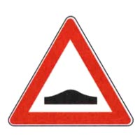
- **25468** — Il segnale raffigurato preavvisa un tratto di strada con visibilità limitata → **✅ VERO**
   
- **25469** — Il segnale raffigurato preavvisa una salita, seguita da una discesa, che limita la visibilità → **✅ VERO**
   
- **25470** — Il segnale raffigurato preavvisa un tratto di strada deformata → **❌ FALSO**
   
- **25471** — Il segnale raffigurato preavvisa un tratto di strada in cattivo stato → **❌ FALSO**
   
- **25472** — Il segnale raffigurato preavvisa lavori in corso → **❌ FALSO**
   
- **25473** — In presenza del segnale raffigurato è necessario moderare la velocità → **✅ VERO**
   
- **25474** — In presenza del segnale raffigurato è vietata l'inversione di marcia → **✅ VERO**
   
- **25475** — In presenza del segnale raffigurato sono vietate la sosta e la fermata sia sul tratto in salita che in discesa → **✅ VERO**
   
- **25476** — In presenza del segnale raffigurato è obbligatorio circolare al centro della strada → **❌ FALSO**
   
- **25477** — In presenza del segnale raffigurato è necessario prestare attenzione al tratto di strada in cattivo stato → **❌ FALSO**
   
- **25478** — In presenza del segnale raffigurato è consentita la sosta sul tratto in salita → **❌ FALSO**
   
- **25479** — Il segnale raffigurato preavvisa una cunetta → **✅ VERO**
   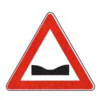
- **25480** — Il segnale raffigurato preavvisa un tratto di strada pericoloso a causa di una cunetta → **✅ VERO**
   
- **25481** — Il segnale raffigurato si trova prima di un tratto di strada in discesa seguito da uno in salita → **✅ VERO**
   
- **25482** — Il segnale raffigurato preavvisa una strada deformata → **❌ FALSO**
   
- **25483** — Il segnale raffigurato preavvisa un restringimento della carreggiata → **❌ FALSO**
   
- **25484** — Il segnale raffigurato preavvisa un dosso → **❌ FALSO**
   
- **25485** — In presenza del segnale raffigurato è necessario moderare la velocità per non perdere il controllo del ciclomotore → **✅ VERO**
   
- **25486** — In presenza del segnale raffigurato è necessario guidare con particolare attenzione soprattutto in caso di pioggia → **✅ VERO**
   
- **25487** — In presenza del segnale raffigurato è necessario aumentare la distanza di sicurezza dal veicolo che precede → **✅ VERO**
   
- **25488** — In presenza del segnale raffigurato è necessario sorpassare → **❌ FALSO**
   
- **25489** — In presenza del segnale raffigurato è necessario sorpassare se provengono veicoli dal senso opposto → **❌ FALSO**
   
- **25490** — In presenza del segnale raffigurato è necessario aumentare la velocità → **❌ FALSO**
   

## 4. Segnali di divieto, segnali di obbligo, segnali di precedenza

- **25971** — Il segnale raffigurato preavvisa l'incrocio con una strada di minore importanza → **✅ VERO**
   
- **25972** — Il segnale raffigurato invita ad usare prudenza → **✅ VERO**
   
- **25973** — Il segnale raffigurato segnala un incrocio in cui si ha la precedenza sui veicoli provenienti da sinistra → **✅ VERO**
   
- **25974** — Il segnale raffigurato segnala sulla sinistra una strada senza uscita → **❌ FALSO**
   
- **25975** — Il segnale raffigurato vieta la svolta a sinistra → **❌ FALSO**
   
- **25976** — Il segnale raffigurato consente la fermata in corrispondenza dell'incrocio → **❌ FALSO**
   
- **25977** — Il segnale raffigurato preavvisa un incrocio in cui si deve dare la precedenza a destra → **✅ VERO**
   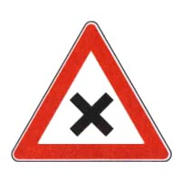
- **25978** — Il segnale raffigurato invita a procedere a velocità particolarmente moderata → **✅ VERO**
   
- **25979** — Il segnale raffigurato preavvisa un incrocio con precedenza a destra → **✅ VERO**
   
- **25980** — Il segnale raffigurato può preavvisare un passaggio a livello custodito con barriere → **❌ FALSO**
   
- **25981** — Il segnale raffigurato può precedere il segnale DARE PRECEDENZA → **❌ FALSO**
   
- **25982** — Il segnale raffigurato può precedere il segnale di STOP → **❌ FALSO**
   
- **25983** — Il segnale raffigurato preavvisa un incrocio con una strada di minore importanza → **✅ VERO**
   
- **25984** — Il segnale raffigurato preavvisa un incrocio in cui si ha diritto di precedenza → **✅ VERO**
   
- **25985** — Il segnale raffigurato al prossimo incrocio ci dà la precedenza sui veicoli provenienti sia da destra che da sinistra → **✅ VERO**
   
- **25986** — Il segnale raffigurato non permette la svolta a sinistra al prossimo incrocio → **❌ FALSO**
   
- **25987** — Il segnale raffigurato indica un incrocio in cui si deve dare precedenza a sinistra → **❌ FALSO**
   
- **25988** — Il segnale raffigurato preavvisa un incrocio nel quale bisogna dare la precedenza → **❌ FALSO**
   
- **25989** — Il segnale raffigurato preavvisa una confluenza sul lato destro → **✅ VERO**
   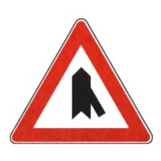
- **25990** — Il segnale raffigurato invita ad accertarsi che i veicoli che si immettono diano la precedenza → **✅ VERO**
   
- **25991** — Il segnale raffigurato indica che abbiamo precedenza sui veicoli che si immettono da destra → **✅ VERO**
   
- **25992** — Il segnale raffigurato impone di dare precedenza ai veicoli provenienti da destra → **❌ FALSO**
   
- **25993** — Il segnale raffigurato precede il segnale DARE PRECEDENZA → **❌ FALSO**
   
- **25994** — Il segnale raffigurato permette la svolta a destra al prossimo incrocio → **❌ FALSO**
   
- **25995** — Il segnale raffigurato obbliga a fermarsi in corrispondenza della striscia trasversale di arresto e a dare la precedenza → **✅ VERO**
   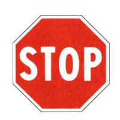
- **25996** — Il segnale raffigurato impone di arrestarsi e dare la precedenza senza occupare l'incrocio → **✅ VERO**
   
- **25997** — Il segnale raffigurato obbliga ad arrestarsi all'incrocio e a dare la precedenza a destra e a sinistra → **✅ VERO**
   
- **25998** — Il segnale raffigurato obbliga ad arrestarsi soltanto in caso di incrocio con altri veicoli → **❌ FALSO**
   
- **25999** — Il segnale raffigurato obbliga ad arrestarsi per dare la precedenza solo ai veicoli provenienti da destra → **❌ FALSO**
   
- **26000** — Il segnale raffigurato obbliga ad arrestarsi all'incrocio anche se il semaforo emette luce verde → **❌ FALSO**
   
- **26001** — Il segnale raffigurato impone di arrestarsi all'incrocio e dare precedenza sia a destra che a sinistra → **✅ VERO**
   
- **26002** — Il segnale raffigurato è utilizzato, di norma, negli incroci con scarsa visibilità → **✅ VERO**
   
- **26003** — Il segnale raffigurato è utilizzato, di norma, negli incroci di particolare pericolosità → **✅ VERO**
   
- **26004** — Il segnale raffigurato obbliga ad arrestarsi soltanto in caso di incrocio con altri veicoli → **❌ FALSO**
   
- **26005** — Il segnale raffigurato obbliga ad arrestarsi per dare la precedenza solo ai veicoli provenienti da destra → **❌ FALSO**
   
- **26006** — Il segnale raffigurato obbliga ad arrestarsi all'incrocio anche se il vigile indica di proseguire → **❌ FALSO**
   
- **26007** — Il segnale raffigurato, nelle strettoie, obbliga a dare precedenza ai veicoli provenienti dal senso opposto → **✅ VERO**
   
- **26008** — Il segnale raffigurato obbliga a dare la precedenza ai veicoli provenienti di fronte → **✅ VERO**
   
- **26009** — Il segnale raffigurato obbliga a dare la precedenza ai veicoli provenienti dal senso contrario → **✅ VERO**
   
- **26010** — Il segnale raffigurato indica il diritto di precedenza sui veicoli provenienti dal senso opposto → **❌ FALSO**
   
- **26011** — Il segnale raffigurato consiglia di effettuare l'inversione di marcia → **❌ FALSO**
   
- **26012** — Il segnale raffigurato indica l'inizio del doppio senso di circolazione → **❌ FALSO**
   
- **26013** — Il segnale raffigurato è un segnale di preavviso dell'obbligo di fermarsi e dare precedenza → **✅ VERO**
   
- **26014** — Il segnale raffigurato preavvisa un segnale di STOP → **✅ VERO**
   
- **26015** — Il segnale raffigurato indica che al prossimo incrocio dovremo arrestarci e dare la precedenza a destra ed a sinistra → **✅ VERO**
   
- **26016** — Il segnale raffigurato obbliga solo a rallentare senza fermarsi all'incrocio → **❌ FALSO**
   
- **26017** — Il segnale raffigurato si trova solo nelle strade urbane → **❌ FALSO**
   
- **26018** — Il segnale raffigurato preavvisa la presenza di un passaggio a livello → **❌ FALSO**
   
- **26019** — Il segnale raffigurato ci invita a maggiore prudenza perché non abbiamo più diritto di precedenza → **✅ VERO**
   
- **26020** — Il segnale raffigurato indica di dare precedenza ai veicoli provenienti da destra → **✅ VERO**
   
- **26021** — Il segnale raffigurato indica la fine del diritto di precedenza → **✅ VERO**
   
- **26022** — Il segnale raffigurato indica strada con diritto di precedenza → **❌ FALSO**
   
- **26023** — Il segnale raffigurato impone l'arresto all'incrocio → **❌ FALSO**
   
- **26024** — Il segnale raffigurato preavvisa l'obbligo di svolta a destra → **❌ FALSO**
   
- **26025** — Il segnale raffigurato indica l'inizio di una strada in cui i veicoli hanno diritto di precedenza → **✅ VERO**
   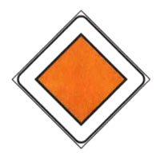
- **26026** — Il segnale raffigurato indica un tratto di strada con diritto di precedenza → **✅ VERO**
   
- **26027** — Il segnale raffigurato invita ad assicurarsi che i veicoli provenienti dalle strade laterali diano la precedenza → **✅ VERO**
   
- **26028** — Il segnale raffigurato impone di fermarsi all'incrocio → **❌ FALSO**
   
- **26029** — Il segnale raffigurato impone di dare la precedenza a destra → **❌ FALSO**
   
- **26030** — Il segnale raffigurato permette il sorpasso in corrispondenza dell'incrocio → **❌ FALSO**
   
- **26031** — In presenza del segnale raffigurato dobbiamo assicurarci che i veicoli provenienti dal senso contrario ci diano la precedenza → **✅ VERO**
   
- **26032** — In presenza del segnale raffigurato i veicoli provenienti dal senso opposto devono darci la precedenza: occorre però prudenza → **✅ VERO**
   
- **26033** — In presenza del segnale raffigurato possiamo percorrere la strettoia per primi, assicurandoci che ci venga data precedenza → **✅ VERO**
   
- **26034** — In presenza del segnale raffigurato si deve dare la precedenza ai veicoli che provengono dal senso opposto → **❌ FALSO**
   
- **26035** — In presenza del segnale raffigurato possiamo procedere senza cautela, dato che abbiamo il diritto di precedenza → **❌ FALSO**
   
- **26036** — In presenza del segnale raffigurato è possibile effettuare il sorpasso → **❌ FALSO**
   
- **26037** — Il segnale raffigurato prescrive di dare precedenza ai veicoli provenienti sia da destra che da sinistra → **✅ VERO**
   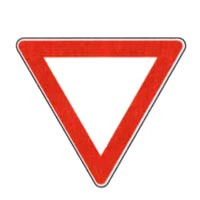
- **26038** — Il segnale raffigurato comporta di rallentare e di dare la precedenza a destra e a sinistra → **✅ VERO**
   
- **26039** — Il segnale raffigurato impone di rallentare e se necessario fermarsi → **✅ VERO**
   
- **26040** — Il segnale raffigurato è impiegato su strade che hanno il diritto di precedenza → **❌ FALSO**
   
- **26041** — Il segnale raffigurato preavvisa un segnale di STOP → **❌ FALSO**
   
- **26042** — Il segnale raffigurato obbliga sempre a fermarsi prima di occupare l'incrocio → **❌ FALSO**
   
- **25707** — Il segnale raffigurato vieta la circolazione nei due sensi → **✅ VERO**
   
- **25708** — Il segnale raffigurato vieta il transito a tutti i veicoli → **✅ VERO**
   
- **25709** — Il segnale raffigurato vieta la circolazione anche ai ciclomotori → **✅ VERO**
   
- **25710** — Il segnale raffigurato non permette l'accesso, ma solo l'uscita da una strada → **❌ FALSO**
   
- **25711** — Il segnale raffigurato indica che la circolazione è a senso unico → **❌ FALSO**
   
- **25712** — Il segnale raffigurato permette il transito dei quadricicli a motore → **❌ FALSO**
   
- **25713** — Il segnale raffigurato vieta di entrare in una strada accessibile invece dall'altra parte → **✅ VERO**
   
- **25714** — Il segnale raffigurato vale anche per i tricicli e i quadricicli a motore → **✅ VERO**
   
- **25715** — Il segnale raffigurato vieta ai veicoli a motore e alle biciclette di entrare nella strada dal lato dove è posto → **✅ VERO**
   
- **25716** — Il segnale raffigurato permette l'accesso ai ciclomotori → **❌ FALSO**
   
- **25717** — Il segnale raffigurato è posto su una strada a doppio senso di circolazione → **❌ FALSO**
   
- **25718** — Il segnale raffigurato vieta il sorpasso → **❌ FALSO**
   
- **25719** — Il segnale raffigurato permette ad un'autovettura di sorpassare un ciclomotore a due ruote → **✅ VERO**
   
- **25720** — Il segnale raffigurato permette ai quadricicli a motore il sorpasso di motocicli → **✅ VERO**
   
- **25721** — Il segnale raffigurato permette di sorpassare ciclomotori a due ruote → **✅ VERO**
   
- **25722** — Il segnale raffigurato vieta di sorpassare qualsiasi veicolo → **❌ FALSO**
   
- **25723** — Il segnale raffigurato indica che la corsia di destra è riservata ai veicoli lenti → **❌ FALSO**
   
- **25724** — Il segnale raffigurato permette ad un ciclomotore di sorpassare un'autovettura → **❌ FALSO**
   
- **25779** — In presenza del segnale raffigurato, si possono sorpassare i ciclomotori a due ruote → **✅ VERO**
   
- **25780** — In presenza del segnale raffigurato, si possono sorpassare i motocicli → **✅ VERO**
   
- **25781** — In presenza del segnale raffigurato, si possono sorpassare le biciclette → **✅ VERO**
   
- **25782** — In presenza del segnale raffigurato, si possono sorpassare tutti gli autoveicoli a motore elettrico → **❌ FALSO**
   
- **25783** — In presenza del segnale raffigurato, si possono sorpassare solo i veicoli a motore che non sono in grado di superare la velocità di 40 km/h → **❌ FALSO**
   
- **25784** — In presenza del segnale raffigurato, si possono sorpassare i quadricicli a motore che procedono molto lentamente → **❌ FALSO**
   
- **25725** — Il segnale raffigurato vieta ai veicoli di superare la velocità indicata → **✅ VERO**
   
- **25726** — Il segnale raffigurato obbliga a rispettare un limite massimo di velocità → **✅ VERO**
   
- **25727** — Il segnale raffigurato indica la velocità massima alla quale i veicoli possono procedere → **✅ VERO**
   
- **25728** — Il segnale raffigurato indica un limite di velocità valido solo per i veicoli a due ruote → **❌ FALSO**
   
- **25729** — Il segnale raffigurato obbliga a rispettare il limite minimo di velocità indicato → **❌ FALSO**
   
- **25730** — Il segnale raffigurato prescrive il divieto di sorpassare qualsiasi veicolo → **❌ FALSO**
   
- **25731** — Il segnale raffigurato vieta le segnalazioni acustiche → **✅ VERO**
   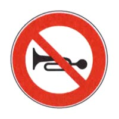
- **25732** — Il segnale raffigurato permette l'uso di avvisatori acustici in caso di pericolo immediato → **✅ VERO**
   
- **25733** — Il segnale raffigurato indica l'inizio di una zona in cui è vietato suonare il clacson → **✅ VERO**
   
- **25734** — Il segnale raffigurato permette l'uso del clacson per richiamare l'attenzione in qualsiasi circostanza → **❌ FALSO**
   
- **25735** — Il segnale raffigurato deve essere rispettato soltanto nelle ore notturne → **❌ FALSO**
   
- **25736** — Il segnale raffigurato prescrive di usare il clacson incrociando altri veicoli → **❌ FALSO**
   
- **25737** — Il segnale raffigurato non permette ai pedoni di percorrere quella strada → **✅ VERO**
   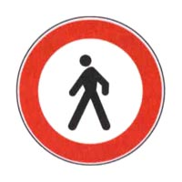
- **25738** — Il segnale raffigurato permette il transito ai ciclomotori → **✅ VERO**
   
- **25739** — Il segnale raffigurato permette il transito ai quadricicli a motore → **✅ VERO**
   
- **25740** — Il segnale raffigurato vale dalle ore 8 alle ore 20 → **❌ FALSO**
   
- **25741** — Il segnale raffigurato obbliga i pedoni a circolare sul margine sinistro della strada → **❌ FALSO**
   
- **25742** — Il segnale raffigurato obbliga a dare la precedenza ai pedoni → **❌ FALSO**
   
- **25743** — Il segnale raffigurato vieta il transito ai motocicli → **✅ VERO**
   
- **25744** — Il segnale raffigurato permette il transito ai quadricicli a motore → **✅ VERO**
   
- **25745** — Il segnale raffigurato permette il transito ai ciclomotori → **✅ VERO**
   
- **25746** — Il segnale raffigurato vieta il transito a tutti i veicoli a due ruote → **❌ FALSO**
   
- **25747** — Il segnale raffigurato permette il transito ai motociclisti con il casco → **❌ FALSO**
   
- **25748** — Il segnale raffigurato vieta il transito ai ciclisti → **❌ FALSO**
   
- **25749** — Il segnale raffigurato permette il transito ai ciclomotori → **✅ VERO**
   
- **25750** — Il segnale raffigurato permette il transito ai pedoni → **✅ VERO**
   
- **25751** — Il segnale raffigurato vieta il transito ai ciclisti → **✅ VERO**
   
- **25752** — Il segnale raffigurato permette il transito delle biciclette nelle ore notturne → **❌ FALSO**
   
- **25753** — Il segnale raffigurato vieta il transito ai motocicli → **❌ FALSO**
   
- **25754** — Il segnale raffigurato vieta il transito ai ciclomotori → **❌ FALSO**
   
- **25755** — Il segnale raffigurato vieta il transito a tutti gli autoveicoli → **✅ VERO**
   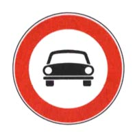
- **25756** — Il segnale raffigurato permette il transito ai ciclomotori a due ruote → **✅ VERO**
   
- **25757** — Il segnale raffigurato permette il transito ai motocicli → **✅ VERO**
   
- **25758** — Il segnale raffigurato indica il divieto di sosta per le autovetture → **❌ FALSO**
   
- **25759** — Il segnale raffigurato indica il divieto di transito per le sole autovetture → **❌ FALSO**
   
- **25760** — Il segnale raffigurato indica una strada riservata ai pedoni → **❌ FALSO**
   
- **25761** — Il segnale raffigurato indica la fine delle prescrizioni precedentemente imposte → **✅ VERO**
   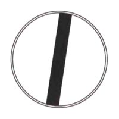
- **25762** — Il segnale raffigurato indica la fine dei divieti precedentemente imposti → **✅ VERO**
   
- **25763** — Il segnale raffigurato indica il punto dal quale le prescrizioni precedentemente indicate non sono più valide → **✅ VERO**
   
- **25764** — Il segnale raffigurato riguarda soltanto i veicoli in servizio pubblico → **❌ FALSO**
   
- **25765** — Il segnale raffigurato indica la fine di un centro abitato → **❌ FALSO**
   
- **25766** — Il segnale raffigurato indica la fine di un tratto di strada sdrucciolevole → **❌ FALSO**
   
- **25767** — Il segnale raffigurato indica la fine di una prescrizione → **✅ VERO**
   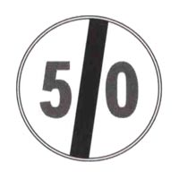
- **25768** — Il segnale raffigurato indica la fine del limite massimo di velocità → **✅ VERO**
   
- **25769** — Il segnale raffigurato indica la fine del relativo divieto → **✅ VERO**
   
- **25770** — Il segnale raffigurato indica il limite di velocità per tutti i veicoli → **❌ FALSO**
   
- **25771** — Il segnale raffigurato indica la fine dell'obbligo di mantenere una distanza di sicurezza di almeno 50 m → **❌ FALSO**
   
- **25772** — Il segnale raffigurato prescrive ai veicoli che non superano la velocità di 50 km/h di marciare sulla corsia di destra → **❌ FALSO**
   
- **25773** — Il segnale raffigurato indica la fine del divieto di sorpasso precedentemente imposto → **✅ VERO**
   
- **25774** — Il segnale raffigurato non permette il sorpasso se deve essere oltrepassata la striscia continua → **✅ VERO**
   
- **25775** — Il segnale raffigurato indica il punto in cui termina il divieto di sorpasso → **✅ VERO**
   
- **25776** — Il segnale raffigurato indica la fine del divieto di sorpasso tra le sole autovetture → **❌ FALSO**
   
- **25777** — Il segnale raffigurato indica la fine del divieto di transito per tutti gli autoveicoli → **❌ FALSO**
   
- **25778** — Il segnale raffigurato indica la fine del limite massimo di velocità → **❌ FALSO**
   
- **25785** — Il segnale raffigurato indica luoghi dove è vietata la sosta ma non la fermata → **✅ VERO**
   
- **25786** — Il segnale raffigurato, sulle strade urbane, vieta la sosta dalle ore 8 alle ore 20 salvo diversa indicazione → **✅ VERO**
   
- **25787** — Il segnale raffigurato cessa di validità dopo il primo incrocio, se non ripetuto → **✅ VERO**
   
- **25788** — Il segnale raffigurato, se posto sul lato sinistro di una strada a senso unico, vieta la sosta anche sul lato destro → **❌ FALSO**
   
- **25789** — Il segnale raffigurato permette la sosta soltanto ai veicoli a due ruote → **❌ FALSO**
   
- **25790** — Il segnale raffigurato permette la sosta ai residenti → **❌ FALSO**
   
- **25791** — Il segnale raffigurato di norma vieta la sosta sia di giorno che di notte, anche nei centri abitati → **✅ VERO**
   
- **25792** — Il segnale raffigurato vieta la fermata anche dei ciclomotori → **✅ VERO**
   
- **25793** — Il segnale raffigurato vieta sia la fermata che la sosta 24 ore su 24 salvo diversa indicazione → **✅ VERO**
   
- **25794** — Il segnale raffigurato vieta la fermata, ma permette la sosta → **❌ FALSO**
   
- **25795** — Il segnale raffigurato vale solo nei giorni feriali, salvo diversa indicazione → **❌ FALSO**
   
- **25796** — Il segnale raffigurato permette la fermata del veicolo per la salita e la discesa del passeggero → **❌ FALSO**
   
- **25797** — Il segnale raffigurato è un segnale di DIVIETO DI SOSTA TEMPORANEO → **✅ VERO**
   
- **25798** — Il segnale raffigurato vieta la sosta nei periodi in cui viene effettuata la pulizia meccanica della strada → **✅ VERO**
   
- **25799** — Il segnale raffigurato nei centri urbani segnala il divieto di sosta limitato ai giorni e alle ore indicate → **✅ VERO**
   
- **25800** — Il segnale raffigurato segnala che nelle ore indicate vale il DIVIETO DI SOSTA per i veicoli rappresentati in figura → **❌ FALSO**
   
- **25801** — Il segnale raffigurato indica che nei giorni e nelle ore indicate è vietata la sosta ai mezzi di pulizia → **❌ FALSO**
   
- **25802** — Il segnale raffigurato indica presenza di un deposito con probabile uscita di mezzi per pulizia meccanica delle strade → **❌ FALSO**
   
- **25803** — Il segnale raffigurato permette la sosta ai veicoli al servizio di persone invalide munite dell'apposito contrassegno → **✅ VERO**
   
- **25804** — Il segnale raffigurato permette il parcheggio ad una particolare categoria di veicoli → **✅ VERO**
   
- **25805** — Il segnale raffigurato non permette la sosta a veicoli diversi da quelli indicati nel pannello → **✅ VERO**
   
- **25806** — Il segnale raffigurato indica una corsia riservata ai veicoli al servizio di persone invalide → **❌ FALSO**
   
- **25807** — Il segnale raffigurato è un divieto di sosta per i veicoli al servizio di invalidi, ma si può parcheggiare → **❌ FALSO**
   
- **25808** — Il segnale raffigurato preavvisa una zona vietata al transito perché attrezzata per persone invalide → **❌ FALSO**
   
- **25809** — Il segnale raffigurato permette la sosta dalle ore 9 alle 17 → **✅ VERO**
   
- **25810** — Il segnale raffigurato vieta la sosta dalle ore 17 alle 20 → **✅ VERO**
   
- **25811** — Il segnale raffigurato permette la sosta in alcune ore e la vieta in altre → **✅ VERO**
   
- **25812** — Il segnale raffigurato, nei centri abitati, permette la sosta dalle ore 20 alle 8 → **❌ FALSO**
   
- **25813** — Il segnale raffigurato vieta la fermata del veicolo tra le ore 17 e le 20 → **❌ FALSO**
   
- **25814** — Il segnale raffigurato permette il parcheggio dalle ore 7 alle 9 → **❌ FALSO**
   
- **25815** — Il segnale raffigurato vieta la sosta davanti al luogo dove è posto → **✅ VERO**
   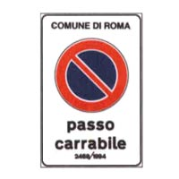
- **25816** — Il segnale raffigurato è posto all'uscita di un passo carrabile → **✅ VERO**
   
- **25817** — Il segnale raffigurato permette la fermata purché il veicolo non sia di intralcio → **✅ VERO**
   
- **25818** — Il segnale raffigurato vale solo di giorno → **❌ FALSO**
   
- **25819** — Il segnale raffigurato vale solo di notte → **❌ FALSO**
   
- **25820** — Il segnale raffigurato permette la sosta a particolari categorie di veicoli → **❌ FALSO**
   
- **25821** — Il segnale raffigurato indica un parcheggio autorizzato → **✅ VERO**
   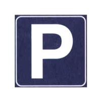
- **25822** — Il segnale raffigurato indica un’area di parcheggio e può essere integrato con pannello che indica le categorie di veicoli esclusi → **✅ VERO**
   
- **25823** — Il segnale raffigurato indica un’area di parcheggio e può essere integrato con un pannello che ne indica la limitazione nel tempo → **✅ VERO**
   
- **25824** — Il segnale raffigurato indica un’area di sosta con parchimetro → **❌ FALSO**
   
- **25825** — Il segnale raffigurato indica sosta libera, ma divieto di fermata → **❌ FALSO**
   
- **25826** — Il segnale raffigurato indica un divieto di parcheggio → **❌ FALSO**
   
- **25827** — Il segnale raffigurato preavvisa che non è permesso proseguire diritto → **✅ VERO**
   
- **25828** — Il segnale raffigurato preavvisa che non è permesso svoltare a destra → **✅ VERO**
   
- **25829** — Il segnale raffigurato preavvisa l'obbligo di svoltare a sinistra → **✅ VERO**
   
- **25830** — Il segnale raffigurato preavvisa un senso unico → **❌ FALSO**
   
- **25831** — Il segnale raffigurato è posto all'inizio di una strada in pendenza → **❌ FALSO**
   
- **25832** — Il segnale raffigurato indica l'obbligo di cambiare corsia → **❌ FALSO**
   
- **25833** — Il segnale raffigurato è posto prima di una piazza con circolazione rotatoria → **✅ VERO**
   
- **25834** — Il segnale raffigurato indica un incrocio con circolazione rotatoria → **✅ VERO**
   
- **25835** — Il segnale raffigurato obbliga i conducenti a circolare secondo il verso indicato dalle frecce → **✅ VERO**
   
- **25836** — Il segnale raffigurato prescrive un obbligo di ROTATORIA solo per le autovetture → **❌ FALSO**
   
- **25837** — Il segnale raffigurato indica l'obbligo di tornare indietro → **❌ FALSO**
   
- **25838** — Il segnale raffigurato non vale per i ciclomotori → **❌ FALSO**
   
- **25839** — Il segnale raffigurato indica il limite di velocità al di sotto del quale è vietato scendere → **✅ VERO**
   
- **25840** — Il segnale raffigurato impone di circolare ad una velocità di almeno 30 km/h → **✅ VERO**
   
- **25841** — Il segnale raffigurato obbliga i veicoli a mantenere almeno la velocità minima indicata → **✅ VERO**
   
- **25842** — Il segnale raffigurato indica una pista riservata ai veicoli in grado di superare la velocità di 30 km/h → **❌ FALSO**
   
- **25843** — Il segnale raffigurato vieta di superare la velocità indicata → **❌ FALSO**
   
- **25844** — Il segnale raffigurato permette di circolare alla velocità costante di 25 km/h → **❌ FALSO**
   
- **25845** — Il segnale raffigurato obbliga ad arrestarsi al posto di blocco della polizia → **✅ VERO**
   
- **25846** — Il segnale raffigurato indica l'obbligo di arresto ad un posto di blocco stradale istituito dagli organi di polizia → **✅ VERO**
   
- **25847** — Il segnale raffigurato segnala un posto di blocco stradale istituito da organi di polizia al quale è obbligatorio fermarsi → **✅ VERO**
   
- **25848** — Il segnale raffigurato prescrive il divieto di transito ai veicoli della polizia → **❌ FALSO**
   
- **25849** — Il segnale raffigurato segnala una stazione autostradale alla quale è obbligatorio fermarsi → **❌ FALSO**
   
- **25850** — Il segnale raffigurato impone di fermarsi e dare precedenza ai mezzi della polizia → **❌ FALSO**
   
- **25851** — Il segnale raffigurato, posto prima di un incrocio, obbliga a proseguire diritto → **✅ VERO**
   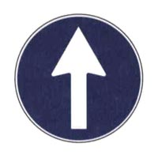
- **25852** — Il segnale raffigurato, all'incrocio, non permette la svolta a destra o a sinistra → **✅ VERO**
   
- **25853** — Il segnale raffigurato è un segnale di direzione obbligatoria → **✅ VERO**
   
- **25854** — Il segnale raffigurato permette di svoltare a destra o a sinistra → **❌ FALSO**
   
- **25855** — Il segnale raffigurato indica la fine del doppio senso di circolazione → **❌ FALSO**
   
- **25856** — Il segnale raffigurato indica l'inizio del senso unico → **❌ FALSO**
   
- **25857** — Il segnale raffigurato non permette di svoltare a destra → **✅ VERO**
   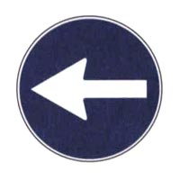
- **25858** — Il segnale raffigurato, all'incrocio, obbliga a svoltare a sinistra → **✅ VERO**
   
- **25859** — Il segnale raffigurato, all'incrocio, non permette di proseguire diritto → **✅ VERO**
   
- **25860** — Il segnale raffigurato permette di andare diritto al prossimo incrocio → **❌ FALSO**
   
- **25861** — Il segnale raffigurato permette di svoltare a destra al prossimo incrocio → **❌ FALSO**
   
- **25862** — Il segnale raffigurato indica che si incrocia una strada a senso unico → **❌ FALSO**
   
- **25863** — Il segnale raffigurato non permette di svoltare a sinistra → **✅ VERO**
   
- **25864** — Il segnale raffigurato, all'incrocio, non permette di proseguire diritto → **✅ VERO**
   
- **25865** — Il segnale raffigurato indica l'unica direzione consentita → **✅ VERO**
   
- **25866** — Il segnale raffigurato indica che è pericoloso svoltare a destra → **❌ FALSO**
   
- **25867** — Il segnale raffigurato indica di proseguire diritto → **❌ FALSO**
   
- **25868** — Il segnale raffigurato indica che si incrocia una strada a senso unico → **❌ FALSO**
   
- **25869** — Il segnale raffigurato preavvisa l'obbligo di svoltare a destra → **✅ VERO**
   
- **25870** — Il segnale raffigurato preavvisa che non è permesso proseguire diritto → **✅ VERO**
   
- **25871** — Il segnale raffigurato preavvisa che non è permesso svoltare a sinistra → **✅ VERO**
   
- **25872** — Il segnale raffigurato obbliga a svoltare subito a destra → **❌ FALSO**
   
- **25873** — Il segnale raffigurato non permette la svolta a destra al prossimo incrocio → **❌ FALSO**
   
- **25874** — Il segnale raffigurato indica una curva pericolosa a destra → **❌ FALSO**
   
- **25875** — Il segnale raffigurato obbliga a svoltare a destra o a sinistra al prossimo incrocio → **✅ VERO**
   
- **25876** — Il segnale raffigurato indica che non è permesso proseguire diritto al prossimo incrocio → **✅ VERO**
   
- **25877** — Il segnale raffigurato indica le uniche direzioni permesse → **✅ VERO**
   
- **25878** — Il segnale raffigurato indica che è permesso sorpassare sia a destra che a sinistra → **❌ FALSO**
   
- **25879** — Il segnale raffigurato obbliga a disporsi su due file → **❌ FALSO**
   
- **25880** — Il segnale raffigurato indica la possibilità di passare sia a destra che a sinistra di un ostacolo → **❌ FALSO**
   
- **25881** — Il segnale raffigurato obbliga a proseguire diritto o svoltare a destra al prossimo incrocio → **✅ VERO**
   
- **25882** — Il segnale raffigurato permette solo di proseguire diritto o svoltare a destra → **✅ VERO**
   
- **25883** — Il segnale raffigurato indica le uniche direzioni permesse → **✅ VERO**
   
- **25884** — Il segnale raffigurato indica che è permesso soltanto svoltare a destra → **❌ FALSO**
   
- **25885** — Il segnale raffigurato indica l'inizio di una corsia riservata ai veicoli lenti → **❌ FALSO**
   
- **25886** — Il segnale raffigurato preavvisa un semaforo → **❌ FALSO**
   
- **25887** — Il segnale raffigurato permette solo di proseguire diritto o di svoltare a sinistra → **✅ VERO**
   
- **25888** — Il segnale raffigurato non permette la svolta a destra → **✅ VERO**
   
- **25889** — Il segnale raffigurato indica che è permesso procedere diritto o a sinistra → **✅ VERO**
   
- **25890** — Il segnale raffigurato permette di proseguire solo diritto → **❌ FALSO**
   
- **25891** — Il segnale raffigurato indica che è permesso soltanto svoltare a sinistra → **❌ FALSO**
   
- **25892** — Il segnale raffigurato permette di sorpassare a sinistra lo spartitraffico → **❌ FALSO**
   
- **25893** — Il segnale raffigurato obbliga i conducenti a passare a sinistra di un ostacolo → **✅ VERO**
   
- **25894** — Il segnale raffigurato obbliga i conducenti a passare a sinistra di un cantiere stradale → **✅ VERO**
   
- **25895** — Il segnale raffigurato obbliga i conducenti a passare a sinistra di uno spartitraffico → **✅ VERO**
   
- **25896** — Il segnale raffigurato indica una discesa pericolosa a sinistra → **❌ FALSO**
   
- **25897** — Il segnale raffigurato obbliga i conducenti a svoltare a sinistra → **❌ FALSO**
   
- **25898** — Il segnale raffigurato indica che è obbligatorio svoltare a destra → **❌ FALSO**
   
- **25899** — Il segnale raffigurato obbliga i conducenti a passare a destra di un ostacolo → **✅ VERO**
   
- **25900** — Il segnale raffigurato, posto in presenza di un'isola di traffico, obbliga i conducenti a passare a destra → **✅ VERO**
   
- **25901** — Il segnale raffigurato, posto in presenza di un cantiere stradale, obbliga i conducenti a passare a destra → **✅ VERO**
   
- **25902** — Il segnale raffigurato obbliga i conducenti a svoltare a destra → **❌ FALSO**
   
- **25903** — Il segnale raffigurato preavvisa l'obbligo di svoltare a destra → **❌ FALSO**
   
- **25904** — Il segnale raffigurato indica che è obbligatorio svoltare a sinistra → **❌ FALSO**
   
- **25905** — Il segnale raffigurato è posto direttamente sull'ostacolo → **✅ VERO**
   
- **25906** — Il segnale raffigurato indica che si può passare a destra e a sinistra di uno spartitraffico → **✅ VERO**
   
- **25907** — Il segnale raffigurato permette il passaggio da entrambi i lati dell'ostacolo → **✅ VERO**
   
- **25908** — Il segnale raffigurato obbliga a svoltare a sinistra o a destra al prossimo incrocio → **❌ FALSO**
   
- **25909** — Il segnale raffigurato vieta di proseguire in quella strada → **❌ FALSO**
   
- **25910** — Il segnale raffigurato indica circolazione rotatoria consentita nei due sensi → **❌ FALSO**
   
- **25911** — Il segnale raffigurato indica la fine del limite minimo di velocità → **✅ VERO**
   
- **25912** — Il segnale raffigurato permette di circolare a velocità inferiore a quella indicata → **✅ VERO**
   
- **25913** — Il segnale raffigurato permette di circolare anche a velocità superiore a quella indicata → **✅ VERO**
   
- **25914** — Il segnale raffigurato indica la fine del limite massimo di velocità → **❌ FALSO**
   
- **25915** — Il segnale raffigurato indica la fine dell'obbligo di tenere la distanza di almeno 30 m dal veicolo che precede → **❌ FALSO**
   
- **25916** — Il segnale raffigurato vieta di circolare alla velocità di 40 km/h → **❌ FALSO**
   
- **25917** — Il segnale raffigurato indica un percorso riservato ai pedoni → **✅ VERO**
   
- **25918** — Il segnale raffigurato indica l'inizio di un viale pedonale → **✅ VERO**
   
- **25919** — Il segnale raffigurato non permette il transito ai veicoli → **✅ VERO**
   
- **25920** — Il segnale raffigurato permette il transito dei ciclomotori ma con particolare attenzione ai pedoni → **❌ FALSO**
   
- **25921** — Il segnale raffigurato è un divieto di transito ai pedoni → **❌ FALSO**
   
- **25922** — Il segnale raffigurato obbliga a dare la precedenza ai pedoni → **❌ FALSO**
   
- **25923** — Il segnale raffigurato indica la fine del percorso riservato ai pedoni → **✅ VERO**
   
- **25924** — Il segnale raffigurato indica la fine del viale pedonale → **✅ VERO**
   
- **25925** — Il segnale raffigurato indica la fine del percorso pedonale → **✅ VERO**
   
- **25926** — Il segnale raffigurato indica la fine di una pista ciclabile → **❌ FALSO**
   
- **25927** — Il segnale raffigurato è un divieto di transito ai pedoni → **❌ FALSO**
   
- **25929** — Il segnale raffigurato indica un percorso vietato ai ciclomotori e ai motocicli → **✅ VERO**
   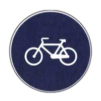
- **25931** — Il segnale raffigurato indica un percorso riservato ai ciclisti → **✅ VERO**
   
- **25932** — Il segnale raffigurato vieta il transito alle biciclette → **❌ FALSO**
   
- **25933** — Il segnale raffigurato indica un percorso pedonale → **❌ FALSO**
   
- **25934** — Il segnale raffigurato indica una pista riservata alle biciclette e ai ciclomotori → **❌ FALSO**
   
- **25935** — Il segnale raffigurato indica la fine della pista ciclabile → **✅ VERO**
   
- **25936** — Il segnale raffigurato indica la fine di un percorso riservato ai ciclisti → **✅ VERO**
   
- **25937** — Il segnale raffigurato indica la fine di una pista riservata alle biciclette → **✅ VERO**
   
- **25938** — Il segnale raffigurato indica la vicinanza di un'officina per veicoli a due ruote → **❌ FALSO**
   
- **25939** — Il segnale raffigurato vieta il transito alle biciclette → **❌ FALSO**
   
- **25940** — Il segnale raffigurato vieta il transito ai ciclomotori → **❌ FALSO**
   
- **25942** — Il segnale raffigurato può indicare il proseguimento delle piste affiancate riservate ai pedoni e ai ciclisti → **✅ VERO**
   
- **25943** — Il segnale raffigurato non permette la circolazione dei ciclomotori → **✅ VERO**
   
- **25944** — Il segnale raffigurato indica la fine delle piste riservate ai pedoni e alle biciclette → **❌ FALSO**
   
- **25945** — Il segnale raffigurato indica l'obbligo di condurre a mano la bicicletta → **❌ FALSO**
   
- **25946** — Il segnale raffigurato indica l'obbligo di parcheggiare la bicicletta e proseguire a piedi → **❌ FALSO**
   
- **25947** — Il segnale raffigurato indica un percorso per pedoni e ciclisti → **✅ VERO**
   
- **25948** — Il segnale raffigurato può indicare il proseguimento di un percorso riservato ai pedoni ed ai ciclisti → **✅ VERO**
   
- **25949** — Il segnale raffigurato non permette la circolazione dei ciclomotori → **✅ VERO**
   
- **25950** — Il segnale raffigurato indica una pista ciclabile a fianco del marciapiede → **❌ FALSO**
   
- **25951** — Il segnale raffigurato indica un'area esclusa al passaggio di ciclisti e pedoni → **❌ FALSO**
   
- **25952** — Il segnale raffigurato indica un'area transitabile con ciclomotori condotti a mano → **❌ FALSO**
   
- **25953** — Il segnale raffigurato indica la fine della pista ciclabile affiancata al marciapiede → **✅ VERO**
   
- **25954** — Il segnale raffigurato indica la fine della pista ciclabile affiancata ad un percorso riservato ai pedoni → **✅ VERO**
   
- **25955** — Il segnale raffigurato indica la fine del percorso pedonale affiancato ad una pista ciclabile → **✅ VERO**
   
- **25956** — Il segnale raffigurato vieta il transito ai ciclomotori → **❌ FALSO**
   
- **25957** — Il segnale raffigurato indica la fine dell'obbligo di passare con biciclette condotte a mano → **❌ FALSO**
   
- **25958** — Il segnale raffigurato vieta l'accesso ai pedoni e alle biciclette → **❌ FALSO**
   
- **25959** — Il segnale raffigurato indica la fine del percorso pedonale e ciclabile → **✅ VERO**
   
- **25960** — Il segnale raffigurato indica la fine di un percorso riservato ai pedoni e ai ciclisti → **✅ VERO**
   
- **25961** — Il segnale raffigurato indica la fine di un percorso riservato → **✅ VERO**
   
- **25962** — Il segnale raffigurato vieta il transito ai pedoni → **❌ FALSO**
   
- **25963** — Il segnale raffigurato vieta il transito ai ciclisti → **❌ FALSO**
   
- **25964** — Il segnale raffigurato vieta il transito ai ciclomotori → **❌ FALSO**
   
- **25965** — Il segnale raffigurato non permette il transito ai veicoli → **✅ VERO**
   
- **25966** — Il segnale raffigurato non permette il transito ai ciclomotori → **✅ VERO**
   
- **25967** — Il segnale raffigurato indica un percorso riservato ai quadrupedi da sella → **✅ VERO**
   
- **25968** — Il segnale raffigurato segnala un pericolo di attraversamento di cavalli → **❌ FALSO**
   
- **25969** — Il segnale raffigurato vieta il transito di persone a cavallo → **❌ FALSO**
   
- **25970** — Il segnale raffigurato è un divieto di transito per cavalli → **❌ FALSO**
   

## 5. Velocità, distanza di sicurezza, sorpasso, svolta, cambio di corsia, cambio di direzione

- **26440** — La velocità deve essere regolata in modo da non costituire pericolo per la sicurezza delle persone → **✅ VERO**
- **26441** — La velocità deve essere regolata in modo da non causare disordine o intralcio alla circolazione → **✅ VERO**
- **26442** — La velocità deve essere regolata in modo da consentire in ogni caso un tempestivo arresto del veicolo → **✅ VERO**
- **26443** — La velocità deve essere regolata in relazione alle condizioni atmosferiche → **✅ VERO**
- **26444** — La velocità deve essere regolata in relazione alla lunghezza del viaggio → **❌ FALSO**
- **26445** — La velocità deve essere regolata in modo da garantire solo la sicurezza della persona trasportata → **❌ FALSO**
- **26446** — La velocità deve essere regolata in base alla fretta del conducente → **❌ FALSO**
- **26447** — Il conducente è tenuto a regolare la velocità in base alle caratteristiche e alle condizioni della strada → **✅ VERO**
- **26448** — Il conducente è tenuto a regolare la velocità in base all'efficienza dei freni del veicolo → **✅ VERO**
- **26449** — Il conducente è tenuto a regolare la velocità in base alle condizioni del traffico → **✅ VERO**
- **26450** — Il conducente è tenuto a regolare la velocità in base alla marca dei pneumatici → **❌ FALSO**
- **26451** — Il conducente è tenuto a regolare la velocità in base alla distanza della località da raggiungere → **❌ FALSO**
- **26452** — Il conducente è tenuto a regolare la velocità in base alla tabella di marcia che ha prestabilito → **❌ FALSO**
- **26453** — E' obbligatorio ridurre la velocità e all'occorrenza fermarsi quando è difficoltoso l'incrocio con altri veicoli → **✅ VERO**
- **26454** — E' obbligatorio ridurre la velocità e all'occorrenza fermarsi quando si rimane abbagliati → **✅ VERO**
- **26455** — E' obbligatorio ridurre la velocità e all'occorrenza fermarsi quando i pedoni che si trovano sul percorso danno segni di incertezza → **✅ VERO**
- **26456** — E' obbligatorio ridurre la velocità e all'occorrenza fermarsi nei tratti di strada in salita → **❌ FALSO**
- **26457** — E' obbligatorio ridurre la velocità e all'occorrenza fermarsi in presenza di tutti i segnali stradali → **❌ FALSO**
- **26458** — E' obbligatorio ridurre la velocità e all'occorrenza fermarsi nelle ore notturne → **❌ FALSO**
- **26459** — Si è tenuti a regolare la velocità in base alle caratteristiche della strada → **✅ VERO**
- **26460** — Si è tenuti a regolare la velocità in base alle condizioni atmosferiche → **✅ VERO**
- **26461** — Si è tenuti a regolare la velocità in base alla visibilità → **✅ VERO**
- **26462** — Si è tenuti a regolare la velocità in base alla lunghezza del viaggio → **❌ FALSO**
- **26463** — Si è tenuti a regolare la velocità in base alla velocità dei veicoli che ci seguono → **❌ FALSO**
- **26464** — Si è tenuti a regolare la velocità in base al tipo di forcella del ciclomotore → **❌ FALSO**
- **26465** — Si deve tenere una velocità che non costituisca pericolo per la sicurezza della circolazione → **✅ VERO**
- **26466** — Si deve tenere una velocità che permetta di intervenire con sicurezza in caso di imprevisti → **✅ VERO**
- **26467** — Si deve tenere una velocità adeguata alle condizioni della strada → **✅ VERO**
- **26468** — Si deve tenere una velocità regolata in funzione del tempo che abbiamo a disposizione → **❌ FALSO**
- **26469** — Si deve tenere una velocità sempre superiore a 40 km/h → **❌ FALSO**
- **26470** — Si deve tenere una velocità proporzionata alla lunghezza del percorso → **❌ FALSO**
- **26471** — E' obbligo del conducente regolare la velocità in relazione alle caratteristiche e allo stato di manutenzione della strada → **✅ VERO**
- **26472** — E' obbligo del conducente regolare la velocità in relazione alle condizioni del traffico → **✅ VERO**
- **26473** — E' obbligo del conducente regolare la velocità in modo da poter arrestare il veicolo entro i limiti del suo campo di visibilità → **✅ VERO**
- **26474** — E' obbligo del conducente regolare la velocità solo di giorno → **❌ FALSO**
- **26475** — E' obbligo del conducente regolare la velocità solo in presenza degli agenti addetti ai servizi di polizia stradale → **❌ FALSO**
- **26476** — E' obbligo del conducente regolare la velocità sulle strade a senso unico → **❌ FALSO**
- **26477** — Si deve in particolare regolare la velocità in curva → **✅ VERO**
- **26478** — Si deve in particolare regolare la velocità in prossimità degli incroci → **✅ VERO**
- **26479** — Si deve in particolare regolare la velocità in caso di nebbia o foschia → **✅ VERO**
- **26480** — Si deve in particolare regolare la velocità quando si gareggia con un altro veicolo → **❌ FALSO**
- **26481** — Si deve in particolare regolare la velocità fuori dai centri abitati → **❌ FALSO**
- **26482** — Si deve in particolare regolare la velocità di giorno → **❌ FALSO**
- **26483** — Si deve in particolare regolare la velocità quando la visibilità è limitata → **✅ VERO**
- **26484** — Si deve in particolare regolare la velocità in prossimità delle scuole → **✅ VERO**
- **26485** — Si deve in particolare regolare la velocità nelle ore notturne → **✅ VERO**
- **26486** — Si deve in particolare regolare la velocità quando il veicolo che segue è di cilindrata superiore → **❌ FALSO**
- **26487** — Si deve in particolare regolare la velocità percorrendo una strada a senso unico → **❌ FALSO**
- **26488** — Si deve in particolare regolare la velocità solo nei giorni festivi → **❌ FALSO**
- **26489** — La distanza di sicurezza va rispettata per non tamponare il veicolo che ci precede → **✅ VERO**
- **26490** — La distanza di sicurezza dipende dalla prontezza di riflessi del conducente → **✅ VERO**
- **26491** — La distanza di sicurezza deve essere calcolata in base alla velocità del proprio veicolo → **✅ VERO**
- **26492** — La distanza di sicurezza è una distanza fissa → **❌ FALSO**
- **26493** — La distanza di sicurezza si deve rispettare solo al di sopra dei 30 km/h → **❌ FALSO**
- **26494** — La distanza di sicurezza deve essere mantenuta solo tra ciclomotori → **❌ FALSO**
- **26495** — La distanza di sicurezza può dipendere dalla velocità del proprio veicolo → **✅ VERO**
- **26496** — La distanza di sicurezza può dipendere dal tempo di reazione del conducente → **✅ VERO**
- **26497** — La distanza di sicurezza può dipendere dall'efficienza dei freni → **✅ VERO**
- **26498** — La distanza di sicurezza può dipendere dalle condizioni dei pneumatici → **✅ VERO**
- **26499** — La distanza di sicurezza può dipendere dalla larghezza della strada → **❌ FALSO**
- **26500** — La distanza di sicurezza può dipendere dalla presenza di veicoli che ci seguono → **❌ FALSO**
- **26501** — La distanza di sicurezza deve essere tale da evitare il tamponamento del veicolo che precede → **✅ VERO**
- **26502** — La distanza di sicurezza deve essere adeguata allo stato di efficienza del veicolo → **✅ VERO**
- **26503** — La distanza di sicurezza deve consentire in ogni caso l'arresto tempestivo del veicolo → **✅ VERO**
- **26504** — La distanza di sicurezza non deve mai essere inferiore a 150 m → **❌ FALSO**
- **26505** — La distanza di sicurezza non dipende dalla velocità del veicolo → **❌ FALSO**
- **26506** — La distanza di sicurezza deve essere mantenuta solo tra i quadricicli a motore → **❌ FALSO**
- **26507** — E' vietato il sorpasso quando non si dispone di uno spazio libero sufficiente → **✅ VERO**
- **26508** — E' vietato il sorpasso nei dossi, su strade con due corsie e a doppio senso di circolazione → **✅ VERO**
- **26509** — E' vietato il sorpasso quando il veicolo che segue ha già iniziato la manovra di sorpasso → **✅ VERO**
- **26510** — E' vietato il sorpasso di veicoli fermatisi per consentire ai pedoni di attraversare la carreggiata → **✅ VERO**
- **26511** — E' vietato il sorpasso nelle strade a senso unico → **❌ FALSO**
- **26512** — E' vietato il sorpasso quando il veicolo che ci precede ha azionato l'indicatore destro per fermarsi → **❌ FALSO**
- **26513** — E' vietato il sorpasso quando il veicolo da superare è un ciclomotore → **❌ FALSO**
- **26514** — E' vietato il sorpasso nelle curve, su strade con due corsie e a doppio senso di circolazione → **✅ VERO**
- **26515** — E' vietato il sorpasso nei passaggi a livello senza barriere e senza semaforo → **✅ VERO**
- **26516** — E' vietato il sorpasso di veicoli fermi al semaforo quando si deve superare la linea continua → **✅ VERO**
- **26517** — E' vietato il sorpasso nelle strade a carreggiate separate → **❌ FALSO**
- **26518** — E' vietato il sorpasso nei centri abitati → **❌ FALSO**
- **26519** — E' vietato il sorpasso nelle ore notturne → **❌ FALSO**
- **26520** — E' vietato il sorpasso quando il veicolo che precede ha segnalato di voler iniziare il sorpasso → **✅ VERO**
- **26521** — E' vietato il sorpasso a destra di un tram fermo per la salita e discesa dei passeggeri, se non c'è il salvagente → **✅ VERO**
- **26522** — E' vietato il sorpasso su strade a due corsie e a doppio senso, quando la visibilità è limitata → **✅ VERO**
- **26523** — E' vietato il sorpasso quando piove → **❌ FALSO**
- **26524** — E' vietato il sorpasso nelle curve, su strade a due corsie per ogni senso di marcia → **❌ FALSO**
- **26525** — E' vietato il sorpasso nei dossi, su strade a senso unico di circolazione → **❌ FALSO**
- **26526** — Nell'eseguire la manovra di sorpasso bisogna segnalare la manovra azionando l'indicatore di direzione → **✅ VERO**
- **26527** — Nell'eseguire la manovra di sorpasso bisogna affiancare il veicolo sulla sua sinistra lasciando un adeguato margine di sicurezza → **✅ VERO**
- **26528** — Nell'eseguire la manovra di sorpasso bisogna assicurarsi che si disponga di uno spazio libero sufficiente → **✅ VERO**
- **26529** — Nell'eseguire la manovra di sorpasso occorre tener presente che sulle strade provinciali il sorpasso è ammesso solo di giorno → **❌ FALSO**
- **26530** — Nell'eseguire la manovra di sorpasso dei motocicli, si può effettuare la manovra sia a destra che a sinistra → **❌ FALSO**
- **26531** — Nell'eseguire la manovra di sorpasso in curva si deve sempre suonare il clacson → **❌ FALSO**
- **26532** — Non si può sorpassare quando si deve oltrepassare una striscia longitudinale bianca continua, singola o doppia → **✅ VERO**
- **26533** — Non si può sorpassare in prossimità o in corrispondenza dei passaggi a livello senza barriere e senza semaforo → **✅ VERO**
- **26534** — Non si può sorpassare un veicolo che si sia fermato per dare la precedenza ad altri veicoli → **✅ VERO**
- **26535** — Non si può sorpassare in corrispondenza dei dossi su strade a senso unico a due corsie → **❌ FALSO**
- **26536** — Non si può sorpassare un veicolo che abbia segnalato l'intenzione di accostarsi a destra → **❌ FALSO**
- **26537** — Non si può sorpassare sulla destra, il tram che marcia al centro della strada → **❌ FALSO**
- **26538** — Lo spazio necessario alla manovra di sorpasso aumenta se il veicolo da sorpassare accelera → **✅ VERO**
- **26539** — Lo spazio necessario alla manovra di sorpasso aumenta in relazione alla lunghezza del veicolo da sorpassare → **✅ VERO**
- **26540** — Lo spazio necessario alla manovra di sorpasso dipende dalla velocità dei due veicoli → **✅ VERO**
- **26541** — Lo spazio necessario alla manovra di sorpasso non interessa ai fini della sicurezza stradale → **❌ FALSO**
- **26543** — Lo spazio necessario alla manovra di sorpasso non dipende dalla lunghezza del veicolo da sorpassare → **❌ FALSO**
- **26544** — Sulle strade a senso unico, si può effettuare un sorpasso anche in presenza di un dosso → **✅ VERO**
- **26545** — Sulle strade a due carreggiate separate, si può effettuare un sorpasso anche in presenza di un dosso → **✅ VERO**
- **26546** — In presenza di un dosso si può effettuare un sorpasso sul suo tratto in discesa, salvo diversa segnalazione → **✅ VERO**
- **26547** — In presenza di un dosso, si può sempre effettuare un sorpasso sul suo tratto in salita → **❌ FALSO**
- **26548** — E’ comunque consigliabile effettuare i sorpassi sulla scia del veicolo che ci precede → **❌ FALSO**
- **26549** — In presenza di nebbia, è consigliabile superare un veicolo che ci precede a velocità moderata per non rischiare di tamponarlo → **❌ FALSO**
- **26550** — Il sorpasso è vietato quando un veicolo si è fermato per consentire ai pedoni di attraversare la strada → **✅ VERO**
- **26551** — Il sorpasso è vietato quando il veicolo che segue abbia già segnalato l'intenzione di effettuare analoga manovra → **✅ VERO**
- **26552** — Il sorpasso è vietato quando ci sia l'apposito segnale → **✅ VERO**
- **26553** — Il sorpasso è vietato quando sulla strada è tracciata la linea longitudinale tratteggiata → **❌ FALSO**
- **26554** — Il sorpasso è vietato quando il veicolo che ci precede è uno dei mezzi di soccorso con il lampeggiante giallo acceso → **❌ FALSO**
- **26555** — Il sorpasso è vietato quando si è in corrispondenza di una curva o di un dosso sulle strade a senso unico → **❌ FALSO**
- **26556** — Il sorpasso a destra è permesso quando il conducente da sorpassare ha segnalato che intende svoltare a sinistra → **✅ VERO**
- **26557** — Il sorpasso a destra è permesso quando si sorpassa un tram in marcia e la larghezza della carreggiata alla sua destra lo permette → **✅ VERO**
- **26558** — Il sorpasso a destra è permesso quando avviene nei confronti dei motocicli e ci sia spazio sufficiente → **❌ FALSO**
- **26559** — Il sorpasso a destra è permesso quando si percorre una strada extraurbana a senso unico → **❌ FALSO**
- **26560** — Il sorpasso a destra è permesso quando si percorre un tratto di strada a traffico molto lento → **❌ FALSO**
- **26561** — Il conducente che intende sorpassare deve assicurarsi che la visibilità sia tale da poter effettuare la manovra senza pericolo → **✅ VERO**
- **26562** — Il conducente che intende sorpassare deve assicurarsi che non vi siano segnali che vietino la manovra → **✅ VERO**
- **26563** — Il conducente che intende sorpassare deve assicurarsi che nessun conducente abbia già iniziato la medesima manovra → **✅ VERO**
- **26564** — Il conducente che intende sorpassare deve assicurarsi che il veicolo proveniente in senso contrario abbia uno spazio di almeno 10 m per arrestarsi → **❌ FALSO**
- **26565** — Il conducente che intende sorpassare deve assicurarsi che il veicolo che precede non stia rallentando → **❌ FALSO**
- **26566** — Il conducente che intende sorpassare deve assicurarsi che il conducente che precede abbia dato via libera → **❌ FALSO**
- **26567** — Il conducente del veicolo che viene sorpassato ha l'obbligo di facilitare la manovra di sorpasso → **✅ VERO**
- **26568** — Il conducente del veicolo che viene sorpassato ha l'obbligo di non costituire pericolo o intralcio alla circolazione → **✅ VERO**
- **26569** — Il conducente del veicolo che viene sorpassato ha l'obbligo di non gareggiare in velocità con il veicolo che sta sorpassando → **✅ VERO**
- **26570** — Il conducente del veicolo che viene sorpassato ha l'obbligo di non accelerare → **✅ VERO**
- **26571** — Il conducente del veicolo che viene sorpassato ha l'obbligo di ridurre sempre la propria velocità → **❌ FALSO**
- **26572** — Il conducente del veicolo che viene sorpassato ha l'obbligo di azionare l'indicatore di direzione destro → **❌ FALSO**
- **26573** — Il conducente del veicolo che viene sorpassato ha l'obbligo di portarsi al centro della carreggiata per evitare sorpassi in scia → **❌ FALSO**
- **26574** — Il conducente del veicolo che viene sorpassato ha l'obbligo di accelerare per permettere al veicolo sorpassante di prendere la scia per aumentare la velocità → **❌ FALSO**
- **26575** — La svolta a destra si effettua tenendosi il più vicino possibile al margine destro della strada → **✅ VERO**
- **26576** — La svolta a destra si effettua azionando l'indicatore di direzione con sufficiente anticipo → **✅ VERO**
- **26577** — La svolta a destra si effettua regolando la velocità man mano che ci si avvicina all'incrocio → **✅ VERO**
- **26578** — La svolta a destra si effettua tenendosi il più vicino possibile al margine sinistro della strada → **❌ FALSO**
- **26579** — La svolta a destra si effettua spostandosi sulla corsia di sinistra → **❌ FALSO**
- **26580** — La svolta a destra si effettua portandosi al centro dell'incrocio → **❌ FALSO**
- **26581** — In una strada a doppio senso di circolazione, per svoltare a sinistra il conducente deve avvicinarsi il più possibile al centro della strada → **✅ VERO**
- **26582** — In una strada a doppio senso di circolazione, per svoltare a sinistra il conducente deve lasciare di norma il centro dell'incrocio alla propria destra → **✅ VERO**
- **26583** — In una strada a doppio senso di circolazione, per svoltare a sinistra il conducente deve dare la precedenza ai veicoli provenienti da destra, salvo diversa segnalazione → **✅ VERO**
- **26584** — In una strada a doppio senso di circolazione, per svoltare a sinistra il conducente deve spostarsi il più possibile sul margine sinistro della strada → **❌ FALSO**
- **26585** — In una strada a doppio senso di circolazione, per svoltare a sinistra il conducente deve effettuare la svolta con rapidità per evitare i veicoli provenienti da destra e da sinistra → **❌ FALSO**
- **26586** — In una strada a doppio senso di circolazione, per svoltare a sinistra il conducente deve dare sempre la precedenza ai veicoli provenienti da sinistra → **❌ FALSO**
- **26587** — Quando si vuole cambiare direzione, per svoltare a destra bisogna tenersi sul margine destro della strada → **✅ VERO**
- **26588** — Quando si vuole cambiare direzione, per svoltare a sinistra su strade a doppio senso bisogna spostarsi al centro → **✅ VERO**
- **26590** — Quando si vuole cambiare direzione, l'indicatore di direzione deve restare in funzione per l'intera durata della manovra → **✅ VERO**
- **26591** — Quando si vuole cambiare direzione, per svoltare a sinistra bisogna sempre girare intorno al centro dell'incrocio → **❌ FALSO**
- **26592** — Quando si vuole cambiare direzione, è necessario in ogni caso fare uso del clacson → **❌ FALSO**
- **26593** — Nell'effettuare la svolta a sinistra si ha l'obbligo di non imboccare contromano la nuova strada → **✅ VERO**
- **26594** — Nell'effettuare la svolta a sinistra si ha l'obbligo di rispettare, di norma, la precedenza dei veicoli provenienti da destra → **✅ VERO**
- **26595** — Nell'effettuare la svolta a sinistra si ha l'obbligo di lasciare, di norma, il centro dell'incrocio alla nostra destra → **✅ VERO**
- **26596** — Nell'effettuare la svolta a sinistra si ha l'obbligo di spostarsi sempre nella corsia di destra → **❌ FALSO**
- **26598** — Nell'effettuare la svolta a sinistra si ha l'obbligo di guardare solo a destra → **❌ FALSO**
- **26599** — Percorrendo una strada a senso unico, la svolta a sinistra si effettua tenendosi il più vicino possibile al margine sinistro della strada → **✅ VERO**
- **26600** — Percorrendo una strada a senso unico, la svolta a sinistra si effettua lasciando di norma il centro dell'incrocio alla nostra destra → **✅ VERO**
- **26601** — Percorrendo una strada a senso unico, la svolta a sinistra si effettua dando la precedenza ai veicoli che provengono da destra → **✅ VERO**
- **26602** — Percorrendo una strada a senso unico, la svolta a sinistra si effettua dando in ogni caso la precedenza ai veicoli provenienti da sinistra → **❌ FALSO**
- **26603** — Percorrendo una strada a senso unico, la svolta a sinistra si effettua senza che sia necessario rallentare, se l'incrocio è libero → **❌ FALSO**
- **26604** — Percorrendo una strada a senso unico, la svolta a sinistra si effettua se è ammessa la circolazione per file parallele, incolonnandosi in una corsia qualsiasi → **❌ FALSO**
- **26605** — Per cambiare corsia, dobbiamo accertarci prima che la corsia che vogliamo occupare sia libera dietro per un tratto sufficiente → **✅ VERO**
- **26606** — Per cambiare corsia, dobbiamo accertarci che il veicolo che sta davanti non abbia segnalato l'inizio della stessa manovra → **✅ VERO**
- **26607** — Per cambiare corsia, dobbiamo evitare di creare intralcio a chi percorre la corsia in cui vogliamo spostarci → **✅ VERO**
- **26608** — Per cambiare corsia, dobbiamo evitare di azionare gli indicatori di direzione se la corsia è libera → **❌ FALSO**
- **26609** — Per cambiare corsia, dobbiamo segnalare sempre la manovra in tempo utile con il clacson → **❌ FALSO**
- **26610** — Per cambiare corsia, dobbiamo accertarci che le corsie siano separate da strisce continue → **❌ FALSO**
- **26611** — Giungendo in prossimità di un incrocio si deve, conducendo un ciclomotore, incolonnarsi con gli altri veicoli in attesa → **✅ VERO**
- **26612** — Giungendo in prossimità di un incrocio si deve segnalare in tempo utile l'intenzione di svoltare → **✅ VERO**
- **26613** — Giungendo in prossimità di un incrocio si deve usare la massima prudenza al fine di evitare incidenti → **✅ VERO**
- **26614** — Giungendo in prossimità di un incrocio si deve dare sempre la precedenza a chi proviene da destra → **❌ FALSO**
- **26615** — Giungendo in prossimità di un incrocio si deve sorpassare a sinistra se vogliamo svoltare a destra → **❌ FALSO**
- **26616** — Giungendo in prossimità di un incrocio si deve, con semaforo verde, accelerare senza usare prudenza → **❌ FALSO**
- **26617** — In prossimità o in corrispondenza degli incroci è vietato procedere a zig zag anche se ci sono strisce tratteggiate → **✅ VERO**
- **26618** — In prossimità o in corrispondenza degli incroci è vietato modificare improvvisamente la direzione di marcia → **✅ VERO**
- **26619** — In prossimità o in corrispondenza degli incroci è vietato effettuare l'inversione di marcia → **✅ VERO**
- **26620** — In prossimità o in corrispondenza degli incroci è vietato usare i fari anabbaglianti → **❌ FALSO**
- **26621** — In prossimità o in corrispondenza degli incroci è vietato azionare l'indicatore di direzione se si svolta → **❌ FALSO**
- **26622** — In prossimità o in corrispondenza degli incroci è vietato superare la velocità di 20 km/h → **❌ FALSO**

## 6. Fermata, sosta, definizioni stradali

- **26623** — La fermata del veicolo è sempre vietata sui marciapiedi, salvo diversa segnalazione, nonché sulle strisce pedonali → **✅ VERO**
- **26624** — La fermata del veicolo è sempre vietata in tutti i luoghi dove sia di intralcio alla circolazione → **✅ VERO**
- **26625** — La fermata del veicolo è sempre vietata nelle curve e sui dossi → **✅ VERO**
- **26626** — La fermata del veicolo è sempre vietata sul margine destro della strada → **❌ FALSO**
- **26627** — La fermata del veicolo è sempre vietata davanti ai cassonetti dei rifiuti urbani → **❌ FALSO**
- **26628** — La fermata del veicolo è sempre vietata in seconda fila → **❌ FALSO**
- **26629** — La fermata è vietata in corrispondenza dei passaggi a livello → **✅ VERO**
- **26630** — La fermata è vietata in corrispondenza e in prossimità degli incroci → **✅ VERO**
- **26631** — La fermata è vietata sui binari del tram posti al centro della strada → **✅ VERO**
- **26632** — La fermata è vietata in prossimità dei segnali stradali → **❌ FALSO**
- **26634** — La fermata è vietata sulle strade che non siano suddivise in corsie → **❌ FALSO**
- **26635** — La fermata è vietata in presenza dell'apposito segnale → **✅ VERO**
- **26636** — La fermata è vietata all'entrata e all'uscita delle piste ciclabili → **✅ VERO**
- **26637** — La fermata è vietata sulle strisce pedonali → **✅ VERO**
- **26638** — La fermata è vietata nei lunghi rettilinei → **❌ FALSO**
- **26639** — La fermata è vietata sul margine destro della carreggiata → **❌ FALSO**
- **26640** — La fermata è vietata nello spazio riservato alla fermata degli autobus → **❌ FALSO**
- **26641** — La fermata di un veicolo è consentita, di norma, lungo il margine destro della carreggiata → **✅ VERO**
- **26642** — La fermata di un veicolo non è consentita sulle strisce pedonali → **✅ VERO**
- **26643** — La fermata di un veicolo non deve comunque causare intralcio alla circolazione → **✅ VERO**
- **26644** — La fermata di un veicolo può avere la durata massima di cinque minuti → **❌ FALSO**
- **26645** — La fermata di un veicolo è consentita in curva → **❌ FALSO**
- **26646** — La fermata di un veicolo è consentita sui dossi → **❌ FALSO**
- **26647** — La sosta non è consentita in corrispondenza o in prossimità dei passaggi a livello → **✅ VERO**
- **26648** — La sosta non è consentita nelle aree destinate alla fermata o alla sosta dei taxi → **✅ VERO**
- **26649** — La sosta non è consentita davanti ai cassonetti dei rifiuti urbani → **✅ VERO**
- **26650** — La sosta non è consentita nelle gallerie urbane a senso unico, solo se non sufficientemente illuminate → **❌ FALSO**
- **26651** — La sosta non è consentita in prossimità delle strisce pedonali → **❌ FALSO**
- **26652** — La sosta non è consentita negli spazi appositamente delimitati per la sosta → **❌ FALSO**
- **26653** — E' proibito sostare in corrispondenza degli spazi destinati al passaggio dei disabili → **✅ VERO**
- **26654** — E' proibito sostare sui binari tranviari → **✅ VERO**
- **26655** — E' proibito sostare nelle corsie riservate ai mezzi pubblici → **✅ VERO**
- **26656** — E' proibito sostare alle fermate degli autobus, solo se lo spazio è delimitato dalle strisce gialle → **❌ FALSO**
- **26657** — E' proibito sostare nelle discese pericolose → **❌ FALSO**
- **26658** — E' proibito sostare sulle strade a senso unico → **❌ FALSO**
- **26659** — La sosta è vietata nelle gallerie e sotto i ponti, salvo diversa segnalazione → **✅ VERO**
- **26660** — La sosta è vietata dove il bordo del marciapiede è dipinto con strisce gialle e nere → **✅ VERO**
- **26661** — La sosta è vietata negli spazi riservati alla sosta dei veicoli per persone disabili → **✅ VERO**
- **26662** — La sosta è vietata sempre davanti alle sale gioco → **❌ FALSO**
- **26663** — La sosta è vietata sui marciapiedi, in ogni caso → **❌ FALSO**
- **26664** — La sosta è vietata in prossimità dei passaggi a livello, solo se senza barriere → **❌ FALSO**
- **26665** — La sosta è vietata davanti ai passi carrabili → **✅ VERO**
- **26666** — La sosta è vietata sui marciapiedi, salvo diversa segnalazione → **✅ VERO**
- **26667** — La sosta è vietata in corrispondenza di incroci regolati da semaforo → **✅ VERO**
- **26668** — La sosta è vietata sempre sui lunghi rettilinei → **❌ FALSO**
- **26669** — La sosta è vietata nelle strade a senso unico → **❌ FALSO**
- **26670** — La sosta è vietata fuori dai centri abitati → **❌ FALSO**
- **26671** — E' vietato sostare negli spazi riservati alla sosta dei veicoli per persone disabili → **✅ VERO**
- **26672** — E' vietato sostare occupando nel parcheggio più di uno spazio → **✅ VERO**
- **26673** — E' vietato sostare davanti ai distributori di carburante, durante l'orario di apertura → **✅ VERO**
- **26674** — E' vietato sostare nelle strade senza marciapiede → **❌ FALSO**
- **26675** — E' vietato sostare lungo le strade prive di illuminazione pubblica → **❌ FALSO**
- **26676** — E' vietato sostare lungo le strade a forte pendenza → **❌ FALSO**
- **26677** — La sosta in doppia fila è vietata ai quadricicli leggeri a motore → **✅ VERO**
- **26678** — La sosta in doppia fila può ostacolare la circolazione → **✅ VERO**
- **26679** — La sosta in doppia fila è ammessa se i veicoli sono a due ruote → **✅ VERO**
- **26680** — La sosta in doppia fila è consentita ai quadricicli leggeri a motore → **❌ FALSO**
- **26681** — La sosta in doppia fila, nei centri abitati, è sempre vietata ai ciclomotori a due ruote → **❌ FALSO**
- **26682** — La sosta in doppia fila è consentita solo per pochi minuti ai quadricicli leggeri a motore → **❌ FALSO**
- **26683** — Quando si esce da un parcheggio autorizzato, si ha l'obbligo di dare la precedenza ai veicoli in transito → **✅ VERO**
- **26684** — Quando si lascia il veicolo in sosta in un parcheggio autorizzato, si ha l'obbligo di non ostacolare gli altri utenti della strada presenti nel parcheggio → **✅ VERO**
- **26685** — Quando si lascia il veicolo in sosta in un parcheggio autorizzato, si ha l'obbligo di disporre il veicolo all’interno degli appositi spazi delimitati → **✅ VERO**
- **26686** — Un parcheggio autorizzato a pagamento, è delimitato da strisce gialle → **❌ FALSO**
- **26687** — Un parcheggio autorizzato delimitato da strisce azzurre è riservato alla sosta dei soli taxi → **❌ FALSO**
- **26688** — Non è ammesso sostare nelle immediate vicinanze di un parcheggio autorizzato → **❌ FALSO**
- **26689** — Uscendo da un parcheggio, per immettersi nella circolazione occorre dare la precedenza ai veicoli in transito → **✅ VERO**
- **26690** — Uscendo da un parcheggio, per immettersi nella circolazione occorre segnalare l'intenzione di immettersi nella corsia di marcia → **✅ VERO**
- **26691** — Uscendo da un parcheggio, per immettersi nella circolazione occorre azionare l'indicatore di direzione dopo essersi immessi nel flusso della circolazione → **❌ FALSO**
- **26692** — Uscendo da un parcheggio, per immettersi nella circolazione occorre disinserire l'indicatore di direzione solo quando si è raggiunta una velocità adeguata al traffico → **❌ FALSO**
- **26694** — Uscendo da un parcheggio, per immettersi nella circolazione occorre accelerare a fondo facendo slittare i pneumatici → **❌ FALSO**
- **26695** — L'attraversamento pedonale è una parte della strada dipinta con strisce bianche per l'attraversamento dei pedoni → **✅ VERO**
- **26696** — L'attraversamento pedonale è una parte della strada in cui i veicoli debbono dare la precedenza ai pedoni che attraversano → **✅ VERO**
- **26697** — L'attraversamento pedonale è una parte della strada destinata al transito dei pedoni che attraversano → **✅ VERO**
- **26698** — L'attraversamento pedonale è una parte della strada in cui è vietato il transito dei veicoli → **❌ FALSO**
- **26699** — L'attraversamento pedonale è una parte della strada dipinta con strisce blu → **❌ FALSO**
- **26700** — L'attraversamento pedonale è una parte al di fuori della strada e destinata al transito dei pedoni → **❌ FALSO**
- **26701** — Una zona a traffico limitato è un'area nella quale la circolazione è limitata ai soli veicoli autorizzati → **✅ VERO**
- **26702** — Una zona a traffico limitato è una area in cui la circolazione è limitata ad ore stabilite → **✅ VERO**
- **26703** — Una zona a traffico limitato è un'area delimitata da appositi segnali stradali → **✅ VERO**
- **26704** — Una zona a traffico limitato è un'area nella quale è permesso solo il transito di ciclomotori e biciclette → **❌ FALSO**
- **26705** — Una zona a traffico limitato è un'area sempre e comunque esclusa al transito dei veicoli a motore → **❌ FALSO**
- **26706** — Una zona a traffico limitato è un'area nella quale l'accesso ai pedoni è soggetto a limitazioni → **❌ FALSO**
- **26707** — Nelle aree pedonali possono passare, di norma, soltanto i pedoni, le biciclette e i veicoli di soccorso → **✅ VERO**
- **26708** — Nelle aree pedonali possono passare i veicoli al servizio di persone disabili, se espressamente consentito → **✅ VERO**
- **26709** — Nelle aree pedonali possono passare i veicoli in servizio di polizia, con sirena e con luce lampeggiante blu in funzione → **✅ VERO**
- **26710** — Nelle aree pedonali possono passare i ciclomotori → **❌ FALSO**
- **26711** — Nelle aree pedonali possono passare i quadricicli a motore purché non superino la velocità di 50 km/h → **❌ FALSO**
- **26712** — Nelle aree pedonali possono passare tutti i veicoli sprovvisti di motore → **❌ FALSO**
- **26713** — Il marciapiede è una parte della strada riservata ai pedoni → **✅ VERO**
- **26714** — Il marciapiede è una parte della strada riservata ai pedoni e anche ai veicoli in sosta se ci sono strisce di parcheggio → **✅ VERO**
- **26715** — Il marciapiede è una parte della strada vietata alla circolazione dei ciclomotori → **✅ VERO**
- **26716** — Il marciapiede è una parte della strada vietata alla circolazione dei pedoni → **❌ FALSO**
- **26717** — Il marciapiede è una parte della strada riservata alle sole biciclette → **❌ FALSO**
- **26718** — Il marciapiede è una parte della strada riservata ai veicoli in sosta, ma vietata ai pedoni → **❌ FALSO**
- **26719** — Il salvagente è destinato al riparo o alla sosta dei pedoni che attraversano la strada → **✅ VERO**
- **26720** — Il salvagente agevola la salita e la discesa dei passeggeri da tram, filobus od autobus → **✅ VERO**
- **26721** — Il salvagente può essere segnalato con colonnine luminose e luci semaforiche gialle lampeggianti → **✅ VERO**
- **26722** — Il salvagente può essere segnalato con colonnine luminose a luce gialla fissa → **✅ VERO**
- **26723** — Il salvagente è una zona destinata alla sosta dei ciclomotori → **❌ FALSO**
- **26724** — Il salvagente è una zona dove è consentito il transito dei ciclomotori → **❌ FALSO**
- **26725** — Il salvagente è una zona della strada destinata al primo soccorso → **❌ FALSO**

## 7. Cause di incidenti, assicurazione

- **26726** — Sulla strada è vietato effettuare un cambiamento di direzione senza segnalare la manovra con sufficiente anticipo → **✅ VERO**
- **26727** — Sulla strada è vietato gareggiare in velocità → **✅ VERO**
- **26728** — Sulla strada è vietato circolare a velocità troppo bassa senza giustificato motivo → **✅ VERO**
- **26729** — Sulla strada è vietato immettersi nel flusso della circolazione provenendo da strade laterali → **❌ FALSO**
- **26730** — Sulla strada è vietato adeguare la velocità in relazione alle sue caratteristiche → **❌ FALSO**
- **26731** — Sulla strada è vietato fermare momentaneamente il veicolo lungo il margine destro → **❌ FALSO**
- **26732** — Causa frequente di incidenti dovuti alle condizioni della strada può essere fondo ghiacciato → **✅ VERO**
- **26733** — Causa frequente di incidenti dovuti alle condizioni della strada può essere strada coperta di foglie → **✅ VERO**
- **26734** — Causa frequente di incidenti dovuti alle condizioni della strada può essere presenza di pietrisco sulla carreggiata → **✅ VERO**
- **26735** — Causa frequente di incidenti dovuti alle condizioni della strada può essere presenza di olio sull'asfalto → **✅ VERO**
- **26736** — Causa frequente di incidenti dovuti alle condizioni della strada può essere fondo asfaltato ruvido → **❌ FALSO**
- **26737** — Causa frequente di incidenti dovuti alle condizioni della strada può essere una buona illuminazione → **❌ FALSO**
- **26738** — In presenza di una galleria è necessario rallentare l'andatura prima di entrare → **✅ VERO**
- **26739** — In presenza di una galleria è necessario tenere saldo il manubrio per fronteggiare colpi di vento laterale all'uscita → **✅ VERO**
- **26740** — Di giorno, prima di entrare in una galleria, è necessario moderare la velocità per abituare gli occhi alla penombra → **✅ VERO**
- **26742** — In presenza di una galleria è necessario frenare bruscamente → **❌ FALSO**
- **26743** — Di giorno, prima di entrare in una galleria, è necessario indossare gli occhiali da sole → **❌ FALSO**
- **26744** — In caso di pioggia occorre ridurre la velocità → **✅ VERO**
- **26745** — In caso di pioggia occorre aumentare la distanza di sicurezza → **✅ VERO**
- **26746** — In caso di pioggia occorre manovrare con prudenza il manubrio → **✅ VERO**
- **26747** — In caso di pioggia occorre passare velocemente sulle pozzanghere per evitare di rimanere impantanati → **❌ FALSO**
- **26748** — In caso di pioggia occorre frenare energicamente → **❌ FALSO**
- **26749** — In caso di pioggia occorre impiegare con prudenza gli indicatori di direzione → **❌ FALSO**
- **26750** — Conducendo un ciclomotore, in caso di pioggia bisogna fare particolare attenzione perché la visibilità attraverso la visiera del casco peggiora notevolmente → **✅ VERO**
- **26751** — Conducendo un ciclomotore, in caso di pioggia bisogna fare particolare attenzione perché le buche piene d'acqua sulla strada sono difficili da individuare → **✅ VERO**
- **26752** — Conducendo un ciclomotore, in caso di pioggia bisogna fare particolare attenzione all’acqua fatta schizzare dai veicoli che precedono → **✅ VERO**
- **26753** — Conducendo un ciclomotore, in caso di pioggia bisogna fare particolare attenzione perché l'aderenza è maggiore → **❌ FALSO**
- **26754** — Conducendo un ciclomotore, in caso di pioggia bisogna fare particolare attenzione perché aumenta la pressione dei pneumatici → **❌ FALSO**
- **26755** — Conducendo un ciclomotore, in caso di pioggia bisogna fare particolare attenzione perché lo spazio di frenatura è minore → **❌ FALSO**
- **26756** — In caso di forti piogge il conducente deve evitare di frenare in modo improvviso e brusco → **✅ VERO**
- **26757** — In caso di forti piogge il conducente deve percorrere le curve a velocità ridotta → **✅ VERO**
- **26758** — In caso di forti piogge il conducente deve aumentare la distanza di sicurezza dal veicolo che lo precede → **✅ VERO**
- **26759** — In caso di forti piogge il conducente deve aumentare la velocità di marcia, nel rispetto dei limiti prescritti → **❌ FALSO**
- **26760** — In caso di forti piogge il conducente deve percorrere le forti discese con il freno sempre azionato → **❌ FALSO**
- **26761** — Con il fondo stradale bagnato è facile perdere il controllo e cadere se si è alla guida un ciclomotore a due ruote → **✅ VERO**
- **26762** — Con il fondo stradale bagnato la strada diventa scivolosa → **✅ VERO**
- **26763** — Con il fondo stradale bagnato la vernice delle strisce rende la strada particolarmente viscida → **✅ VERO**
- **26764** — Con il fondo stradale bagnato aumenta l’aderenza → **❌ FALSO**
- **26765** — Con il fondo stradale bagnato diminuisce lo spazio di frenata → **❌ FALSO**
- **26766** — Con il fondo stradale bagnato si frena meglio → **❌ FALSO**
- **26767** — Il fenomeno dell'aquaplaning fa scivolare le ruote sullo strato di acqua compressa → **✅ VERO**
- **26768** — Il fenomeno dell'aquaplaning inizia a velocità più bassa se il pneumatico è molto consumato → **✅ VERO**
- **26769** — Il fenomeno dell'aquaplaning dipende fondamentalmente dall'insufficiente uscita dell'acqua dagli intagli del battistrada → **✅ VERO**
- **26770** — Il fenomeno dell'aquaplaning si verifica più facilmente a velocità ridotta → **❌ FALSO**
- **26771** — Il fenomeno dell'aquaplaning riduce lo sbandamento del veicolo → **❌ FALSO**
- **26772** — Il fenomeno dell'aquaplaning non dipende dallo spessore del battistrada → **❌ FALSO**
- **26773** — Su strade coperte di neve o ghiaccio è opportuno moderare la velocità → **✅ VERO**
- **26774** — Su strade coperte di neve o ghiaccio è opportuno tenersi a maggior distanza dal veicolo che precede → **✅ VERO**
- **26775** — Su strade coperte di neve o ghiaccio è opportuno evitare brusche accelerazioni → **✅ VERO**
- **26776** — Su strade coperte di neve o ghiaccio è opportuno frenare con maggiore energia → **❌ FALSO**
- **26777** — Su strade coperte di neve o ghiaccio è opportuno accelerare al massimo alla partenza → **❌ FALSO**
- **26778** — Su strade coperte di neve o ghiaccio è opportuno sterzare bruscamente per evitare veicoli fermi → **❌ FALSO**
- **26779** — In caso di strada scivolosa il conducente deve affrontare le curve a velocità particolarmente moderata → **✅ VERO**
- **26780** — In caso di strada scivolosa il conducente deve aumentare la distanza di sicurezza dal veicolo che lo precede → **✅ VERO**
- **26781** — In caso di strada scivolosa il conducente deve cercare di procedere a velocità quanto più possibile moderata e uniforme → **✅ VERO**
- **26782** — In caso di strada scivolosa il conducente deve aumentare bruscamente la velocità di marcia → **❌ FALSO**
- **26783** — In caso di strada scivolosa il conducente deve frenare bruscamente in curva → **❌ FALSO**
- **26784** — In caso di strada scivolosa il conducente deve controllare la direzione di marcia con colpi di manubrio improvvisi ed ampi → **❌ FALSO**
- **26785** — L'aderenza delle ruote sull'asfalto è ridotta da strada bagnata → **✅ VERO**
- **26786** — L'aderenza delle ruote sull'asfalto è ridotta da presenza di foglie → **✅ VERO**
- **26787** — L'aderenza delle ruote sull'asfalto è ridotta da presenza di neve o di ghiaccio → **✅ VERO**
- **26788** — L'aderenza delle ruote sull'asfalto è ridotta da presenza di olio sulla strada → **✅ VERO**
- **26789** — L'aderenza delle ruote sull'asfalto è ridotta da bassa velocità → **❌ FALSO**
- **26790** — L'aderenza delle ruote sull'asfalto è ridotta da un elevato numero di giri del motore → **❌ FALSO**
- **26791** — L'aderenza delle ruote sull'asfalto è ridotta da asfalto molto ruvido → **❌ FALSO**
- **26792** — In caso di nebbia fitta è opportuno procedere facendo riferimento alla segnaletica orizzontale → **✅ VERO**
- **26793** — In caso di nebbia fitta è opportuno procedere ad una velocità adeguata alla visibilità → **✅ VERO**
- **26794** — In caso di nebbia fitta, se la visibilità è troppo ridotta, è opportuno fermarsi fuori dalla carreggiata, qualora ciò si renda necessario → **✅ VERO**
- **26795** — In caso di nebbia fitta è opportuno evitare di fermarsi sulla carreggiata, se non per cause di forza maggiore → **✅ VERO**
- **26796** — In caso di nebbia fitta è opportuno entrare velocemente nel banco di nebbia, per poterne uscire al più presto → **❌ FALSO**
- **26797** — In caso di nebbia fitta è opportuno procedere a zig zag per far meglio notare la propria presenza → **❌ FALSO**
- **26798** — In caso di nebbia fitta è opportuno mantenere sempre acceso l'indicatore di direzione sinistro → **❌ FALSO**
- **26799** — In caso di nebbia fitta è opportuno suonare insistentemente il clacson → **❌ FALSO**
- **26800** — In caso di forte vento laterale è opportuno ridurre la velocità → **✅ VERO**
- **26801** — In caso di forte vento laterale è opportuno mantenersi a distanza dagli ostacoli laterali → **✅ VERO**
- **26802** — In caso di forte vento laterale è opportuno usare particolare cautela nel percorrere viadotti → **✅ VERO**
- **26803** — In caso di forte vento laterale è opportuno ridurre la pressione dei pneumatici → **❌ FALSO**
- **26804** — In caso di forte vento laterale è opportuno accodarsi al veicolo che precede senza rispettare la distanza di sicurezza → **❌ FALSO**
- **26805** — In caso di forte vento laterale è opportuno uscire dalle gallerie ad alta velocità → **❌ FALSO**
- **26806** — Quando, giunti in prossimità di un incrocio, ci accorgiamo di aver sbagliato la corsia di preselezione, procediamo nella direzione già presa senza arrestarci bruscamente → **✅ VERO**
- **26807** — Quando, giunti in prossimità di un incrocio, ci accorgiamo di aver sbagliato la corsia di preselezione, non effettuiamo bruschi cambiamenti di corsia per non intralciare i veicoli che seguono → **✅ VERO**
- **26808** — Quando, giunti in prossimità di un incrocio, ci accorgiamo di aver sbagliato la corsia di preselezione, non ci fermiamo a chiedere informazioni, per non ostacolare la circolazione → **✅ VERO**
- **26809** — Quando, giunti in prossimità di un incrocio, ci accorgiamo di aver sbagliato la corsia di preselezione, effettuiamo la manovra di svolta che intendevamo fare, dando però precedenza a tutti i veicoli → **❌ FALSO**
- **26810** — Quando, giunti in prossimità di un incrocio, ci accorgiamo di aver sbagliato la corsia di preselezione, accostiamo sulla destra e ci fermiamo finché non sia passata la colonna dei veicoli che seguono → **❌ FALSO**
- **26811** — Quando, giunti in prossimità di un incrocio, ci accorgiamo di aver sbagliato la corsia di preselezione, cerchiamo di retrocedere, con prudenza, fino al punto in cui possiamo cambiare corsia → **❌ FALSO**
- **26812** — Quando un pedone attraversa la strada fuori dalle strisce pedonali è necessario ridurre la velocità ed eventualmente fermarsi → **✅ VERO**
- **26813** — Quando un pedone attraversa la strada fuori dalle strisce pedonali è necessario rallentare e avvisare il pedone con un breve colpo di clacson, in caso di pericolo immediato → **✅ VERO**
- **26814** — Quando un pedone attraversa la strada fuori dalle strisce pedonali è necessario ridurre la velocità fino a fermarsi tempestivamente, se occorre → **✅ VERO**
- **26815** — Quando un pedone attraversa la strada fuori dalle strisce pedonali è necessario, nelle ore notturne, procedere con gli abbaglianti accesi così che possa accorgersi di noi → **❌ FALSO**
- **26816** — Quando un pedone attraversa la strada fuori dalle strisce pedonali è necessario cercare di richiamare la sua attenzione con qualsiasi mezzo, perché ci dia la precedenza → **❌ FALSO**
- **26817** — Quando un pedone attraversa la strada fuori dalle strisce pedonali è necessario proseguire comunque perché abbiamo la precedenza → **❌ FALSO**
- **26818** — Di notte, incrociando un veicolo con fari a luce abbagliante accesi, occorre procedere con prudenza, usando le luci anabbaglianti → **✅ VERO**
- **26819** — Di notte, incrociando un veicolo con fari a luce abbagliante accesi, occorre cercare di non venire abbagliati, distogliendo lo sguardo dal fascio luminoso → **✅ VERO**
- **26820** — Di notte, incrociando un veicolo con fari a luce abbagliante accesi, occorre rallentare adeguatamente ed eventualmente fermarsi → **✅ VERO**
- **26821** — Di notte, incrociando un veicolo con fari a luce abbagliante accesi, occorre procedere a nostra volta con i fari abbaglianti, onde vedere bene la strada → **❌ FALSO**
- **26822** — Di notte, incrociando un veicolo con fari a luce abbagliante accesi, occorre fermarsi bruscamente → **❌ FALSO**
- **26823** — Di notte, incrociando un veicolo con fari a luce abbagliante accesi, occorre cercare di ripararsi gli occhi con le mani → **❌ FALSO**
- **26824** — In caso di traffico intenso, il conducente deve adeguarsi alla velocità del traffico che scorre sulla corsia su cui sta viaggiando → **✅ VERO**
- **26825** — In caso di traffico intenso, il conducente deve mantenere sempre la distanza di sicurezza dal veicolo che lo precede → **✅ VERO**
- **26826** — In caso di traffico intenso, il conducente deve evitare di suonare il clacson per invitare i veicoli che lo precedono ad accelerare → **✅ VERO**
- **26827** — In caso di traffico intenso, il conducente deve cambiare ripetutamente corsia cercando sempre quella più libera → **❌ FALSO**
- **26828** — In caso di traffico intenso, il conducente deve occupare anche le corsie riservate alla marcia dei veicoli in servizio pubblico → **❌ FALSO**
- **26829** — In caso di traffico intenso, il conducente deve procedere velocemente a zig zag tra i veicoli → **❌ FALSO**
- **26830** — Al fine di evitare il prodursi di incidenti stradali, il conducente controllerà spesso l'efficienza del clacson e delle luci → **✅ VERO**
- **26831** — Al fine di evitare il prodursi di incidenti stradali, il conducente controllerà spesso lo spessore del battistrada dei pneumatici → **✅ VERO**
- **26832** — Al fine di evitare il prodursi di incidenti stradali, il conducente controllerà spesso il corretto funzionamento degli organi dello sterzo (manubrio) → **✅ VERO**
- **26833** — Al fine di evitare il prodursi di incidenti stradali, il conducente controllerà spesso il livello del liquido contenuto nella batteria → **❌ FALSO**
- **26834** — Al fine di evitare il prodursi di incidenti stradali, il conducente controllerà spesso lo stato di usura del cilindro → **❌ FALSO**
- **26835** — Al fine di evitare il prodursi di incidenti stradali, il conducente controllerà spesso la rumorosità della marmitta → **❌ FALSO**
- **26836** — Conducendo un ciclomotore non bisogna avere indosso oggetti pericolosi in caso di caduta → **✅ VERO**
- **26837** — Conducendo un ciclomotore non bisogna sovraccaricare il veicolo per non comprometterne la stabilità → **✅ VERO**
- **26838** — Conducendo un ciclomotore si deve guidare in posizione eretta per non affaticare la colonna vertebrale → **✅ VERO**
- **26839** — Conducendo un ciclomotore bisogna fare attenzione a buche e fossi, soprattutto nelle ore notturne → **✅ VERO**
- **26840** — Conducendo un ciclomotore bisogna fermarsi bruscamente appena squilla il proprio telefono cellulare → **❌ FALSO**
- **26841** — Conducendo un ciclomotore è obbligatorio fermarsi in caso di pioggia → **❌ FALSO**
- **26842** — Per garantire la sicurezza della circolazione ed evitare incidenti è necessario, fra l'altro, ricordare che se la velocità raddoppia, lo spazio di frenatura aumenta quattro volte → **✅ VERO**
- **26843** — Per garantire la sicurezza della circolazione ed evitare incidenti è necessario, fra l'altro, controllare periodicamente lo stato delle pastiglie dei freni a disco e dei dischi → **✅ VERO**
- **26844** — Per garantire la sicurezza della circolazione ed evitare incidenti è necessario, fra l'altro, controllare periodicamente lo stato delle ganasce e dei tamburi nei freni a tamburo → **✅ VERO**
- **26845** — Per garantire la sicurezza della circolazione ed evitare incidenti è necessario, fra l'altro, evitare di surriscaldare i freni con l'uso prolungato → **✅ VERO**
- **26846** — Per garantire la sicurezza della circolazione ed evitare incidenti è necessario, fra l'altro, frenare a fondo su strada scivolosa → **❌ FALSO**
- **26847** — Per garantire la sicurezza della circolazione ed evitare incidenti è necessario, fra l'altro, evitare qualsiasi manovra di frenatura su fondo sconnesso → **❌ FALSO**
- **26848** — Per garantire la sicurezza della circolazione ed evitare incidenti è necessario, fra l'altro, controllare che la pressione del liquido dei freni sia bassa durante la marcia → **❌ FALSO**
- **26849** — Per garantire la sicurezza della circolazione dei veicoli ed evitare incidenti è necessario, fra l'altro, controllare periodicamente che la pressione dei pneumatici sia quella consigliata dalla casa → **✅ VERO**
- **26850** — Per garantire la sicurezza della circolazione dei veicoli ed evitare incidenti è necessario, fra l'altro, sostituire i pneumatici molto consumati perché rendono meno efficace la frenatura → **✅ VERO**
- **26851** — Per garantire la sicurezza della circolazione dei veicoli ed evitare incidenti è necessario, fra l'altro, osservare se il pneumatico si consuma soprattutto ai bordi, perché la pressione è troppo bassa → **✅ VERO**
- **26852** — Per garantire la sicurezza della circolazione dei veicoli ed evitare incidenti è necessario, fra l'altro, aumentare la pressione dei pneumatici per migliorarne l'aderenza → **❌ FALSO**
- **26853** — Per garantire la sicurezza della circolazione dei veicoli ed evitare incidenti è necessario, fra l'altro, diminuire la pressione dei pneumatici per migliorare la stabilità del veicolo → **❌ FALSO**
- **26854** — Per garantire la sicurezza della circolazione dei veicoli ed evitare incidenti è necessario, fra l'altro, diminuire la pressione dei pneumatici perché se ne migliora il raffreddamento → **❌ FALSO**
- **26855** — Le cause più frequenti di incidenti stradali sono attribuibili ad imprudenza o inosservanza di norme → **✅ VERO**
- **26856** — Le cause più frequenti di incidenti stradali dipendono dal comportamento umano → **✅ VERO**
- **26857** — Le cause più frequenti di incidenti stradali sono per la maggior parte dipendenti da comportamenti errati → **✅ VERO**
- **26858** — Le cause più frequenti di incidenti stradali dipendono principalmente da difetti del veicolo → **❌ FALSO**
- **26859** — Le cause più frequenti di incidenti stradali dipendono dalla sfortuna → **❌ FALSO**
- **26860** — Le cause più frequenti di incidenti stradali dipendono principalmente da errori di progettazione della strada → **❌ FALSO**
- **26861** — Può essere causa di incidente l’inesperienza del conducente → **✅ VERO**
- **26862** — Può essere causa di incidente lo stato psicofisico alterato → **✅ VERO**
- **26863** — Può essere causa di incidente affrontare una curva a velocità eccessiva → **✅ VERO**
- **26864** — Può essere causa di incidente la sfortuna → **❌ FALSO**
- **26865** — Può essere causa di incidente la marca del ciclomotore → **❌ FALSO**
- **26866** — Può essere causa di incidente l'uso del casco integrale → **❌ FALSO**
- **26867** — L’attenzione di un guidatore diminuisce quando si ha uno stato d'animo alterato → **✅ VERO**
- **26868** — L’attenzione di un guidatore diminuisce se si ha una conversazione animata con il passeggero → **✅ VERO**
- **26869** — L’attenzione di un guidatore diminuisce per l’eccessivo uso di alcool → **✅ VERO**
- **26870** — L’attenzione di un guidatore diminuisce dopo aver bevuto un caffè → **❌ FALSO**
- **26871** — L’attenzione di un guidatore diminuisce in caso di traffico intenso → **❌ FALSO**
- **26872** — L’attenzione di un guidatore diminuisce con il freddo → **❌ FALSO**
- **26873** — Lo spazio di frenatura di un ciclomotore aumenta se il battistrada dei pneumatici è consumato → **✅ VERO**
- **26874** — Lo spazio di frenatura di un ciclomotore aumenta con l'aumentare della velocità → **✅ VERO**
- **26875** — Lo spazio di frenatura di un ciclomotore aumenta se il fondo stradale è bagnato → **✅ VERO**
- **26876** — Lo spazio di frenatura di un ciclomotore non dipende dalle condizioni dei pneumatici → **❌ FALSO**
- **26877** — Lo spazio di frenatura di un ciclomotore diminuisce se si frena sterzando → **❌ FALSO**
- **26878** — Lo spazio di frenatura di un ciclomotore diminuisce se si trasporta un passeggero → **❌ FALSO**
- **26879** — Marciando ad una velocità di 45 km/h occorrono circa 20 m per arrestare il ciclomotore → **✅ VERO**
- **26880** — Marciando ad una velocità di 45 km/h in un secondo vengono percorsi circa 13 m → **✅ VERO**
- **26881** — Marciando ad una velocità di 45 km/h si è al limite delle prestazioni consentite ad un ciclomotore → **✅ VERO**
- **26882** — Marciando ad una velocità di 45 km/h in un secondo viene percorso circa 1 m → **❌ FALSO**
- **26883** — Marciando ad una velocità di 45 km/h il ciclomotore si arresta in 30 m → **❌ FALSO**
- **26884** — Marciando ad una velocità di 45 km/h il ciclomotore si arresta in meno di 3 m → **❌ FALSO**
- **26885** — Lo spazio totale di arresto aumenta se il conducente è distratto → **✅ VERO**
- **26886** — Lo spazio totale di arresto dipende anche dal tempo di reazione del conducente → **✅ VERO**
- **26887** — Lo spazio totale di arresto aumenta se aumenta la velocità del veicolo → **✅ VERO**
- **26888** — Lo spazio totale di arresto dipende dal casco che si usa → **❌ FALSO**
- **26889** — Lo spazio totale di arresto non dipende dal tempo di reazione del conducente → **❌ FALSO**
- **26890** — Lo spazio totale di arresto diminuisce se il battistrada dei pneumatici è più consumato → **❌ FALSO**
- **26891** — Fermarsi a parlare in mezzo alla strada seduti sul ciclomotore può creare pericolo o intralcio alla circolazione → **✅ VERO**
- **26892** — Può creare pericolo o intralcio alla circolazione viaggiare affiancati → **✅ VERO**
- **26893** — Può creare pericolo o intralcio alla circolazione viaggiare a zig zag tra i veicoli → **✅ VERO**
- **26894** — Può creare pericolo o intralcio alla circolazione sostare fuori dalla strada → **❌ FALSO**
- **26895** — Può creare pericolo o intralcio alla circolazione svoltare a destra con prudenza → **❌ FALSO**
- **26896** — Può creare pericolo o intralcio alla circolazione fermarsi sul lato destro della strada → **❌ FALSO**
- **26897** — E' obbligatorio dare la precedenza a destra e a sinistra ai tram, salvo diversa segnalazione → **✅ VERO**
- **26898** — E' obbligatorio dare la precedenza a destra e a sinistra quando ci si immette nel flusso della circolazione → **✅ VERO**
- **26899** — E' obbligatorio dare la precedenza a destra e a sinistra quando si effettua l'inversione del senso di marcia → **✅ VERO**
- **26900** — E' obbligatorio dare la precedenza a destra e a sinistra negli incroci con semaforo a luce gialla lampeggiante → **❌ FALSO**
- **26901** — E' obbligatorio dare la precedenza a destra e a sinistra quando si svolta a sinistra → **❌ FALSO**
- **26902** — E' obbligatorio dare la precedenza a destra e a sinistra quando si incrocia una strada a senso unico → **❌ FALSO**
- **26903** — E' obbligatorio dare la precedenza a destra e a sinistra quando si esce da un parcheggio → **✅ VERO**
- **26904** — E' obbligatorio dare la precedenza a destra e a sinistra uscendo da un passo carrabile → **✅ VERO**
- **26905** — E' obbligatorio dare la precedenza a destra e a sinistra in presenza del segnale di STOP → **✅ VERO**
- **26906** — E' obbligatorio dare la precedenza a destra e a sinistra in presenza del segnale DIRITTO DI PRECEDENZA → **❌ FALSO**
- **26907** — E' obbligatorio dare la precedenza a destra e a sinistra percorrendo un viale pedonale → **❌ FALSO**
- **26908** — E' obbligatorio dare la precedenza a destra e a sinistra sempre, di notte → **❌ FALSO**
- **26909** — La polizza di assicurazione per la responsabilità civile copre la responsabilità civile gravante sul conducente e sul proprietario → **✅ VERO**
- **26910** — La polizza di assicurazione per la responsabilità civile copre i danni provocati dal ciclomotore, entro i massimali → **✅ VERO**
- **26911** — La polizza di assicurazione per la responsabilità civile copre i rischi derivanti in sede civile dalla circolazione dei ciclomotori → **✅ VERO**
- **26912** — La polizza di assicurazione per la responsabilità civile copre i danni provocati a persone e cose entro i massimali → **✅ VERO**
- **26913** — La polizza di assicurazione per la responsabilità civile copre l'incendio e il furto, entro i massimali → **❌ FALSO**
- **26914** — La polizza di assicurazione per la responsabilità civile copre ogni forma di responsabilità, in proporzione al premio pagato → **❌ FALSO**
- **26915** — La polizza di assicurazione per la responsabilità civile copre la responsabilità civile, oltre i massimali → **❌ FALSO**
- **26916** — La polizza di assicurazione per la responsabilità civile copre i danni causati al proprio ciclomotore → **❌ FALSO**
- **26917** — In relazione al contratto di assicurazione stipulato, l'impresa assicuratrice deve rilasciare al contraente la polizza di assicurazione → **✅ VERO**
- **26919** — In relazione al contratto di assicurazione stipulato, l'impresa assicuratrice deve rilasciare al contraente il certificato di assicurazione da esibire a richiesta assieme al certificato di circolazione → **✅ VERO**
- **26920** — In relazione al contratto di assicurazione stipulato, l'impresa assicuratrice deve rilasciare al contraente un manuale completo sulle cautele da osservare per evitare incidenti → **❌ FALSO**
- **26921** — In relazione al contratto di assicurazione stipulato, l'impresa assicuratrice deve rilasciare al contraente un estratto del codice civile contenente articoli che riguardano l'assicurazione di ciclomotori → **❌ FALSO**
- **26922** — In relazione al contratto di assicurazione stipulato, l'impresa assicuratrice deve rilasciare al contraente un manuale di pronto soccorso → **❌ FALSO**
- **26924** — Quando l’assicurazione per la responsabilità civile del ciclomotore è scaduta di validità, si può incorrere in una pesante sanzione → **✅ VERO**
- **26925** — Quando l’assicurazione per la responsabilità civile del ciclomotore è scaduta di validità, si può incorrere nel sequestro del veicolo → **✅ VERO**
- **26926** — Quando l’assicurazione per la responsabilità civile del ciclomotore è scaduta di validità, si può continuare a guidare solo per brevi tragitti → **❌ FALSO**
- **26927** — Quando l’assicurazione per la responsabilità civile del ciclomotore è scaduta di validità, si può guidare solo su strade extraurbane → **❌ FALSO**
- **26928** — Quando l’assicurazione per la responsabilità civile del ciclomotore è scaduta di validità, possono guidarlo solo i maggiorenni → **❌ FALSO**

## 8. Elementi del ciclomotore e loro uso, casco

- **26929** — Durante la marcia dei ciclomotori è sempre obbligatorio l'uso dei proiettori a luce anabbagliante, in ogni condizione di tempo → **✅ VERO**
- **26930** — Durante, la marcia dei ciclomotori è sempre obbligatorio l'uso dei proiettori a luce anabbagliante, anche durante il giorno → **✅ VERO**
- **26931** — Durante la marcia dei ciclomotori è sempre obbligatorio l'uso dei proiettori a luce anabbagliante, sia di giorno che di notte → **✅ VERO**
- **26932** — Durante la marcia dei ciclomotori è sempre obbligatorio l'uso dei proiettori a luce anabbagliante, sia nei centri abitati che fuori → **✅ VERO**
- **26933** — Durante la marcia dei ciclomotori è obbligatorio l'uso dei proiettori a luce anabbagliante solo se la pubblica illuminazione manca o non è sufficiente → **❌ FALSO**
- **26934** — Durante la marcia dei ciclomotori è sempre obbligatorio l'uso dei proiettori a luce anabbagliante in sostituzione dei proiettori di profondità → **❌ FALSO**
- **26935** — Durante la marcia dei ciclomotori è obbligatorio l'uso dei proiettori a luce anabbagliante solo di notte → **❌ FALSO**
- **26936** — I catadiottri sono dispositivi che riflettono la luce e hanno la funzione di indicare, specialmente di notte, la presenza di veicoli, anche se a luci spente → **✅ VERO**
- **26937** — I catadiottri sono dispositivi che riflettono la luce e hanno la funzione di facilitare la visibilità notturna di rimorchi isolati parcheggiati su strada → **✅ VERO**
- **26938** — I catadiottri sono dispositivi che riflettono la luce e hanno la funzione di segnalare la presenza del veicolo, diventando luminosi se illuminati da fari → **✅ VERO**
- **26939** — I catadiottri sono dispositivi che riflettono la luce e hanno la funzione di far individuare il veicolo nel caso in cui non funzionino le luci posteriori → **✅ VERO**
- **26940** — I catadiottri sono dispositivi che riflettono la luce e hanno la funzione di segnalare, se rossi e triangolari, la presenza di un quadriciclo a motore → **❌ FALSO**
- **26941** — I catadiottri sono dispositivi che riflettono la luce e hanno la funzione di sostituire gli indicatori di direzione se questi non funzionano → **❌ FALSO**
- **26942** — L'uso degli indicatori di direzione è obbligatorio per segnalare l'intenzione di sorpassare → **✅ VERO**
- **26943** — L'uso degli indicatori di direzione è obbligatorio per segnalare che si vuole cambiare corsia → **✅ VERO**
- **26944** — L'uso degli indicatori di direzione è obbligatorio ogni qualvolta si deve fare una manovra di svolta → **✅ VERO**
- **26945** — L'uso degli indicatori di direzione è obbligatorio quando ci si arresta al semaforo → **❌ FALSO**
- **26946** — L'uso degli indicatori di direzione è obbligatorio nella marcia per file parallele, anche se non si cambia corsia → **❌ FALSO**
- **26947** — L'uso degli indicatori di direzione è obbligatorio solo quando si svolta a sinistra → **❌ FALSO**
- **26948** — Se sul ciclomotore non funzionano gli indicatori di direzione si può proseguire sporgendo lateralmente il braccio prima di svoltare → **✅ VERO**
- **26949** — Se sul ciclomotore non funzionano gli indicatori di direzione bisogna provvedere alla riparazione → **✅ VERO**
- **26950** — Se sul ciclomotore non funzionano gli indicatori di direzione, per indicare l'intenzione di cambiare corsia occorre far segno con il braccio → **✅ VERO**
- **26951** — Se sul ciclomotore non funzionano gli indicatori di direzione non si deve proseguire in nessun caso → **❌ FALSO**
- **26952** — Se sul ciclomotore non funzionano gli indicatori di direzione, prima di svoltare occorre alzare verticalmente il braccio → **❌ FALSO**
- **26953** — Se sul ciclomotore non funzionano gli indicatori di direzione, prima di svoltare bisogna suonare il clacson → **❌ FALSO**
- **26954** — Durante la marcia, l'uso dei proiettori a luce abbagliante è vietato quando si incrociano altri veicoli → **✅ VERO**
- **26955** — Durante la marcia, l'uso dei proiettori a luce abbagliante è vietato quando si segue un veicolo a breve distanza → **✅ VERO**
- **26956** — Durante la marcia, l'uso dei proiettori a luce abbagliante è vietato quando c'è il pericolo di abbagliare gli altri utenti della strada → **✅ VERO**
- **26957** — Durante la marcia, l'uso dei proiettori a luce abbagliante è vietato nei centri abitati → **✅ VERO**
- **26958** — Durante la marcia, l'uso dei proiettori a luce abbagliante è vietato mezz'ora prima del sorgere del sole → **❌ FALSO**
- **26959** — Durante la marcia, l'uso dei proiettori a luce abbagliante è vietato solo quando il veicolo che ci precede è un'autovettura → **❌ FALSO**
- **26960** — Durante la marcia, l'uso dei proiettori a luce abbagliante è vietato nei centri abitati, solo in caso di pioggia → **❌ FALSO**
- **26961** — E' permesso lampeggiare con le luci abbaglianti per dare avvertimenti utili al fine di evitare incidenti → **✅ VERO**
- **26962** — E' permesso lampeggiare con le luci abbaglianti per segnalare al veicolo che precede l'intenzione di sorpassare → **✅ VERO**
- **26963** — Di giorno, nei centri abitati, è permesso lampeggiare con le luci abbaglianti in sostituzione del clacson → **✅ VERO**
- **26964** — E' permesso lampeggiare con le luci abbaglianti solo nelle gallerie → **❌ FALSO**
- **26965** — E' permesso lampeggiare con le luci abbaglianti purché l'illuminazione esterna manchi o sia insufficiente → **❌ FALSO**
- **26966** — Di giorno, è permesso lampeggiare con le luci abbaglianti solo nei casi di pericolo immediato → **❌ FALSO**
- **26967** — Il clacson non può essere usato per motivi diversi da quelli legati alla circolazione stradale → **✅ VERO**
- **26968** — Nei centri abitati non si può usare il clacson, salvo casi di pericolo immediato → **✅ VERO**
- **26969** — Il clacson, quando è necessario, deve essere usato con moderazione → **✅ VERO**
- **26970** — Il clacson può essere usato fuori dai centri abitati se le circostanze lo rendono consigliabile → **✅ VERO**
- **26971** — Il clacson può essere sempre usato in prossimità di un ospedale → **❌ FALSO**
- **26972** — Fuori dai centri abitati, si deve sempre usare il clacson se si intende sorpassare → **❌ FALSO**
- **26973** — Il clacson non può mai essere usato nei centri abitati, né di giorno né di notte → **❌ FALSO**
- **26974** — Si deve sempre usare il clacson in prossimità degli attraversamenti pedonali → **❌ FALSO**
- **26975** — I pneumatici che presentano lesioni sui fianchi devono sempre essere sostituiti → **✅ VERO**
- **26976** — I pneumatici che presentano lesioni sui fianchi possono sgonfiarsi improvvisamente → **✅ VERO**
- **26977** — I pneumatici che presentano lesioni sui fianchi costituiscono un grave pericolo durante la circolazione → **✅ VERO**
- **26978** — I pneumatici che presentano lesioni sui fianchi possono essere usati a basse velocità → **❌ FALSO**
- **26979** — I pneumatici che presentano lesioni sui fianchi debbono essere subito ricostruiti e ricoperti → **❌ FALSO**
- **26980** — I pneumatici che presentano lesioni sui fianchi possono essere usati senza problemi → **❌ FALSO**
- **26981** — I pneumatici con battistrada eccessivamente consumato aumentano la possibilità di slittamento in curva → **✅ VERO**
- **26982** — I pneumatici con battistrada eccessivamente consumato si forano più facilmente → **✅ VERO**
- **26983** — I pneumatici con battistrada eccessivamente consumato provocano l'aumento dello spazio di frenatura del veicolo → **✅ VERO**
- **26984** — I pneumatici con battistrada eccessivamente consumato non influiscono nella frenatura del veicolo → **❌ FALSO**
- **26985** — I pneumatici con battistrada eccessivamente consumato aumentano l'aderenza → **❌ FALSO**
- **26986** — I pneumatici con battistrada eccessivamente consumato sono pericolosi soltanto in caso di pioggia → **❌ FALSO**
- **26987** — Il battistrada dei pneumatici dei ciclomotori non deve essere liscio → **✅ VERO**
- **26988** — Il battistrada dei pneumatici dei ciclomotori deve essere verificato frequentemente → **✅ VERO**
- **26989** — Il battistrada dei pneumatici dei ciclomotori deve avere uno spessore di almeno 0,5 mm → **✅ VERO**
- **26990** — Il battistrada dei pneumatici dei ciclomotori deve avere uno spessore di almeno 2,5 mm → **❌ FALSO**
- **26991** — Il battistrada dei pneumatici dei ciclomotori deve avere uno spessore di almeno 1 mm → **❌ FALSO**
- **26992** — Il battistrada dei pneumatici dei ciclomotori non influisce sulla sicurezza → **❌ FALSO**
- **26993** — Circolando con pneumatici a pressione inferiore a quella consigliata dalla casa costruttrice si ha maggior consumo di carburante → **✅ VERO**
- **26994** — Circolando con pneumatici a pressione inferiore a quella consigliata dalla casa costruttrice il battistrada si consuma maggiormente ai lati → **✅ VERO**
- **26995** — Circolando con pneumatici a pressione inferiore a quella consigliata dalla casa costruttrice, in caso di strada bagnata, aumenta il pericolo di aquaplaning → **✅ VERO**
- **26996** — Circolando con pneumatici a pressione inferiore a quella consigliata dalla casa costruttrice è minore la stabilità del veicolo → **✅ VERO**
- **26997** — Circolando con pneumatici a pressione inferiore a quella consigliata dalla casa costruttrice si consumano maggiormente nella loro parte centrale → **❌ FALSO**
- **26998** — Circolando con pneumatici a pressione inferiore a quella consigliata dalla casa costruttrice si ottiene una migliore prestazione del veicolo → **❌ FALSO**
- **26999** — Occorre verificare frequentemente la pressione di gonfiaggio dei pneumatici → **✅ VERO**
- **27000** — Occorre verificare frequentemente che la pressione dei pneumatici sia quella indicata dal costruttore → **✅ VERO**
- **27001** — Occorre verificare frequentemente l'efficienza dell'impianto di illuminazione → **✅ VERO**
- **27002** — Occorre verificare frequentemente l'efficienza dell'impianto frenante → **✅ VERO**
- **27003** — Occorre verificare frequentemente che i pneumatici siano sempre leggermente sgonfi → **❌ FALSO**
- **27004** — Occorre verificare frequentemente che i pneumatici siano più gonfi di quanto indicato dal costruttore → **❌ FALSO**
- **27005** — Il proprietario di un ciclomotore ha l'obbligo di effettuare la revisione periodica al proprio veicolo a quattro anni dalla immissione in circolazione → **✅ VERO**
- **27006** — Il proprietario di un ciclomotore ha l'obbligo di effettuare la revisione periodica al proprio veicolo ogni due anni successivamente alla prima revisione → **✅ VERO**
- **27007** — Il proprietario di un ciclomotore ha l'obbligo di effettuare la revisione periodica al proprio veicolo ogni anno → **❌ FALSO**
- **27008** — Il proprietario di un ciclomotore ha l'obbligo di effettuare la revisione periodica al proprio veicolo ad ogni nuova immatricolazione → **❌ FALSO**
- **27009** — Per mantenere i freni efficienti è necessario sottoporre a periodici controlli il consumo degli elementi frenanti → **✅ VERO**
- **27010** — Per mantenere i freni efficienti è necessario sottoporre a periodici controlli il livello dell'olio dei freni → **✅ VERO**
- **27011** — Per mantenere i freni efficienti è necessario sottoporre a periodici controlli la corsa della leva che li comanda → **✅ VERO**
- **27012** — Per mantenere i freni efficienti è necessario sottoporre a periodici controlli i cerchioni delle ruote → **❌ FALSO**
- **27013** — Per mantenere i freni efficienti è necessario sottoporre a periodici controlli la composizione chimica del liquido idraulico dei freni → **❌ FALSO**
- **27014** — Per mantenere i freni efficienti è necessario sottoporre a periodici controlli la struttura del pneumatico → **❌ FALSO**
- **27015** — Quando si frena con un ciclomotore su una superficie stradale asciutta bisogna utilizzare sia il freno anteriore che quello posteriore → **✅ VERO**
- **27016** — Quando si frena con un ciclomotore su una superficie stradale asciutta bisogna azionare entrambi i comandi dei freni → **✅ VERO**
- **27017** — Quando si frena con un ciclomotore su una superficie stradale asciutta bisogna evitare sempre frenate brusche → **✅ VERO**
- **27018** — Quando si frena con un ciclomotore su una superficie stradale asciutta bisogna utilizzare solo il freno più efficiente → **❌ FALSO**
- **27019** — Quando si frena con un ciclomotore su una superficie stradale asciutta bisogna utilizzare solo il freno anteriore → **❌ FALSO**
- **27020** — Quando si frena con un ciclomotore su una superficie stradale asciutta basta utilizzare un solo freno → **❌ FALSO**
- **27021** — In caso di frenata di emergenza con il ciclomotore si utilizzano entrambi i freni → **✅ VERO**
- **27022** — In caso di frenata di emergenza con il ciclomotore è consigliabile spostare il proprio peso all’indietro → **✅ VERO**
- **27023** — In caso di frenata di emergenza con il ciclomotore bisogna frenare a fondo, evitando il bloccaggio delle ruote → **✅ VERO**
- **27024** — In caso di frenata di emergenza con il ciclomotore si frena esclusivamente con il freno anteriore → **❌ FALSO**
- **27025** — In caso di frenata di emergenza con il ciclomotore si frena esclusivamente con il freno posteriore → **❌ FALSO**
- **27026** — In caso di frenata di emergenza con il ciclomotore si frena a scatti per bloccare le ruote → **❌ FALSO**
- **27027** — Se il ciclomotore in fase di frenatura tende a sbandare, il conducente deve ridurre lo sforzo frenante → **✅ VERO**
- **27028** — Se il ciclomotore in fase di frenatura tende a sbandare, il conducente deve procedere con cautela e portarlo in officina per la messa a punto → **✅ VERO**
- **27029** — Se il ciclomotore in fase di frenatura tende a sbandare, il conducente deve controllare la pressione di gonfiaggio dei pneumatici → **✅ VERO**
- **27030** — Se il ciclomotore in fase di frenatura tende a sbandare, il conducente deve restare padrone di sé stesso → **✅ VERO**
- **27031** — Se il ciclomotore in fase di frenatura tende a sbandare, il conducente deve controllare il livello dell'olio del motore → **❌ FALSO**
- **27032** — Se il ciclomotore in fase di frenatura tende a sbandare, il conducente deve mantenerlo frenato a fondo e controllarne l'andamento con rapide sterzate → **❌ FALSO**
- **27033** — Se il ciclomotore in fase di frenatura tende a sbandare, il conducente deve lasciare bruscamente l'acceleratore → **❌ FALSO**
- **27034** — Si devono regolare gli specchietti retrovisori del ciclomotore dopo che si è indossato il casco → **✅ VERO**
- **27035** — Si devono regolare gli specchietti retrovisori del ciclomotore dopo che si è tolto il cavalletto → **✅ VERO**
- **27036** — Si devono regolare gli specchietti retrovisori del ciclomotore prima di partire → **✅ VERO**
- **27037** — Si devono regolare gli specchietti retrovisori del ciclomotore prima di togliere il cavalletto → **❌ FALSO**
- **27038** — Si devono regolare gli specchietti retrovisori del ciclomotore dopo aver già percorso un tratto di strada → **❌ FALSO**
- **27039** — Prima di partire con il ciclomotore è necessario controllare il regolare funzionamento dei comandi dei freni → **✅ VERO**
- **27040** — Prima di partire con il ciclomotore è necessario togliere l’antifurto, se inserito → **✅ VERO**
- **27041** — Prima di partire con il ciclomotore è necessario controllare che lo sterzo giri libero → **✅ VERO**
- **27042** — Prima di partire con il ciclomotore è necessario regolare gli specchi retrovisori → **✅ VERO**
- **27043** — Prima di partire con il ciclomotore è necessario controllare il funzionamento delle luci → **✅ VERO**
- **27044** — Prima di partire con il ciclomotore è necessario controllare la candela → **❌ FALSO**
- **27045** — Prima di partire con il ciclomotore è necessario indossare sempre gli occhiali da sole → **❌ FALSO**
- **27046** — Prima di partire con il ciclomotore è necessario girare la manopola dell'acceleratore, anche a motore spento → **❌ FALSO**
- **27047** — E' vietato modificare il ciclomotore per renderlo più veloce → **✅ VERO**
- **27048** — E' vietato truccare il dispositivo silenziatore → **✅ VERO**
- **27049** — E' vietato modificare il motore del ciclomotore per consentirgli di superare i 45 km/h → **✅ VERO**
- **27050** — E' vietato circolare con il ciclomotore sollevando da terra la ruota anteriore → **✅ VERO**
- **27051** — E' vietato circolare di giorno su un ciclomotore tenendo i fari anabbaglianti accesi → **❌ FALSO**
- **27053** — E' vietato spegnere il motore durante il rifornimento di carburante → **❌ FALSO**
- **27054** — Per garantire la sicurezza della circolazione ed evitare incidenti è necessario, fra l'altro effettuare le revisioni periodiche del ciclomotore previste dalla legge → **✅ VERO**
- **27055** — Per garantire la sicurezza della circolazione ed evitare incidenti è necessario, fra l'altro mantenere efficienti i dispositivi di frenatura e di illuminazione → **✅ VERO**
- **27056** — Per garantire la sicurezza della circolazione ed evitare incidenti è necessario, fra l'altro far controllare periodicamente, ad un meccanico, l'efficienza del ciclomotore → **✅ VERO**
- **27057** — Per garantire la sicurezza della circolazione ed evitare incidenti è necessario, fra l'altro togliere gli specchietti retrovisori → **❌ FALSO**
- **27058** — Per garantire la sicurezza della circolazione ed evitare incidenti è necessario, fra l'altro sostituire le lampadine con altre di diverso colore → **❌ FALSO**
- **27059** — Per garantire la sicurezza della circolazione ed evitare incidenti è necessario, fra l'altro tenere le luci spente durante il giorno → **❌ FALSO**
- **27060** — Per garantire la sicurezza della circolazione ed evitare incidenti è necessario, fra l'altro affiancare un altro ciclomotore per parlare con il conducente → **❌ FALSO**
- **27061** — L'uso del casco è obbligatorio per i conducenti di ciclomotori a due ruote → **✅ VERO**
- **27062** — L'uso del casco è obbligatorio per limitare le lesioni alla testa in caso di incidente → **✅ VERO**
- **27063** — L'uso del casco è obbligatorio per il passeggero del ciclomotore → **✅ VERO**
- **27064** — L'uso del casco è obbligatorio per chi guida ciclomotori a due ruote, anche se ha compiuto 18 anni → **✅ VERO**
- **27065** — L'uso del casco è obbligatorio solo nel periodo invernale → **❌ FALSO**
- **27066** — L'uso del casco è obbligatorio per i conducenti di ciclomotori solo fino a 16 anni di età → **❌ FALSO**
- **27067** — L'uso del casco è obbligatorio solo per i conducenti di tricicli a motore → **❌ FALSO**
- **27068** — Si deve utilizzare un casco che si indossa perfettamente → **✅ VERO**
- **27069** — Si deve utilizzare un casco che non si muova, una volta indossato → **✅ VERO**
- **27070** — Si deve utilizzare un casco omologato secondo le norme europee → **✅ VERO**
- **27071** — Si deve utilizzare un casco di qualsiasi misura disponibile → **❌ FALSO**
- **27072** — Si deve utilizzare un casco più largo e comodo possibile → **❌ FALSO**
- **27073** — Si deve utilizzare un casco con almeno tre colori → **❌ FALSO**
- **27074** — Per la propria sicurezza è necessario sostituire la visiera del casco quando comincia ad essere rigata → **✅ VERO**
- **27075** — Per la propria sicurezza è necessario che il cinturino del casco sia in buone condizioni → **✅ VERO**
- **27076** — Per la propria sicurezza è necessario sostituire la visiera del casco se rotta o graffiata → **✅ VERO**
- **27077** — Per la propria sicurezza è necessario continuare ad usare la visiera del casco anche se graffiata → **❌ FALSO**
- **27078** — Per la propria sicurezza è necessario circolare con la visiera del casco completamente appannata → **❌ FALSO**
- **27079** — Per la propria sicurezza è necessario non pulire mai la visiera del casco → **❌ FALSO**
- **27080** — Il casco va sostituito dopo un incidente con caduta → **✅ VERO**
- **27081** — Il casco va sostituito in ogni caso dopo aver subìto un forte urto → **✅ VERO**
- **27082** — Il casco deve avere la visiera priva di graffi → **✅ VERO**
- **27083** — Il casco deve essere di tipo omologato → **✅ VERO**
- **27084** — Il casco può essere modificato internamente per muoverlo più comodamente → **❌ FALSO**
- **27085** — Il casco se ha subìto urti molto forti ma non è rotto si può riutilizzare → **❌ FALSO**
- **27086** — Il casco d'estate può essere indossato con il cinturino slacciato → **❌ FALSO**
- **27087** — Il casco deve essere allacciato in modo che non scivoli → **✅ VERO**
- **27088** — Il casco deve essere allacciato con il cinturino ben stretto → **✅ VERO**
- **27089** — Il casco deve essere allacciato in modo che sia ben stretto sulla testa → **✅ VERO**
- **27090** — Il casco deve essere allacciato non obbligatoriamente → **❌ FALSO**
- **27091** — Il casco deve essere allacciato con il cinturino allentato, in modo che non ci opprima troppo → **❌ FALSO**
- **27092** — Il casco deve essere allacciato sempre con il cinturino allentato → **❌ FALSO**
- **27093** — Se il conducente è minorenne, viaggiare sul ciclomotore senza casco comporta il fermo del veicolo → **✅ VERO**
- **27094** — Viaggiare sul ciclomotore con casco e visiera alzata, ci espone al rischio di fastidiosi impatti con insetti → **✅ VERO**
- **27095** — In caso di incidente, viaggiare sul ciclomotore senza casco può comportare gravi lesioni al capo → **✅ VERO**
- **27096** — Viaggiare sul ciclomotore senza casco é consentito su strade rettilinee → **❌ FALSO**
- **27097** — Viaggiare sul ciclomotore senza casco é consentito solo ai maggiorenni → **❌ FALSO**
- **27098** — Viaggiare sul ciclomotore senza casco non é rischioso → **❌ FALSO**

## 9. Comportamenti alla guida del ciclomotore

- **27099** — Se si è minorenni e non si ha la patente A1, per poter circolare con un ciclomotore occorre la patente AM → **✅ VERO**
- **27100** — Per poter circolare con un ciclomotore occorre aver compiuto il quattordicesimo anno di età → **✅ VERO**
- **27101** — Per poter circolare con un ciclomotore occorre portare con sé il certificato di circolazione → **✅ VERO**
- **27102** — Per poter circolare con un ciclomotore occorre portare con sé il certificato di assicurazione → **✅ VERO**
- **27103** — Per poter circolare con un ciclomotore occorre aver conseguito almeno la patente A1 → **❌ FALSO**
- **27104** — Per poter circolare con un ciclomotore occorre portare con sé la ricevuta di pagamento del ciclomotore → **❌ FALSO**
- **27105** — Chi guida ciclomotori deve esibire, a richiesta degli agenti, il certificato di circolazione del veicolo → **✅ VERO**
- **27107** — Chi guida ciclomotori deve esibire, a richiesta degli agenti, il certificato di assicurazione del veicolo → **✅ VERO**
- **27108** — Chi guida ciclomotori deve esibire, a richiesta degli agenti, il libretto di uso e manutenzione del veicolo → **❌ FALSO**
- **27109** — Chi guida ciclomotori deve esibire, a richiesta degli agenti, l’atto di acquisto del veicolo → **❌ FALSO**
- **27110** — Chi guida ciclomotori deve esibire, a richiesta degli agenti, il proprio codice fiscale → **❌ FALSO**
- **27111** — La patente AM si può conseguire a partire dai 14 anni → **✅ VERO**
- **27112** — La patente AM è necessaria, per i minorenni che non abbiano conseguito la patente A1, per poter condurre qualsiasi tipo di ciclomotore → **✅ VERO**
- **27113** — Per condurre un ciclomotore non è necessaria la patente AM, se si è titolari della patente A1 → **✅ VERO**
- **27114** — La patente AM è indispensabile solo se si vuole condurre un ciclomotore con a bordo un passeggero → **❌ FALSO**
- **27115** — Se si guida un quadriciclo leggero a motore e si è minorenni non è necessaria alcuna patente → **❌ FALSO**
- **27116** — La patente AM deve essere rinnovata ogni 2 anni → **❌ FALSO**
- **27117** — La patente AM viene rilasciata dopo aver superato un esame teorico e uno pratico → **✅ VERO**
- **27118** — Con la patente AM si possono condurre ciclomotori a tre o quattro ruote, anche se si è minorenni → **✅ VERO**
- **27119** — La patente AM deve essere portata con sé quando si è alla guida di un ciclomotore e non si possiede altra patente → **✅ VERO**
- **27120** — La patente AM è necessaria solo per trasportare un passeggero sul ciclomotore → **❌ FALSO**
- **27121** — La patente AM consente, solo in Italia, di condurre anche motocicli fino a 125 cm3 di cilindrata senza passeggeri a bordo → **❌ FALSO**
- **27122** — I ciclomotori devono circolare vicino al margine destro della strada → **✅ VERO**
- **27123** — Su strada a due corsie e a doppio senso, i ciclomotori possono usare la corsia di sinistra per il sorpasso → **✅ VERO**
- **27124** — Su strade a tre corsie per senso di marcia, durante la marcia normale, i ciclomotori devono percorrere la corsia di destra → **✅ VERO**
- **27125** — Su strada a due corsie e a doppio senso, i ciclomotori possono utilizzare per il sorpasso tutte e due le corsie → **❌ FALSO**
- **27126** — Quando una strada è a tre corsie e a doppio senso, i ciclomotori possono circolare per file parallele → **❌ FALSO**
- **27127** — I ciclomotori possono circolare al centro della strada quando è libera → **❌ FALSO**
- **27128** — Su strada a doppio senso di marcia a due corsie, i ciclomotori devono marciare il più possibile vicino al margine destro della strada quando incrociano altri veicoli → **✅ VERO**
- **27129** — Su strada a due corsie a doppio senso di circolazione, i ciclomotori devono marciare il più possibile vicino al margine destro della strada quando percorrono una curva → **✅ VERO**
- **27130** — Su strada a due corsie a due sensi di marcia, i ciclomotori devono marciare il più possibile vicino al margine destro della strada quando percorrono un dosso → **✅ VERO**
- **27131** — Su strada a senso unico, i ciclomotori devono marciare il più possibile vicino al margine destro della strada quando percorrono una curva → **❌ FALSO**
- **27132** — I ciclomotori devono marciare il più possibile vicino al margine destro della strada quando devono svoltare a sinistra → **❌ FALSO**
- **27133** — I ciclomotori devono marciare il più possibile vicino al margine destro della strada quando sorpassano un altro ciclomotore → **❌ FALSO**
- **27134** — E' vietato sostare con i ciclomotori nelle corsie riservate ai mezzi pubblici → **✅ VERO**
- **27135** — E' vietato sostare con i ciclomotori sulle piste per biciclette → **✅ VERO**
- **27136** — E' vietato sostare con i ciclomotori sui marciapiedi, salvo diversa segnalazione → **✅ VERO**
- **27137** — E' vietato sostare con i ciclomotori in prossimità o in corrispondenza dei segnali stradali, anche se perfettamente visibili → **❌ FALSO**
- **27138** — E' vietato sostare con i ciclomotori nei centri abitati, quando non esistono le apposite strisce → **❌ FALSO**
- **27139** — E' sempre vietato sostare con i ciclomotori lungo il margine sinistro delle strade a senso unico → **❌ FALSO**
- **27140** — Quando si sosta sulla strada con un ciclomotore deve essere lasciato parallelo al marciapiede, salvo diversa segnalazione → **✅ VERO**
- **27141** — Quando si sosta sulla strada con un ciclomotore è consigliabile utilizzare, se presente, il cavalletto centrale → **✅ VERO**
- **27142** — Quando si sosta sulla strada con un ciclomotore è vietato lasciarlo sul marciapiede, salvo diversa segnalazione → **✅ VERO**
- **27143** — Quando si sosta sulla strada con un ciclomotore si deve spegnere il motore, anche se la sosta è di breve durata → **✅ VERO**
- **27144** — Quando si sosta sulla strada con un ciclomotore lo si può lasciare sul marciapiede, ma solo per poco tempo → **❌ FALSO**
- **27145** — Quando si sosta sulla strada con un ciclomotore lo si può lasciare sul marciapiede, basta lasciare lo spazio per i pedoni → **❌ FALSO**
- **27146** — Quando si parcheggia un ciclomotore su una strada in discesa, lo si lascia sul cavalletto centrale con la ruota anteriore rivolta verso la salita → **✅ VERO**
- **27147** — Quando si parcheggia un ciclomotore su una strada in discesa, non lo si lascia mai con la ruota anteriore rivolta verso la discesa → **✅ VERO**
- **27148** — Quando si parcheggia un ciclomotore su una strada in discesa, occorre sempre verificarne la stabilità sul cavalletto → **✅ VERO**
- **27149** — Quando si parcheggia un ciclomotore su una strada in discesa, si punta la sua ruota anteriore verso il marciapiede → **❌ FALSO**
- **27150** — Quando si parcheggia un ciclomotore su una strada in discesa, lo si lascia sul cavalletto centrale con la ruota anteriore rivolta verso la discesa → **❌ FALSO**
- **27151** — Quando si parcheggia un ciclomotore su una strada in discesa, lo si deve lasciare appoggiato ad un muro → **❌ FALSO**
- **27152** — Chi guida un ciclomotore deve dare di norma la precedenza negli incroci anche ai veicoli lenti, se provengono da destra → **✅ VERO**
- **27153** — Chi guida un ciclomotore deve evitare di costituire pericolo per gli altri utenti della strada → **✅ VERO**
- **27154** — Chi guida un ciclomotore deve guardare nello specchietto retrovisore prima di segnalare l'intenzione di cambiare corsia → **✅ VERO**
- **27155** — Chi guida un ciclomotore deve tenere in funzione gli anabbaglianti anche di giorno → **✅ VERO**
- **27156** — Chi guida un ciclomotore deve guidare sempre al centro della strada, però senza superare la striscia di corsia → **❌ FALSO**
- **27157** — Chi guida un ciclomotore deve procedere a zig zag per superare i veicoli incolonnati → **❌ FALSO**
- **27158** — Chi guida un ciclomotore deve procedere a velocità elevata per non creare intralcio → **❌ FALSO**
- **27159** — Per assicurare stabilità al ciclomotore in curva è opportuno percorrerla, se ad ampio raggio, con il motore leggermente in tiro → **✅ VERO**
- **27160** — Per assicurare stabilità al ciclomotore in curva è opportuno procedere a velocità particolarmente moderata nelle curve strette → **✅ VERO**
- **27161** — Per assicurare stabilità al ciclomotore in curva è opportuno evitare di sterzare bruscamente → **✅ VERO**
- **27162** — Per assicurare stabilità al ciclomotore in curva è opportuno ridurre la velocità prima di affrontarla → **✅ VERO**
- **27163** — Per assicurare stabilità al ciclomotore in curva è opportuno aumentare la velocità nella sua parte iniziale → **❌ FALSO**
- **27164** — Per assicurare stabilità al ciclomotore in curva è opportuno portarsi al centro della strada per ridurre il raggio di curvatura → **❌ FALSO**
- **27165** — Impennare con il ciclomotore é pericoloso e può far perdere il controllo → **✅ VERO**
- **27166** — Impennare con il ciclomotore é vietato → **✅ VERO**
- **27167** — Impennare con il ciclomotore può provocare lesioni gravi in caso di caduta → **✅ VERO**
- **27168** — Impennare con il ciclomotore non comporta particolari pericoli → **❌ FALSO**
- **27169** — Impennare con il ciclomotore non è vietato se la strada é libera → **❌ FALSO**
- **27170** — Impennare con il ciclomotore non é vietato → **❌ FALSO**
- **27171** — Alla guida di un ciclomotore è vietato parlare al telefono cellulare senza l'auricolare → **✅ VERO**
- **27172** — Alla guida di un ciclomotore è obbligatorio indossare il casco → **✅ VERO**
- **27173** — Alla guida di un ciclomotore è necessario guidare con prudenza → **✅ VERO**
- **27174** — Alla guida di un ciclomotore è vietato circolare sulle autostrade → **✅ VERO**
- **27175** — Alla guida di un ciclomotore si possono usare le cuffie per sentire la radio → **❌ FALSO**
- **27176** — Alla guida di un ciclomotore è possibile trainare il ciclomotore in panne di un amico → **❌ FALSO**
- **27177** — Alla guida di un ciclomotore si può sempre trasportare un passeggero → **❌ FALSO**
- **27178** — Alla guida di un ciclomotore è possibile farsi trainare → **❌ FALSO**
- **27179** — Con il ciclomotore ci si immette nella circolazione evitando brusche accelerate → **✅ VERO**
- **27180** — Con il ciclomotore ci si immette nella circolazione accelerando progressivamente per evitare che la ruota anteriore si sollevi → **✅ VERO**
- **27181** — Con il ciclomotore ci si immette nella circolazione verificando di non tagliare la strada ad altri veicoli → **✅ VERO**
- **27182** — Con il ciclomotore ci si immette nella circolazione partendo il più velocemente possibile per anticipare gli altri veicoli → **❌ FALSO**
- **27183** — Con il ciclomotore ci si immette nella circolazione accelerando repentinamente anche se per far ciò non si da la precedenza agli altri veicoli → **❌ FALSO**
- **27184** — Con il ciclomotore ci si immette nella circolazione accelerando e impennando con la ruota anteriore → **❌ FALSO**
- **27185** — La corretta posizione di guida sul ciclomotore prevede che il conducente abbia le braccia piegate e le gambe leggermente aperte per avere maggior stabilità → **✅ VERO**
- **27186** — La corretta posizione di guida sul ciclomotore prevede che il conducente sia ben seduto sulla sella, con le braccia leggermente piegate → **✅ VERO**
- **27187** — La corretta posizione di guida sul ciclomotore prevede che il conducente sia seduto in modo da poter mettere bene i piedi per terra a veicolo fermo → **✅ VERO**
- **27188** — La corretta posizione di guida sul ciclomotore prevede che il conducente sia in piedi sulla pedana → **❌ FALSO**
- **27189** — La corretta posizione di guida sul ciclomotore prevede che il conducente sia seduto sulla parte posteriore della sella e con le braccia distese → **❌ FALSO**
- **27190** — La corretta posizione di guida sul ciclomotore prevede che il conducente sia con i piedi non poggiati né sulla pedana né sui pedali → **❌ FALSO**
- **27191** — Percorrendo con un ciclomotore una strada diritta e priva di traffico non ci si deve distrarre → **✅ VERO**
- **27192** — Percorrendo con un ciclomotore una strada diritta e priva di traffico si deve guidare in ogni caso con prudenza → **✅ VERO**
- **27193** — Percorrendo con un ciclomotore una strada diritta e priva di traffico si deve tenere la destra → **✅ VERO**
- **27194** — Percorrendo con un ciclomotore una strada diritta e priva di traffico ci si può guardare in giro, ammirando il panorama che ci circonda → **❌ FALSO**
- **27195** — Percorrendo con un ciclomotore una strada diritta e priva di traffico si può prestare una attenzione minore perché non ci sono curve → **❌ FALSO**
- **27196** — Percorrendo con un ciclomotore una strada diritta e priva di traffico si può impennare → **❌ FALSO**
- **27197** — Se si è alla guida di un ciclomotore su una strada diritta e priva di traffico e un amico ci saluta, si deve continuare a guardare davanti → **✅ VERO**
- **27198** — Se si è alla guida di un ciclomotore su una strada diritta e priva di traffico e un amico ci saluta, non bisogna distrarsi → **✅ VERO**
- **27199** — Se si è alla guida di un ciclomotore su una strada diritta e priva di traffico e un amico ci saluta, occorre sempre essere prudenti → **✅ VERO**
- **27200** — Se si è alla guida di un ciclomotore su una strada diritta e priva di traffico e un amico ci saluta, ci si può voltare per salutarlo → **❌ FALSO**
- **27201** — Se si è alla guida di un ciclomotore su una strada diritta e priva di traffico e un amico ci saluta, si può frenare bruscamente per andare a salutarlo → **❌ FALSO**
- **27202** — Se si è alla guida di un ciclomotore su una strada diritta e priva di traffico e un amico ci saluta, si può attraversare la strada per andargli incontro senza segnalare la manovra → **❌ FALSO**
- **27203** — Alla guida di un ciclomotore, in caso di pioggia, si deve ridurre l’andatura evitando le manovre brusche → **✅ VERO**
- **27204** — Alla guida di un ciclomotore, in caso di pioggia, occorre far attenzione alle rotaie e ai tombini → **✅ VERO**
- **27205** — Alla guida di un ciclomotore, in caso di pioggia si deve frenare con dolcezza per evitare di cadere → **✅ VERO**
- **27206** — Alla guida di un ciclomotore, in caso di pioggia, bisogna evitare di schizzare l'acqua sui pedoni → **✅ VERO**
- **27207** — Alla guida di un ciclomotore, in caso di pioggia, è pericoloso frenare sulle strisce della segnaletica orizzontale → **✅ VERO**
- **27208** — Alla guida di un ciclomotore, in caso di pioggia, si deve accelerare per percorrere più strada possibile → **❌ FALSO**
- **27209** — Alla guida di un ciclomotore, in caso di pioggia, è sempre necessario fermarsi e cercare un riparo → **❌ FALSO**
- **27210** — Alla guida di un ciclomotore, in caso di pioggia, è necessario aumentare la velocità per evitare slittamenti → **❌ FALSO**
- **27211** — Se, per un guasto, il ciclomotore è in panne, bisogna condurlo a mano camminando alla sua destra → **✅ VERO**
- **27212** — Se, per un guasto, il ciclomotore è in panne, non bisogna farsi trainare → **✅ VERO**
- **27213** — Se, per un guasto, il ciclomotore è in panne, se non si può trasportare altrove, bisogna lasciarlo in modo che non intralci → **✅ VERO**
- **27214** — Se, per un guasto, il ciclomotore è in panne, bisogna spingerlo standovi seduto sopra → **❌ FALSO**
- **27215** — Se, per un guasto, il ciclomotore è in panne, lo si può lasciare in strada, staccando però la targa → **❌ FALSO**
- **27216** — Se, per un guasto, il ciclomotore è in panne, si può essere trainati solo da un altro ciclomotore → **❌ FALSO**
- **27217** — Guidando un ciclomotore occorre fare attenzione all'apertura improvvisa delle portiere dei veicoli → **✅ VERO**
- **27218** — Guidando un ciclomotore è opportuno avere la visiera o gli occhiali protettivi → **✅ VERO**
- **27219** — Guidando un ciclomotore è opportuno non indossare indumenti svolazzanti → **✅ VERO**
- **27220** — Guidando un ciclomotore é opportuno indossare abiti che consentano libertà di movimento → **✅ VERO**
- **27221** — Guidando un ciclomotore è opportuno indossare sandali o ciabatte → **❌ FALSO**
- **27222** — Guidando un ciclomotore è opportuno indossare indumenti svolazzanti per essere più visibili → **❌ FALSO**
- **27223** — Guidando un ciclomotore, quando si giunge ad un semaforo, bisogna superare i veicoli fermi con la massima velocità consentita → **❌ FALSO**
- **27224** — Guidando un ciclomotore, si può anche oltrepassare la striscia continua, se questo serve a superare i veicoli incolonnati → **❌ FALSO**
- **27230** — Conducendo un ciclomotore bisogna essere tolleranti di fronte ai comportamenti errati degli altri utenti → **✅ VERO**
- **27231** — Conducendo un ciclomotore bisogna sforzarsi di prevedere il comportamento degli altri utenti → **✅ VERO**
- **27232** — Conducendo un ciclomotore bisogna evitare di fumare perché impedisce una presa sicura del manubrio → **✅ VERO**
- **27233** — Conducendo un ciclomotore l'uso di cuffie sonore migliora l'attenzione alla guida → **❌ FALSO**
- **27234** — Conducendo un ciclomotore è consentito trasportare animali sul pianale poggiapiedi → **❌ FALSO**
- **27235** — Conducendo un ciclomotore bisogna leggere con attenzione i cartelloni pubblicitari → **❌ FALSO**
- **27236** — Gareggiare in velocità con un altro ciclomotore è sempre vietato → **✅ VERO**
- **27237** — Gareggiare in velocità con un altro ciclomotore è proibito anche se avviene su strade extraurbane poco trafficate → **✅ VERO**
- **27238** — Gareggiare in velocità con un altro ciclomotore comporta la confisca dei veicoli → **✅ VERO**
- **27239** — Gareggiare in velocità con un altro ciclomotore è consentito solo di notte → **❌ FALSO**
- **27240** — Gareggiare in velocità con un altro ciclomotore è consentito nelle zone a traffico limitato → **❌ FALSO**
- **27241** — Gareggiare in velocità con un altro ciclomotore è consentito se il motore è stato elaborato → **❌ FALSO**
- **27242** — Se il veicolo che segue mantiene una distanza di sicurezza insufficiente dal ciclomotore che si sta conducendo, è opportuno guardare spesso negli specchi retrovisori → **✅ VERO**
- **27243** — Se il veicolo che segue mantiene una distanza di sicurezza insufficiente dal ciclomotore che si sta conducendo conviene, se occorre fermarsi e lasciarsi sorpassare → **✅ VERO**
- **27244** — Se il veicolo che segue mantiene una distanza di sicurezza insufficiente dal ciclomotore che si sta conducendo, è bene lasciarsi sorpassare → **✅ VERO**
- **27245** — Se il veicolo che segue mantiene una distanza di sicurezza insufficiente dal ciclomotore che si sta conducendo, è obbligatorio accelerare per distanziare il veicolo che segue → **❌ FALSO**
- **27246** — Se il veicolo che segue mantiene una distanza di sicurezza insufficiente dal ciclomotore che si sta conducendo, bisogna frenare bruscamente e a fondo → **❌ FALSO**
- **27247** — Se il veicolo che segue mantiene una distanza di sicurezza insufficiente dal ciclomotore che si sta conducendo, bisogna invitare a gesti il conducente che segue ad allontanarsi → **❌ FALSO**
- **27248** — Il conducente di un ciclomotore deve evitare di prestare il veicolo a chi non ha i requisiti necessari per la guida → **✅ VERO**
- **27249** — Il conducente di un ciclomotore deve ricordare che la marmitta, surriscaldandosi, può provocare gravi ustioni → **✅ VERO**
- **27250** — Il conducente di un ciclomotore deve fare in modo che la targa sia sempre ben leggibile → **✅ VERO**
- **27251** — Il conducente di un ciclomotore non deve tenere acceso il motore nei locali chiusi → **✅ VERO**
- **27252** — Il conducente di un ciclomotore deve tenere presente che, con il casco indossato, si sentono meglio i rumori esterni → **❌ FALSO**
- **27253** — Il conducente di un ciclomotore deve segnalare l'intenzione di svoltare solo se transitano altri veicoli → **❌ FALSO**
- **27254** — Il conducente di un ciclomotore deve spostarsi a zig zag tra le corsie per raggiungere più rapidamente l'incrocio → **❌ FALSO**
- **27255** — I conducenti di ciclomotori possono essere imputabili per reati, avendo compiuto 14 anni → **✅ VERO**
- **27256** — I conducenti di ciclomotori non devono trasportare oggetti che sporgono di oltre 50 cm → **✅ VERO**
- **27257** — I conducenti di ciclomotori non devono togliere la targhetta di identificazione del veicolo → **✅ VERO**
- **27258** — I conducenti di ciclomotori possono reggere il manubrio con una sola mano se trasportano pacchi → **❌ FALSO**
- **27259** — I conducenti di ciclomotori possono procedere sollevando la ruota anteriore durante il sorpasso → **❌ FALSO**
- **27260** — I conducenti di ciclomotori possono viaggiare affiancati sulla stessa corsia → **❌ FALSO**
- **27261** — Guidando un ciclomotore, è opportuno indossare abiti di colori vivaci per essere più visibili → **✅ VERO**
- **27262** — Guidando un ciclomotore, è opportuno indossare indumenti con inserti retroriflettenti per essere più visibili → **✅ VERO**
- **27263** — Guidando un ciclomotore, è opportuno tenere puliti i catadiottri per essere più visibili → **✅ VERO**
- **27264** — Guidando un ciclomotore, si deve viaggiare al centro della strada per essere più visibili → **❌ FALSO**
- **27265** — Guidando un ciclomotore, si deve suonare il clacson ad intervalli regolari per essere più facilmente individuabili → **❌ FALSO**
- **27266** — Guidando un ciclomotore di notte, è consigliabile indossare abiti scuri per essere più visibili → **❌ FALSO**
- **27267** — I conducenti di ciclomotori che, senza un valido motivo, procedono troppo lentamente, ostacolano inutilmente la circolazione → **✅ VERO**
- **27268** — I conducenti di ciclomotori che, senza un valido motivo, procedono troppo lentamente, aumentano il pericolo di tamponamenti → **✅ VERO**
- **27269** — I conducenti di ciclomotori che, senza un valido motivo, procedono troppo lentamente, possono indurre i conducenti dei veicoli che seguono ad effettuare sorpassi pericolosi → **✅ VERO**
- **27270** — I conducenti di ciclomotori che, senza un valido motivo, procedono troppo lentamente, non rappresentano intralcio per la circolazione → **❌ FALSO**
- **27271** — I conducenti di ciclomotori che, senza un valido motivo, procedono troppo lentamente, possono togliersi il casco → **❌ FALSO**
- **27272** — I conducenti di ciclomotori che, senza un valido motivo, procedono troppo lentamente, non devono segnalare l'intenzione di svoltare → **❌ FALSO**
- **27273** — Se si viaggia in gruppo con dei ciclomotori, bisogna mantenere lo stesso la distanza di sicurezza, anche all’interno del gruppo → **✅ VERO**
- **27274** — Se si viaggia in gruppo con dei ciclomotori, bisogna considerare che è opportuno non sorpassare all’interno del gruppo → **✅ VERO**
- **27275** — Se si viaggia in gruppo con dei ciclomotori, bisogna non viaggiare affiancati nella stessa corsia → **✅ VERO**
- **27276** — Se si viaggia in gruppo con dei ciclomotori, bisogna viaggiare accostati l’uno a fianco all’altro nella stessa corsia → **❌ FALSO**
- **27277** — Se si viaggia in gruppo con dei ciclomotori, bisogna farsi trainare dal veicolo che precede → **❌ FALSO**
- **27278** — Se si viaggia in gruppo con dei ciclomotori, bisogna tenere presente che si può superare il limite di velocità → **❌ FALSO**
- **27279** — Conducendo per la prima volta un ciclomotore diverso da quello guidato abitualmente, è necessario tenere presente che non si è abituati alle diverse caratteristiche del nuovo veicolo → **✅ VERO**
- **27280** — Conducendo per la prima volta un ciclomotore diverso da quello guidato abitualmente, è necessario tenere presente che non si conosce bene la reazione del veicolo alle diverse frenate → **✅ VERO**
- **27281** — Conducendo per la prima volta un ciclomotore diverso da quello guidato abitualmente, è necessario tenere presente che non si sa ancora come il veicolo si comporta nelle curve → **✅ VERO**
- **27282** — Conducendo per la prima volta un ciclomotore diverso da quello guidato abitualmente, è necessario tenere presente che è opportuno prendere confidenza con il mezzo in zone poco trafficate → **✅ VERO**
- **27283** — Conducendo per la prima volta un ciclomotore diverso da quello guidato abitualmente, è necessario tenere presente che le reazioni del veicolo sono diverse solo alla velocità massima → **❌ FALSO**
- **27284** — Conducendo per la prima volta un ciclomotore diverso da quello guidato abitualmente, è necessario tenere presente che lo si può provare anche senza casco → **❌ FALSO**
- **27285** — Conducendo per la prima volta un ciclomotore diverso da quello guidato abitualmente, è necessario tenere presente che si possono superare i 45 km/h per prendere più rapidamente confidenza → **❌ FALSO**
- **27286** — Su un ciclomotore, si deve guidare con entrambe le mani sul manubrio e i piedi sugli appoggi → **✅ VERO**
- **27287** — Alla guida di un ciclomotore si deve mantenere la corretta posizione di guida → **✅ VERO**
- **27288** — Alla guida di un ciclomotore, si deve assolutamente evitare di alzarsi in piedi durante la guida → **✅ VERO**
- **27289** — Alla guida di un ciclomotore, si deve procedere spesso a zig zag, per far meglio notare la propria presenza → **❌ FALSO**
- **27290** — Alla guida di un ciclomotore, si deve tenere il cellulare in mano durante la marcia → **❌ FALSO**
- **27291** — Alla guida di un ciclomotore, si deve suonare il clacson incrociando altri ciclomotori → **❌ FALSO**

## 10. Educazione alla legalità

- **27292** — Quando, ad un incrocio, al segnale di via libera il veicolo che sta davanti non riparte subito, è opportuno attendere pazientemente la ripresa della marcia → **✅ VERO**
- **27293** — Quando, ad un incrocio, al segnale di via libera il veicolo che sta davanti non riparte subito, è opportuno evitare di strombazzare → **✅ VERO**
- **27294** — Quando, ad un incrocio, al segnale di via libera il veicolo che sta davanti non riparte subito, è opportuno evitare di superarlo con manovre errate o improprie → **✅ VERO**
- **27295** — Quando, ad un incrocio, al segnale di via libera il veicolo che sta davanti non riparte subito, è opportuno suonare insistentemente per sollecitare il conducente a rimettersi in moto → **❌ FALSO**
- **27296** — Quando, ad un incrocio, al segnale di via libera il veicolo che sta davanti non riparte subito, è opportuno cercare di sgomberare al più presto la strada, anche invertendo il senso di marcia → **❌ FALSO**
- **27297** — La responsabilità civile derivante dall’incidente stradale sorge qualora si causi un danno a persone, animali o cose → **✅ VERO**
- **27298** — La responsabilità civile derivante dall’incidente stradale grava anche sul proprietario, anche se egli non è presente al momento dell’incidente → **✅ VERO**
- **27299** — La responsabilità civile derivante dall’incidente stradale obbliga il responsabile al risarcimento del danno causato → **✅ VERO**
- **27300** — La responsabilità civile derivante dall’incidente stradale è di ciascuno dei conducenti coinvolti, finché non sia dimostrato il contrario → **✅ VERO**
- **27301** — La responsabilità civile derivante dall’incidente stradale si limita al risarcimento dei danni alle sole cose → **❌ FALSO**
- **27302** — La responsabilità civile derivante dall’incidente stradale è esclusa per danni di lieve entità → **❌ FALSO**
- **27303** — La responsabilità civile derivante dall’incidente stradale è a carico dell'impresa assicuratrice anche per danni superiori ai massimali → **❌ FALSO**
- **27304** — La responsabilità civile derivante dall’incidente stradale consiste nell’obbligo di assistere gli eventuali feriti → **❌ FALSO**
- **27305** — La responsabilità penale derivante da incidente stradale sorge qualora esso provochi lesioni gravi a persone → **✅ VERO**
- **27306** — La responsabilità penale derivante da incidente stradale sorge in caso di omicidio colposo → **✅ VERO**
- **27307** — La responsabilità penale derivante da incidente stradale sorge allorché vengano violate norme contemplate dal codice penale → **✅ VERO**
- **27308** — La responsabilità penale derivante da incidente stradale è personale → **✅ VERO**
- **27309** — La responsabilità penale derivante da incidente stradale è di chi ha causato l’incidente → **✅ VERO**
- **27310** — La responsabilità penale derivante da incidente stradale sorge qualora esso provochi lesioni di qualsiasi entità → **❌ FALSO**
- **27311** — La responsabilità penale derivante da incidente stradale sorge in ogni caso in cui sia violato il codice della strada → **❌ FALSO**
- **27312** — La responsabilità penale derivante da incidente stradale ricade sempre nei confronti del genitore, nel caso in cui il conducente sia minorenne → **❌ FALSO**
- **27313** — La responsabilità penale derivante da incidente stradale è esclusa quando si sia prestato soccorso alla vittima → **❌ FALSO**
- **27314** — Dopo un incidente stradale senza danni alle persone occorre, se possibile, spostare il ciclomotore almeno sul margine destro della carreggiata → **✅ VERO**
- **27315** — Dopo un incidente stradale senza danni alle persone occorre, non potendo spostare il ciclomotore, segnalarne la presenza sulla strada → **✅ VERO**
- **27316** — Dopo un incidente stradale senza danni alle persone occorre, non potendo spostare il ciclomotore, chiamare il soccorso stradale e rimanere sul posto in attesa → **✅ VERO**
- **27317** — Dopo un incidente stradale senza danni alle persone occorre coprire il ciclomotore con un telo di plastica → **❌ FALSO**
- **27318** — Dopo un incidente stradale senza danni alle persone occorre collocare subito il veicolo sul marciapiede → **❌ FALSO**
- **27319** — Dopo un incidente stradale senza danni alle persone occorre presentare in ogni caso denunzia al più vicino commissariato di polizia → **❌ FALSO**
- **27320** — Se, guidando un ciclomotore, si urta un veicolo in sosta, bisogna fare in modo di lasciare i propri dati → **✅ VERO**
- **27321** — Se, guidando un ciclomotore, si urta un veicolo in sosta, occorre rintracciare il proprietario e lasciargli i propri dati → **✅ VERO**
- **27322** — Se, guidando un ciclomotore, si urta un veicolo in sosta, si ha l’obbligo di risarcire il danno → **✅ VERO**
- **27323** — Se, guidando un ciclomotore, si urta un veicolo in sosta, si può andare via se nessuno ha visto → **❌ FALSO**
- **27324** — Se, guidando un ciclomotore, si urta un veicolo in sosta, non si ha alcuna responsabilità se si è minorenne → **❌ FALSO**
- **27325** — Se, guidando un ciclomotore, si urta un veicolo in sosta, è meglio allontanarsi subito per non farsi incolpare di danni maggiori → **❌ FALSO**
- **27326** — Se, guidando un ciclomotore, si è coinvolti in un incidente senza feriti, si ha l’obbligo di fermarsi per constatare i danni → **✅ VERO**
- **27327** — Se, guidando un ciclomotore, si è coinvolti in un incidente senza feriti, non bisogna mai perdere la calma → **✅ VERO**
- **27328** — Se, guidando un ciclomotore, si è coinvolti in un incidente senza feriti, si può andare subito a casa ad avvisare i genitori → **❌ FALSO**
- **27329** — Se, guidando un ciclomotore, si è coinvolti in un incidente senza feriti, se si è minorenni si può andare via subito → **❌ FALSO**
- **27330** — In caso di incidente, si deve segnalare il pericolo ai veicoli che sopraggiungono per impedirne il passaggio nella zona pericolosa → **✅ VERO**
- **27331** — In caso di incidente, si deve segnalare il pericolo ai veicoli che sopraggiungono anche nel caso in cui si sono verificate perdite di olio sulla strada → **✅ VERO**
- **27332** — In caso di incidente, si deve segnalare il pericolo ai veicoli che sopraggiungono per proteggere un ferito che non si possa spostare dalla strada → **✅ VERO**
- **27333** — In caso di incidente, si deve segnalare il pericolo ai veicoli che sopraggiungono solo in caso di nebbia → **❌ FALSO**
- **27334** — In caso di incidente, si deve segnalare il pericolo ai veicoli che sopraggiungono solamente se il traffico è bloccato a causa dell'incidente → **❌ FALSO**
- **27335** — In caso di incidente, non si deve mai segnalare il pericolo ai veicoli che sopraggiungono se l'incidente è avvenuto in un centro abitato illuminato → **❌ FALSO**
- **27336** — Si deve chiamare la polizia a seguito di incidente stradale se vi sono feriti → **✅ VERO**
- **27337** — Si deve chiamare la polizia a seguito di incidente stradale quando vi sono lesioni alle persone → **✅ VERO**
- **27338** — Si deve chiamare la polizia a seguito di incidente stradale quando l'altro conducente non dimostra di essere assicurato → **✅ VERO**
- **27339** — Si deve chiamare la polizia a seguito di incidente stradale solo in caso di danni ai veicoli → **❌ FALSO**
- **27340** — Si deve chiamare la polizia a seguito di incidente stradale quando non ci siano altri testimoni → **❌ FALSO**
- **27341** — Se vi sono feriti a seguito di un incidente stradale si deve chiamare subito i soccorsi e descrivere i danni riportati dalle persone ferite → **✅ VERO**
- **27342** — Se vi sono feriti a seguito di un incidente stradale si deve avvertire rapidamente il 112, il 113 o il 118 → **✅ VERO**
- **27343** — Se vi sono feriti a seguito di un incidente stradale si deve chiamare i soccorsi al numero telefonico 118 → **✅ VERO**
- **27344** — Se vi sono feriti a seguito di un incidente stradale si deve somministrare loro bevande alcooliche → **❌ FALSO**
- **27345** — Se vi sono feriti a seguito di un incidente stradale si deve proseguire senza fermarsi a prestare soccorso → **❌ FALSO**
- **27346** — Se vi sono feriti a seguito di un incidente stradale si deve prestare aiuto solo se si è personalmente responsabili dell’incidente → **❌ FALSO**
- **27347** — In caso di incidente il soccorritore deve valutare la situazione per scongiurare ulteriori pericoli → **✅ VERO**
- **27348** — In caso di incidente il soccorritore deve chiamare i soccorsi e rimanere fino all’arrivo degli agenti → **✅ VERO**
- **27349** — In caso di incidente il soccorritore deve segnalare come meglio può l'incidente → **✅ VERO**
- **27350** — In caso di incidente il soccorritore deve allontanarsi velocemente dal luogo dell'incidente → **❌ FALSO**
- **27351** — In caso di incidente il soccorritore deve identificare l'infortunato → **❌ FALSO**
- **27352** — In caso di incidente il soccorritore deve somministrare farmaci → **❌ FALSO**
- **27353** — Soccorrere un infortunato sulla strada è obbligatorio anche per dovere morale → **✅ VERO**
- **27354** — Soccorrere un infortunato sulla strada è un obbligo previsto dal codice penale → **✅ VERO**
- **27355** — Soccorrere un infortunato sulla strada è obbligatorio perché così si possono limitare gli effetti negativi dell'incidente → **✅ VERO**
- **27356** — Soccorrere un infortunato sulla strada non è obbligatorio → **❌ FALSO**
- **27357** — Soccorrere un infortunato sulla strada è obbligatorio solo per i medici e il personale sanitario → **❌ FALSO**
- **27358** — Soccorrere un infortunato sulla strada non è obbligatorio, anche per evitare di essere coinvolti → **❌ FALSO**
- **27359** — L'assunzione di alcool influenza la guida in quanto può provocare eccitazione ed imprudenza → **✅ VERO**
- **27360** — L'assunzione di alcool influenza la guida in quanto rende più lenti i riflessi → **✅ VERO**
- **27361** — L'assunzione di alcool influenza la guida in quanto può provocare sonnolenza → **✅ VERO**
- **27362** — L'assunzione di alcool influenza la guida in quanto riduce la capacità di concentrazione → **✅ VERO**
- **27363** — L'assunzione di alcool influenza la guida in quanto diminuisce il livello di attenzione → **✅ VERO**
- **27364** — L'assunzione di alcool influenza la guida in quanto annulla la stanchezza → **❌ FALSO**
- **27365** — L'assunzione di alcool influenza la guida in quanto aumenta la capacità di concentrazione → **❌ FALSO**
- **27366** — L'assunzione di alcool influenza la guida in quanto rende più vigili e attenti → **❌ FALSO**
- **27367** — L'assunzione di alcool influenza la guida in quanto la rende più sportiva e meno noiosa → **❌ FALSO**
- **27368** — L'assunzione di alcool influenza la guida in quanto migliora la capacità visiva → **❌ FALSO**
- **27369** — Lo stato di ebbrezza durante la guida provoca pericolo grave per la circolazione → **✅ VERO**
- **27370** — Lo stato di ebbrezza durante la guida è punito con l'arresto e con il pagamento di una somma in denaro → **✅ VERO**
- **27371** — Lo stato di ebbrezza durante la guida può essere accertato con alcooltest, al quale è obbligatorio sottoporsi → **✅ VERO**
- **27372** — Lo stato di ebbrezza durante la guida è vietato solo nel fine settimana → **❌ FALSO**
- **27373** — Lo stato di ebbrezza durante la guida è consentito in assenza di passeggero → **❌ FALSO**
- **27374** — Lo stato di ebbrezza durante la guida è consentito se si circola a velocità moderata → **❌ FALSO**
- **27375** — L'assunzione di stupefacenti influisce sulla guida perché altera le percezioni (vista, udito, riflessi) → **✅ VERO**
- **27376** — L'assunzione di stupefacenti influisce sulla guida perché può causare sonnolenza od eccitazione → **✅ VERO**
- **27377** — L'assunzione di stupefacenti influisce sulla guida perché altera i riflessi e la coordinazione dei movimenti → **✅ VERO**
- **27378** — L'assunzione di stupefacenti influisce sulla guida perché la rende più sicura → **❌ FALSO**
- **27379** — L'assunzione di stupefacenti influisce sulla guida perché migliora l'autocontrollo → **❌ FALSO**
- **27380** — L'assunzione di stupefacenti influisce sulla guida perché migliora la capacità visiva → **❌ FALSO**
- **27381** — La disattenzione e il mancato senso del pericolo possono essere causati da abuso di alcool → **✅ VERO**
- **27382** — La disattenzione e il mancato senso del pericolo possono essere causati da uso di stupefacenti → **✅ VERO**
- **27383** — La disattenzione e il mancato senso del pericolo possono essere causati da uso di sonniferi → **✅ VERO**
- **27384** — La disattenzione e il mancato senso del pericolo possono essere causati dall’uso di bevande energetiche → **❌ FALSO**
- **27385** — La disattenzione e il mancato senso del pericolo possono essere causati dall’uso di spezie alimentari → **❌ FALSO**
- **27386** — La disattenzione e il mancato senso del pericolo possono essere causati dall’uso di bevande analcoliche molto gasate → **❌ FALSO**
- **27387** — Su tutte le strade è vietato danneggiare le opere e gli impianti che ad esse appartengono → **✅ VERO**
- **27388** — Su tutte le strade è vietato gettare dai veicoli in movimento qualsiasi cosa → **✅ VERO**
- **27389** — Su tutte le strade è vietato depositare rifiuti → **✅ VERO**
- **27390** — Su tutte le strade è vietato dare la precedenza ai pedoni → **❌ FALSO**
- **27391** — Su tutte le strade è vietato usare l'avvisatore acustico (clacson) → **❌ FALSO**
- **27392** — Su tutte le strade è vietato viaggiare di giorno con i fari anabbaglianti sempre accesi → **❌ FALSO**
- **27399** — Per limitare i consumi di carburante del ciclomotore conviene mantenere il più possibile costante la velocità → **✅ VERO**
- **27400** — Per limitare i consumi di carburante del ciclomotore conviene ridurre il numero e l'intensità delle accelerazioni → **✅ VERO**
- **27401** — Per limitare i consumi di carburante del ciclomotore è necessario curare la manutenzione del motore → **✅ VERO**
- **27402** — Per limitare i consumi di carburante del ciclomotore si devono mantenere elevate velocità → **❌ FALSO**
- **27403** — Per limitare i consumi di carburante del ciclomotore conviene evitare percorsi pianeggianti → **❌ FALSO**
- **27404** — Per limitare i consumi di carburante del ciclomotore si deve tenere il motore acceso durante le soste prolungate → **❌ FALSO**
- **27405** — Per ridurre l'inquinamento dell'aria provocato dalla circolazione dei ciclomotori, il conducente deve mantenere in buono stato di manutenzione gli organi di alimentazione → **✅ VERO**
- **27406** — Per ridurre l'inquinamento dell'aria provocato dalla circolazione dei ciclomotori, il conducente deve mantenere in buono stato di manutenzione gli organi di accensione → **✅ VERO**
- **27407** — Per ridurre l'inquinamento dell'aria provocato dalla circolazione dei ciclomotori il conducente deve sostituire il filtro dell'aria nei tempi suggeriti dalla casa costruttrice del veicolo → **✅ VERO**
- **27408** — Per ridurre l'inquinamento dell'aria provocato dalla circolazione dei ciclomotori il conducente deve ridurre la pressione di gonfiaggio dei pneumatici → **❌ FALSO**
- **27409** — Per ridurre l'inquinamento dell'aria provocato dalla circolazione dei ciclomotori il conducente deve marciare alle più elevate velocità permesse dal codice e dai segnali stradali → **❌ FALSO**
- **27410** — Per ridurre l'inquinamento dell'aria provocato dalla circolazione dei ciclomotori il conducente deve accelerare ripetutamente da fermo per tenere caldo il motore e migliorarne il rendimento → **❌ FALSO**
- **27411** — L'inquinamento atmosferico prodotto dai ciclomotori può essere ridotto limitando i consumi di carburante → **✅ VERO**
- **27412** — L'inquinamento atmosferico prodotto dai ciclomotori può essere ridotto tenendo un'andatura quanto più possibile uniforme → **✅ VERO**
- **27413** — L'inquinamento atmosferico prodotto dai ciclomotori può essere ridotto spegnendo il motore in caso di arresto prolungato → **✅ VERO**
- **27414** — L'inquinamento atmosferico prodotto dai ciclomotori può essere ridotto utilizzando costantemente il motore ai massimi giri → **❌ FALSO**
- **27415** — L'inquinamento atmosferico prodotto dai ciclomotori può essere ridotto tenendo il motore, durante le fermate, ad elevato numero di giri → **❌ FALSO**
- **27416** — L'inquinamento atmosferico prodotto dai ciclomotori può essere ridotto accelerando bruscamente con il ciclomotore sul cavalletto → **❌ FALSO**
- **27417** — Per evitare rumori molesti durante la circolazione si deve, fra l'altro, far controllare che il dispositivo silenziatore funzioni bene e sia di tipo approvato → **✅ VERO**
- **27418** — Per evitare rumori molesti durante la circolazione si deve, fra l'altro, usare il clacson nei centri abitati solo in caso di effettivo e immediato pericolo → **✅ VERO**
- **27419** — Per evitare rumori molesti durante la circolazione si deve, fra l'altro, evitare di frenare bruscamente provocando lo strisciamento dei pneumatici → **✅ VERO**
- **27420** — Per evitare rumori molesti durante la circolazione si deve, fra l'altro, suonare per richiamare un conducente che ha commesso un'infrazione → **❌ FALSO**
- **27421** — Per evitare rumori molesti durante la circolazione si deve, fra l'altro, sgommare alla partenza quando compare il verde del semaforo, per sgomberare al più presto l'incrocio → **❌ FALSO**
- **27422** — Per evitare rumori molesti durante la circolazione si deve, fra l'altro, mantenere il motore acceso durante le fermate per esigenze del traffico, accelerando ripetutamente → **❌ FALSO**
- **27423** — Per ridurre il rumore emesso dai ciclomotori è necessario far verificare che il dispositivo silenziatore funzioni bene e sia di tipo approvato → **✅ VERO**
- **27424** — Per ridurre il rumore emesso dai ciclomotori è necessario far sostituire la marmitta deteriorata con altra di tipo approvato per lo stesso veicolo → **✅ VERO**
- **27425** — Per ridurre il rumore emesso dai ciclomotori è necessario far controllare i freni, se stridono → **✅ VERO**
- **27426** — Per ridurre il rumore emesso dai ciclomotori è necessario modificare il dispositivo silenziatore in modo da migliorare il rendimento del motore → **❌ FALSO**
- **27427** — Per ridurre il rumore emesso dai ciclomotori è necessario eliminare la marmitta per migliorare il rendimento del motore → **❌ FALSO**
- **27428** — Per ridurre il rumore emesso dai ciclomotori è necessario sostituire il dispositivo silenziatore, se inefficiente, con altro di qualsiasi tipo → **❌ FALSO**
- **27429** — Se si avvicina un veicolo con luce blu lampeggiante accesa e sirena in funzione è necessario dargli la precedenza → **✅ VERO**
- **27430** — Se si avvicina un veicolo con luce blu lampeggiante accesa e sirena in funzione è necessario fermarsi sul lato destro della strada favorendo il transito → **✅ VERO**
- **27431** — Se si avvicina un veicolo con luce blu lampeggiante accesa e sirena in funzione è necessario non ostacolarne la marcia → **✅ VERO**
- **27432** — Se si avvicina un veicolo con luce blu lampeggiante accesa e sirena in funzione è necessario salire in ogni caso sul marciapiede → **❌ FALSO**
- **27433** — Se si avvicina un veicolo con luce blu lampeggiante accesa e sirena in funzione è necessario seguirne la scia dopo il passaggio, per guadagnare tempo → **❌ FALSO**
- **27434** — Se si avvicina un veicolo con luce blu lampeggiante accesa e sirena in funzione è necessario fermarsi solo se si è alla guida di un veicolo ingombrante → **❌ FALSO**
- **27435** — Il conducente del ciclomotore non deve trainare o farsi trainare → **✅ VERO**
- **27436** — Il conducente del ciclomotore deve evitare la posizione sdraiata in avanti, anche se essa riduce la resistenza dell’aria → **✅ VERO**
- **27438** — Il conducente del ciclomotore deve denunciare entro 48 ore lo smarrimento o il furto della targa → **✅ VERO**
- **27439** — Il conducente del ciclomotore deve sapere che l’assicurazione risarcirà sempre i danni subìti dal passeggero trasportato → **❌ FALSO**
- **27440** — Il conducente del ciclomotore può trasportare fino a due passeggeri se il veicolo è idoneo → **❌ FALSO**
- **27441** — Il conducente del ciclomotore deve esporre il contrassegno di assicurazione → **❌ FALSO**
- **27442** — Il conducente del ciclomotore non deve usare il casco se soffre di claustrofobia → **❌ FALSO**
- **27443** — Se, conducendo un quadriciclo leggero a motore, si intralciano i veicoli che seguono, occorre ridurre la velocità e fermarsi per dare la possibilità ai veicoli che seguono di superare → **✅ VERO**
- **27444** — Se, conducendo un quadriciclo leggero a motore, si intralciano i veicoli che seguono, occorre fermarsi appena possibile per far defluire il traffico retrostante → **✅ VERO**
- **27445** — Se, conducendo un quadriciclo leggero a motore, si intralciano i veicoli che seguono, occorre permettere il sorpasso ai veicoli più veloci che seguono appena si sia giunti in un punto sicuro → **✅ VERO**
- **27446** — Se, conducendo un quadriciclo leggero a motore, si intralciano i veicoli che seguono, occorre portarsi al centro della strada → **❌ FALSO**
- **27447** — Se, conducendo un quadriciclo leggero a motore, si intralciano i veicoli che seguono, occorre invertire il senso di marcia → **❌ FALSO**
- **27448** — Se, conducendo un quadriciclo leggero a motore, si intralciano i veicoli che seguono, occorre azionare l'indicatore di direzione sinistro → **❌ FALSO**
- **27449** — Se altri utenti della strada non ci danno la precedenza, occorre frenare e rinunciare al proprio diritto di precedenza → **✅ VERO**
- **27450** — Se altri utenti della strada non ci danno la precedenza, occorre fare tutto il possibile per evitare l’incidente, anche fermandosi se necessario → **✅ VERO**
- **27451** — Se altri utenti della strada non ci danno la precedenza, bisogna azionare il clacson per avvertirli, e passare comunque per primi → **❌ FALSO**
- **27452** — Se altri utenti della strada ci non danno la precedenza perché siamo noi a doverlo fare, non vi è l’obbligo di usare prudenza → **❌ FALSO**
- **27453** — Se altri utenti della strada non ci danno la precedenza, in caso d’incidente la responsabilità sarà sempre e solo del veicolo che non ha dato la precedenza → **❌ FALSO**
- **27454** — Pur essendo accesa la luce verde del semaforo, non bisogna impegnare l’incrocio se, a causa del traffico, non si è sicuri di poterlo attraversare → **✅ VERO**
- **27455** — Pur essendo accesa la luce verde del semaforo, non bisogna impegnare l’incrocio quando il vigile indica di fermarsi → **✅ VERO**
- **27456** — Pur essendo accesa la luce verde del semaforo, non bisogna impegnare l’incrocio quando si sente la sirena di un mezzo di soccorso → **✅ VERO**
- **27457** — Pur essendo accesa la luce verde del semaforo, non bisogna impegnare l’incrocio quando è presente anche il segnale DARE PRECEDENZA → **❌ FALSO**
- **27458** — Pur essendo accesa la luce verde del semaforo, non bisogna impegnare l’incrocio quando si trova il segnale di STOP → **❌ FALSO**
- **27459** — Pur essendo accesa la luce verde del semaforo, non bisogna impegnare l’incrocio quando dal senso opposto giunge un veicolo con il dispositivo a luce gialla lampeggiante → **❌ FALSO**
- **27460** — Relativamente all’uso degli specchietti retrovisori di un ciclomotore è bene sapere che veicoli e pedoni possono trovarsi nell’angolo cieco e quindi non essere visti → **✅ VERO**
- **27461** — Relativamente all’uso degli specchietti retrovisori di un ciclomotore è bene sapere che devono essere mantenuti sempre efficienti e in buone condizioni → **✅ VERO**
- **27462** — Relativamente all’uso degli specchietti retrovisori di un ciclomotore è bene sapere che devono essere fissati e regolati correttamente → **✅ VERO**
- **27463** — Relativamente all’uso degli specchietti retrovisori di un ciclomotore è bene sapere che non devono essere incrinati o sporchi → **✅ VERO**
- **27464** — Relativamente all’uso degli specchietti retrovisori di un ciclomotore è bene sapere che si possono utilizzare anche quelli non omologati → **❌ FALSO**
- **27465** — Su un ciclomotore, il carico trasportato non deve coprire i dispositivi di segnalazione visiva e la targa → **✅ VERO**
- **27466** — Su un ciclomotore, il carico trasportato non deve ostacolare l’azionamento dei comandi → **✅ VERO**
- **27467** — Su un ciclomotore, il carico trasportato non deve strisciare a terra nelle curve → **✅ VERO**
- **27468** — Su un ciclomotore, il carico trasportato deve essere saldamente fissato, in modo da non comportare pericolo durante la guida → **✅ VERO**
- **27469** — Su un ciclomotore, il carico trasportato non deve sporgere troppo, in quanto potrebbe causare la perdita di controllo del veicolo → **✅ VERO**
- **27470** — Su un ciclomotore, il carico trasportato può sporgere posteriormente fino a 80 cm → **❌ FALSO**
- **27471** — Su un ciclomotore, il carico trasportato può sporgere lateralmente, fino ad un massimo di 30 cm dall’asse del veicolo → **❌ FALSO**
- **27472** — Su un ciclomotore, il carico trasportato deve essere fissato su manubrio, parafanghi e forcella → **❌ FALSO**
- **27473** — La fatica provoca indebolimento temporaneo delle facoltà fisiche e mentali → **✅ VERO**
- **27474** — La fatica provoca sonnolenza → **✅ VERO**
- **27475** — La fatica provoca riduzione dell’attenzione e della capacità visiva → **✅ VERO**
- **27476** — La fatica provoca incertezza nella valutazione della distanza → **✅ VERO**
- **27477** — La fatica non costituisce un grave pericolo durante la guida → **❌ FALSO**
- **27478** — La fatica si manifesta solo di notte → **❌ FALSO**
- **27479** — La fatica fa reagire più prontamente → **❌ FALSO**
- **27480** — La sonnolenza provoca la riduzione della coscienza e della volontà → **✅ VERO**
- **27481** — La sonnolenza è favorita dall’affaticamento → **✅ VERO**
- **27482** — La sonnolenza fa perdere il senso della propria velocità → **✅ VERO**
- **27483** — La sonnolenza aumenta la capacità di concentrazione → **❌ FALSO**
- **27484** — La sonnolenza migliora il controllo del ciclomotore → **❌ FALSO**
- **27485** — La sonnolenza si manifesta spesso nei percorsi impegnativi → **❌ FALSO**
- **27486** — L'uso di droghe, anche se fatto una sola volta, è pericoloso perché può causare imprudenza nella guida → **✅ VERO**
- **27487** — L'uso di droghe, anche se fatto una sola volta, è pericoloso perché può far durare lo stato confusionale per parecchie ore → **✅ VERO**
- **27488** — L'uso di droghe, anche se fatto una sola volta, è pericoloso perché può modificare, anche temporaneamente, la percezione della realtà → **✅ VERO**
- **27489** — L'uso di droghe, anche se fatto una sola volta, è pericoloso perché può causare disturbi dell’attenzione e della concentrazione → **✅ VERO**
- **27490** — L'uso di droghe, anche se fatto una sola volta, è pericoloso perché aumenta la capacità di giudizio e il senso di sicurezza → **❌ FALSO**
- **27491** — L'uso di droghe, anche se fatto una sola volta, è pericoloso perché si incorre nella confisca del veicolo → **❌ FALSO**
- **27492** — L'uso di droghe, anche se fatto una sola volta, è pericoloso perché si incorre nel fermo amministrativo del veicolo → **❌ FALSO**
- **27493** — Gli effetti dell’alcool sul sistema nervoso vengono amplificati se assunto insieme a sonniferi → **✅ VERO**
- **27494** — Gli effetti dell’alcool sul sistema nervoso vengono amplificati se assunto insieme ad antidolorifici o calmanti → **✅ VERO**
- **27495** — Gli effetti dell’alcool sul sistema nervoso vengono amplificati se si beve a stomaco vuoto → **✅ VERO**
- **27496** — Gli effetti dell’alcool sul sistema nervoso vengono amplificati se subito dopo l’assunzione si beve un bicchiere d’acqua molto fredda → **❌ FALSO**
- **27497** — Gli effetti dell’alcool sul sistema nervoso vengono amplificati se si beve lentamente → **❌ FALSO**
- **27498** — Gli effetti dell’alcool sul sistema nervoso vengono amplificati se si fuma una sigaretta → **❌ FALSO**
- **27499** — Dopo il cambio d’olio del motore, l’olio esausto (usato) deve essere consegnato ad una ditta autorizzata → **✅ VERO**
- **27500** — Dopo il cambio d’olio del motore, l’olio esausto (usato) non deve essere scaricato in un tombino della fognatura → **✅ VERO**
- **27501** — Dopo il cambio d’olio del motore, l’olio esausto (usato) non deve essere disperso nel terreno o nell’acqua → **✅ VERO**
- **27502** — Dopo il cambio d’olio del motore, l’olio esausto (usato) può essere scaricato nei tombini della fognatura, purché mescolato a solvente → **❌ FALSO**
- **27503** — Dopo il cambio d’olio del motore, è opportuno bruciare l’olio esausto (usato) → **❌ FALSO**
- **27504** — Dopo il cambio d’olio del motore, l’olio esausto (usato) va diluito con acqua, prima di essere smaltito → **❌ FALSO**
- **27505** — Se sulla strada si trovano degli oggetti pericolosi (bottiglie di vetro, sassi o pezzi di legno), occorre rimuoverli dalla strada, dopo essersi accertati che non sopraggiungano veicoli → **✅ VERO**
- **27506** — Se sulla strada si trovano degli oggetti pericolosi (bottiglie di vetro, sassi o pezzi di legno), occorre avvisare gli addetti alla manutenzione o pulizia della strada → **✅ VERO**
- **27507** — Se sulla strada si trovano degli oggetti pericolosi (bottiglie di vetro, sassi o pezzi di legno), occorre prevedere il possibile rischio di cadere, passandovi sopra con la ruota del ciclomotore → **✅ VERO**
- **27508** — Se sulla strada si trovano degli oggetti pericolosi (bottiglie di vetro, sassi o pezzi di legno), occorre lasciarli nella posizione in cui si trovano, senza fare nulla → **❌ FALSO**
- **27509** — Se sulla strada si trovano degli oggetti pericolosi (bottiglie di vetro, sassi o pezzi di legno), occorre trascinarli fuori dalla strada, ma solo nelle ore notturne → **❌ FALSO**
- **27510** — Se sulla strada si trovano degli oggetti pericolosi (bottiglie di vetro, sassi o pezzi di legno), occorre spostarli verso il centro della carreggiata per essere notati a distanza dai veicoli in transito → **❌ FALSO**
- **27511** — Se su una strada si nota la presenza di un cedimento del fondo stradale o un tombino scoperchiato, occorre avvisare gli addetti alla manutenzione della strada → **✅ VERO**
- **27512** — Se su una strada si nota la presenza di un cedimento del fondo stradale o un tombino scoperchiato, occorre avvisare del possibile pericolo gli altri utenti → **✅ VERO**
- **27513** — Se su una strada si nota la presenza di un cedimento del fondo stradale o un tombino scoperchiato, occorre ridurre la velocità del veicolo che si conduce → **✅ VERO**
- **27514** — Se su una strada si nota la presenza di un cedimento del fondo stradale o un tombino scoperchiato, occorre spostarsi dalla zona cedevole, invadendo la corsia destinata al senso opposto → **❌ FALSO**
- **27515** — Se su una strada si nota la presenza di un cedimento del fondo stradale o un tombino scoperchiato, occorre calarsi all’interno del tombino per verificare l’eventuale presenza di operai → **❌ FALSO**
- **27516** — Se su una strada si nota la presenza di un cedimento del fondo stradale o un tombino scoperchiato, occorre avvisare le autorità solo se si tratta di un tombino di gas, luce e acqua → **❌ FALSO**
