# Quiz teoria — Revisione patente A e B

- **Fonte ufficiale:** Ministero delle Infrastrutture e dei Trasporti — [Il Portale dell'Automobilista, "Quiz per le patenti AM, B, superiori e CQC"](https://www.ilportaledellautomobilista.it/web/portale-automobilista/-/quiz-per-le-patenti-am-b-superiori-e-cqc)
- **File originale (PDF):** https://www.ilportaledellautomobilista.it/documents/56611/57321/domande+revisione+AB+italiano+23+04+2025/f06e544b-db67-40f4-a5db-2a21f5896521
- **Scaricato:** 2026-10-17 (listato in vigore, valido per il 2026)
- **Ambito:** Esame di revisione (patente A/B)
- **Domande:** 1814 (938 VERO / 876 FALSO), 18 sezioni, 119 figure

Ogni domanda: `numero` — testo → risposta corretta. Le figure si trovano in `images/`.

## Indice

1. [Segnali di pericolo](#sezione-1) (148)
2. [Segnali di divieto](#sezione-2) (137)
3. [Segnali di obbligo](#sezione-3) (136)
4. [Segnali di precedenza](#sezione-4) (88)
5. [Segnaletica orizzontale; segni sugli ostacoli](#sezione-5) (108)
6. [Segnalazioni semaforiche; segnalazioni degli agenti del traffico](#sezione-6) (93)
7. [Limiti di velocità; pericolo e intralcio alla circolazione; comportamenti ai passaggi a livello](#sezione-7) (132)
8. [Distanza di sicurezza](#sezione-8) (82)
9. [Norme sulla circol. dei veicoli; pos. dei veicoli sulla carreggiata; cambio di direz. di corsia (svolta); comp. in presenza di funerali, cortei, convogli militari; comp. agli incroci; norme di prec.; obblighi verso veicoli di Polizia e di emergenza; rischi legati a manovra e a guida dei diversi tipi di veicolo e relativo campo visivo del cond.](#sezione-9) (171)
10. [Norme sul sorpasso](#sezione-10) (80)
11. [Fermata, sosta, arresto e partenza](#sezione-11) (54)
12. [Ingombro della carreggiata; segnalazione di veicolo fermo; norme sulla circolazione in autostrada e strade extraurbane principali; trasporto di persone; carico dei veicoli; pannelli sui veicoli; traino dei veicoli e dei veicoli in avaria; traino dei rimorchi](#sezione-12) (50)
13. [Uso delle luci; uso dei dispositivi acustici; spie e simboli](#sezione-13) (56)
14. [Dispositivi di equipaggiamento: funzione ed uso; cinture di sicurezza e sistemi di ritenuta per bambini; casco protettivo; abbigliamento di sicurezza](#sezione-14) (83)
15. [Comportamenti per prevenire incidenti stradali; comportamento in caso di incidente stradale; peculiarità della guida di motocicli](#sezione-15) (57)
16. [Guida in relazione alle qualità e condizioni fisiche e psichiche; alcool, droga e farmaci ; primo soccorso](#sezione-16) (55)
17. [Limitazione dei consumi; rispetto dell'ambiente; inquinamento: atmosferico, acustico, da cattivo smaltimento dei rifiuti](#sezione-17) (103)
18. [Elementi costitutivi del veicolo importanti per la sicurezza; manutenzione ed uso; stabilità e tenuta di strada del veicolo; comportamenti e cautele di guida](#sezione-18) (181)

## 1. Segnali di pericolo

- **18870** — In presenza del segnale raffigurato è necessario adeguare la velocità in relazione alle particolari condizioni del fondo stradale → **✅ VERO**
   
- **18872** — In presenza del segnale raffigurato è necessario moderare la velocità per evitare eccessive sollecitazioni e danni alle sospensioni → **✅ VERO**
   
- **18873** — In presenza del segnale raffigurato è necessario tenere saldamente il volante, per controllare possibili sbandamenti → **✅ VERO**
   
- **18874** — In presenza del segnale raffigurato è obbligatorio circolare al centro della carreggiata → **❌ FALSO**
   
- **18876** — In presenza del segnale raffigurato è necessario fare attenzione al restringimento della carreggiata → **❌ FALSO**
   
- **18878** — In presenza del segnale raffigurato è necessario rallentare solo se provengono veicoli dal senso opposto → **❌ FALSO**
   
- **18892** — In presenza del segnale raffigurato è necessario moderare la velocità in relazione alla visibilità → **✅ VERO**
   
- **18893** — In presenza del segnale raffigurato è vietata l'inversione di marcia → **✅ VERO**
   
- **18894** — In presenza del segnale raffigurato sono vietate la sosta e la fermata sia sul tratto in salita che su quello in discesa → **✅ VERO**
   
- **18898** — Il segnale raffigurato vieta il transito degli autobus → **❌ FALSO**
   
- **18899** — In presenza del segnale raffigurato è vietato il sorpasso nel tratto in discesa → **❌ FALSO**
   
- **18901** — In presenza del segnale raffigurato è possibile effettuare l'inversione di marcia nel tratto in discesa → **❌ FALSO**
   
- **18915** — In presenza del segnale raffigurato è necessario moderare la velocità per evitare danni alle sospensioni → **✅ VERO**
   
- **18916** — In presenza del segnale raffigurato è necessario moderare la velocità per mantenere il controllo del veicolo → **✅ VERO**
   
- **18918** — In presenza del segnale raffigurato e in caso di pioggia è necessario prevedere la possibilità di accumulo di acqua nella cunetta → **✅ VERO**
   
- **18920** — In presenza del segnale raffigurato è necessario rallentare solo se provengono veicoli dal senso opposto → **❌ FALSO**
   
- **18921** — In presenza del segnale raffigurato non è necessario rallentare se la cunetta presenta visibilità → **❌ FALSO**
   
- **18922** — In presenza del segnale raffigurato è vietato il sorpasso se si circola in una strada a senso unico → **❌ FALSO**
   
- **18939** — Il segnale raffigurato preannuncia un tratto di strada in cui è necessario regolare la velocità in relazione alla visibilità e al raggio della curva → **✅ VERO**
   
- **18940** — Il segnale raffigurato preannuncia un tratto di strada in cui è necessario percorrere la curva con più attenzione se la strada è bagnata → **✅ VERO**
   
- **18941** — Il segnale raffigurato preannuncia un tratto di strada in cui non è consentito il sorpasso se la carreggiata è a doppio senso di circolazione e con due sole corsie → **✅ VERO**
   
- **18945** — Il segnale raffigurato preannuncia un tratto di strada in cui è consentita la fermata, ma non la sosta → **❌ FALSO**
   
- **18947** — Il segnale raffigurato preannuncia un tratto di strada in cui è consentito effettuare l'inversione di marcia → **❌ FALSO**
   
- **18948** — Il segnale raffigurato preannuncia un tratto di strada in cui è consentito effettuare manovre di retromarcia → **❌ FALSO**
   
- **18991** — Su strada a due sole corsie e a doppio senso di circolazione, in presenza del segnale raffigurato si deve marciare il più possibile vicino al margine destro → **✅ VERO**
   
- **18993** — In presenza del segnale raffigurato è necessario percorrere le curve con più attenzione in caso di pioggia → **✅ VERO**
   
- **18994** — In presenza del segnale raffigurato è necessario regolare la velocità in relazione alle condizioni di carico del veicolo → **✅ VERO**
   
- **18997** — Il segnale raffigurato preannuncia un tratto di strada in cui è consentita l'inversione di marcia → **❌ FALSO**
   
- **18999** — Il segnale raffigurato preannuncia un tratto di strada in cui è consentita la manovra di retromarcia → **❌ FALSO**
   
- **19001** — In presenza del segnale raffigurato è consentito effettuare la fermata in curva → **❌ FALSO**
   
- **19045** — In presenza del segnale raffigurato è necessario moderare la velocità per essere pronti ad arrestarsi se le barriere sono chiuse → **✅ VERO**
   
- **19046** — In presenza del segnale raffigurato non è consentito impegnare il passaggio a livello se il traffico intenso impedisce di sgomberarlo → **✅ VERO**
   
- **19047** — In presenza del segnale raffigurato è necessario arrestarsi se sono in funzione le due luci rosse lampeggianti → **✅ VERO**
   
- **19050** — In presenza del segnale raffigurato è consentito sostare in corrispondenza o in prossimità dei passaggi a livelli → **❌ FALSO**
   
- **19051** — In presenza del segnale raffigurato è necessario rallentare solo in caso di scarsa visibilità → **❌ FALSO**
   
- **19053** — In presenza del segnale raffigurato sono consentite la fermata ma non la sosta in prossimità o in corrispondenza dei binari → **❌ FALSO**
   
- **19068** — In presenza del segnale raffigurato è necessario rallentare in relazione alla visibilità della linea ferroviaria → **✅ VERO**
   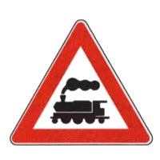
- **19069** — In presenza del segnale raffigurato è necessario usare la massima prudenza → **✅ VERO**
   
- **19073** — In presenza del segnale raffigurato è necessario rallentare esclusivamente in caso di nebbia → **❌ FALSO**
   
- **19076** — In presenza del segnale raffigurato è obbligatorio usare il segnalatore acustico (clacson) prima di attraversare i binari → **❌ FALSO**
   
- **19078** — Il segnale raffigurato indica che la sede ferroviaria ha un solo binario → **✅ VERO**
   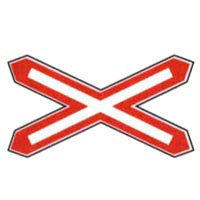
- **19079** — Il segnale raffigurato è posto nelle immediate vicinanze di un attraversamento ferroviario senza barriere → **✅ VERO**
   
- **19081** — Il segnale raffigurato è posto sulla strada dopo il segnale PASSAGGIO A LIVELLO SENZA BARRIERE → **✅ VERO**
   
- **19087** — Il segnale raffigurato è installato in prossimità di un passaggio a livello con semibarriere → **❌ FALSO**
   
- **19089** — Il segnale raffigurato è integrato da una luce verde ed una rossa fissa → **❌ FALSO**
   
- **19090** — Il segnale raffigurato si trova, di norma, a 150 metri dai binari → **❌ FALSO**
   
- **19091** — Il segnale raffigurato impone di arrestarsi entro la striscia di arresto, se è in arrivo il treno. → **✅ VERO**
   
- **19092** — Il segnale raffigurato è posto nelle immediate vicinanze di un attraversamento ferroviario a livello senza barriere → **✅ VERO**
   
- **19093** — Il segnale raffigurato indica che la linea ferroviaria ha più di un binario → **✅ VERO**
   
- **19098** — Il segnale raffigurato è posto, di norma, a 150 metri dai binari → **❌ FALSO**
   
- **19100** — Il segnale raffigurato preannuncia un doppio incrocio stradale pericoloso → **❌ FALSO**
   
- **19102** — Il segnale raffigurato può essere posto prima di un attraversamento ferroviario con semibarriere → **❌ FALSO**
   
- **19131** — In presenza del segnale raffigurato si può sorpassare a destra il tram in marcia se vi è lo spazio necessario → **✅ VERO**
   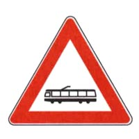
- **19132** — In presenza del segnale raffigurato si può circolare sui binari senza intralciare la marcia del tram → **✅ VERO**
   
- **19133** — In presenza del segnale raffigurato si può sorpassare a destra il tram fermo al centro della strada per la salita e discesa dei passeggeri, solo se esiste l'apposito salvagente → **✅ VERO**
   
- **19138** — In presenza del segnale raffigurato il sorpasso dei tram è vietato esclusivamente ai motocicli → **❌ FALSO**
   
- **19139** — In presenza del segnale raffigurato è vietata la marcia sopra i binari del tram → **❌ FALSO**
   
- **19140** — In presenza del segnale raffigurato il sorpasso del tram è consentito solo a sinistra → **❌ FALSO**
   
- **19145** — Il segnale raffigurato preannuncia un attraversamento pedonale → **✅ VERO**
   
- **19146** — In presenza del segnale raffigurato, il conducente deve dare la precedenza ai pedoni che attraversano sulle strisce → **✅ VERO**
   
- **19149** — Il segnale raffigurato comporta il divieto di sorpassare un veicolo che si sia arrestato per far attraversare i pedoni → **✅ VERO**
   
- **19151** — Il segnale raffigurato preannuncia un viale pedonale → **❌ FALSO**
   
- **19152** — Il segnale raffigurato impone di usare i dispositivi di segnalazione acustica per far spostare i pedoni → **❌ FALSO**
   
- **19153** — Il segnale raffigurato consente la fermata dei veicoli sull'attraversamento pedonale, purché rimanga spazio sufficiente per i pedoni → **❌ FALSO**
   
- **19156** — In presenza del segnale raffigurato non è consentito sorpassare i veicoli che rallentano per far attraversare i pedoni → **✅ VERO**
   
- **19157** — In presenza del segnale raffigurato bisogna rallentare per essere pronti ad arrestarsi se ci sono pedoni che attraversano la carreggiata → **✅ VERO**
   
- **19159** — In presenza del segnale raffigurato non si deve effettuare sosta o fermata sopra le strisce pedonali → **✅ VERO**
   
- **19161** — In presenza del segnale raffigurato è obbligatorio suonare il clacson se vi sono pedoni che attraversano sulle strisce pedonali → **❌ FALSO**
   
- **19163** — In presenza del segnale raffigurato i pedoni devono dare la precedenza ai veicoli → **❌ FALSO**
   
- **19164** — In presenza del segnale raffigurato non è obbligatorio dare la precedenza ai pedoni che attraversano sulle strisce pedonali → **❌ FALSO**
   
- **19181** — In presenza del segnale raffigurato bisogna comportarsi in modo da non costituire pericolo o intralcio per i ciclisti → **✅ VERO**
   
- **19182** — In presenza del segnale raffigurato bisogna rallentare ed essere pronti ad arrestarsi, se necessario, per dare la precedenza ai ciclisti che attraversano → **✅ VERO**
   
- **19183** — In presenza del segnale raffigurato non è consentito sorpassare i veicoli che si sono arrestati per far attraversare la carreggiata ai ciclisti → **✅ VERO**
   
- **19184** — In presenza del segnale raffigurato si deve suonare il clacson se vi sono ciclisti che stanno attraversando sulle strisce → **❌ FALSO**
   
- **19185** — In presenza del segnale raffigurato è necessario tenere presente che i ciclisti devono dare la precedenza ai veicoli → **❌ FALSO**
   
- **19186** — In presenza del segnale raffigurato bisogna dare la precedenza solo ai ciclisti che attraversano da destra → **❌ FALSO**
   
- **19201** — In presenza del segnale raffigurato si deve moderare la velocità per evitare di tamponare veicoli che procedono più lentamente → **✅ VERO**
   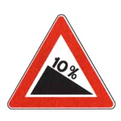
- **19202** — In presenza del segnale raffigurato bisogna evitare l'uso prolungato dei freni per non surriscaldarli → **✅ VERO**
   
- **19204** — In presenza del segnale raffigurato bisogna usare molta prudenza se la strada è bagnata → **✅ VERO**
   
- **19205** — In presenza del segnale raffigurato si deve rallentare usando continuamente i freni per non danneggiare il cambio di velocità → **❌ FALSO**
   
- **19207** — In presenza del segnale raffigurato bisogna marciare con la frizione abbassata → **❌ FALSO**
   
- **19208** — In presenza del segnale raffigurato il conducente deve diminuire la distanza di sicurezza dal veicolo che lo precede → **❌ FALSO**
   
- **19210** — Il segnale raffigurato preannuncia una salita da percorrere con prudenza → **✅ VERO**
   
- **19211** — Il segnale raffigurato preannuncia un tratto di strada da percorrere con marcia adeguatamente bassa → **✅ VERO**
   
- **19215** — Il segnale raffigurato preannuncia un tratto di strada pericoloso per curve strette → **❌ FALSO**
   
- **19216** — Il segnale raffigurato preannuncia una discesa e ne specifica la pendenza → **❌ FALSO**
   
- **19218** — Il segnale raffigurato preannuncia una strettoia con probabili difficoltà di incrocio con i veicoli provenienti dal senso opposto → **✅ VERO**
   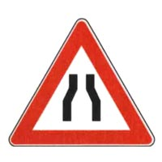
- **19219** — Il segnale raffigurato preannuncia un restringimento sui due lati della carreggiata → **✅ VERO**
   
- **19224** — Il segnale raffigurato comporta di moderare la velocità → **✅ VERO**
   
- **19225** — Il segnale raffigurato preannuncia un senso unico alternato con l'obbligo di dare la precedenza ai veicoli provenienti dall'altro senso → **❌ FALSO**
   
- **19226** — Il segnale raffigurato preannuncia che i veicoli provenienti dall'altro senso devono darci la precedenza → **❌ FALSO**
   
- **19229** — Il segnale raffigurato preannuncia l'ingresso di una galleria → **❌ FALSO**
   
- **19272** — Il segnale raffigurato preannuncia un tratto di strada che può diventare pericoloso in particolari condizioni climatiche specificate nei pannelli integrativi → **✅ VERO**
   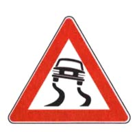
- **19276** — Il segnale raffigurato preannuncia un tratto di strada sul quale può diminuire l'aderenza degli pneumatici → **✅ VERO**
   
- **19277** — Il segnale raffigurato comporta di procedere a velocità moderata e di evitare brusche manovre → **✅ VERO**
   
- **19279** — Il segnale raffigurato preannuncia la possibilità di sbandamento per forte vento laterale → **❌ FALSO**
   
- **19281** — Il segnale raffigurato preannuncia che su quella strada diminuisce lo spazio di frenatura → **❌ FALSO**
   
- **19283** — Il segnale raffigurato preannuncia una strada con molte curve → **❌ FALSO**
   
- **19285** — In presenza del segnale raffigurato è necessario moderare la velocità ed evitare brusche frenate in caso di pioggia → **✅ VERO**
   
- **19286** — In presenza del segnale raffigurato è necessario moderare la velocità ed evitare brusche accelerate in caso di ghiaccio → **✅ VERO**
   
- **19290** — In presenza del segnale raffigurato è necessario diminuire la distanza dal veicolo che ci precede, in caso di pioggia → **❌ FALSO**
   
- **19295** — In presenza del segnale raffigurato è necessario montare le catene → **❌ FALSO**
   
- **19310** — In presenza del segnale raffigurato occorre prestare particolare attenzione per la possibile presenza di bambini → **✅ VERO**
   
- **19312** — In presenza del segnale raffigurato occorre prestare particolare attenzione ai movimenti imprevedibili dei bambini → **✅ VERO**
   
- **19313** — In presenza del segnale raffigurato è vietato sorpassare i veicoli che si sono fermati per lasciare attraversare i bambini → **✅ VERO**
   
- **19314** — In presenza del segnale raffigurato è necessario fare attenzione ai bambini sulla carreggiata e non a quelli sul marciapiede → **❌ FALSO**
   
- **19315** — In presenza del segnale raffigurato è vietato transitare durante l'orario di uscita dei bambini da scuola → **❌ FALSO**
   
- **19316** — In presenza del segnale raffigurato è vietato superare la velocità di 30 km/h → **❌ FALSO**
   
- **19339** — Il segnale raffigurato preannuncia che una carreggiata a senso unico, diventa a doppio senso di circolazione → **✅ VERO**
   
- **19340** — Il segnale raffigurato preannuncia che, poco oltre, si potranno incontrare veicoli che marciano in senso opposto → **✅ VERO**
   
- **19345** — In presenza del segnale raffigurato il sorpasso, se consentito, deve essere effettuato con particolare prudenza → **✅ VERO**
   
- **19347** — Il segnale raffigurato preannuncia che la circolazione diventa a senso unico → **❌ FALSO**
   
- **19348** — Il segnale raffigurato impone di dare la precedenza ai veicoli provenienti in senso contrario → **❌ FALSO**
   
- **19351** — Il segnale raffigurato preannuncia un senso unico alternato → **❌ FALSO**
   
- **19370** — Il segnale raffigurato preannuncia un tratto di strada sul quale l'aderenza del veicolo può diminuire → **✅ VERO**
   
- **19371** — Il segnale raffigurato richiede di procedere con cautela in presenza di pedoni, anche se si trovano fuori dalla carreggiata → **✅ VERO**
   
- **19376** — In presenza del segnale raffigurato occorre considerare il pericolo di sbandamento o di slittamento → **✅ VERO**
   
- **19380** — Il segnale raffigurato preannuncia un tratto di strada soggetto a frana → **❌ FALSO**
   
- **19382** — Il segnale raffigurato preannuncia la presenza di banchine cedevoli → **❌ FALSO**
   
- **19383** — Il segnale raffigurato preannuncia un tratto di strada ove esiste il pericolo di caduta di massi → **❌ FALSO**
   
- **19395** — Il segnale raffigurato preannuncia il pericolo di caduta di massi da destra → **✅ VERO**
   
- **19396** — Il segnale raffigurato preannuncia un tratto di strada ove esiste il pericolo di presenza di pietre sulla carreggiata → **✅ VERO**
   
- **19398** — In presenza del segnale raffigurato è opportuno moderare la velocità per evitare di urtare eventuali massi caduti sulla carreggiata → **✅ VERO**
   
- **19401** — Il segnale raffigurato preannuncia una strettoia a destra → **❌ FALSO**
   
- **19402** — Il segnale raffigurato preannuncia un tratto di strada non asfaltato → **❌ FALSO**
   
- **19404** — Il segnale raffigurato preannuncia un tratto di strada dove non si può circolare ad oltre 30 km/h → **❌ FALSO**
   
- **19406** — Il segnale raffigurato preannuncia un semaforo → **✅ VERO**
   
- **19409** — In presenza del segnale raffigurato bisogna moderare la velocità per potersi all'occorrenza fermare → **✅ VERO**
   
- **19412** — Il segnale raffigurato è obbligatorio sulle strade extraurbane → **✅ VERO**
   
- **19415** — Il segnale raffigurato preannuncia un attraversamento ferroviario senza barriere → **❌ FALSO**
   
- **19417** — Il segnale raffigurato preannuncia un senso unico alternato → **❌ FALSO**
   
- **19418** — Il segnale raffigurato preannuncia la presenza di un ponte mobile → **❌ FALSO**
   
- **19442** — Il segnale raffigurato preannuncia un pericolo che, in caso di forte vento laterale, è maggiore per i veicoli che trainano rimorchi → **✅ VERO**
   
- **19443** — Il segnale raffigurato preannuncia, in caso di forte vento laterale, un pericolo che è maggiore per i veicoli a due ruote → **✅ VERO**
   
- **19444** — Il segnale raffigurato preannuncia, in caso di forte vento laterale, un pericolo che è maggiore per i veicoli che trainano caravan → **✅ VERO**
   
- **19449** — Il segnale raffigurato preannuncia, in caso di forte vento laterale, un pericolo maggiore all'entrata delle gallerie per i veicoli stretti e alti → **❌ FALSO**
   
- **19450** — Il segnale raffigurato preannuncia una zona dove, in caso di forte vento laterale, i veicoli con rimorchio hanno maggiore tenuta di strada → **❌ FALSO**
   
- **19452** — Il segnale raffigurato preannuncia, in caso di forte vento laterale, un pericolo che è minore per i veicoli con carichi voluminosi sopra il tetto → **❌ FALSO**
   
- **19468** — Il segnale raffigurato preannuncia un incrocio di due o più strade extraurbane regolato con circolazione rotatoria → **✅ VERO**
   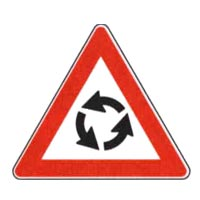
- **19469** — Il segnale raffigurato preannuncia un incrocio di più strade regolato con circolazione nel senso indicato dalle frecce → **✅ VERO**
   
- **19470** — Il segnale raffigurato può essere usato anche nei centri abitati → **✅ VERO**
   
- **19471** — Il segnale raffigurato vieta la svolta a destra al primo incrocio → **❌ FALSO**
   
- **19472** — Il segnale raffigurato preannuncia una strada senza uscita, per cui bisogna tornare indietro → **❌ FALSO**
   
- **19473** — Il segnale raffigurato preannuncia una svolta a sinistra obbligatoria → **❌ FALSO**
   
- **19474** — Il segnale raffigurato preannuncia un pericolo diverso da quelli per cui sono previsti specifici segnali → **✅ VERO**
   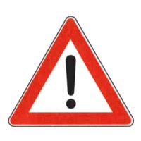
- **19475** — Il segnale raffigurato preannuncia che bisogna usare prudenza perché è vicino un pericolo → **✅ VERO**
   
- **19480** — Il segnale raffigurato preannuncia un tratto di strada in cattivo stato o con pavimentazione irregolare → **❌ FALSO**
   
- **19481** — Il segnale raffigurato preannuncia che bisogna proseguire diritto → **❌ FALSO**
   

## 2. Segnali di divieto

- **19512** — Il segnale raffigurato vieta la circolazione nei due sensi → **✅ VERO**
   
- **19513** — Il segnale raffigurato vieta il transito a tutti i veicoli → **✅ VERO**
   
- **19515** — Il segnale raffigurato è posto su entrambi gli accessi della strada → **✅ VERO**
   
- **19521** — Il segnale raffigurato consente il transito alle biciclette → **❌ FALSO**
   
- **19524** — Il segnale raffigurato non consente l'ingresso, ma solo l'uscita dalla strada → **❌ FALSO**
   
- **19525** — Il segnale raffigurato indica che la circolazione è a senso unico → **❌ FALSO**
   
- **19533** — Il divieto imposto dal segnale raffigurato deve essere rispettato anche nelle ore notturne → **✅ VERO**
   
- **19534** — Il segnale raffigurato è posto su una strada a senso unico → **✅ VERO**
   
- **19535** — Il segnale raffigurato è un SENSO VIETATO → **✅ VERO**
   
- **19536** — Il segnale raffigurato consente l'accesso ai motocicli → **❌ FALSO**
   
- **19537** — Il segnale raffigurato consente l'accesso ai ciclomotori → **❌ FALSO**
   
- **19541** — Il segnale raffigurato vieta il sorpasso → **❌ FALSO**
   
- **19545** — Il segnale raffigurato consente ad un'autovettura di sorpassare un motociclo → **✅ VERO**
   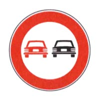
- **19546** — Il segnale raffigurato si può trovare sia sulle strade urbane che su quelle extraurbane → **✅ VERO**
   
- **19550** — Il segnale raffigurato vieta il sorpasso fra autoveicoli, anche se la manovra può compiersi entro la semicarreggiata → **✅ VERO**
   
- **19551** — Il segnale raffigurato consente ad un motociclo di sorpassare un'autovettura → **❌ FALSO**
   
- **19553** — Il segnale raffigurato consente di sorpassare un'autovettura purché non si oltrepassi la striscia continua → **❌ FALSO**
   
- **19555** — Il segnale raffigurato consente il sorpasso tra autovetture se non vi è la striscia bianca continua → **❌ FALSO**
   
- **19582** — Il segnale raffigurato vieta ad un veicolo di circolare a meno di 70 metri da quello che lo precede → **✅ VERO**
   
- **19583** — Il segnale raffigurato vale anche per i motocicli → **✅ VERO**
   
- **19584** — Il segnale raffigurato deve essere rispettato anche quando si viaggia a bassa velocità → **✅ VERO**
   
- **19589** — Il segnale raffigurato preavvisa che a 70 metri inizia il divieto di transito per le autovetture → **❌ FALSO**
   
- **19590** — In presenza del segnale raffigurato le autovetture non possono superare la velocità di 70 km/h → **❌ FALSO**
   
- **19591** — Il segnale raffigurato indica la lunghezza massima del cavo di traino → **❌ FALSO**
   
- **19593** — In presenza del segnale raffigurato è vietato superare la velocità di 80 km/h → **✅ VERO**
   
- **19594** — Il segnale raffigurato può trovarsi anche sulle autostrade → **✅ VERO**
   
- **19595** — Il limite di velocità indicato sul segnale raffigurato ha validità immediatamente dopo il segnale stesso → **✅ VERO**
   
- **19598** — Il segnale raffigurato impone di mantenere una distanza di sicurezza di almeno 80 metri → **❌ FALSO**
   
- **19600** — Il segnale raffigurato indica la velocità consigliata → **❌ FALSO**
   
- **19601** — Il segnale raffigurato permette di effettuare il sorpasso a velocità superiore a 80 km/h → **❌ FALSO**
   
- **19605** — Il segnale raffigurato vieta ai veicoli di superare la velocità indicata → **✅ VERO**
   
- **19606** — Il segnale raffigurato obbliga a rispettare un limite massimo di velocità → **✅ VERO**
   
- **19607** — Il segnale raffigurato indica la velocità massima alla quale i veicoli possono procedere → **✅ VERO**
   
- **19611** — Il segnale raffigurato indica un limite di velocità valido solo per autoveicoli → **❌ FALSO**
   
- **19614** — Il limite di velocità indicato dal segnale raffigurato entra in vigore 150 metri dopo il segnale stesso → **❌ FALSO**
   
- **19616** — Il segnale raffigurato indica un limite di velocità valido dalle ore 8.00 alle ore 20.00 → **❌ FALSO**
   
- **19617** — Il segnale raffigurato vieta l'uso del clacson → **✅ VERO**
   
- **19618** — Il segnale raffigurato vieta le segnalazioni acustiche → **✅ VERO**
   
- **19622** — Il segnale raffigurato consente l'uso del clacson per richiamare l'attenzione in qualsiasi circostanza → **❌ FALSO**
   
- **19626** — Il segnale raffigurato consente l'uso del clacson nei casi di ingorgo stradale → **❌ FALSO**
   
- **19627** — Il segnale raffigurato indica la fine del divieto di segnalazioni acustiche → **❌ FALSO**
   
- **19656** — Il segnale raffigurato vieta il transito ai pedoni → **✅ VERO**
   
- **19657** — Il segnale raffigurato consente il transito agli autoveicoli → **✅ VERO**
   
- **19658** — Il segnale raffigurato consente il transito ai motocicli → **✅ VERO**
   
- **19661** — Il segnale raffigurato vieta il transito ai ciclomotori → **❌ FALSO**
   
- **19663** — Il segnale raffigurato indica un'area urbana riservata a parco giochi e divertimenti → **❌ FALSO**
   
- **19665** — Il segnale raffigurato indica l'inizio di un percorso pedonale → **❌ FALSO**
   
- **19679** — Il segnale raffigurato vieta il transito ai motocicli → **✅ VERO**
   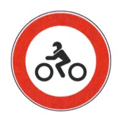
- **19681** — Il segnale raffigurato consente il transito alle autovetture → **✅ VERO**
   
- **19683** — Il segnale raffigurato vieta il transito ai motocicli di qualsiasi cilindrata → **✅ VERO**
   
- **19684** — Il segnale raffigurato consente il transito ai motocicli → **❌ FALSO**
   
- **19686** — Il segnale raffigurato si riferisce ai soli motocicli di cilindrata superiore ai 125 cm3 → **❌ FALSO**
   
- **19691** — Il segnale raffigurato obbliga i motociclisti a servirsi della pista loro riservata → **❌ FALSO**
   
- **19703** — Il segnale raffigurato vieta il transito a tutti gli autoveicoli → **✅ VERO**
   
- **19705** — In presenza del segnale raffigurato è permesso il transito ai motocicli → **✅ VERO**
   
- **19706** — In presenza del segnale raffigurato è permesso il transito ai ciclomotori a due ruote → **✅ VERO**
   
- **19711** — In presenza del segnale raffigurato è consentito il transito alle autovetture adibite al servizio di taxi → **❌ FALSO**
   
- **19713** — In presenza del segnale raffigurato è consentito il transito agli autobus → **❌ FALSO**
   
- **19714** — In presenza del segnale raffigurato è consentito il transito agli autocarri → **❌ FALSO**
   
- **19795** — Il segnale raffigurato può trovarsi prima di una strettoia → **✅ VERO**
   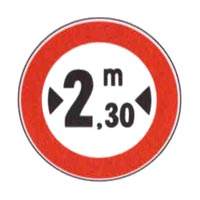
- **19797** — Il segnale raffigurato indica la larghezza massima dei veicoli ammessi al transito → **✅ VERO**
   
- **19799** — Il segnale raffigurato si riferisce a tutti i veicoli di larghezza superiore a 2,30 metri → **✅ VERO**
   
- **19801** — In presenza del segnale raffigurato i veicoli a trazione animale larghi più di 2,30 m possono transitare → **❌ FALSO**
   
- **19802** — Il segnale raffigurato è un divieto che non riguarda gli autobus → **❌ FALSO**
   
- **19803** — Il segnale raffigurato indica la larghezza di una strettoia → **❌ FALSO**
   
- **19806** — Il segnale raffigurato indica l'altezza massima, misurata dal piano stradale, dei veicoli che possono transitare → **✅ VERO**
   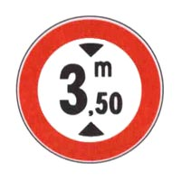
- **19807** — Il segnale raffigurato vieta il transito degli autoveicoli con altezza, comprensiva del carico, superiore a 3,50 metri → **✅ VERO**
   
- **19811** — Il segnale raffigurato può trovarsi in un punto in cui la strada passa sotto un ponte → **✅ VERO**
   
- **19812** — Il segnale raffigurato vieta il transito degli autoveicoli di lunghezza superiore a 3,50 metri → **❌ FALSO**
   
- **19815** — Il segnale raffigurato indica che possono passare gli autocarri con carico alto 3,50 metri dal piano del cassone → **❌ FALSO**
   
- **19816** — Il segnale raffigurato indica la distanza di sicurezza da tenere dal veicolo che precede → **❌ FALSO**
   
- **19817** — Il segnale raffigurato vieta il transito a tutti i veicoli di lunghezza complessiva superiore a 10 metri → **✅ VERO**
   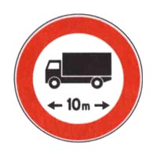
- **19819** — Il segnale raffigurato vieta il transito a veicoli di lunghezza superiore a quella indicata → **✅ VERO**
   
- **19822** — Il segnale raffigurato deve essere rispettato anche dai conducenti di complessi di veicoli → **✅ VERO**
   
- **19823** — Il segnale raffigurato deve essere rispettato solo dai conducenti di veicoli adibiti al trasporto di cose → **❌ FALSO**
   
- **19824** — Il segnale raffigurato obbliga un veicolo a distanziare quello che lo segue di almeno 10 metri → **❌ FALSO**
   
- **19826** — Il segnale raffigurato impone il distanziamento minimo tra autocarri per consentire alle autovetture di sorpassarli → **❌ FALSO**
   
- **19850** — Il segnale raffigurato indica la fine delle prescrizioni precedentemente imposte → **✅ VERO**
   
- **19852** — Il segnale raffigurato è un segnale di via libera → **✅ VERO**
   
- **19854** — Il segnale raffigurato indica il punto dal quale le prescrizioni precedentemente indicate non sono più valide → **✅ VERO**
   
- **19856** — Il segnale raffigurato riguarda soltanto i veicoli in servizio pubblico → **❌ FALSO**
   
- **19858** — Il segnale raffigurato indica la fine di un centro abitato → **❌ FALSO**
   
- **19859** — Il segnale raffigurato indica la fine del pericolo precedentemente segnalato → **❌ FALSO**
   
- **19861** — Il segnale raffigurato indica la fine del limite massimo di velocità → **✅ VERO**
   
- **19862** — Il segnale raffigurato consente di circolare a velocità superiore a 50 km/h → **✅ VERO**
   
- **19864** — Il segnale raffigurato consente di marciare anche a velocità inferiore a 50 km/h → **✅ VERO**
   
- **19866** — Il segnale raffigurato indica il limite di velocità per tutti i veicoli → **❌ FALSO**
   
- **19867** — Il segnale raffigurato vieta di superare la velocità di 50 km/h → **❌ FALSO**
   
- **19869** — Il segnale raffigurato indica la fine dell'obbligo di mantenere una distanza di sicurezza di almeno 50 metri → **❌ FALSO**
   
- **19872** — Il segnale raffigurato indica la fine del divieto di sorpasso precedentemente imposto → **✅ VERO**
   
- **19874** — Il segnale raffigurato indica il punto in cui termina il divieto di sorpasso → **✅ VERO**
   
- **19876** — Il segnale raffigurato può essere posto sia nei centri urbani che fuori → **✅ VERO**
   
- **19882** — Il segnale raffigurato indica la fine del limite massimo di velocità → **❌ FALSO**
   
- **19884** — Il segnale raffigurato indica che è finito l'obbligo di mantenere la distanza di sicurezza → **❌ FALSO**
   
- **19885** — Il segnale raffigurato indica la fine del divieto di sosta in seconda fila → **❌ FALSO**
   
- **19896** — Il segnale raffigurato è posto nei luoghi dove la sosta è vietata → **✅ VERO**
   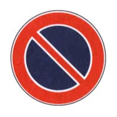
- **19897** — Il segnale raffigurato vieta la sosta sulle strade urbane dalle ore 8.00 alle ore 20.00, salvo diversa indicazione → **✅ VERO**
   
- **19898** — Il segnale raffigurato può essere integrato da pannelli per indicarne l'inizio, il proseguimento o la fine → **✅ VERO**
   
- **19905** — Il segnale raffigurato preannuncia un divieto di fermata → **❌ FALSO**
   
- **19906** — Il segnale raffigurato non vale per i motocicli ed i ciclomotori → **❌ FALSO**
   
- **19907** — In presenza del segnale raffigurato è sempre prevista la rimozione forzata del veicolo → **❌ FALSO**
   
- **19911** — Il segnale raffigurato vieta la sosta, ma non la fermata → **✅ VERO**
   
- **19912** — Il segnale raffigurato contraddistingue le aree dove è proibito lasciare in sosta un veicolo → **✅ VERO**
   
- **19916** — Il segnale raffigurato vieta la sosta sul lato della strada dove è posto → **✅ VERO**
   
- **19920** — Il segnale raffigurato, nelle strade extraurbane, consente la sosta dopo le ore 20.00 → **❌ FALSO**
   
- **19921** — Il segnale raffigurato consente la sosta soltanto ai veicoli a due ruote → **❌ FALSO**
   
- **19922** — Il segnale raffigurato consente la sosta ai quadricicli a motore → **❌ FALSO**
   
- **19939** — Il segnale raffigurato vieta la temporanea sospensione della marcia del veicolo → **✅ VERO**
   
- **19940** — Il segnale raffigurato vieta la fermata volontaria di tutti i veicoli → **✅ VERO**
   
- **19941** — Lungo le strade dove è posto, il segnale raffigurato vale 24 ore su 24 → **✅ VERO**
   
- **19942** — Il segnale raffigurato vieta la sosta, ma consente la fermata → **❌ FALSO**
   
- **19944** — Il segnale raffigurato consente la fermata per far salire o scendere passeggeri → **❌ FALSO**
   
- **19945** — Il segnale raffigurato consente la fermata se il veicolo non arreca intralcio alla circolazione → **❌ FALSO**
   
- **19946** — Il segnale raffigurato vieta la sosta sia di giorno che di notte, anche nei centri abitati → **✅ VERO**
   
- **19947** — Il segnale raffigurato vieta la fermata a tutti i veicoli → **✅ VERO**
   
- **19948** — Il segnale raffigurato, in assenza di iscrizioni integrative, vige per tutto l'arco delle ventiquattro ore → **✅ VERO**
   
- **19953** — Il segnale raffigurato vieta la fermata, ma consente la sosta → **❌ FALSO**
   
- **19957** — Il segnale raffigurato vale solo nei giorni feriali, salvo diversa indicazione → **❌ FALSO**
   
- **19958** — Il segnale raffigurato consente la fermata del veicolo per la salita e la discesa dei passeggeri → **❌ FALSO**
   
- **19982** — Il segnale raffigurato vieta la sosta nel luogo dove è posto → **✅ VERO**
   
- **19984** — Il segnale raffigurato indica lo sbocco di un passo carrabile → **✅ VERO**
   
- **19985** — Il segnale raffigurato consente la fermata, purché il veicolo non sia di intralcio → **✅ VERO**
   
- **19987** — Il segnale raffigurato è posto soltanto nelle strade urbane → **❌ FALSO**
   
- **19988** — Il segnale raffigurato vale solo nelle ore diurne → **❌ FALSO**
   
- **19989** — Il segnale raffigurato vale solo nelle ore notturne → **❌ FALSO**
   
- **19992** — Il segnale raffigurato consente la sosta ai veicoli al servizio di persone invalide munite dell'apposito contrassegno → **✅ VERO**
   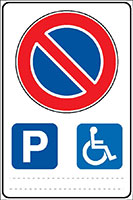
- **19994** — Il segnale raffigurato rappresenta una specifica eccezione al divieto di sosta → **✅ VERO**
   
- **19995** — Il segnale raffigurato non consente la sosta a veicoli diversi da quelli al servizio di persone invalide → **✅ VERO**
   
- **19996** — Il segnale raffigurato consente la sosta agli scuolabus → **❌ FALSO**
   
- **19997** — Il segnale raffigurato indica una corsia riservata ai veicoli al servizio di persone invalide → **❌ FALSO**
   
- **19999** — Il segnale raffigurato preavvisa una zona vietata al traffico regolare perché attrezzata per persone invalide → **❌ FALSO**
   
- **20003** — Il segnale raffigurato rappresenta una regolazione della sosta → **✅ VERO**
   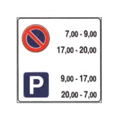
- **20005** — Il segnale raffigurato vieta la sosta dalle ore 17.00 alle 20.00 → **✅ VERO**
   
- **20006** — Il segnale raffigurato consente la sosta in alcune ore e la vieta in altre → **✅ VERO**
   
- **20009** — Il segnale raffigurato, nei centri abitati, consente la sosta dalle ore 20.00 alle 8.00 → **❌ FALSO**
   
- **20011** — Il segnale raffigurato vieta la fermata del veicolo tra le ore 17.00 e le 20.00 → **❌ FALSO**
   
- **20012** — Il segnale raffigurato consente il parcheggio dalle ore 7.00 alle 9.00 → **❌ FALSO**
   

## 3. Segnali di obbligo

- **20033** — Il segnale raffigurato preannuncia che non è consentito proseguire diritto → **✅ VERO**
   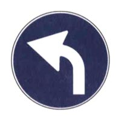
- **20035** — Il segnale raffigurato è posto prima di un incrocio → **✅ VERO**
   
- **20036** — Il segnale raffigurato precede un segnale di DIREZIONE OBBLIGATORIA A SINISTRA → **✅ VERO**
   
- **20041** — Il segnale raffigurato indica che è obbligatorio passare a sinistra dell'ostacolo → **❌ FALSO**
   
- **20043** — Il segnale raffigurato indica l'obbligo di cambiare corsia → **❌ FALSO**
   
- **20044** — Il segnale raffigurato presegnala una curva pericolosa a sinistra → **❌ FALSO**
   
- **20045** — Il segnale raffigurato indica l'obbligo di proseguire diritto → **✅ VERO**
   
- **20046** — Il segnale raffigurato non consente la svolta a sinistra → **✅ VERO**
   
- **20048** — Il segnale raffigurato, in corrispondenza di un incrocio, non consente la svolta a destra o a sinistra → **✅ VERO**
   
- **20054** — Il segnale raffigurato consente di svoltare a destra o a sinistra → **❌ FALSO**
   
- **20055** — Il segnale raffigurato consente di svoltare all'incrocio → **❌ FALSO**
   
- **20062** — Il segnale raffigurato preannuncia una direzione consigliata → **❌ FALSO**
   
- **20066** — Il segnale raffigurato indica l'obbligo di svoltare a sinistra → **✅ VERO**
   
- **20067** — Il segnale raffigurato non consente di svoltare a destra → **✅ VERO**
   
- **20070** — Il segnale raffigurato indica l'unica direzione consentita → **✅ VERO**
   
- **20074** — Il segnale raffigurato consente di andare diritto all'incrocio → **❌ FALSO**
   
- **20075** — Il segnale raffigurato consente di svoltare a destra all'incrocio → **❌ FALSO**
   
- **20078** — Il segnale raffigurato indica che è obbligatorio passare a sinistra di un ostacolo posto sulla carreggiata → **❌ FALSO**
   
- **20090** — Il segnale raffigurato indica l'obbligo di svoltare a destra → **✅ VERO**
   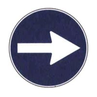
- **20091** — Il segnale raffigurato non consente di svoltare a sinistra → **✅ VERO**
   
- **20092** — Il segnale raffigurato, in corrispondenza di un incrocio, obbliga a svoltare a destra → **✅ VERO**
   
- **20098** — Il segnale raffigurato indica che è pericoloso svoltare a destra → **❌ FALSO**
   
- **20099** — Il segnale raffigurato prescrive di proseguire diritto → **❌ FALSO**
   
- **20100** — Il segnale raffigurato indica l'inizio del senso unico di circolazione nella svolta a destra → **❌ FALSO**
   
- **20134** — Il segnale raffigurato precede il segnale di DIREZIONE OBBLIGATORIA A DESTRA → **✅ VERO**
   
- **20135** — Il segnale raffigurato preannuncia che non è consentito proseguire diritto → **✅ VERO**
   
- **20136** — Il segnale raffigurato preannuncia che non è consentito svoltare a sinistra → **✅ VERO**
   
- **20140** — Il segnale raffigurato obbliga a svoltare subito a destra → **❌ FALSO**
   
- **20142** — Il segnale raffigurato indica che è obbligatorio passare a destra dell'ostacolo → **❌ FALSO**
   
- **20143** — Il segnale raffigurato preannuncia l'obbligo di svoltare a sinistra → **❌ FALSO**
   
- **20144** — Il segnale raffigurato è preavviso dell'obbligo di svoltare a sinistra → **✅ VERO**
   
- **20145** — Il segnale raffigurato precede un incrocio in cui non è consentito proseguire diritto o girare a destra → **✅ VERO**
   
- **20146** — Il segnale raffigurato preannuncia l'obbligo di svoltare a sinistra al prossimo incrocio → **✅ VERO**
   
- **20151** — Il segnale raffigurato indica che non è consentito svoltare a sinistra al prossimo incrocio → **❌ FALSO**
   
- **20152** — Il segnale raffigurato obbliga ad andare diritto o a svoltare a sinistra → **❌ FALSO**
   
- **20153** — Il segnale raffigurato preannuncia di andare diritto ma non di svoltare a destra → **❌ FALSO**
   
- **20158** — Il segnale raffigurato indica le direzioni consentite a destra e a sinistra → **✅ VERO**
   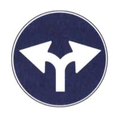
- **20159** — Il segnale raffigurato obbliga a svoltare a destra o a sinistra al prossimo incrocio → **✅ VERO**
   
- **20160** — Il segnale raffigurato indica che non è consentito proseguire diritto all'incrocio → **✅ VERO**
   
- **20166** — Il segnale raffigurato indica che il sorpasso è consentito sia a destra che a sinistra → **❌ FALSO**
   
- **20168** — Il segnale raffigurato indica la facoltà di passare a destra o a sinistra di un'isola spartitraffico → **❌ FALSO**
   
- **20169** — Il segnale raffigurato indica passaggio consentito alla destra ed alla sinistra di un ostacolo → **❌ FALSO**
   
- **20181** — Il segnale raffigurato obbliga a proseguire diritto o svoltare a destra all'incrocio → **✅ VERO**
   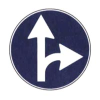
- **20183** — Il segnale raffigurato non consente la svolta a sinistra all'incrocio → **✅ VERO**
   
- **20185** — Il segnale raffigurato indica le uniche direzioni consentite → **✅ VERO**
   
- **20188** — Il segnale raffigurato consente solo di proseguire diritto → **❌ FALSO**
   
- **20189** — Il segnale raffigurato indica che è consentito soltanto svoltare a destra → **❌ FALSO**
   
- **20190** — Il segnale raffigurato obbliga a passare a destra di un cantiere stradale → **❌ FALSO**
   
- **20215** — Il segnale raffigurato indica che è consentito proseguire diritto → **✅ VERO**
   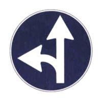
- **20216** — Il segnale raffigurato indica che è consentito svoltare a sinistra → **✅ VERO**
   
- **20217** — Il segnale raffigurato indica che si può scegliere fra le due direzioni consentite → **✅ VERO**
   
- **20218** — Il segnale raffigurato indica che si deve dare la precedenza a destra → **❌ FALSO**
   
- **20219** — Il segnale raffigurato indica che è obbligatorio proseguire solo diritto → **❌ FALSO**
   
- **20220** — Il segnale raffigurato indica che è obbligatorio svoltare unicamente a sinistra → **❌ FALSO**
   
- **20224** — Il segnale raffigurato obbliga i conducenti a passare a sinistra di un ostacolo → **✅ VERO**
   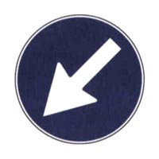
- **20225** — Il segnale raffigurato obbliga i conducenti a passare a sinistra di un'isola di traffico → **✅ VERO**
   
- **20226** — Il segnale raffigurato obbliga i conducenti a passare a sinistra di un salvagente → **✅ VERO**
   
- **20231** — Il segnale raffigurato obbliga i conducenti a svoltare a sinistra → **❌ FALSO**
   
- **20232** — Il segnale raffigurato preannuncia l'obbligo di svoltare a sinistra → **❌ FALSO**
   
- **20233** — Il segnale raffigurato indica che è obbligatorio svoltare a destra → **❌ FALSO**
   
- **20244** — Il segnale raffigurato obbliga i conducenti a passare a destra di un ostacolo → **✅ VERO**
   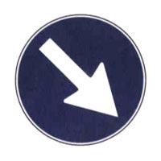
- **20245** — Il segnale raffigurato, posto in presenza di un'isola di traffico, obbliga i conducenti a passare a destra → **✅ VERO**
   
- **20246** — Il segnale raffigurato, posto in presenza di un salvagente, obbliga i conducenti a passare a destra → **✅ VERO**
   
- **20249** — Il segnale raffigurato presegnala una curva pericolosa a destra → **❌ FALSO**
   
- **20251** — Il segnale raffigurato obbliga i conducenti a svoltare a destra → **❌ FALSO**
   
- **20252** — Il segnale raffigurato preannuncia l'obbligo di svoltare a destra → **❌ FALSO**
   
- **20263** — Il segnale raffigurato indica al conducente gli unici passaggi consentiti → **✅ VERO**
   
- **20264** — Il segnale raffigurato indica i passaggi consentiti a destra e a sinistra di un'isola di traffico → **✅ VERO**
   
- **20265** — Il segnale raffigurato consente ai conducenti di passare sia a destra che a sinistra di un salvagente → **✅ VERO**
   
- **20269** — Il segnale raffigurato obbliga a svoltare a sinistra o a destra all'incrocio → **❌ FALSO**
   
- **20270** — Il segnale raffigurato vieta di proseguire in quella strada → **❌ FALSO**
   
- **20271** — Il segnale raffigurato è, di norma, preceduto dal segnale ROTATORIA → **❌ FALSO**
   
- **20274** — Il segnale raffigurato presegnala un incrocio regolato con circolazione rotatoria → **✅ VERO**
   
- **20275** — Il segnale raffigurato, in corrispondenza di una piazza, prescrive l'obbligo di circolazione secondo il verso indicato → **✅ VERO**
   
- **20276** — Il segnale raffigurato è posto prima dello sbocco su un'area in cui è prescritta la circolazione rotatoria → **✅ VERO**
   
- **20279** — Il segnale raffigurato preannuncia una direzione obbligatoria a sinistra → **❌ FALSO**
   
- **20280** — Il segnale raffigurato è collocato sulla colonnina luminosa posta al centro di una rotatoria → **❌ FALSO**
   
- **20281** — Il segnale raffigurato è integrato con un segnale di PASSAGGIO OBBLIGATORIO A SINISTRA → **❌ FALSO**
   
- **20293** — In presenza del segnale raffigurato è consentito marciare alla velocità di 40 km/h → **✅ VERO**
   
- **20296** — Il segnale raffigurato impone di circolare ad una velocità di almeno 30 km/h → **✅ VERO**
   
- **20297** — Il segnale raffigurato obbliga i veicoli a mantenere almeno la velocità indicata → **✅ VERO**
   
- **20299** — Il segnale raffigurato consente di marciare alla velocità di 20 km/h → **❌ FALSO**
   
- **20301** — Il segnale raffigurato vieta di superare la velocità indicata → **❌ FALSO**
   
- **20302** — Il segnale raffigurato consente di marciare ad una velocità superiore a 30 km/h, senza alcun limite → **❌ FALSO**
   
- **20319** — Il segnale raffigurato indica la fine del limite minimo di velocità → **✅ VERO**
   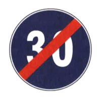
- **20321** — Il segnale raffigurato consente di circolare entro i limiti massimi di velocità vigenti per quella strada → **✅ VERO**
   
- **20322** — Il segnale raffigurato consente di circolare a velocità superiore a quella indicata → **✅ VERO**
   
- **20325** — Il segnale raffigurato vieta la circolazione ai veicoli di massa superiore a 30 tonnellate → **❌ FALSO**
   
- **20326** — Il segnale raffigurato indica la fine del limite di lunghezza massima dei complessi di veicoli → **❌ FALSO**
   
- **20327** — Il segnale raffigurato indica la fine dell'obbligo di mantenere la distanza di almeno 30 metri dal veicolo che precede → **❌ FALSO**
   
- **20329** — Il segnale raffigurato prescrive di circolare con catene o pneumatici invernali → **✅ VERO**
   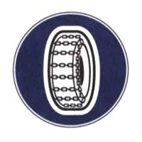
- **20330** — Il segnale raffigurato indica che la circolazione è consentita solo con catene o pneumatici invernali → **✅ VERO**
   
- **20331** — Il segnale raffigurato consente il transito solo ai veicoli muniti di catene o pneumatici invernali → **✅ VERO**
   
- **20335** — Il segnale raffigurato vieta la circolazione ai veicoli muniti di pneumatici con catene → **❌ FALSO**
   
- **20337** — Il segnale raffigurato vieta la circolazione a veicoli muniti di pneumatici con spessore del battistrada inferiore a 3 millimetri → **❌ FALSO**
   
- **20338** — Il segnale raffigurato obbliga a togliere le catene per non rovinare l'asfalto → **❌ FALSO**
   
- **20340** — Il segnale raffigurato indica l'inizio di un viale pedonale → **✅ VERO**
   
- **20342** — Il segnale raffigurato vale anche di giorno → **✅ VERO**
   
- **20343** — Il segnale raffigurato indica un percorso pedonale → **✅ VERO**
   
- **20344** — Il segnale raffigurato consente il transito anche ai veicoli, ma solo con particolare prudenza ed attenzione ai pedoni → **❌ FALSO**
   
- **20345** — Il segnale raffigurato indica un divieto di transito per i pedoni → **❌ FALSO**
   
- **20346** — Il segnale raffigurato indica un attraversamento pedonale → **❌ FALSO**
   
- **20349** — Il segnale raffigurato è posto in corrispondenza della fine del percorso pedonale → **✅ VERO**
   
- **20350** — Il segnale raffigurato è posto in corrispondenza della fine del viale pedonale → **✅ VERO**
   
- **20351** — Il segnale raffigurato indica che da lì in poi i pedoni non circolano più su un percorso riservato → **✅ VERO**
   
- **20352** — Il segnale raffigurato preannuncia un attraversamento pedonale → **❌ FALSO**
   
- **20353** — Il segnale raffigurato preannuncia un divieto di transito per i pedoni → **❌ FALSO**
   
- **20355** — Il segnale raffigurato preannuncia la fine di un'area vietata ai pedoni → **❌ FALSO**
   
- **20356** — Il segnale raffigurato è posto in corrispondenza di un percorso vietato alle autovetture e ai motocicli → **✅ VERO**
   
- **20358** — Il segnale raffigurato è posto in corrispondenza di un percorso riservato alle biciclette → **✅ VERO**
   
- **20361** — Il segnale raffigurato vieta il transito alle biciclette → **❌ FALSO**
   
- **20362** — Il segnale raffigurato è posto in corrispondenza di un percorso per pedoni e biciclette → **❌ FALSO**
   
- **20365** — Il segnale raffigurato è posto in corrispondenza di un'area vietata al transito delle biciclette → **❌ FALSO**
   
- **20375** — Il segnale raffigurato è posto in corrispondenza dell'inizio di una pista ciclabile accanto al marciapiede → **✅ VERO**
   
- **20377** — Il segnale raffigurato è posto in corrispondenza dell'inizio di una pista riservata alle biciclette, affiancata da un viale pedonale → **✅ VERO**
   
- **20380** — Il segnale raffigurato è posto in corrispondenza di un percorso unico per pedoni e ciclisti → **❌ FALSO**
   
- **20382** — Il segnale raffigurato è posto in corrispondenza della fine delle corsie riservate ai pedoni e alle biciclette → **❌ FALSO**
   
- **20384** — Il segnale raffigurato preannuncia l'obbligo di parcheggiare la bicicletta e proseguire a piedi → **❌ FALSO**
   
- **20426** — Il segnale raffigurato prescrive di arrestarsi al varco doganale → **✅ VERO**
   
- **20427** — Il segnale raffigurato obbliga ad arrestarsi alla frontiera per il controllo doganale → **✅ VERO**
   
- **20428** — Il segnale raffigurato indica che bisogna rallentare e fermarsi alla dogana → **✅ VERO**
   
- **20431** — Il segnale raffigurato obbliga a rallentare fermandosi al varco doganale solo se si hanno oggetti o merci da dichiarare → **❌ FALSO**
   
- **20432** — Il segnale raffigurato preannuncia la presenza di un comando stazione carabinieri → **❌ FALSO**
   
- **20433** — Il segnale raffigurato si trova solo alla frontiera con un paese della Comunità Europea → **❌ FALSO**
   
- **20434** — Il segnale raffigurato preannuncia la presenza di un posto di blocco stradale istituito da organi di polizia → **✅ VERO**
   
- **20435** — Il segnale raffigurato obbliga ad arrestarsi in prossimità di blocco stradale istituito da organi di polizia → **✅ VERO**
   
- **20436** — Il segnale raffigurato indica l'obbligo di arresto ad un posto di blocco stradale istituito dagli organi di polizia → **✅ VERO**
   
- **20439** — Il segnale raffigurato obbliga a rallentare per essere pronti a fermarsi in caso di segnalazione da parte degli agenti → **❌ FALSO**
   
- **20441** — Il segnale raffigurato segnala una stazione autostradale alla quale è obbligatorio fermarsi → **❌ FALSO**
   
- **20442** — Il segnale raffigurato impone di fermarsi e dare precedenza ai mezzi della polizia → **❌ FALSO**
   
- **20444** — Il segnale raffigurato obbliga ad arrestarsi all'accesso autostradale → **✅ VERO**
   
- **20445** — Il segnale raffigurato impone l'obbligo di rallentare e fermarsi per le operazioni di pedaggio autostradale → **✅ VERO**
   
- **20446** — Il segnale raffigurato segnala una stazione autostradale alla quale è obbligatorio fermarsi → **✅ VERO**
   
- **20450** — Il segnale raffigurato preannuncia una stazione ferroviaria → **❌ FALSO**
   
- **20451** — Il segnale raffigurato vieta l'accesso ad un'area riservata ai mezzi della società autostradale → **❌ FALSO**
   
- **20453** — Il segnale raffigurato può indicare il punto di arresto nei pontili d'imbarco di navi traghetto → **❌ FALSO**
   

## 4. Segnali di precedenza

- **20467** — Il segnale raffigurato obbliga a dare precedenza ai veicoli provenienti sia da destra che da sinistra → **✅ VERO**
   
- **20470** — Il segnale raffigurato si trova sulle corsie di accelerazione per l'immissione in autostrada → **✅ VERO**
   
- **20472** — Il segnale raffigurato preannuncia di moderare particolarmente la velocità e all'occorrenza fermarsi → **✅ VERO**
   
- **20475** — Il segnale raffigurato è impiegato su strade che godono del diritto di precedenza → **❌ FALSO**
   
- **20478** — Il segnale raffigurato obbliga a fermarsi prima di impegnare l'incrocio → **❌ FALSO**
   
- **20479** — Il segnale raffigurato si trova solo su strade urbane → **❌ FALSO**
   
- **20483** — Il segnale raffigurato obbliga a dare precedenza ai veicoli che circolano sulla strada su cui ci si immette → **✅ VERO**
   
- **20485** — Il segnale raffigurato si trova sulle rampe di raccordo per l'immissione in autostrada → **✅ VERO**
   
- **20486** — Il segnale raffigurato impone l'uso della massima prudenza al fine di evitare incidenti → **✅ VERO**
   
- **20487** — Il segnale raffigurato può essere preceduto dal PREAVVISO DI FERMARSI E DARE PRECEDENZA → **❌ FALSO**
   
- **20489** — Il segnale raffigurato preannuncia di arrestarsi prima di impegnare l'incrocio → **❌ FALSO**
   
- **20490** — Il segnale raffigurato si trova solo su strade extraurbane → **❌ FALSO**
   
- **20492** — Il segnale raffigurato impone di arrestarsi e dare la precedenza prima di impegnare l'incrocio → **✅ VERO**
   
- **20493** — Il segnale raffigurato obbliga ad arrestarsi all'incrocio e a dare la precedenza a destra e a sinistra → **✅ VERO**
   
- **20494** — Il segnale raffigurato impone di fermarsi all'incrocio anche in presenza di semaforo a luce lampeggiante gialla → **✅ VERO**
   
- **20496** — Il segnale raffigurato si trova, in genere, negli incroci con scarsa visibilità → **✅ VERO**
   
- **20498** — Il segnale raffigurato è utilizzato, di norma, negli incroci di particolare pericolosità → **✅ VERO**
   
- **20502** — Il segnale raffigurato obbliga ad arrestarsi soltanto in caso di incrocio con altri veicoli → **❌ FALSO**
   
- **20503** — Il segnale raffigurato obbliga ad arrestarsi per dare la precedenza solo ai veicoli provenienti da destra → **❌ FALSO**
   
- **20506** — Il segnale raffigurato preannuncia di arrestarsi all'incrocio anche se il semaforo emette luce verde → **❌ FALSO**
   
- **20507** — Il segnale raffigurato preannuncia l'obbligo di arresto ad un posto di blocco istituito dagli organi di polizia → **❌ FALSO**
   
- **20508** — Il segnale raffigurato obbliga ad arrestarsi solo se sopraggiungono altri veicoli → **❌ FALSO**
   
- **20536** — Il segnale raffigurato preannuncia un incrocio in cui vale la regola generale di dare la precedenza a destra → **✅ VERO**
   
- **20537** — Il segnale raffigurato prescrive di procedere a velocità particolarmente moderata → **✅ VERO**
   
- **20538** — Il segnale raffigurato preannuncia un incrocio in cui si deve dare precedenza a destra → **✅ VERO**
   
- **20541** — Il segnale raffigurato presegnala un passaggio a livello custodito con barriere → **❌ FALSO**
   
- **20545** — Il segnale raffigurato, in autostrada, viene posto a una distanza maggiore di 250 metri → **❌ FALSO**
   
- **20546** — Il segnale raffigurato preannuncia la presenza del segnale CROCE DI S. ANDREA → **❌ FALSO**
   
- **20547** — Il segnale raffigurato impone, nelle strettoie, di dare precedenza ai veicoli provenienti dal senso opposto → **✅ VERO**
   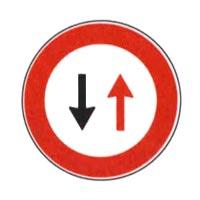
- **20548** — Il segnale raffigurato preannuncia, in presenza di lavori, di dare precedenza ai veicoli provenienti dal senso opposto → **✅ VERO**
   
- **20549** — Il segnale raffigurato preannuncia che bisogna dare la precedenza ai veicoli provenienti di fronte → **✅ VERO**
   
- **20554** — Il segnale raffigurato preannuncia che la circolazione è ammessa nei giorni pari in un senso e nei giorni dispari nell'altro → **❌ FALSO**
   
- **20555** — Il segnale raffigurato preannuncia il diritto di precedenza nei sensi unici alternati → **❌ FALSO**
   
- **20559** — Il segnale raffigurato si trova su strade a senso unico di circolazione → **❌ FALSO**
   
- **20594** — Il segnale raffigurato indica che termina una strada con diritto di precedenza → **✅ VERO**
   
- **20595** — Il segnale raffigurato indica che dopo di esso si dovrà, di norma, dare la precedenza a destra → **✅ VERO**
   
- **20596** — Il segnale raffigurato indica la fine del diritto di precedenza anche sulle strade urbane → **✅ VERO**
   
- **20597** — Il segnale raffigurato indica la fine di un'autostrada → **❌ FALSO**
   
- **20600** — Il segnale raffigurato indica fine del limite di velocità → **❌ FALSO**
   
- **20601** — Il segnale raffigurato indica la fine di tutti i divieti → **❌ FALSO**
   
- **20602** — Il segnale raffigurato preannuncia un incrocio con strade di minore importanza → **✅ VERO**
   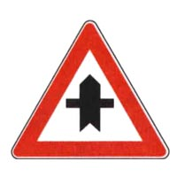
- **20603** — Il segnale raffigurato preannuncia un incrocio in cui si ha la precedenza sui veicoli provenienti dalle strade secondarie → **✅ VERO**
   
- **20605** — Il segnale raffigurato, all'incrocio, ci dà la precedenza sui veicoli provenienti sia da destra che da sinistra → **✅ VERO**
   
- **20611** — Il segnale raffigurato vieta la svolta a sinistra all'incrocio → **❌ FALSO**
   
- **20613** — Il segnale raffigurato è posto sulle autostrade → **❌ FALSO**
   
- **20615** — Il segnale raffigurato preannuncia un incrocio nel quale bisogna dare la precedenza → **❌ FALSO**
   
- **20617** — Il segnale raffigurato preannuncia che si incrocia a destra una strada di minore importanza → **✅ VERO**
   
- **20619** — In presenza del segnale raffigurato bisogna usare prudenza perché ci si sta avvicinando ad un incrocio → **✅ VERO**
   
- **20622** — Il segnale raffigurato preannuncia un incrocio in cui il conducente ha la precedenza sui veicoli provenienti da destra → **✅ VERO**
   
- **20624** — Il segnale raffigurato vieta la svolta a destra → **❌ FALSO**
   
- **20627** — Il segnale raffigurato preannuncia un incrocio in cui il conducente ha l'obbligo di fermarsi e dare precedenza ai veicoli provenienti da destra → **❌ FALSO**
   
- **20628** — Il segnale raffigurato indica una piazzola di sosta a destra → **❌ FALSO**
   
- **20629** — Il segnale raffigurato preannuncia che si incrocia sulla sinistra una strada di minore importanza → **✅ VERO**
   
- **20631** — Il segnale raffigurato prescrive di usare prudenza perché ci si sta avvicinando ad un incrocio → **✅ VERO**
   
- **20634** — Il segnale raffigurato preannuncia un incrocio in cui si ha la precedenza sui veicoli provenienti da sinistra → **✅ VERO**
   
- **20635** — Il segnale raffigurato preannuncia sulla sinistra una strada senza uscita → **❌ FALSO**
   
- **20636** — Il segnale raffigurato vieta la svolta a sinistra → **❌ FALSO**
   
- **20640** — Il segnale raffigurato preannuncia l'incrocio con un binario morto → **❌ FALSO**
   
- **20641** — Il segnale raffigurato preannuncia una immissione da destra con corsia di accelerazione → **✅ VERO**
   
- **20643** — Il segnale raffigurato può trovarsi sulle autostrade → **✅ VERO**
   
- **20644** — Il segnale raffigurato invita ad usare la massima prudenza al fine di evitare incidenti → **✅ VERO**
   
- **20648** — Il segnale raffigurato preannuncia di dare precedenza ai veicoli provenienti da destra → **❌ FALSO**
   
- **20651** — Il segnale raffigurato, su autostrada, non comporta una riduzione della velocità → **❌ FALSO**
   
- **20652** — Il segnale raffigurato consente la svolta a destra al prossimo incrocio → **❌ FALSO**
   
- **20653** — Il segnale raffigurato preannuncia un'immissione stradale con corsia di accelerazione posta sulla sinistra → **✅ VERO**
   
- **20654** — Il segnale raffigurato preannuncia una confluenza sul lato sinistro della carreggiata → **✅ VERO**
   
- **20657** — Il segnale raffigurato è usato su strade con diritto di precedenza → **✅ VERO**
   
- **20660** — Il segnale raffigurato prescrive di dare la precedenza ai veicoli provenienti da sinistra → **❌ FALSO**
   
- **20661** — Il segnale raffigurato preannuncia che non si ha diritto di precedenza nella confluenza → **❌ FALSO**
   
- **20664** — Il segnale raffigurato consente la svolta a sinistra al prossimo incrocio → **❌ FALSO**
   
- **20665** — Il segnale raffigurato indica l'inizio di una strada in cui i veicoli hanno diritto di precedenza → **✅ VERO**
   
- **20666** — Il segnale raffigurato può essere posto su una strada statale → **✅ VERO**
   
- **20667** — In presenza del segnale raffigurato bisogna comunque dare la precedenza ai veicoli che hanno in funzione il lampeggiante blu e sirena → **✅ VERO**
   
- **20671** — Il segnale raffigurato obbliga ad arrestarsi all'incrocio → **❌ FALSO**
   
- **20672** — Il segnale raffigurato può essere posto a protezione di attraversamenti pedonali pericolosi → **❌ FALSO**
   
- **20673** — Il segnale raffigurato è posto esclusivamente su strade extraurbane ad intenso traffico → **❌ FALSO**
   
- **20677** — Il segnale raffigurato si può trovare all'inizio di una strada urbana o extraurbana che gode del diritto di precedenza → **✅ VERO**
   
- **20678** — Il segnale raffigurato può essere ripetuto in formato piccolo prima e dopo ogni incrocio → **✅ VERO**
   
- **20681** — In presenza del segnale raffigurato è comunque necessario moderare la velocità in prossimità degli incroci → **✅ VERO**
   
- **20682** — Il segnale raffigurato si trova all'inizio di una strada senza diritto di precedenza → **❌ FALSO**
   
- **20683** — Il segnale raffigurato si trova all'inizio di un'autostrada → **❌ FALSO**
   
- **20685** — In presenza del segnale raffigurato non occorrono particolari cautele perché si ha la precedenza → **❌ FALSO**
   
- **20689** — In presenza del segnale raffigurato dobbiamo accertarci che i veicoli provenienti dal senso contrario ci diano la precedenza → **✅ VERO**
   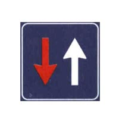
- **20690** — In presenza del segnale raffigurato possiamo percorrere la strettoia, dopo esserci assicurati di aver ottenuto la precedenza → **✅ VERO**
   
- **20691** — In presenza del segnale raffigurato dobbiamo procedere con cautela, anche se abbiamo la precedenza → **✅ VERO**
   
- **20693** — In presenza del segnale raffigurato si deve dare la precedenza ai veicoli che provengono dal senso opposto → **❌ FALSO**
   
- **20694** — In presenza del segnale raffigurato possiamo procedere senza cautela, dato che abbiamo il diritto di precedenza → **❌ FALSO**
   
- **20698** — Il segnale raffigurato preannuncia il divieto d'inversione di marcia → **❌ FALSO**
   

## 5. Segnaletica orizzontale; segni sugli ostacoli

- **20709** — La striscia bianca discontinua in figura può essere superata → **✅ VERO**
   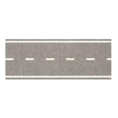
- **20710** — La striscia bianca discontinua in figura divide la carreggiata in due corsie → **✅ VERO**
   
- **20714** — La striscia bianca discontinua in figura consente la svolta a sinistra → **✅ VERO**
   
- **20715** — La striscia bianca discontinua in figura consente di circolare stando a cavallo di essa → **❌ FALSO**
   
- **20716** — La striscia bianca discontinua in figura divide la strada da una pista ciclabile → **❌ FALSO**
   
- **20717** — La striscia bianca discontinua in figura si trova in vicinanza di tutti i passaggi a livello → **❌ FALSO**
   
- **20719** — Le strisce lungo il centro della carreggiata possono essere superate se discontinue (tratteggiate) → **✅ VERO**
- **20720** — Le strisce lungo il centro della carreggiata non possono essere superate se continue → **✅ VERO**
- **20723** — Le strisce lungo il centro della carreggiata possono essere bianche o azzurre → **❌ FALSO**
- **20725** — La striscia di mezzo in figura non consente il sorpasso in ogni caso → **❌ FALSO**
   
- **20727** — La doppia striscia continua in figura non può essere superata → **✅ VERO**
   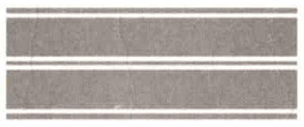
- **20729** — La doppia striscia continua in figura non consente l'inversione del senso di marcia → **✅ VERO**
   
- **20730** — La doppia striscia continua in figura non consente di svoltare a sinistra → **✅ VERO**
   
- **20731** — La doppia striscia continua in figura si può trovare ai bordi della strada, per segnalare i margini → **❌ FALSO**
   
- **20734** — La doppia striscia continua in figura è di colore azzurro nei parcheggi a pagamento → **❌ FALSO**
   
- **20735** — La doppia striscia continua in figura può essere superata → **❌ FALSO**
   
- **20744** — Le frecce direzionali in figura indicano ai conducenti le direzioni consentite all'incrocio → **✅ VERO**
   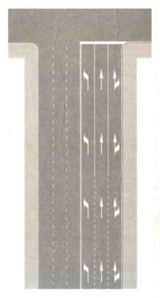
- **20746** — Le frecce direzionali in figura obbligano a seguire la direzione indicata se le strisce di corsia sono continue → **✅ VERO**
   
- **20747** — Le frecce direzionali in figura sono a freccia combinata diritta-destra per corsie destinate a chi deve proseguire diritto o a destra → **✅ VERO**
   
- **20752** — Le frecce direzionali in figura ci consentono di cambiare corsia se le strisce sono continue → **❌ FALSO**
   
- **20754** — Le frecce direzionali in figura sono di colore giallo nelle strade dove è vietata la sosta → **❌ FALSO**
   
- **20755** — Le frecce direzionali in figura sono di colore blu nelle autostrade → **❌ FALSO**
   
- **20788** — La segnaletica in figura indica una zona per la fermata degli autobus in servizio pubblico di linea → **✅ VERO**
   
- **20791** — La segnaletica in figura vieta la sosta ma non la fermata anche nelle parti con striscia gialla a zig zag → **✅ VERO**
   
- **20794** — La segnaletica in figura non consente alle autovetture di circolare all'interno dell'area segnata → **❌ FALSO**
   
- **20798** — La segnaletica in figura consente la sosta delle autovetture dalle ore 20.00 alle ore 8.00 → **❌ FALSO**
   
- **20799** — In presenza dell'isola di traffico rappresentata in figura il veicolo C deve svoltare a destra → **✅ VERO**
   
- **20800** — In presenza dell'isola di traffico rappresentata in figura il veicolo B deve svoltare a destra → **✅ VERO**
   
- **20801** — In presenza dell'isola di traffico rappresentata in figura il veicolo A deve andare diritto → **✅ VERO**
   
- **20802** — In presenza dell'isola di traffico rappresentata in figura il veicolo C può andare in qualsiasi direzione → **❌ FALSO**
   
- **20803** — In presenza dell'isola di traffico rappresentata in figura il veicolo B può svoltare a sinistra, dando la precedenza al veicolo A → **❌ FALSO**
   
- **20804** — In presenza dell'isola di traffico rappresentata in figura il veicolo A può svoltare a sinistra, dando la precedenza al veicolo C → **❌ FALSO**
   
- **20811** — Tutte e tre le corsie rappresentate in figura consentono al conducente di proseguire dritto → **✅ VERO**
   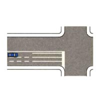
- **20812** — La corsia di sinistra rappresentata in figura consente al conducente di proseguire dritto o svoltare a sinistra → **✅ VERO**
   
- **20813** — La corsia di mezzo rappresentata in figura consente al conducente solo di proseguire diritto → **✅ VERO**
   
- **20817** — La corsia di sinistra rappresentata in figura consente al conducente solo di svoltare a sinistra → **❌ FALSO**
   
- **20818** — La corsia di destra rappresentata in figura è riservata ai veicoli lenti → **❌ FALSO**
   
- **20819** — La corsia di destra rappresentata in figura consente al conducente solo di svoltare a destra → **❌ FALSO**
   
- **20827** — La corsia A rappresentata in figura consente al conducente solo di svoltare a sinistra → **✅ VERO**
   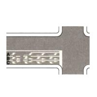
- **20828** — La corsia B rappresentata in figura consente al conducente di proseguire diritto e di svoltare a sinistra → **✅ VERO**
   
- **20829** — In presenza della segnaletica in figura , la corsia C è l'unica che consente di svoltare a destra. → **✅ VERO**
   
- **20831** — Tutte e tre le corsie rappresentate in figura consentono al conducente di proseguire diritto → **❌ FALSO**
   
- **20832** — In presenza della segnaletica in figura, la corsia A è l'unica che consente di svoltare a sinistra → **❌ FALSO**
   
- **20833** — La corsia B rappresentata in figura consente al conducente solo di proseguire diritto → **❌ FALSO**
   
- **20854** — In una strada a senso unico di circolazione con la segnaletica indicata in figura si può sorpassare anche superando la striscia di mezzo → **✅ VERO**
   
- **20857** — In una strada a senso unico di circolazione con la segnaletica indicata in figura la corsia di sinistra è, di norma, riservata al sorpasso → **✅ VERO**
   
- **20858** — In una strada a senso unico di circolazione con la segnaletica indicata in figura è consentito il sorpasso in vicinanza o in corrispondenza di dossi → **✅ VERO**
   
- **20859** — In una strada a senso unico di circolazione con la segnaletica indicata in figura si può sempre viaggiare per file parallele → **❌ FALSO**
   
- **20860** — In una strada a senso unico di circolazione con la segnaletica indicata in figura si può fare l'inversione del senso di marcia → **❌ FALSO**
   
- **20861** — In una strada a senso unico di circolazione con la segnaletica indicata in figura si può circolare stando a cavallo della striscia di mezzo → **❌ FALSO**
   
- **20863** — La segnaletica in figura indica, sia dentro che fuori dei centri abitati, un attraversamento pedonale → **✅ VERO**
   
- **20865** — La segnaletica in figura indica un attraversamento pedonale → **✅ VERO**
   
- **20867** — La segnaletica in figura indica un attraversamento in cui i pedoni hanno la precedenza → **✅ VERO**
   
- **20868** — La segnaletica in figura indica un'isola di traffico → **❌ FALSO**
   
- **20870** — La segnaletica in figura indica un attraversamento ciclabile → **❌ FALSO**
   
- **20871** — La segnaletica in figura indica un passo carrabile → **❌ FALSO**
   
- **20873** — La striscia bianca trasversale in figura può essere completata con la scritta STOP, dipinta sulla pavimentazione stradale → **✅ VERO**
   
- **20874** — La striscia bianca trasversale in figura indica il punto in cui i conducenti devono arrestarsi in presenza del segnale FERMARSI E DARE PRECEDENZA (STOP) → **✅ VERO**
   
- **20875** — La striscia bianca trasversale in figura indica il punto in cui i conducenti devono arrestarsi in presenza del semaforo a luce rossa → **✅ VERO**
   
- **20878** — La striscia bianca trasversale in figura indica un attraversamento pedonale non regolato → **❌ FALSO**
   
- **20879** — La striscia bianca trasversale in figura indica un attraversamento ciclabile → **❌ FALSO**
   
- **20880** — La striscia bianca trasversale in figura non può mai essere superata → **❌ FALSO**
   
- **20889** — In una carreggiata a doppio senso di circolazione la striscia di mezzo può essere continua o discontinua (tratteggiata) → **✅ VERO**
- **20890** — In una carreggiata a doppio senso di circolazione la striscia di mezzo, se discontinua (tratteggiata), può essere superata durante un sorpasso → **✅ VERO**
- **20894** — Nella carreggiata a doppio senso di circolazione la striscia di mezzo in figura, può essere superata con le sole ruote di sinistra → **❌ FALSO**
   
- **20895** — Nella carreggiata a doppio senso di circolazione come in figura la striscia di mezzo divide la strada in due carreggiate, ognuna a due corsie → **❌ FALSO**
   
- **20897** — La segnaletica in figura obbliga i conducenti ad arrestarsi quando vi sono pedoni che attraversano la carreggiata → **✅ VERO**
   
- **20898** — Un attraversamento pedonale può essere preceduto sulla destra da una striscia gialla a zig zag, come nella figura seguente → **✅ VERO**
   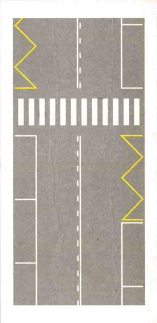
- **20900** — La segnaletica in figura obbliga i conducenti a fermarsi e dare la precedenza ai pedoni che si accingono ad attraversare → **✅ VERO**
   
- **20901** — La segnaletica in figura è un'isola di rifugio per pedoni e ciclisti → **❌ FALSO**
   
- **20902** — La segnaletica in figura non consente ai veicoli di transitarci sopra → **❌ FALSO**
   
- **20904** — La segnaletica in figura non consente il transito ai pedoni → **❌ FALSO**
   
- **20906** — La striscia bianca discontinua in figura, nelle strade a senso unico, divide le corsie → **✅ VERO**
   
- **20907** — La striscia bianca discontinua in figura consente l'inversione di marcia nelle strade a senso unico → **❌ FALSO**
   
- **20909** — La striscia bianca discontinua in figura si trova solo nelle strade a senso unico → **❌ FALSO**
   
- **20910** — La striscia bianca discontinua in figura nelle strade a senso unico è posta nei dossi, per dividere i due sensi di marcia → **❌ FALSO**
   
- **20912** — La striscia bianca continua di mezzo in figura non può essere superata → **✅ VERO**
   
- **20914** — La striscia bianca continua di mezzo in figura, sulle strade a doppio senso si può trovare sul tratto in salita di un dosso → **✅ VERO**
   
- **20915** — La striscia bianca continua di mezzo in figura, sulle strade a doppio senso può trovarsi in vicinanza degli attraversamenti pedonali → **✅ VERO**
   
- **20918** — La striscia bianca continua di mezzo in figura consente di marciarvi a cavallo → **❌ FALSO**
   
- **20919** — La striscia bianca continua di mezzo in figura consente il sorpasso anche superandola, purché con le sole ruote di sinistra → **❌ FALSO**
   
- **20920** — La striscia bianca continua di mezzo in figura consente l'inversione di marcia nelle strade a doppio senso → **❌ FALSO**
   
- **20923** — L'elemento in figura è un rallentatore di velocità installato sulla strada → **✅ VERO**
   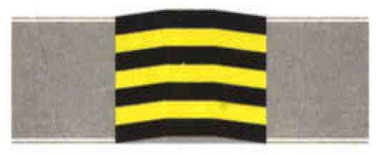
- **20925** — Le strisce di delimitazione gialle in figura individuano un'area di parcheggio riservata a persone invalide → **✅ VERO**
   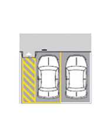
- **20926** — Le strisce gialle diagonali in figura devono essere lasciate libere per consentire l'entrata e l'uscita dal veicolo delle persone invalide → **✅ VERO**
   
- **20929** — L'elemento in figura individua un attraversamento ciclabile → **❌ FALSO**
   
- **20931** — Le strisce gialle in figura delimitano un'area di parcheggio riservata ai taxi → **❌ FALSO**
   
- **20932** — Le strisce gialle in figura delimitano un'area riservata al carico e allo scarico di merci → **❌ FALSO**
   
- **20935** — Le strisce bianche discontinue sull'intersezione in figura sono strisce di guida → **✅ VERO**
   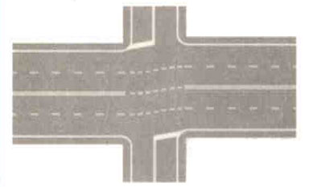
- **20936** — La striscia bianca laterale discontinua in figura divide la carreggiata da una corsia di accelerazione → **✅ VERO**
   
- **20937** — La striscia bianca laterale discontinua in figura individua il bordo della strada principale, separandolo da quello della strada secondaria → **✅ VERO**
   
- **20940** — La striscia bianca laterale discontinua separa la carreggiata dalla corsia di emergenza → **❌ FALSO**
- **20941** — La striscia bianca laterale discontinua segnala l'inizio di una banchina → **❌ FALSO**
- **20943** — La striscia bianca laterale discontinua in figura delimita l'accesso ad una pista ciclabile → **❌ FALSO**
   
- **20945** — La segnaletica rappresentata in figura si trova vicino ad un passaggio a livello → **✅ VERO**
   
- **20948** — In presenza della segnaletica rappresentata in figura non è consentito spostarsi nella parte sinistra della carreggiata → **✅ VERO**
   
- **20949** — In presenza della segnaletica rappresentata in figura i conducenti devono prestare attenzione all'eventuale sopraggiungere di treni → **✅ VERO**
   
- **20950** — La segnaletica rappresentata in figura serve ad indicare che a 150 metri vi è un attraversamento tranviario molto pericoloso → **❌ FALSO**
   
- **20952** — La segnaletica rappresentata in figura segnala la vicinanza di un incrocio regolato da Polizia locale → **❌ FALSO**
   
- **20953** — La segnaletica rappresentata in figura delimita un parcheggio di autobus in servizio pubblico di linea → **❌ FALSO**
   
- **20956** — La corsia di emergenza (corsia A) non si può occupare per le manovre di sorpasso → **✅ VERO**
   
- **20959** — Nella segnaletica in figura la striscia bianca continua che delimita la corsia di emergenza, (corsia A), può essere sempre superata in caso di intenso traffico → **❌ FALSO**
   
- **20960** — La corsia di emergenza (corsia A) è riservata alla svolta a destra → **❌ FALSO**
   
- **20962** — La corsia di emergenza (corsia A) è vietata al transito degli autoveicoli ma non al transito dei motocicli → **❌ FALSO**
   
- **20963** — La striscia trasversale continua in figura indica il punto in cui bisogna arrestarsi ad un incrocio, se regolato da semaforo a luce rossa → **✅ VERO**
   
- **20964** — La striscia trasversale continua in figura indica il punto in cui dobbiamo sempre arrestarci ad un incrocio, se il vigile lo impone → **✅ VERO**
   
- **20967** — La striscia trasversale continua in figura indica il punto in cui bisogna sempre arrestarsi in vicinanza di un incrocio stradale → **❌ FALSO**
   
- **20968** — La striscia trasversale continua in figura indica che è obbligatorio dare la precedenza ai veicoli provenienti sia da destra sia da sinistra → **❌ FALSO**
   

## 6. Segnalazioni semaforiche; segnalazioni degli agenti del traffico

- **20970** — In presenza della luce semaforica rossa i veicoli devono arrestarsi → **✅ VERO**
   
- **20973** — Quando è accesa la luce rossa del semaforo bisogna arrestarsi prima della striscia trasversale d'arresto → **✅ VERO**
   
- **20974** — Durante il periodo di accensione della luce rossa i veicoli non devono superare la striscia di arresto → **✅ VERO**
   
- **20975** — La luce rossa accesa del semaforo consente di svoltare a destra con prudenza, dando precedenza ai pedoni che attraversano la strada → **❌ FALSO**
   
- **20976** — La luce rossa accesa del semaforo consente di ripartire lentamente quando appare il giallo per gli altri veicoli → **❌ FALSO**
   
- **20978** — La luce rossa accesa del semaforo consente l'attraversamento dell'incrocio, purché sia libero → **❌ FALSO**
   
- **20980** — Quando è accesa la luce verde del semaforo in figura è possibile svoltare a sinistra, dando la precedenza ai veicoli che arrivano di fronte → **✅ VERO**
   
- **20981** — Quando è accesa la luce verde del semaforo in figura si può svoltare a destra → **✅ VERO**
   
- **20984** — Quando è accesa la luce verde del semaforo in figura si può attraversare l'incrocio, usando prudenza → **✅ VERO**
   
- **20986** — Avvicinandosi ad un semaforo, che già da molto tempo ha la luce verde accesa, occorre accelerare, senza che vi sia necessità di guardare la luce del semaforo → **❌ FALSO**
   
- **20987** — Quando è accesa la luce verde del semaforo in figura si può svoltare a sinistra, ma solo quando si accende anche la luce gialla → **❌ FALSO**
   
- **20988** — Quando è accesa la luce verde del semaforo in figura, il conducente che svolta a sinistra ha la precedenza sui veicoli che provengono di fronte → **❌ FALSO**
   
- **20992** — Nei semafori in figura le frecce verdi accese indicano le direzioni verso le quali si può proseguire → **✅ VERO**
   
- **20995** — Nel semaforo in figura le frecce gialle lampeggianti accese indicano di attraversare l'incrocio con particolare prudenza → **✅ VERO**
   
- **20996** — Nel semaforo in figura le frecce verdi accese, rivolte verso l'alto, indicano che si può proseguire in tutte le direzioni → **❌ FALSO**
   
- **20997** — Nel semaforo in figura le frecce rosse accese indicano di proseguire con prudenza → **❌ FALSO**
   
- **21000** — La luce gialla fissa obbliga chi ha già impegnato l'incrocio a liberarlo al più presto → **✅ VERO**
   
- **21001** — La luce gialla fissa obbliga a fermarsi prima del punto di arresto, purché lo si possa fare senza creare pericolo → **✅ VERO**
   
- **21002** — La luce gialla fissa si accende quando il verde e il rosso sono spenti → **✅ VERO**
   
- **21003** — La luce gialla fissa consente in ogni caso di proseguire impegnando l'incrocio → **❌ FALSO**
   
- **21006** — La luce gialla fissa si accende quando è ancora accesa quella rossa → **❌ FALSO**
   
- **21008** — La luce gialla fissa si accende insieme con il rosso → **❌ FALSO**
   
- **21017** — Le luci rosse accese lampeggianti in figura obbligano ad arrestarsi a un passaggio a livello ferroviario senza barriere → **✅ VERO**
   
- **21018** — Le luci rosse accese lampeggianti in figura obbligano ad arrestarsi a un passaggio a livello ferroviario con semibarriere → **✅ VERO**
   
- **21021** — Le luci rosse accese lampeggianti in figura obbligano a non superare la striscia trasversale d'arresto → **✅ VERO**
   
- **21022** — Le luci rosse accese lampeggianti in figura si trovano in vicinanza di un posto di blocco della polizia → **❌ FALSO**
   
- **21024** — Le luci rosse accese lampeggianti in figura indicano l'uscita obbligatoria dall'autostrada → **❌ FALSO**
   
- **21026** — Le luci rosse accese lampeggianti in figura indicano che sta per accendersi la luce verde → **❌ FALSO**
   
- **21058** — Il semaforo in figura non consente di occupare la corsia indicata con luce rossa a forma di X → **✅ VERO**
   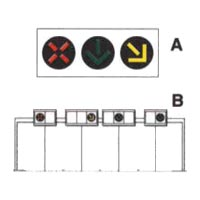
- **21059** — Il semaforo in figura consente di impegnare la corsia indicata dalla freccia verde → **✅ VERO**
   
- **21060** — Nei semafori in figura la luce gialla lampeggiante obbliga il conducente a spostarsi nella corsia indicata dalla freccia → **✅ VERO**
   
- **21061** — Il semaforo in figura non consente di occupare le corsie indicate dalle frecce verdi → **❌ FALSO**
   
- **21063** — Nei semafori in figura, la luce rossa a forma di X impone di arrestarsi ed attendere la luce gialla → **❌ FALSO**
   
- **21064** — Il semaforo in figura non vale per le biciclette → **❌ FALSO**
   
- **21065** — La luce verde accesa del semaforo in figura permette ai pedoni l'attraversamento → **✅ VERO**
   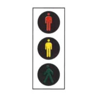
- **21066** — La luce verde accesa del semaforo in figura consente ai pedoni di attraversare la strada → **✅ VERO**
   
- **21067** — La luce verde accesa del semaforo in figura consente ai pedoni di impegnare la carreggiata per attraversarla → **✅ VERO**
   
- **21068** — Il semaforo in figura indica una scala mobile in funzione → **❌ FALSO**
   
- **21070** — La luce verde accesa del semaforo in figura obbliga i pedoni a dare la precedenza ai veicoli che svoltano → **❌ FALSO**
   
- **21071** — Il semaforo in figura segnala un ascensore pubblico → **❌ FALSO**
   
- **21084** — Il semaforo in figura riguarda i veicoli che devono proseguire nella direzione della freccia → **✅ VERO**
   
- **21085** — Il semaforo in figura consente di proseguire nella sola direzione della freccia verde → **✅ VERO**
   
- **21090** — I segnali luminosi in figura sono semafori per i veicoli in servizio di linea per trasporto di persone → **❌ FALSO**
   
- **21091** — I segnali luminosi in figura sono semafori per i veicoli su rotaie (tram, treni) → **❌ FALSO**
   
- **21097** — Il semaforo in figura vale per i veicoli in servizio di linea per trasporto di persone → **✅ VERO**
   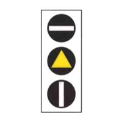
- **21098** — Il semaforo in figura impone l'arresto ai veicoli in servizio di linea per trasporto di persone quando è accesa la barra bianca in alto → **✅ VERO**
   
- **21099** — Il semaforo in figura consente ai veicoli di trasporto pubblico di persone di proseguire quando in basso è accesa la barra bianca → **✅ VERO**
   
- **21101** — Il semaforo in figura regola il transito dei pedoni → **❌ FALSO**
   
- **21102** — Il semaforo in figura indica un passaggio a livello senza barriere → **❌ FALSO**
   
- **21103** — Il semaforo in figura regola il transito nei pontili per l'imbarco sulle navi traghetto → **❌ FALSO**
   
- **21104** — Il semaforo in figura indica la vicinanza di una stazione ferroviaria → **❌ FALSO**
   
- **21106** — Il semaforo in figura regola il passaggio dei pedoni negli incroci → **✅ VERO**
   
- **21107** — Il segnale luminoso in figura è un semaforo per i pedoni → **✅ VERO**
   
- **21109** — Il semaforo in figura, con luce rossa accesa impone ai pedoni di non attraversare → **✅ VERO**
   
- **21110** — Il segnale luminoso in figura indica la presenza di una scuola → **❌ FALSO**
   
- **21111** — Il semaforo in figura indica lo svolgimento di una gara podistica → **❌ FALSO**
   
- **21115** — Il semaforo in figura indica l'entrata di una struttura sportiva → **❌ FALSO**
   
- **21117** — Il segnale luminoso in figura è un semaforo riservato ai conducenti di biciclette → **✅ VERO**
   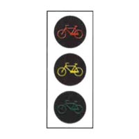
- **21118** — Il semaforo in figura, con luce rossa accesa, impone l'arresto alle biciclette → **✅ VERO**
   
- **21120** — Il semaforo in figura, con luce verde accesa, consente soltanto ai conducenti di biciclette di attraversare l'incrocio → **✅ VERO**
   
- **21122** — Il semaforo in figura indica lo svolgimento di una gara ciclistica → **❌ FALSO**
   
- **21124** — Il semaforo in figura indica una corsia riservata ai motocicli → **❌ FALSO**
   
- **21125** — Il semaforo in figura indica il divieto di transito per le biciclette → **❌ FALSO**
   
- **21157** — Quando il vigile si dispone con le braccia aperte verso la nostra direzione come in figura è vietato il passaggio → **✅ VERO**
   
- **21160** — Quando il vigile si dispone con le braccia aperte verso la nostra direzione come in figura non si può attraversare l'incrocio → **✅ VERO**
   
- **21162** — La posizione del vigile con le braccia aperte verso la nostra direzione come in figura equivale alla luce rossa del semaforo → **✅ VERO**
   
- **21165** — Quando il vigile si dispone con le braccia aperte verso la nostra direzione come in figura bisogna suonare il clacson, ma con moderazione, per richiamare l'attenzione del vigile → **❌ FALSO**
   
- **21166** — Quando il vigile si dispone con le braccia aperte verso la nostra direzione come in figura si può svoltare, ma non proseguire diritto → **❌ FALSO**
   
- **21167** — La posizione del vigile con le braccia aperte verso la nostra direzione come in figura equivale alla luce verde del semaforo → **❌ FALSO**
   
- **21168** — Quando il vigile si dispone di profilo con le braccia aperte come in figura è consentito il passaggio delle correnti di traffico che scorrono parallele alle sue braccia → **✅ VERO**
   
- **21169** — Quando il vigile si dispone di profilo con le braccia aperte come in figura si può svoltare a destra se si proviene dalla sua destra o dalla sua sinistra → **✅ VERO**
   
- **21171** — La posizione di profilo del vigile con le braccia aperte come in figura equivale alla luce verde del semaforo per le correnti di traffico che scorrono parallele alle sue braccia → **✅ VERO**
   
- **21172** — Quando il vigile si dispone di profilo con le braccia aperte come in figura si deve obbligatoriamente proseguire diritto → **❌ FALSO**
   
- **21174** — Quando il vigile si dispone di profilo con le braccia aperte come in figura ci si deve arrestare dopo aver superato le strisce dell'attraversamento pedonale → **❌ FALSO**
   
- **21175** — La posizione di profilo del vigile con le braccia aperte come in figura, per le correnti di traffico che scorrono parallele alle sue braccia equivale alla luce rossa del semaforo → **❌ FALSO**
   
- **21176** — La posizione del vigile con un braccio alzato come in figura equivale alla luce gialla fissa del semaforo → **✅ VERO**
   
- **21177** — Se il vigile ha un braccio alzato come in figura bisogna liberare velocemente l'incrocio, se già è stato impegnato → **✅ VERO**
   
- **21178** — Se il vigile ha un braccio alzato come in figura bisogna arrestarsi prima dell'incrocio, se è possibile farlo senza creare pericolo → **✅ VERO**
   
- **21180** — Se il vigile ha un braccio alzato come in figura bisogna in ogni caso arrestarsi → **❌ FALSO**
   
- **21181** — Se il vigile ha un braccio alzato come in figura è consentito soltanto svoltare a destra → **❌ FALSO**
   
- **21183** — La posizione del vigile con il braccio alzato come in figura equivale alla luce rossa del semaforo → **❌ FALSO**
   
- **21184** — Il vigile disposto con le braccia ad angolo retto come in figura consente la svolta a sinistra ai veicoli che arrivano dalla sua sinistra → **✅ VERO**
   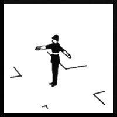
- **21185** — Il vigile disposto con le braccia ad angolo retto come in figura ferma i veicoli che arrivano dalla sua destra → **✅ VERO**
   
- **21186** — Il vigile disposto con le braccia ad angolo retto come in figura vieta di proseguire diritto ai veicoli che gli vengono dalle sue spalle → **✅ VERO**
   
- **21189** — Il vigile disposto con le braccia ad angolo retto come in figura consente di svoltare a destra ai veicoli che arrivano dalla sua destra → **❌ FALSO**
   
- **21190** — Il vigile disposto con le braccia ad angolo retto come in figura consente la svolta a destra ai veicoli che arrivano dalle sue spalle → **❌ FALSO**
   
- **21191** — Il vigile disposto con le braccia ad angolo retto come in figura consente la svolta a sinistra ai veicoli che arrivano dalla sua destra → **❌ FALSO**
   
- **21210** — Chi guida autoveicoli o motocicli deve esibire, a richiesta degli agenti, la carta di circolazione → **✅ VERO**
- **21211** — Chi guida autoveicoli o motocicli deve esibire, a richiesta degli agenti, la patente di guida → **✅ VERO**
- **21213** — Chi guida autoveicoli deve esibire, a richiesta degli agenti, il segnale mobile di pericolo (triangolo) → **✅ VERO**
- **21214** — Chi guida autoveicoli o motocicli deve mostrare, a richiesta degli agenti, la valigetta di pronto soccorso → **❌ FALSO**
- **21216** — Chi guida autoveicoli o motocicli deve esibire, a richiesta degli agenti, il codice fiscale → **❌ FALSO**
- **21217** — Chi guida autoveicoli o motocicli deve mostrare, a richiesta degli agenti, l'attestazione di pagamento della tassa di possesso (bollo) → **❌ FALSO**

## 7. Limiti di velocità; pericolo e intralcio alla circolazione; comportamenti ai passaggi a livello

- **22271** — Il conducente deve regolare la velocità in relazione allo stato del veicolo → **✅ VERO**
- **22272** — Il conducente deve regolare la velocità in relazione al carico del veicolo → **✅ VERO**
- **22274** — Il conducente deve regolare la velocità in relazione alle condizioni della strada → **✅ VERO**
- **22275** — Il conducente deve regolare la velocità in relazione alle condizioni del traffico → **✅ VERO**
- **22277** — Il conducente deve regolare la velocità in modo da non costituire pericolo per le persone → **✅ VERO**
- **22278** — Il conducente deve regolare la velocità in modo da non costituire disordine per la circolazione → **✅ VERO**
- **22281** — Il conducente deve regolare la velocità in relazione alle condizioni atmosferiche → **✅ VERO**
- **22282** — Il conducente deve regolare la velocità tenendo conto esclusivamente dei limiti massimi → **❌ FALSO**
- **22283** — Il conducente deve regolare la velocità in relazione alla propria abilità alla guida → **❌ FALSO**
- **22284** — Il conducente deve regolare la velocità in relazione alla marca dei pneumatici → **❌ FALSO**
- **22285** — Il conducente deve regolare la velocità in relazione alla distanza del luogo da raggiungere → **❌ FALSO**
- **22287** — Il conducente deve sempre essere in grado di arrestare il veicolo in condizioni di sicurezza → **✅ VERO**
- **22288** — Il conducente deve poter arrestare il veicolo nel campo di visibilità e in condizioni di sicurezza. → **✅ VERO**
- **22289** — E' obbligatorio regolare la velocità nelle curve → **✅ VERO**
- **22290** — E' obbligatorio regolare la velocità nei tratti di strada a visibilità limitata → **✅ VERO**
- **22291** — E' obbligatorio regolare la velocità in prossimità delle intersezioni → **✅ VERO**
- **22292** — E' obbligatorio regolare la velocità in prossimità delle scuole → **✅ VERO**
- **22293** — E' obbligatorio regolare la velocità in prossimità di luoghi frequentati dai bambini → **✅ VERO**
- **22294** — E' obbligatorio regolare la velocità nelle forti discese → **✅ VERO**
- **22295** — E' obbligatorio regolare la velocità nei passaggi stretti → **✅ VERO**
- **22297** — E' obbligatorio regolare la velocità nelle ore notturne → **✅ VERO**
- **22298** — E' obbligatorio regolare la velocità nell'attraversamento di abitati → **✅ VERO**
- **22301** — E' obbligatorio regolare la velocità in caso di nebbia o foschia → **✅ VERO**
- **22302** — E' obbligatorio regolare la velocità nei tratti di strada coperti da neve → **✅ VERO**
- **22304** — E' obbligatorio ridurre la velocità su strada a senso unico → **❌ FALSO**
- **22305** — E' obbligatorio ridurre la velocità fuori dai centri abitati → **❌ FALSO**
- **22306** — E' obbligatorio ridurre la velocità nelle strade provinciali → **❌ FALSO**
- **22307** — E' obbligatorio regolare la velocità nelle ore diurne ma non in quelle notturne → **❌ FALSO**
- **22309** — E' obbligatorio ridurre la velocità nelle strade in salita → **❌ FALSO**
- **22310** — E' obbligatorio ridurre la velocità in presenza di qualunque segnale stradale → **❌ FALSO**
- **22311** — E' obbligatorio ridurre la velocità solo in presenza degli agenti del traffico → **❌ FALSO**
- **22313** — E' obbligatorio regolare la velocità sulle strade extraurbane secondarie, ma non in quelle principali → **❌ FALSO**
- **22314** — E' obbligatorio ridurre la velocità solo se l'autovettura è scarica → **❌ FALSO**
- **22315** — E' obbligatorio ridurre la velocità in prossimità degli autovelox → **❌ FALSO**
- **22316** — E' obbligatorio ridurre la velocità e all'occorrenza fermarsi quando riesce malagevole l'incrocio con altri veicoli → **✅ VERO**
- **22317** — E' obbligatorio ridurre la velocità e all'occorrenza fermarsi in prossimità degli attraversamenti pedonali → **✅ VERO**
- **22318** — E' obbligatorio ridurre la velocità e all'occorrenza fermarsi quando i pedoni, che sono sul percorso, tardano a scansarsi → **✅ VERO**
- **22319** — E' obbligatorio ridurre la velocità e all'occorrenza fermarsi quando i pedoni, che sono sul percorso, danno segni d'incertezza → **✅ VERO**
- **22320** — E' obbligatorio ridurre la velocità e all'occorrenza fermarsi quando gli animali che si trovano sulla strada danno segni di spavento → **✅ VERO**
- **22321** — E' obbligatorio ridurre la velocità e all'occorrenza fermarsi quando si rimane abbagliati → **✅ VERO**
- **22322** — E' obbligatorio ridurre la velocità e all'occorrenza fermarsi in corrispondenza dei passi carrabili → **❌ FALSO**
- **22323** — E' obbligatorio ridurre la velocità e all'occorrenza fermarsi in prossimità delle fermate degli autobus → **❌ FALSO**
- **22324** — E' obbligatorio ridurre la velocità e all'occorrenza fermarsi ogni volta che si percorre un cavalcavia → **❌ FALSO**
- **22325** — E' obbligatorio ridurre la velocità e all'occorrenza fermarsi in prossimità degli autovelox → **❌ FALSO**
- **22326** — E' obbligatorio ridurre la velocità e all'occorrenza fermarsi in corrispondenza di qualunque segnale stradale → **❌ FALSO**
- **22327** — E' obbligatorio ridurre la velocità e all'occorrenza fermarsi all'uscita dei centri abitati → **❌ FALSO**
- **22328** — Il limite massimo di velocità per un'autovettura sulle autostrade è ordinariamente di 130 km/h → **✅ VERO**
- **22329** — Il limite massimo di velocità per un'autovettura sulle strade extraurbane principali è ordinariamente di 110 km/h → **✅ VERO**
- **22330** — Il limite massimo di velocità per un'autovettura sulle strade extraurbane secondarie è di 90 km/h → **✅ VERO**
- **22331** — Il limite massimo di velocità per un'autovettura nei centri abitati è ordinariamente di 50 km/h → **✅ VERO**
- **22335** — Il limite massimo di velocità per un motociclo nei centri abitati, è ordinariamente di 50 km/h → **✅ VERO**
- **22338** — Il limite massimo di velocità per un'autovettura in caso di precipitazioni atmosferiche sulle autostrade è di 110 km/h → **✅ VERO**
- **22339** — Il limite massimo di velocità per un'autovettura in caso di precipitazioni atmosferiche su strade extraurbane principali è di 90 km/h → **✅ VERO**
- **22342** — Il limite massimo di velocità per un'autovettura su una qualsiasi autostrada è di 150 km/h → **❌ FALSO**
- **22345** — Il limite massimo di velocità per un'autovettura nei centri abitati è sempre di 70 km/h → **❌ FALSO**
- **22348** — Il limite massimo di velocità degli autocarri nei centri abitati è di 40 km/h → **❌ FALSO**
- **22351** — Il limite massimo di velocità per un autoveicolo fino a 3,5 tonnellate nei centri abitati è di 40 km/h → **❌ FALSO**
- **22352** — Il limite massimo di velocità per qualsiasi veicolo nei centri abitati è di 60 km/h → **❌ FALSO**
- **22353** — Il limite massimo di velocità per una macchina agricola con pneumatici è di 50 km/h → **❌ FALSO**
- **22354** — Il limite massimo di velocità per una macchina operatrice gommata è di 50 km/h → **❌ FALSO**
- **22355** — Il limite massimo di velocità per una macchina agricola gommata è di 40 km/h → **✅ VERO**
- **22357** — Il limite di velocità sulle autostrade per coloro che hanno conseguito la patente da meno di 3 anni è di 100 km/h → **✅ VERO**
- **22358** — Il limite di velocità sulle strade extraurbane principali per coloro che hanno conseguito la patente da meno di 3 anni è di 90 km/h → **✅ VERO**
- **22359** — Viaggiare ad alta velocità incide sul consumo di carburante e sull'inquinamento ambientale → **✅ VERO**
- **22360** — Brusche variazioni di velocità comportano maggior consumo di carburante → **✅ VERO**
- **22361** — La velocità in curva incide sulla tenuta di strada del veicolo → **✅ VERO**
- **22362** — L'eccessiva velocità in curva può determinare il ribaltamento del veicolo → **✅ VERO**
- **22363** — I tratti di strada in curva debbono essere percorsi con il pedale della frizione abbassato → **❌ FALSO**
- **22364** — Il limite di velocità sulle autostrade per coloro che hanno conseguito la patente da meno di tre anni è di 110 km/h → **❌ FALSO**
- **22365** — Il limite di velocità sulle strade extraurbane principali per coloro che hanno conseguito la patente da meno di 3 anni è di 110 km/h → **❌ FALSO**
- **22367** — Il limite massimo di velocità sulle autostrade è di 80 km/h per le autovetture con rimorchio → **✅ VERO**
- **22368** — Il limite massimo di velocità sulle autostrade è ordinariamente di 130 km/h per i motocicli → **✅ VERO**
- **22369** — Il limite massimo di velocità sulle autostrade è ordinariamente di 130 km/h per autocaravan di massa complessiva fino a 3,5 tonnellate → **✅ VERO**
- **22370** — Il limite massimo di velocità sulle autostrade è di 80 km/h per l'autovettura che traina un caravan → **✅ VERO**
- **22371** — Il limite massimo di velocità sulle strade extraurbane principali è ordinariamente di 110 km/h per i motocicli → **✅ VERO**
- **22373** — Il limite massimo di velocità sulle strade extraurbane principali è di 70 km/h per autovetture con rimorchio per trasporto imbarcazioni → **✅ VERO**
- **22374** — Il limite massimo di velocità sulle strade extraurbane secondarie è di 90 km/h per i motocicli → **✅ VERO**
- **22376** — Il limite massimo di velocità sulle autostrade è di 130 km/h per le autovetture con rimorchio → **❌ FALSO**
- **22377** — Il limite massimo di velocità sulle autostrade è di 90 km/h per i motocicli → **❌ FALSO**
- **22378** — Il limite massimo di velocità sulle autostrade è di 90 km/h per autocaravan → **❌ FALSO**
- **22379** — Il limite massimo di velocità sulle autostrade è di 70 km/h per autovettura che traina un caravan → **❌ FALSO**
- **22381** — Il limite massimo di velocità su strade extraurbane principali è di 100 km/h per i motocicli → **❌ FALSO**
- **22382** — Il limite massimo di velocità sulle strade extraurbane principali è di 80 km/h per autovetture con rimorchio per trasporto di imbarcazioni → **❌ FALSO**
- **22383** — Il limite massimo di velocità sulle strade extraurbane secondarie è di 70 km/h per i motocicli → **❌ FALSO**
- **22384** — La velocità dei veicoli deve essere regolata in modo da non causare intralcio alla circolazione → **✅ VERO**
- **22385** — E' obbligatorio ridurre la velocità e all'occorrenza fermarsi negli incroci, per far passare i veicoli cui spetti la precedenza → **✅ VERO**
- **22387** — Si è tenuti a regolare la velocità in funzione del tipo di alimentazione del motore → **❌ FALSO**
- **22389** — Si è tenuti a regolare la velocità in funzione del tipo di cambio di velocità → **❌ FALSO**
- **22390** — La velocità deve essere moderata nei tratti di strada a visuale non libera → **✅ VERO**
- **22391** — Si deve tenere una velocità che non costituisca pericolo per la sicurezza della circolazione → **✅ VERO**
- **22392** — Si deve tenere una velocità che consenta di intervenire con sicurezza in caso di imprevisti → **✅ VERO**
- **22393** — Si deve tenere una velocità adeguata alle proprie condizioni psicofisiche → **✅ VERO**
- **22395** — Si deve tenere una velocità regolata in funzione del tempo che abbiamo a disposizione → **❌ FALSO**
- **22396** — La velocità deve essere moderata fuori dai centri abitati → **❌ FALSO**
- **22409** — Su strade extraurbane principali il limite massimo di velocità è di 110 km/h per le autovetture → **✅ VERO**
- **22411** — Su strade extraurbane principali il limite massimo di velocità è di 110 km/h per autoveicoli fino a 3,5t → **✅ VERO**
- **22412** — Su strade extraurbane principali il limite massimo di velocità è di 70 km/h per autotreni → **✅ VERO**
- **22414** — Su strade extraurbane principali il limite massimo di velocità è di 100 km/h per autocaravan di massa complessiva fino a 3,5 t → **❌ FALSO**
- **22415** — Su strade extraurbane principali il limite massimo di velocità è di 80 km/h per autovetture con rimorchio leggero → **❌ FALSO**
- **22416** — Su strade extraurbane principali il limite massimo di velocità è di 100 km/h per motocicli → **❌ FALSO**
- **22418** — Il limite massimo di velocità su strade extraurbane secondarie è di 90 km/h per motocicli → **✅ VERO**
- **22420** — Il limite massimo di velocità su strade extraurbane secondarie è di 70 km/h per autovetture con rimorchio per trasporto di imbarcazioni o simili → **✅ VERO**
- **22421** — Il limite massimo di velocità su strade extraurbane secondarie è di 90 km/h per autocaravan di massa complessiva fino a 3,5t → **✅ VERO**
- **22423** — Il limite massimo di velocità su strade extraurbane secondarie è di 70 km/h per autotreni → **✅ VERO**
- **22424** — Il limite massimo di velocità su strade extraurbane secondarie è di 70 km/h per i ciclomotori → **❌ FALSO**
- **22426** — Il limite massimo di velocità su strade extraurbane secondarie è di 80 km/h per motocicli → **❌ FALSO**
- **22427** — Il limite massimo di velocità su strade extraurbane secondarie è di 100 km/h per le autovetture → **❌ FALSO**
- **22429** — Il limite massimo di velocità su strade extraurbane secondarie è di 100 km/h per autoveicoli fino a 3,5 tonnellate → **❌ FALSO**
- **22439** — La velocità deve essere particolarmente moderata in prossimità di un incrocio → **✅ VERO**
- **22440** — La velocità deve essere particolarmente moderata nelle strettoie → **✅ VERO**
- **22441** — La velocità deve essere particolarmente moderata quando risulta difficoltoso l'incrocio con altri veicoli → **✅ VERO**
- **22442** — La velocità deve essere particolarmente moderata nei tratti di strada in cui manca la visibilità (curve, dossi) → **✅ VERO**
- **22443** — La velocità deve essere particolarmente moderata quando, in mancanza di marciapiedi, i pedoni occupano la carreggiata → **✅ VERO**
- **22445** — La velocità deve essere particolarmente moderata subito dopo il tramonto del sole → **❌ FALSO**
- **22446** — La velocità deve essere particolarmente moderata subito dopo un incrocio → **❌ FALSO**
- **22447** — Si deve regolare la velocità in base alla fretta del conducente → **❌ FALSO**
- **22448** — Si deve tenere una velocità adeguata solo alle nostre condizioni di salute → **❌ FALSO**
- **22450** — Si deve diminuire la velocità quando si è seguiti da un autobus di linea → **❌ FALSO**
- **22452** — La velocità deve essere diminuita in caso di forte vento laterale → **✅ VERO**
- **22453** — La velocità va diminuita in caso di abbagliamento dovuto al sole → **✅ VERO**
- **22454** — Sulle autostrade e sulle strade extraurbane principali, in caso di nebbia fitta, con visibilità inferiore a 100 m, possono essere imposti limiti massimi temporanei di velocità, non superiori a 50 km/h → **✅ VERO**
- **22455** — Salvo diversa segnalazione, il limite massimo di velocità sulle strade extraurbane principali è di 100 km/h → **❌ FALSO**
- **22456** — Salvo diversa segnalazione, il limite massimo di velocità nei centri abitati è di 60 km/h, valido fino ad un chilometro dopo l'uscita del paese → **❌ FALSO**
- **22457** — Si deve diminuire la velocità ogni qualvolta si incontra un segnale stradale di indicazione → **❌ FALSO**
- **22458** — Sulle autostrade, il limite massimo di velocità è di 80 km/h per le autovetture che trainano un rimorchio per il trasporto di cavalli → **✅ VERO**
- **22459** — Il limite massimo di velocità sulle strade extraurbane secondarie è di 70 km/h per le autovetture che trainano un rimorchio per il trasporto di motocicli → **✅ VERO**
- **22460** — Si deve, in particolare, regolare la velocità in presenza di lavori in corso → **✅ VERO**
- **22461** — Si deve, in particolare, regolare la velocità se si incontra sulla strada il segnale di veicolo fermo (triangolo mobile di pericolo) → **✅ VERO**
- **22465** — Sulle autostrade a quattro corsie è consentito viaggiare fino a 170 km/h → **❌ FALSO**
- **22466** — Sulle autostrade è consentito superare, nelle ore notturne, la velocità di 130 km/h, purché si usino i proiettori a luce abbagliante → **❌ FALSO**
- **22468** — Nelle autostrade, il limite massimo di velocità è di 150 km/h nelle ore diurne e di 130 km/h in quelle notturne → **❌ FALSO**
- **22471** — Il limite massimo di velocità sulle strade extraurbane secondarie è di 90 km/h per le autovetture che trainano un rimorchio per il trasporto di gommoni o alianti → **❌ FALSO**

## 8. Distanza di sicurezza

- **22528** — Il conducente deve valutare la distanza di sicurezza anche sulla base della velocità del veicolo di cui è alla guida → **✅ VERO**
- **22529** — Il conducente deve commisurare la distanza di sicurezza anche in base alla propria prontezza di riflessi → **✅ VERO**
- **22530** — Il valore della distanza di sicurezza deve essere stabilito anche in base alle condizioni del traffico → **✅ VERO**
- **22532** — Il valore della distanza di sicurezza deve essere stabilito anche in base alle condizioni atmosferiche → **✅ VERO**
- **22533** — Il valore della distanza di sicurezza deve essere stabilito anche in base al tipo di veicolo di cui si è alla guida → **✅ VERO**
- **22534** — Il valore della distanza di sicurezza deve essere stabilito anche in base allo stato di efficienza del veicolo → **✅ VERO**
- **22535** — Il valore della distanza di sicurezza deve essere stabilito anche in base all'entità del carico → **✅ VERO**
- **22539** — Il valore della distanza di sicurezza deve essere stabilito anche in base all'efficienza dei freni → **✅ VERO**
- **22540** — Il valore della distanza di sicurezza deve essere stabilito anche in base alla condizione dei pneumatici → **✅ VERO**
- **22541** — Su strada extraurbana a una corsia per senso di marcia, la distanza fra veicoli adibiti al trasporto di merci di massa complessiva superiore a 3,5 tonnellate, cui sia stato imposto il divieto di sorpasso, deve essere di almeno 100 metri → **✅ VERO**
- **22542** — Il valore della distanza di sicurezza deve essere stabilito anche in base al tipo di alimentazione del motore → **❌ FALSO**
- **22544** — Il valore della distanza di sicurezza deve essere stabilito anche in base alla potenza del motore → **❌ FALSO**
- **22545** — Il valore della distanza di sicurezza deve essere stabilito anche in base all'ampiezza della carreggiata → **❌ FALSO**
- **22546** — Il conducente deve stabilire il valore della distanza di sicurezza anche in base alla larghezza del veicolo di cui è alla guida → **❌ FALSO**
- **22547** — Il conducente ha l'obbligo di controllare che il veicolo che lo segue rispetti la distanza di sicurezza → **❌ FALSO**
- **22550** — La distanza fra autotreni, in presenza di segnali di divieto di sorpasso fra di loro, deve essere pari ad almeno 10 metri → **❌ FALSO**
- **22551** — Sulle strade extraurbane , il valore della distanza di sicurezza è sempre pari a 70 metri → **❌ FALSO**
- **22552** — Il valore della distanza di sicurezza deve essere almeno pari a quello della distanza di frenatura → **❌ FALSO**
- **22554** — La distanza di sicurezza non deve essere rispettata a velocità di marcia inferiori ai 50 km/h → **❌ FALSO**
- **22555** — Il valore della distanza di sicurezza deve essere stabilito anche in base alla marcia innestata → **❌ FALSO**
- **22556** — La distanza di sicurezza è commisurata anche alle condizioni psicofisiche del conducente → **✅ VERO**
- **22557** — La distanza di sicurezza va rispettata per non tamponare il veicolo che ci precede → **✅ VERO**
- **22563** — La distanza di sicurezza è una distanza fissa → **❌ FALSO**
- **22564** — La distanza di sicurezza si deve rispettare al di sopra di una certa velocità → **❌ FALSO**
- **22565** — La distanza di sicurezza è commisurata anche all'aderenza degli pneumatici → **✅ VERO**
- **22566** — La distanza di sicurezza dipende dallo spazio percorso nel tempo di reazione → **✅ VERO**
- **22567** — La distanza di sicurezza deve essere di almeno 100 metri nelle forti discese → **❌ FALSO**
- **22568** — La distanza di sicurezza deve essere di almeno 100 metri in caso di nevicata in atto → **❌ FALSO**
- **22572** — Lo spazio percorso nel tempo di reazione è quello percorso dal momento della percezione di una situazione di pericolo a quello di inizio della frenata → **✅ VERO**
- **22574** — La distanza di sicurezza può essere maggiore dello spazio percorso nel tempo di reazione → **✅ VERO**
- **22575** — La distanza di sicurezza deve essere mantenuta per evitare lo scontro frontale → **❌ FALSO**
- **22577** — La distanza di sicurezza può essere inferiore allo spazio percorso nel tempo di reazione → **❌ FALSO**
- **22588** — La distrazione del conducente può essere causa di incidenti → **✅ VERO**
- **22589** — La distrazione del conducente può essere causata dall'accensione del cellulare → **✅ VERO**
- **22590** — La distrazione del conducente può essere causata dalla accensione di una sigaretta → **✅ VERO**
- **22592** — La distrazione del conducente non è determinata dall'uso del "cellulare" → **❌ FALSO**
- **22593** — La distrazione del conducente non rappresenta un pericolo se si limita a pochi secondi → **❌ FALSO**
- **22602** — Lo spazio di frenatura è quello percorso dall'inizio della frenata all'arresto del veicolo → **✅ VERO**
- **22603** — Lo spazio di frenatura si quadruplica se la velocità si raddoppia → **✅ VERO**
- **22604** — Lo spazio di frenatura diventa nove volte maggiore se la velocità si triplica → **✅ VERO**
- **22605** — Lo spazio di frenatura diventa sedici volte maggiore se la velocità si quadruplica → **✅ VERO**
- **22606** — Lo spazio di frenatura è indipendente dalla velocità → **❌ FALSO**
- **22607** — Lo spazio di frenatura si raddoppia se la velocità si raddoppia → **❌ FALSO**
- **22608** — Lo spazio di frenatura aumenta se l'aderenza tra pneumatico e asfalto è bassa → **✅ VERO**
- **22609** — Lo spazio di frenatura aumenta se la strada è innevata → **✅ VERO**
- **22610** — Lo spazio di frenatura aumenta se la strada è bagnata → **✅ VERO**
- **22611** — Lo spazio di frenatura aumenta se la strada è in discesa → **✅ VERO**
- **22613** — Lo spazio di frenatura diminuisce Se il conducente ha i riflessi pronti → **❌ FALSO**
- **22614** — Lo spazio di frenatura diminuisce se le ruote si bloccano → **❌ FALSO**
- **22616** — Lo spazio di frenatura aumenta se la strada è in salita → **❌ FALSO**
- **22617** — Lo spazio di frenatura diminuisce se la strada è in discesa → **❌ FALSO**
- **22618** — Lo spazio totale di arresto è pari allo spazio percorso nel tempo di reazione più quello percorso durante la frenata → **✅ VERO**
- **22619** — Lo spazio totale di arresto dipende dalla velocità → **✅ VERO**
- **22620** — Lo spazio totale di arresto dipende dall'usura dei pneumatici → **✅ VERO**
- **22621** — Lo spazio totale di arresto dipende dalle condizioni dell'asfalto → **✅ VERO**
- **22622** — Lo spazio totale di arresto è indipendente dall'usura dei pneumatici → **❌ FALSO**
- **22623** — Lo spazio totale di arresto è indipendente dalle condizioni dell'asfalto → **❌ FALSO**
- **22624** — Lo spazio totale di arresto è pari allo spazio percorso nel tempo di reazione → **❌ FALSO**
- **22625** — Lo spazio totale di arresto è pari allo spazio percorso durante la frenata → **❌ FALSO**
- **22627** — Lo spazio totale di arresto aumenta se aumenta la velocità → **✅ VERO**
- **22628** — Lo spazio totale di arresto aumenta se la strada è innevata → **✅ VERO**
- **22629** — Lo spazio totale di arresto aumenta se la strada è coperta di fango → **✅ VERO**
- **22630** — Lo spazio totale di arresto aumenta se i pneumatici sono usurati → **✅ VERO**
- **22632** — Lo spazio totale di arresto aumenta se diminuisce la velocità → **❌ FALSO**
- **22633** — Lo spazio totale di arresto aumenta se l'asfalto è ruvido → **❌ FALSO**
- **22634** — Sulla distanza di sicurezza influisce la concentrazione del conducente → **✅ VERO**
- **22635** — Sulla distanza di sicurezza influisce la velocità a cui si viaggia → **✅ VERO**
- **22636** — Sulla distanza di sicurezza influisce il carico trasportato dal veicolo → **✅ VERO**
- **22637** — Sulla distanza di sicurezza influiscono l'aderenza e le condizioni dei pneumatici → **✅ VERO**
- **22639** — Sulla distanza di sicurezza influisce il numero di corsie della strada → **❌ FALSO**
- **22640** — Sulla distanza di sicurezza influisce la dimensione del veicolo che precede → **❌ FALSO**
- **22641** — Sulla distanza di sicurezza influisce il numero di marce del cambio di velocità → **❌ FALSO**
- **22642** — Sulla distanza di sicurezza influisce il numero di ruote del veicolo → **❌ FALSO**
- **22645** — La distanza di sicurezza dipende dalle condizioni di salute del conducente → **✅ VERO**
- **22646** — La distanza di sicurezza dipende dall'attenzione e concentrazione del conducente durante la guida → **✅ VERO**
- **22649** — La distanza di sicurezza dipende dall'efficienza del freno a mano → **❌ FALSO**
- **22650** — La distanza di sicurezza dipende dalla presenza di veicoli che seguono → **❌ FALSO**
- **22652** — La distanza di sicurezza va sempre mantenuta, anche prima di iniziare un sorpasso → **✅ VERO**
- **22654** — La distanza di sicurezza deve essere tale da riuscire a fermare in tempo il veicolo, in caso di pericolo → **✅ VERO**
- **22656** — La distanza di sicurezza deve essere sempre uguale allo spazio di frenatura del veicolo → **❌ FALSO**
- **22657** — La distanza di sicurezza deve essere aumentata quando il veicolo che precede trasporta un carico sporgente, poco stabile → **✅ VERO**
- **22659** — La distanza di sicurezza può essere diminuita nelle gallerie → **❌ FALSO**

## 9. Norme sulla circol. dei veicoli; pos. dei veicoli sulla carreggiata; cambio di direz. di corsia (svolta); comp. in presenza di funerali, cortei, convogli militari; comp. agli incroci; norme di prec.; obblighi verso veicoli di Polizia e di emergenza; rischi legati a manovra e a guida dei diversi tipi di veicolo e relativo campo visivo del cond.

- **22672** — E' vietato, in quanto costituisce pericolo o intralcio per la circolazione, tenersi sul margine sinistro della carreggiata per svoltare in una strada a destra → **✅ VERO**
- **22673** — E' vietato, in quanto costituisce pericolo o intralcio per la circolazione, sostare sui binari tramviari → **✅ VERO**
- **22674** — E' vietato, in quanto costituisce pericolo o intralcio per la circolazione, effettuare un cambiamento di direzione senza segnalare la manovra con sufficiente anticipo → **✅ VERO**
- **22675** — E' vietato, in quanto costituisce pericolo o intralcio per la circolazione, gareggiare in velocità → **✅ VERO**
- **22676** — E' vietato, in quanto costituisce pericolo o intralcio per la circolazione, circolare a velocità troppo bassa senza giustificato motivo → **✅ VERO**
- **22677** — E' vietato, in quanto costituisce pericolo o intralcio per la circolazione, immettersi nel flusso della circolazione provenendo da strade laterali → **❌ FALSO**
- **22678** — E' vietato, in quanto costituisce pericolo o intralcio per la circolazione, regolare la velocità in relazione alle caratteristiche e condizioni delle strade → **❌ FALSO**
- **22679** — E' vietato, in quanto costituisce pericolo o intralcio per la circolazione, fermare momentaneamente un veicolo lungo il margine destro di una carreggiata a senso unico → **❌ FALSO**
- **22716** — Quando, giunti in prossimità di un incrocio, ci accorgiamo di aver sbagliato la corsia di preselezione dobbiamo seguire la direzione consentita dall'eventuale segnaletica orizzontale → **✅ VERO**
- **22717** — Quando, giunti in prossimità di un incrocio, ci accorgiamo di aver sbagliato la corsia di preselezione non dobbiamo effettuare cambiamenti di corsia, anche per non intralciare i veicoli che seguono → **✅ VERO**
- **22718** — Quando, giunti in prossimità di un incrocio, ci accorgiamo di aver sbagliato la corsia di preselezione non ci dobbiamo arrestare bruscamente, per evitare tamponamenti e confusione nella circolazione → **✅ VERO**
- **22719** — Quando, giunti in prossimità di un incrocio, ci accorgiamo di aver sbagliato la corsia di preselezione non ci dobbiamo fermare a chiedere informazioni, per non ostacolare il flusso della circolazione → **✅ VERO**
- **22720** — Quando, giunti in prossimità di un incrocio, ci accorgiamo di aver sbagliato la corsia di preselezione dobbiamo procedere nel senso voluto dalla segnaletica, dando le dovute precedenze → **✅ VERO**
- **22721** — Giungendo ad un incrocio, se non si è in grado di capire subito chi ha la precedenza, bisogna procedere con prudenza e accortezza → **✅ VERO**
- **22722** — Giungendo ad un incrocio, se non si è in grado di capire subito chi ha la precedenza, si può proseguire senza rallentare, se si sceglie di andare diritto → **❌ FALSO**
- **22723** — Quando, giunti in prossimità di un incrocio, ci accorgiamo di aver sbagliato la corsia di preselezione dobbiamo effettuare la manovra di svolta che intendevamo fare, dando però precedenza a tutti i veicoli → **❌ FALSO**
- **22724** — Quando, giunti in prossimità di un incrocio, ci accorgiamo di aver sbagliato la corsia di preselezione dobbiamo chiedere consiglio agli agenti del traffico → **❌ FALSO**
- **22725** — Quando, giunti in prossimità di un incrocio, ci accorgiamo di aver sbagliato la corsia di preselezione dobbiamo azionare l'accensione simultanea di tutti gli indicatori di direzione, quale segnale di pericolo → **❌ FALSO**
- **22726** — Quando, giunti in prossimità di un incrocio, ci accorgiamo di aver sbagliato la corsia di preselezione dobbiamo accostarci sulla destra e fermarci finché non sia passata la colonna dei veicoli che seguono → **❌ FALSO**
- **22727** — Quando, giunti in prossimità di un incrocio, ci accorgiamo di aver sbagliato la corsia di preselezione cerchiamo di retrocedere, con prudenza, fino al punto in cui cessano le strisce continue di corsia → **❌ FALSO**
- **22728** — Quando, giunti in prossimità di un incrocio, ci accorgiamo di aver sbagliato la corsia di preselezione dobbiamo arrivare al semaforo e attendere che la luce ci consenta di effettuare il cambio di corsia → **❌ FALSO**
- **22729** — In un centro abitato, quando un pedone, fuori delle strisce di attraversamento, non accenni a darci la precedenza, è necessario ridurre la velocità e, occorrendo, fermarsi per non investirlo → **✅ VERO**
- **22730** — In un centro abitato, quando un pedone, fuori delle strisce di attraversamento, non accenni a darci la precedenza, è opportuno rallentare e avvisarlo con un breve colpo di clacson, in caso di pericolo immediato → **✅ VERO**
- **22731** — In un centro abitato, quando un pedone, fuori delle strisce di attraversamento, non accenni a darci la precedenza, è necessario ridurre la velocità fino a fermarsi tempestivamente, se occorre → **✅ VERO**
- **22732** — In un centro abitato, quando un pedone, fuori delle strisce di attraversamento, non accenni a darci la precedenza, è opportuno nelle ore notturne, procedere con gli abbaglianti accesi così che possa accorgersi di noi → **❌ FALSO**
- **22733** — In un centro abitato, quando un pedone, fuori delle strisce di attraversamento, non accenni a darci la precedenza, è opportuno cercare di richiamare la sua attenzione con qualsiasi mezzo, perché ci dia la precedenza → **❌ FALSO**
- **22734** — In un centro abitato, quando un pedone, fuori delle strisce di attraversamento, non accenni a darci la precedenza, è necessario proseguire, senza curarci di lui, perché abbiamo la precedenza → **❌ FALSO**
- **22766** — Per non costituire pericolo o intralcio per la circolazione, è necessario guidare in modo adeguato alle caratteristiche del veicolo, della strada e del traffico → **✅ VERO**
- **22767** — Per non costituire pericolo o intralcio per la circolazione, è necessario osservare non solo le norme sulla circolazione, ma anche le cautele dettate dal buonsenso → **✅ VERO**
- **22768** — Per non costituire pericolo o intralcio per la circolazione, è necessario unire all'applicazione delle fondamentali norme sulla circolazione un forte senso civico → **✅ VERO**
- **22769** — Per non costituire pericolo o intralcio per la circolazione, è necessario limitarsi ad osservare i limiti massimi di velocità → **❌ FALSO**
- **22770** — Per non costituire pericolo o intralcio per la circolazione, è necessario procedere sempre a velocità costante → **❌ FALSO**
- **22772** — Per non costituire pericolo o intralcio per la circolazione, è necessario limitarsi ad osservare i limiti minimi di velocità → **❌ FALSO**
- **22773** — In caso di traffico intenso il conducente deve regolare la propria velocità uniformandola il più possibile a quella della corrente di traffico che scorre lungo la corsia occupata → **✅ VERO**
- **22774** — In caso di traffico intenso il conducente deve mantenere sempre la distanza di sicurezza dal veicolo che lo precede → **✅ VERO**
- **22777** — In caso di traffico intenso il conducente deve occupare le corsie riservate alla marcia dei veicoli in servizio pubblico, se libere → **❌ FALSO**
- **22778** — In caso di traffico intenso il conducente deve fare uso del lampeggio simultaneo di tutti gli indicatori di direzione → **❌ FALSO**
- **22779** — Per effettuare la svolta a destra occorre tenersi il più vicino possibile al margine destro della carreggiata → **✅ VERO**
- **22780** — Per effettuare la svolta a destra bisogna segnalare in anticipo la manovra da compiere, azionando l'indicatore di direzione → **✅ VERO**
- **22782** — La svolta a destra si effettua moderando la velocità man mano che ci si avvicina al punto di svolta → **✅ VERO**
- **22786** — La svolta a destra si effettua senza mai dare la precedenza ai pedoni, se il semaforo ha la luce verde accesa → **❌ FALSO**
- **22787** — La svolta a destra si effettua girando attorno alla colonnina luminosa eventualmente posta al centro dell'incrocio → **❌ FALSO**
- **22788** — Quando si vuole svoltare a destra è necessario portarsi in vicinanza del centro dell'incrocio → **❌ FALSO**
- **22789** — Su una strada a tre corsie a doppio senso di marcia, in figura, si deve impegnare quella centrale solo per il sorpasso → **✅ VERO**
   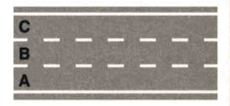
- **22790** — Su una strada a due corsie a doppio senso di marcia, in figura, si deve impegnare quella di sinistra solo per il sorpasso → **✅ VERO**
   
- **22791** — Sulle strade extraurbane principali la sosta è consentita solo nelle apposite aree → **✅ VERO**
- **22792** — Su una strada a due carreggiate separate, in figura, si deve percorrere la carreggiata di destra per la marcia normale e quella di sinistra per il sorpasso → **❌ FALSO**
   
- **22793** — Nelle strade composte da una carreggiata a due corsie a doppio senso di marcia, in figura, si può marciare per file parallele → **❌ FALSO**
   
- **22794** — Nelle strade a quattro carreggiate separate, quelle centrali sono riservate al sorpasso → **❌ FALSO**
- **22795** — Chi intende cambiare corsia deve controllare che la corsia che vuole occupare sia libera davanti per un tratto sufficiente → **✅ VERO**
- **22796** — Chi intende cambiare corsia deve controllare che la corsia che vuole occupare sia libera dietro per un tratto sufficiente → **✅ VERO**
- **22797** — Chi intende cambiare corsia, per effettuare un sorpasso, deve controllare che il veicolo che sta davanti non abbia segnalato l'inizio della stessa manovra → **✅ VERO**
- **22798** — Chi intende cambiare corsia deve segnalare la manovra in anticipo, tramite l'indicatore di direzione → **✅ VERO**
- **22799** — Chi intende cambiare corsia non deve creare intralcio o pericolo per chi percorre la corsia che vuole impegnare → **✅ VERO**
- **22800** — Chi intende cambiare corsia non deve azionare l'indicatore di direzione se la strada è libera → **❌ FALSO**
- **22801** — Chi intende cambiare corsia ha l'obbligo di segnalare la manovra con l'uso dell'avvisatore acustico (clacson o trombe) → **❌ FALSO**
- **22802** — Prima di cambiare corsia è necessario accertare che le corsie siano separate da una striscia continua → **❌ FALSO**
- **22803** — In una carreggiata a doppio senso di circolazione per svoltare a sinistra bisogna avvicinarsi al centro della carreggiata → **✅ VERO**
- **22804** — In una carreggiata a doppio senso di circolazione per svoltare a sinistra occorre, di norma, occupare l'area sinistra dell'incrocio, come i veicoli in figura, salvo diversa segnalazione → **✅ VERO**
   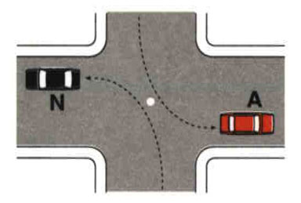
- **22806** — In una carreggiata a doppio senso di circolazione per svoltare a sinistra bisogna dare la precedenza ai veicoli provenienti da destra, salvo diversa segnalazione → **✅ VERO**
- **22808** — In una carreggiata a doppio senso di circolazione per svoltare a sinistra bisogna effettuare la manovra velocemente, per evitare i veicoli provenienti da destra e da sinistra → **❌ FALSO**
- **22809** — In una carreggiata a doppio senso di circolazione per svoltare a sinistra bisogna effettuare la svolta occupando sempre il lato destro dell'incrocio, come i veicoli in figura → **❌ FALSO**
   
- **22811** — In una carreggiata a doppio senso di circolazione per svoltare a sinistra occorre suonare il clacson, per attraversare con maggior sicurezza l'incrocio → **❌ FALSO**
- **22812** — I veicoli devono, di norma, circolare sulla parte destra della carreggiata ed in vicinanza del margine destro → **✅ VERO**
- **22813** — In una strada divisa in due carreggiate separate come in figura, i veicoli devono, di norma, circolare sulla carreggiata di destra rispetto alla propria direzione di marcia → **✅ VERO**
   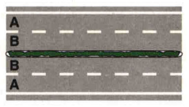
- **22815** — In una carreggiata a doppio senso di marcia con due corsie, come in figura, i veicoli devono circolare nella corsia di destra, impegnando solo quella di sinistra per il sorpasso → **✅ VERO**
   
- **22817** — I veicoli a motore possono circolare per file parallele in vicinanza di incroci regolati da vigili o da semafori → **✅ VERO**
- **22820** — Per svoltare a sinistra i veicoli debbono tenersi sul margine destro della carreggiata → **❌ FALSO**
- **22821** — E' possibile circolare al centro della carreggiata quando la strada è libera → **❌ FALSO**
- **22822** — In una strada a doppio senso di marcia con due corsie, come in figura, i veicoli possono circolare per file parallele → **❌ FALSO**
   
- **22823** — In caso di intenso traffico è consentito circolare per file parallele, utilizzando le corsie riservate agli autobus e ai veicoli in servizio pubblico → **❌ FALSO**
- **22826** — Su strade a doppio senso di marcia con due corsie, come in figura, incrociando altri veicoli occorre spostarsi il più vicino possibile al margine destro della carreggiata → **✅ VERO**
   
- **22827** — In una carreggiata a doppio senso di marcia con due corsie, come in figura, i veicoli devono circolare nella corsia di destra, impegnando quella di sinistra solo per il sorpasso → **✅ VERO**
   
- **22828** — Su strada a doppio senso di marcia con due corsie, come in figura, i veicoli che percorrono il tratto in salita di un dosso devono tenersi il più possibile vicino al margine destro della carreggiata → **✅ VERO**
   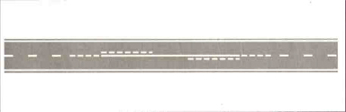
- **22831** — I veicoli che percorrono una curva, su strada a due corsie per ogni senso di marcia, come in figura, possono marciare oltrepassando la striscia discontinua se la strada è libera → **❌ FALSO**
   
- **22836** — In una carreggiata come in figura in caso di intenso traffico, ciclomotori e motocicli possono circolare sulla pista ciclabile se non superano la velocità di 20 km/h → **❌ FALSO**
   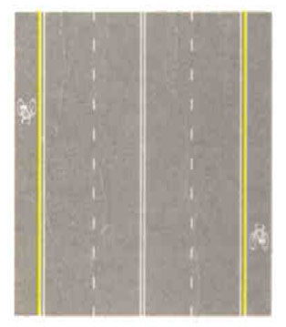
- **22837** — In caso di traffico intenso, i motocicli possono circolare sulle corsie di emergenza → **❌ FALSO**
- **22838** — Quando si vuole cambiare corsia non si deve creare intralcio o pericolo a chi si trova sulla corsia da impegnare → **✅ VERO**
- **22839** — Quando si vuole cambiare corsia si deve segnalare in anticipo la manovra da compiere → **✅ VERO**
- **22840** — Quando si vuole cambiare corsia bisogna controllare che la corsia da impegnare sia libera davanti per un tratto sufficiente → **✅ VERO**
- **22842** — Quando si vuole cambiare corsia si deve segnalare la manovra, facendo uso dell'indicatore di direzione → **✅ VERO**
- **22845** — Quando si vuole cambiare corsia l'uso dell'indicatore di direzione è facoltativo se ci sono le strisce discontinue (tratteggiate) → **❌ FALSO**
- **22846** — Quando si vuole cambiare corsia, per immettersi nella corsia di destra, non occorre alcuna particolare attenzione → **❌ FALSO**
- **22847** — In vicinanza degli incroci, come in figura si può sempre cambiare corsia fino alla striscia trasversale di arresto → **❌ FALSO**
   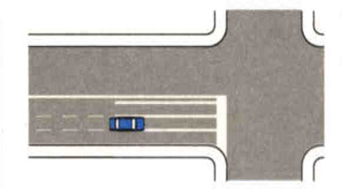
- **22848** — Quando si vuole cambiare corsia per un sorpasso è obbligatorio ridurre la velocità → **❌ FALSO**
- **22849** — Quando si vuole cambiare direzione si deve azionare in anticipo l'indicatore di direzione → **✅ VERO**
- **22850** — Per svoltare a sinistra bisogna, di norma, lasciare il centro dell'incrocio alla nostra destra, come i veicoli in figura → **✅ VERO**
   
- **22851** — Su strada a senso unico per svoltare a sinistra bisogna tenersi sul margine sinistro → **✅ VERO**
- **22854** — Per svoltare a sinistra bisogna girare intorno al centro dell'incrocio, come i veicoli in figura → **❌ FALSO**
   
- **22855** — Quando si vuole cambiare direzione è obbligatorio fare uso delle segnalazioni acustiche (clacson o trombe) → **❌ FALSO**
- **22856** — Viaggiando su semicarreggiata a tre corsie, come in figura, per svoltare a sinistra si deve utilizzare la corsia centrale → **❌ FALSO**
   
- **22857** — Su una strada a doppio senso di marcia per svoltare a sinistra non si deve prendere contromano la strada in cui si svolta → **✅ VERO**
- **22858** — Su una strada a doppio senso di marcia nello svoltare a sinistra si deve, di norma, lasciare il centro dell'incrocio alla nostra destra, come i veicoli in figura → **✅ VERO**
   
- **22860** — Su una strada a doppio senso di marcia per svoltare a sinistra è necessario spostarsi a sinistra della linea continua di mezzeria → **❌ FALSO**
- **22862** — Su una strada a doppio senso di marcia per svoltare a sinistra è necessario arrestarsi prima di completare la manovra, anche se non sopraggiungono veicoli → **❌ FALSO**
- **22866** — E' consentita la marcia per file parallele su strade a due corsie per senso di marcia ad un incrocio regolato da semaforo → **✅ VERO**
- **22867** — Su strade con almeno due corsie per senso di marcia, come in figura, qualora il traffico sia intenso, si può viaggiare per file parallele → **✅ VERO**
   
- **22868** — Di norma, è consentito viaggiare per file parallele lungo il tratto di strada che porta ad un incrocio regolato da agenti del traffico → **✅ VERO**
- **22870** — Percorrendo una carreggiata a senso unico la svolta a sinistra si effettua immettendosi in una corsia qualsiasi, se si viaggia per file parallele → **❌ FALSO**
- **22874** — Nei centri urbani è consentito marciare per file parallele in qualunque condizione di traffico → **❌ FALSO**
- **22878** — Durante la marcia per file parallele i motocicli possono procedere passando tra i veicoli affiancati → **❌ FALSO**
- **22879** — Agli incroci è obbligatorio dare la precedenza ai veicoli circolanti su rotaie (tram e treni), salvo diversa segnalazione → **✅ VERO**
- **22880** — E' obbligatorio dare la precedenza a destra e a sinistra quando, da fermi, ci si immette nella circolazione → **✅ VERO**
- **22881** — E' obbligatorio dare la precedenza a tutti i veicoli circolanti sulle strade quando si effettua l'inversione del senso di marcia → **✅ VERO**
- **22883** — E' obbligatorio dare la precedenza a destra e a sinistra quando si esce da un passo carrabile → **✅ VERO**
- **22886** — E' obbligatorio dare la precedenza a destra e a sinistra in presenza del segnale ROTATORIA → **❌ FALSO**
- **22887** — E' obbligatorio dare la precedenza a tutti i veicoli circolanti negli incroci regolati da semaforo a luce gialla lampeggiante → **❌ FALSO**
- **22888** — E' obbligatorio dare la precedenza a tutti i veicoli circolanti quando si svolta a sinistra → **❌ FALSO**
- **22889** — E' obbligatorio dare la precedenza a tutti i veicoli circolanti in presenza del segnale in figura → **❌ FALSO**
   
- **22890** — Giungendo in vicinanza di un incrocio bisogna predisporsi ad osservare le norme di precedenza → **✅ VERO**
- **22891** — Giungendo in vicinanza di un incrocio ci si deve spostare per tempo sulla corsia destinata alla direzione che si intende prendere → **✅ VERO**
- **22892** — Giungendo in vicinanza di un incrocio si deve segnalare per tempo l'intenzione di svoltare → **✅ VERO**
- **22893** — Giungendo alla guida di un veicolo a due ruote in vicinanza di un incrocio, bisogna incolonnarsi dietro gli altri veicoli in attesa → **✅ VERO**
- **22894** — Giungendo ad un incrocio è consentito impegnarlo solo se si ha la possibilità di proseguire e liberarlo → **✅ VERO**
- **22895** — Giungendo in vicinanza di un incrocio si deve usare la massima prudenza per evitare incidenti → **✅ VERO**
- **22896** — Giungendo in vicinanza di un incrocio bisogna passare sempre prima dei veicoli che arrivano da destra → **❌ FALSO**
- **22897** — Giungendo in vicinanza di un incrocio bisogna sorpassare velocemente a sinistra se si vuole svoltare a destra → **❌ FALSO**
- **22898** — Giungendo in vicinanza di un incrocio nei centri abitati occorre suonare il clacson → **❌ FALSO**
- **22900** — In vicinanza o in corrispondenza degli incroci non è consentito cambiare improvvisamente la direzione di marcia → **✅ VERO**
- **22901** — In vicinanza o in corrispondenza degli incroci non è consentito effettuare l'inversione di marcia → **✅ VERO**
- **22904** — In vicinanza o in corrispondenza degli incroci non è consentito sorpassare una bicicletta, se si deve occupare la corsia opposta di marcia → **✅ VERO**
- **22905** — In vicinanza o in corrispondenza degli incroci non è consentito usare i fari anabbaglianti → **❌ FALSO**
- **22908** — In vicinanza o in corrispondenza degli incroci regolati da semaforo non è consentito il sorpasso → **❌ FALSO**
- **22909** — In vicinanza o in corrispondenza degli incroci non si deve rallentare se il semaforo è a luce gialla lampeggiante → **❌ FALSO**
- **22911** — Se ad un incrocio giungono contemporaneamente da strade diverse due veicoli, l'obbligo di dare la precedenza spetta, di norma, al conducente del veicolo che arriva da sinistra → **✅ VERO**
- **22912** — Se ad un incrocio giungono contemporaneamente da strade diverse due veicoli, entrambi hanno l'obbligo di moderare la velocità, per evitare incidenti → **✅ VERO**
- **22913** — Giungendo ad un incrocio, bisogna essere prudenti e tolleranti nei confronti di chi, pur non avendo la precedenza, passa ugualmente per primo → **✅ VERO**
- **22914** — Uscendo con un veicolo da una proprietà privata, bisogna procedere con prudenza → **✅ VERO**
- **22915** — Uscendo con un veicolo da una proprietà privata, bisogna dare la precedenza agli eventuali pedoni → **✅ VERO**
- **22917** — Se ad un incrocio giungono contemporaneamente da strade diverse due veicoli, l'obbligo di dare la precedenza spetta al conducente del veicolo che percorre la strada più stretta → **❌ FALSO**
- **22918** — Uscendo con un veicolo da una proprietà privata, è obbligatorio suonare il clacson → **❌ FALSO**
- **22919** — Uscendo con un veicolo da una proprietà privata, si ha la precedenza sui pedoni → **❌ FALSO**
- **22927** — Il conducente che intende effettuare l'inversione di marcia su una strada a doppio senso deve dare la precedenza ai veicoli che sopraggiungono → **✅ VERO**
- **22928** — Il conducente che intende effettuare l'inversione di marcia su una strada a doppio senso deve rinunciare a compiere la manovra, qualora vi sia traffico intenso e continuo → **✅ VERO**
- **22929** — Il conducente che intende effettuare l'inversione di marcia su una strada a doppio senso deve rinunciare ad eseguire la manovra, se vi è scarsa visibilità → **✅ VERO**
- **22930** — Il conducente che intende effettuare l'inversione di marcia su una strada a doppio senso deve azionare l'indicatore di direzione → **✅ VERO**
- **22931** — Il conducente che intende effettuare l'inversione di marcia su una strada a doppio senso non deve creare pericolo o intralcio agli altri utenti della strada → **✅ VERO**
- **22932** — Il conducente che intende effettuare l'inversione di marcia su una strada a doppio senso deve azionare la segnalazione luminosa di pericolo → **❌ FALSO**
- **22933** — Il conducente che intende effettuare l'inversione di marcia su una strada a doppio senso può compiere la manovra anche in curva, se dà precedenza a tutti i veicoli → **❌ FALSO**
- **22934** — Il conducente che può effettuare l'inversione di marcia su una strada a doppio senso deve accertarsi se la linea di mezzeria è continua → **❌ FALSO**
- **22935** — Il conducente che intende effettuare l'inversione di marcia su una strada a doppio senso può compiere la manovra anche con scarsa visibilità, se la linea di mezzeria è tratteggiata → **❌ FALSO**
- **22937** — Nelle strade a doppio senso di circolazione non è consentito effettuare l'inversione del senso di marcia in vicinanza o in corrispondenza di curve → **✅ VERO**
- **22938** — L'inversione del senso di marcia non è consentita in vicinanza o in corrispondenza degli incroci → **✅ VERO**
- **22939** — Nelle strade a doppio senso non è consentito effettuare l'inversione del senso di marcia in tutti i casi di scarsa visibilità → **✅ VERO**
- **22940** — Nelle strade a doppio senso di circolazione non è consentito effettuare l'inversione del senso di marcia in vicinanza o in corrispondenza di dossi → **✅ VERO**
- **22941** — Quando manca la segnaletica orizzontale non è consentito effettuare manovre di inversione del senso di marcia → **❌ FALSO**
- **22942** — Qualora la linea di margine della carreggiata sia continua, non è consentito effettuare l'inversione di marcia → **❌ FALSO**
- **22943** — Fuori dai centri abitati non è consentito effettuare l'inversione di marcia → **❌ FALSO**
- **22944** — Sulle autostrade a tre corsie per ogni senso di marcia è consentito l'inversione del senso di marcia → **❌ FALSO**
- **22946** — Negli incroci regolati con circolazione rotatoria, in assenza di specifico segnale, vale la regola generale di dare la precedenza a destra → **✅ VERO**
- **22947** — Negli incroci regolati con rotatoria, la circolazione può essere disciplinata in modo che i veicoli in entrata diano la precedenza a quelli già circolanti nell'anello → **✅ VERO**
- **22948** — In un incrocio regolato con circolazione rotatoria, l'obbligo di dare la precedenza può essere imposto ai veicoli che stanno per immettersi → **✅ VERO**
- **22949** — Giungendo ad un incrocio, regolato con circolazione rotatoria, prima di immettersi è opportuno moderare la velocità ed usare la massima prudenza, controllando nel contempo il comportamento degli altri utenti → **✅ VERO**
- **22951** — In presenza del segnale DARE PRECEDENZA, se occorre arrestarsi, bisogna che ciò avvenga in corrispondenza della striscia trasversale, formata da una serie di triangoli bianchi → **✅ VERO**
- **22952** — Giungendo ad un incrocio in cui la circolazione è regolata con rotatoria, è obbligatorio dare la precedenza ai veicoli provenienti da sinistra → **❌ FALSO**
- **22953** — Per immettersi in un incrocio, regolato con circolazione rotatoria, bisogna dare sempre la precedenza ai veicoli già circolanti all'interno della rotatoria → **❌ FALSO**
- **22954** — In un incrocio regolato con circolazione rotatoria, i veicoli circolanti nell'anello possono effettuare manovre di retromarcia → **❌ FALSO**
- **22956** — Quando un incrocio è regolato con rotatoria, i veicoli circolanti all'interno dell'anello possono sorpassare sia a destra che a sinistra → **❌ FALSO**
- **22957** — Se in una strada a forte pendenza, il passaggio tra veicoli non è facilmente possibile, in genere spetta al conducente che procede in discesa arrestarsi ed eventualmente fare retromarcia → **✅ VERO**
- **22958** — Qualora in una strada a forte pendenza il passaggio tra veicoli risulti difficoltoso, se uno dei due conducenti si trova in vicinanza di una piazzola di scambio, spetta a lui accostare e lasciar passare l'altro conducente → **✅ VERO**
- **22959** — In presenza del segnale DARE PRECEDENZA occorre usare prudenza e moderare la velocità, ma occorre arrestarsi solo in caso di necessità → **✅ VERO**
- **22960** — In presenza del segnale di STOP non occorre arrestarsi, se non vi è la linea trasversale di arresto e non si vedono sopraggiungere veicoli → **❌ FALSO**
- **22961** — Se in una strada a forte pendenza, il passaggio tra veicoli non è facilmente possibile, in genere spetta al conducente che procede in salita arrestarsi → **❌ FALSO**
- **22962** — In vicinanza di un incrocio semaforizzato è consentito arrestarsi sulle strisce pedonali, se il semaforo per i pedoni è disposto al rosso → **❌ FALSO**
- **22970** — Il conducente che intende immettersi nel flusso della circolazione deve assicurarsi di poter effettuare la manovra senza creare pericolo o intralcio agli altri utenti della strada → **✅ VERO**
- **22971** — Il conducente che intende immettersi nel flusso della circolazione deve tenere conto della posizione, distanza, direzione degli altri utenti della strada → **✅ VERO**
- **22972** — Il conducente che intende immettersi nel flusso della circolazione deve azionare l'indicatore di direzione per segnalare con sufficiente anticipo l' intenzione di effettuare tale manovra → **✅ VERO**
- **22973** — Il conducente che intende immettersi nel flusso della circolazione deve dare la precedenza ai veicoli in transito → **✅ VERO**
- **22974** — Il conducente che intende immettersi nel flusso della circolazione può evitare di azionare l'indicatore di direzione se non sopraggiungono altri veicoli → **❌ FALSO**
- **22975** — Il conducente che intende immettersi nel flusso della circolazione deve dare la precedenza ai veicoli in transito solo in presenza di apposito segnale → **❌ FALSO**
- **22976** — Il conducente che si immette nel flusso della circolazione deve dare la precedenza ai veicoli in transito ad eccezione delle biciclette → **❌ FALSO**

## 10. Norme sul sorpasso

- **23457** — Il conducente che intende sorpassare deve accertarsi che la visibilità sia tale da consentire la manovra → **✅ VERO**
- **23458** — Il conducente che intende sorpassare deve accertarsi che la manovra possa compiersi senza costituire intralcio → **✅ VERO**
- **23459** — Il conducente che intende sorpassare deve accertarsi che il conducente che lo precede nella stessa corsia non abbia segnalato di voler compiere analoga manovra → **✅ VERO**
- **23460** — Il conducente che intende sorpassare deve accertarsi che il conducente che lo segue sulla stessa carreggiata non abbia iniziato il sorpasso → **✅ VERO**
- **23461** — Il conducente che intende sorpassare deve accertarsi che la strada sia libera per consentire la completa esecuzione del sorpasso → **✅ VERO**
- **23463** — Il conducente che intende sorpassare deve tener conto di eventuali veicoli che provengono dalla direzione opposta → **✅ VERO**
- **23467** — Il conducente che intende sorpassare deve accertarsi semplicemente che nessun veicolo provenga dalla direzione opposta → **❌ FALSO**
- **23468** — Il conducente che intende sorpassare ha come unico obbligo quello di azionare l'indicatore di direzione (frecce) → **❌ FALSO**
- **23469** — Il conducente che intende sorpassare deve unicamente accertarsi che non vi sia nessun segnale di divieto di sorpasso → **❌ FALSO**
- **23470** — Prima di iniziare una manovra di sorpasso occorre azionare l'indicatore di direzione → **✅ VERO**
- **23473** — Dopo aver effettuato una manovra di sorpasso il conducente del veicolo deve riportarsi a destra appena possibile senza creare pericolo o intralcio → **✅ VERO**
- **23474** — Il conducente del veicolo che viene sorpassato deve agevolare la manovra di sorpasso e non accelerare → **✅ VERO**
- **23476** — La manovra di sorpasso non va effettuata se lo spazio visibile risulta insufficiente per completarla in sicurezza → **✅ VERO**
- **23478** — Il conducente che intende effettuare il sorpasso ha l'obbligo di azionare il segnale acustico → **❌ FALSO**
- **23480** — Dopo il sorpasso il veicolo può immediatamente spostarsi a destra se taglia la strada a quello sorpassato → **❌ FALSO**
- **23481** — Il conducente del veicolo sorpassato può gareggiare in velocità con il conducente del veicolo che lo sta sorpassando → **❌ FALSO**
- **23482** — La manovra di sorpasso si effettua anche se lo spazio visibile risulta insufficiente per completarla in sicurezza → **❌ FALSO**
- **23484** — La manovra di sorpasso deve essere eseguita a destra se il conducente del veicolo da sorpassare ha segnalato l'intenzione di voler svoltare a sinistra → **✅ VERO**
- **23485** — La manovra di sorpasso deve essere eseguita a destra se, su strada a senso unico, il conducente del veicolo da sorpassare ha segnalato l'intenzione di voler accostare a sinistra → **✅ VERO**
- **23487** — Se il tram o il filobus sono fermi la manovra di sorpasso può effettuarsi a destra se esiste il salvagente → **✅ VERO**
- **23491** — La manovra di sorpasso può, di norma, effettuarsi a destra sulle autostrade → **❌ FALSO**
- **23492** — La manovra di sorpasso può effettuarsi a sinistra soltanto se il veicolo da sorpassare sta svoltando a destra → **❌ FALSO**
- **23493** — E' vietato effettuare un secondo sorpasso senza prima essersi riportati a destra → **❌ FALSO**
- **23494** — Il sorpasso è vietato in prossimità delle curve su strade a due corsie a doppio senso di marcia → **✅ VERO**
- **23495** — Il sorpasso è vietato in prossimità dei dossi su strade a due corsie a doppio senso di marcia → **✅ VERO**
- **23496** — Il sorpasso è vietato in caso di scarsa visibilità → **✅ VERO**
- **23499** — E' vietato il sorpasso di un veicolo che ne stia superando un altro se ciò impone di spostarsi sul lato riservato all'altro senso di marcia → **✅ VERO**
- **23500** — E' vietato il sorpasso di veicoli fermi ai passaggi a livello, se bisogna impegnare la semicarreggiata opposta → **✅ VERO**
- **23502** — E' vietato il sorpasso di veicoli fermi ai semafori quando, a tal fine è necessario spostarsi sul lato riservato all'altro senso di marcia → **✅ VERO**
- **23510** — E' vietato il sorpasso di un veicolo che si sia arrestato in corrispondenza di un passaggio pedonale per consentire l'attraversamento di pedoni → **✅ VERO**
- **23511** — E' vietato il sorpasso di un veicolo che abbia rallentato in corrispondenza di un passaggio pedonale per consentire l'attraversamento dei pedoni → **✅ VERO**
- **23512** — E' vietato sorpassare sulle corsie di accelerazione o di decelerazione → **✅ VERO**
- **23513** — E' vietato il sorpasso se si deve valicare la striscia longitudinale bianca continua semplice o doppia → **✅ VERO**
- **23515** — Lo spazio necessario al sorpasso aumenta in relazione alla maggiore lunghezza del veicolo da sorpassare → **✅ VERO**
- **23517** — Lo spazio necessario al sorpasso è maggiore se vi è poca differenza di velocità tra i veicoli → **✅ VERO**
- **23522** — E' vietato il sorpasso se il veicolo da superare si è fermato per dare precedenza ai pedoni, anche fuori dagli attraversamenti pedonali → **✅ VERO**
- **23524** — Prima di rientrare nella corsia di destra dopo il sorpasso, occorre controllare la posizione del veicolo sorpassato attraverso gli specchietti retrovisori → **✅ VERO**
- **23526** — Il sorpasso è vietato in curva anche se la strada è a due carreggiate separate → **❌ FALSO**
- **23528** — E' consentito il sorpasso di veicoli fermi ai passaggi a livello senza barriere se il treno è distante → **❌ FALSO**
- **23530** — E' consentito il sorpasso sulle intersezioni purché non provenga nessuno dalla destra → **❌ FALSO**
- **23531** — E' consentito il sorpasso sulle corsie d'accelerazione purché la manovra venga effettuata con attenzione → **❌ FALSO**
- **23532** — E' sempre consentito superare un veicolo a due ruote → **❌ FALSO**
- **23533** — E' vietato il sorpasso nelle strade a senso unico → **❌ FALSO**
- **23535** — In autostrada si può sorpassare indifferentemente a destra e a sinistra → **❌ FALSO**
- **23536** — Il sorpasso tra motocicli si può effettuare sia a destra che a sinistra → **❌ FALSO**
- **23538** — Lo spazio necessario per il sorpasso è indipendente dalla lunghezza dei veicoli → **❌ FALSO**
- **23539** — E' vietato il sorpasso di un autobus fermo per la salita e la discesa dei passeggeri → **❌ FALSO**
- **23540** — Il sorpasso è vietato sulle curve e sui dossi delle strade a senso unico → **❌ FALSO**
- **23541** — Il sorpasso è vietato se si è costretti a superare la linea longitudinale tratteggiata → **❌ FALSO**
- **23542** — E' consentito il sorpasso a destra dei motocicli se vi è spazio sufficiente → **❌ FALSO**
- **23543** — In caso di intenso traffico è consentito ai motociclisti utilizzare per il sorpasso le corsie riservate → **❌ FALSO**
- **23544** — Quando si inizia il sorpasso è consentito segnalare la manovra ai veicoli che precedono lampeggiando con i proiettori abbaglianti → **✅ VERO**
- **23549** — Dopo il sorpasso bisogna rientrare immediatamente a destra, rallentando → **❌ FALSO**
- **23552** — È vietato il sorpasso se nevica → **❌ FALSO**
- **23560** — E'vietato sorpassare accodandosi ad un'ambulanza in servizio di emergenza → **✅ VERO**
- **23563** — Su carreggiate a due corsie a doppio senso di marcia in prossimità di un dosso, è consentito sorpassare nella scia del veicolo che precede → **❌ FALSO**
- **23570** — Nella fase di sorpasso, il conducente è tenuto a evitare di stringere o di tagliare la strada al veicolo sorpassato → **✅ VERO**
- **23571** — La pericolosità del sorpasso è determinata dal rischio di urtare altri veicoli che manifestano l'intenzione di compiere la stessa manovra → **✅ VERO**
- **23573** — La pericolosità del sorpasso è determinata dal rischio di collisione, in fase di rientro in corsia, con il veicolo sorpassato → **✅ VERO**
- **23574** — La pericolosità del sorpasso è determinata dal rischio di urto frontale con un veicolo che provenga dal senso contrario → **✅ VERO**
- **23578** — Nella fase di sorpasso, il conducente è tenuto a mantenere una velocità almeno doppia di quella del veicolo sorpassato → **❌ FALSO**
- **23583** — Nella fase di rientro dal sorpasso in autostrada, il conducente deve distanziarsi di almeno 100 m dal veicolo sorpassato → **❌ FALSO**
- **23586** — Il sorpasso a destra è consentito quando si percorre una strada extraurbana a senso unico → **❌ FALSO**
- **23587** — Il conducente che intende sorpassare deve assicurarsi che la potenza del motore del proprio veicolo sia maggiore di quella del veicolo da sorpassare → **❌ FALSO**
- **23588** — Il conducente del veicolo da sorpassare ha l'obbligo di non gareggiare in velocità con il veicolo sorpassante → **✅ VERO**
- **23589** — Il conducente del veicolo da sorpassare ha l'obbligo di non accelerare la propria andatura → **✅ VERO**
- **23590** — Il conducente del veicolo da sorpassare ha l'obbligo di fermarsi appena possibile per far defluire il traffico se guida un veicolo molto lento → **✅ VERO**
- **23591** — Il conducente del veicolo da sorpassare ha l'obbligo di tenersi il più possibile vicino al margine destro su strade ad unica corsia per senso di marcia → **✅ VERO**
- **23593** — Il conducente del veicolo da sorpassare ha l'obbligo di azionare la segnalazione luminosa di pericolo(lampeggio simultaneo di tutte le frecce) per segnalare che la strada è sgombra → **❌ FALSO**
- **23594** — Il conducente del veicolo da sorpassare ha l'obbligo di ridurre sempre la propria velocità → **❌ FALSO**
- **23595** — Il conducente del veicolo da sorpassare ha l'obbligo di inserire le marce più basse per facilitare il sorpasso → **❌ FALSO**
- **23596** — Per effettuare il sorpasso bisogna considerare che un veicolo trainante un caravan non può mai essere superato in una discesa a forte pendenza → **❌ FALSO**
- **23598** — Se si viene sorpassati mentre sopraggiunge un veicolo dal senso opposto, è consigliabile ridurre la velocità → **✅ VERO**
- **23599** — Se si viene sorpassati mentre sopraggiunge un veicolo dal senso opposto, occorre spostarsi il più vicino possibile al margine destro della carreggiata → **✅ VERO**
- **23604** — Se si viene sorpassati mentre sopraggiunge un veicolo dal senso opposto, si ha l'obbligo di mantenere la stessa velocità → **❌ FALSO**
- **23605** — Se si viene sorpassati mentre sopraggiunge un veicolo dal senso opposto, occorre azionare l'indicatore di direzione destro, come segnale di pericolo → **❌ FALSO**
- **23607** — Durante un sorpasso in autostrada, l'insufficiente distanza di sicurezza può essere causa di incidente → **✅ VERO**
- **23609** — Durante un sorpasso in autostrada, mantenersi troppo a lungo sulla corsia di sorpasso può essere motivo di intralcio → **✅ VERO**
- **23612** — Il sorpasso in autostrada può essere motivo di incidente, se viene effettuato in vicinanza di una piazzola di sosta → **❌ FALSO**
- **23613** — Il sorpasso in autostrada può essere motivo di incidente, se si viaggia con le luci anabbaglianti sempre accese → **❌ FALSO**

## 11. Fermata, sosta, arresto e partenza

- **23622** — Il conducente di un autoveicolo in sosta sul lato destro di una strada urbana, prima di aprire la portiera, deve fare particolare attenzione ai veicoli che sopraggiungono → **✅ VERO**
- **23623** — Il conducente di un autoveicolo in sosta su una strada stretta, prima di scendere deve controllare che non sopraggiungano veicoli → **✅ VERO**
- **23624** — E' opportuno che il conducente di un autoveicolo in sosta sul lato sinistro in una strada urbana a senso unico, ricordi al passeggero di prestare particolare attenzione ai veicoli che sopraggiungono, prima di aprire la portiera → **✅ VERO**
- **23625** — E' opportuno che il conducente di un autoveicolo, in sosta sul lato destro di una strada urbana, ricordi al passeggero che apre la portiera di destra di fare attenzione ai pedoni in transito → **✅ VERO**
- **23626** — Il conducente di un autoveicolo può lasciare il motore acceso se sosta per poco tempo → **❌ FALSO**
- **23627** — Il conducente di un autoveicolo in sosta su una strada stretta, prima di scendere deve preoccuparsi dei veicoli che sopraggiungono da dietro, ma non di quelli di fronte → **❌ FALSO**
- **23650** — La fermata non deve arrecare intralcio alla circolazione → **✅ VERO**
- **23651** — Durante la fermata il conducente non deve impedire con il proprio autoveicolo il normale flusso del traffico → **✅ VERO**
- **23652** — Durante la fermata il conducente deve comportarsi in modo da non costituire pericolo agli altri utenti della strada → **✅ VERO**
- **23653** — Durante la fermata il conducente deve essere sempre presente e pronto a riprendere la marcia → **✅ VERO**
- **23654** — Durante la fermata il conducente deve sempre adottare le opportune cautele atte ad evitare incidenti → **✅ VERO**
- **23655** — Non è consentito fermarsi per chiedere informazioni agli agenti del traffico, quando ciò possa causare intralcio o rallentamento alla circolazione → **✅ VERO**
- **23656** — Durante la fermata il conducente può allontanarsi per brevissimo tempo prima di riprendere la marcia → **❌ FALSO**
- **23657** — La fermata di un veicolo è sempre consentita per chiedere informazioni agli agenti del traffico → **❌ FALSO**
- **23658** — Durante la fermata il conducente, se si allontana, deve lasciare il veicolo con il motore acceso → **❌ FALSO**
- **23659** — In caso di fermata, ove non esista marciapiede rialzato, il conducente deve lasciare uno spazio non inferiore ad un metro per il transito dei pedoni → **✅ VERO**
- **23660** — Fuori dei centri abitati, il conducente, in caso di fermata, deve collocare, se possibile, il veicolo fuori della carreggiata → **✅ VERO**
- **23661** — Fuori dei centri abitati, il conducente, in caso di fermata, deve collocare il veicolo fuori della carreggiata, ma non sulle piste ciclabili → **✅ VERO**
- **23662** — Fuori dei centri abitati, se non è possibile collocare il veicolo fuori della carreggiata, il conducente deve effettuare la fermata il più vicino possibile al margine destro della carreggiata → **✅ VERO**
- **23663** — In caso di fermata su strada urbana in cui non esiste il marciapiede rialzato, il conducente deve collocare il veicolo il più vicino possibile al margine destro della carreggiata → **❌ FALSO**
- **23664** — Fuori dei centri abitati, il conducente, in caso di fermata ha l'obbligo di collocare il veicolo fuori della carreggiata, eventualmente su una pista ciclabile → **❌ FALSO**
- **23665** — La fermata è vietata in corrispondenza o in prossimità dei passaggi a livello → **✅ VERO**
- **23666** — La fermata è vietata sui binari di linee ferroviarie o tranviarie o così vicino ad essi da intralciare la marcia dei veicoli su rotaia → **✅ VERO**
- **23667** — La fermata è vietata nelle gallerie, salvo diversa segnalazione. → **✅ VERO**
- **23668** — La fermata è vietata nei sottovia, sotto i sovrapassaggi, sotto i fornici e i portici, salvo diversa segnalazione. → **✅ VERO**
- **23669** — La fermata è vietata sui dossi. → **✅ VERO**
- **23670** — Fuori dai centri abitati e sulle strade urbane di scorrimento la fermata è vietata in prossimità dei dossi. → **✅ VERO**
- **23671** — La fermata è vietata nelle curve e, fuori dei centri abitati e sulle strade urbane di scorrimento, anche in loro prossimità → **✅ VERO**
- **23672** — La fermata è vietata sul margine destro della carreggiata → **❌ FALSO**
- **23673** — La fermata è vietata lungo il margine sinistro di una carreggiata a senso unico di circolazione → **❌ FALSO**
- **23674** — La fermata di breve durata è consentita anche in curva. → **❌ FALSO**
- **23675** — La fermata è vietata allo sbocco dei passi carrabili → **❌ FALSO**
- **23676** — La fermata è vietata sulle aree destinate al mercato o al carico e allo scarico delle merci → **❌ FALSO**
- **23677** — La fermata è vietata in prossimità e in corrispondenza di segnali stradali verticali in modo da occultarne la vista → **✅ VERO**
- **23678** — La fermata è vietata in prossimità e in corrispondenza di segnali semaforici in modo da occultarne la vista → **✅ VERO**
- **23679** — La fermata è vietata in corrispondenza dei segnali orizzontali di preselezione e lungo le corsie di canalizzazione → **✅ VERO**
- **23680** — Fuori dei centri abitati, la fermata è vietata in corrispondenza e in prossimità delle aree di intersezione → **✅ VERO**
- **23681** — Nei centri abitati, la fermata e la sosta sono vietate in corrispondenza delle aree di intersezione e in prossimità di esse a meno di 5 metri, salvo diversa segnalazione. → **✅ VERO**
- **23682** — La fermata è vietata limitatamente alle ore di esercizio, in corrispondenza dei distributori di carburante → **❌ FALSO**
- **23683** — La fermata è vietata dopo il segnale DIVIETO DI SOSTA → **❌ FALSO**
   
- **23684** — La fermata è vietata in prossimità dei segnali stradali, anche se il veicolo non ne occulta la vista → **❌ FALSO**
- **23685** — La fermata è vietata lungo le autostrade, anche in caso di emergenza → **❌ FALSO**
- **23686** — Nei centri abitati la fermata è vietata in prossimità delle aree di intersezione, a più di 5 metri → **❌ FALSO**
- **23687** — La fermata è consentita sulle corsie di accelerazione, purché brevissima → **❌ FALSO**
- **23688** — La sosta e la fermata sono sempre vietate sugli attraversamenti pedonali → **✅ VERO**
- **23689** — La sosta e la fermata sono vietate in ogni caso sulle piste ciclabili e agli sbocchi di esse → **✅ VERO**
- **23690** — La sosta e la fermata sono vietate sui marciapiedi, salvo diversa segnalazione → **✅ VERO**
- **23691** — La fermata è consentita allo sbocco dei passi carrabili → **✅ VERO**
- **23692** — La fermata è consentita davanti ai cassonetti dei rifiuti urbani → **✅ VERO**
- **23693** — La fermata è consentita sugli attraversamenti pedonali per far scendere un passeggero → **❌ FALSO**
- **23694** — La fermata per esigenze di brevissima durata è vietata sulle piste ciclabili ma non agli sbocchi di esse → **❌ FALSO**
- **23695** — La fermata è vietata allo sbocco dei passi carrabili → **❌ FALSO**
- **23696** — La fermata è sempre vietata in seconda fila → **❌ FALSO**
- **23697** — La fermata è vietata in ogni caso nelle ore notturne → **❌ FALSO**

## 12. Ingombro della carreggiata; segnalazione di veicolo fermo; norme sulla circolazione in autostrada e strade extraurbane principali; trasporto di persone; carico dei veicoli; pannelli sui veicoli; traino dei veicoli e dei veicoli in avaria; traino dei rimorchi

- **23854** — Sulle autostrade e strade extraurbane principali è vietata la circolazione di macchine agricole → **✅ VERO**
- **23855** — Sulle autostrade e strade extraurbane principali è vietata la circolazione di veicoli con carico disordinato e non solidamente assicurato o sporgente oltre i limiti consentiti → **✅ VERO**
- **23857** — Sulle autostrade e strade extraurbane principali è vietata la circolazione di veicoli le cui condizioni di uso, equipaggiamento e gommatura possono costituire pericolo per la circolazione → **✅ VERO**
- **23861** — Sono ammessi a circolare su autostrade e strade extraurbane principali i ciclomotori che sviluppano una velocità di almeno 50 km/h → **❌ FALSO**
- **23862** — Sono ammesse a circolare su autostrade e strade extraurbane principali le macchine agricole, non trainanti un rimorchio → **❌ FALSO**
- **23863** — Sono ammessi a circolare su autostrade e strade extraurbane principali i veicoli non muniti di pneumatici, se assicurati → **❌ FALSO**
- **23870** — Sulle carreggiate, sulle rampe, sugli svincoli, sulle aree di servizio o di parcheggio e in ogni altra pertinenza autostradale è vietato richiedere o concedere passaggi → **✅ VERO**
- **23877** — Nelle aree di servizio e di parcheggio delle autostrade la durata massima per la sosta di un veicolo è di tre ore → **❌ FALSO**
- **23878** — Durante la marcia sulle autostrade e strade extraurbane principali è obbligatorio l'uso dei proiettori anabbaglianti anche di giorno → **✅ VERO**
- **23879** — Durante la marcia sulle autostrade e strade extraurbane principali l'uso dei proiettori anabbaglianti è facoltativo in condizioni di perfetta visibilità → **❌ FALSO**
- **23880** — Sulle carreggiate, sulle rampe e sugli svincoli di autostrade e strade extraurbane principali è vietato invertire il senso di marcia e attraversare lo spartitraffico, anche all'altezza dei varchi → **✅ VERO**
- **23881** — Sulle carreggiate, sulle rampe e sugli svincoli di autostrade e strade extraurbane principali è vietato percorrere la carreggiata o parte di essa nel senso di marcia opposto a quello consentito → **✅ VERO**
- **23882** — Sulle carreggiate, sulle rampe e sugli svincoli di autostrade e strade extraurbane principali è vietato effettuare la retromarcia → **✅ VERO**
- **23884** — Sulle corsie per le soste di emergenza delle autostrade è vietato effettuare la retromarcia → **✅ VERO**
- **23885** — Sulle carreggiate, sulle rampe e sugli svincoli di autostrade e strade extraurbane principali il conducente può invertire il senso di marcia adottando tutti gli accorgimenti necessari → **❌ FALSO**
- **23886** — Sulle carreggiate, sulle rampe e sugli svincoli di autostrade e strade extraurbane principali il conducente può invertire il senso di marcia in casi di particolare emergenza → **❌ FALSO**
- **23887** — Sulle carreggiate, sulle rampe e sugli svincoli di autostrade e strade extraurbane principali il conducente può procedere in senso contrario al normale flusso del traffico, per brevi tratti → **❌ FALSO**
- **23888** — Sulle autostrade e strade extraurbane principali il conducente può utilizzare la corsia di emergenza se il traffico è intenso → **❌ FALSO**
- **23889** — Sulle autostrade e sulle strade extraurbane principali il conducente che percorre la corsia di accelerazione deve dare la precedenza ai veicoli in circolazione sulle corsie di marcia → **✅ VERO**
- **23891** — Sulle autostrade e sulle strade extraurbane principali il conducente deve segnalare tempestivamente il cambiamento di corsia servendosi degli indicatori di direzione → **✅ VERO**
- **23892** — In caso di ingorgo su strade extraurbane principali o autostrade, se la corsia di emergenza manca o non è sufficiente alla circolazione dei veicoli di polizia o di soccorso, il conducente del veicolo che occupa la prima corsia di destra deve disporsi il più vicino possibile alla striscia di sinistra → **✅ VERO**
- **23895** — Sulle autostrade e sulle strade extraurbane principali se il traffico non è intenso il conducente non ha l'obbligo di servirsi degli indicatori di direzione per segnalare il cambiamento di corsia → **❌ FALSO**
- **23896** — Sulle autostrade e sulle strade extraurbane principali è consentita la marcia per file parallele anche in assenza di traffico → **❌ FALSO**
- **23897** — Sulle carreggiate, sulle rampe e sugli svincoli delle autostrade è consentito sostare solo in situazioni di emergenza dovute a malessere del conducente o dei passeggeri oppure ad inefficienza del veicolo → **✅ VERO**
- **23898** — Sulle carreggiate, sulle rampe e sugli svincoli delle autostrade è consentito, nel caso di malessere di un passeggero, fermarsi sulla corsia per la sosta di emergenza → **✅ VERO**
- **23900** — Sulle carreggiate, sulle rampe e sugli svincoli delle autostrade la sosta di emergenza non deve superare il tempo strettamente necessario e non deve protrarsi comunque oltre tre ore → **✅ VERO**
- **23901** — Sulle carreggiate, sulle rampe e sugli svincoli delle autostrade è vietato sostare o fermarsi, in caso di malessere dei passeggeri → **❌ FALSO**
- **23903** — Sulle carreggiate, sulle rampe e sugli svincoli delle autostrade la sosta di emergenza non deve superare il tempo strettamente necessario e può protrarsi fino a 24 ore → **❌ FALSO**
- **24075** — Nei caravan, per ridurre il rischio di ribaltamento in curva, occorre sistemare il carico degli oggetti pesanti in modo da mantenere il baricentro il più basso possibile → **✅ VERO**
- **24076** — Nei caravan, per ridurre il rischio di ribaltamento in curva, occorre sistemare il carico in modo il più possibile equilibrato tra lato destro e sinistro → **✅ VERO**
- **24077** — Il caravan non è considerato un rimorchio perché può essere adibito ad alloggio → **❌ FALSO**
- **24078** — E' possibile alloggiare nei caravan (roulotte) durante la circolazione, purché tutti i passeggeri allaccino le cinture di sicurezza → **❌ FALSO**
- **24115** — Alla guida di un veicolo con rimorchio, nello svoltare a destra, bisogna fare particolare attenzione a non investire, con la ruota posteriore destra, eventuali pedoni che si trovino vicino al marciapiede → **✅ VERO**
- **24116** — Quando si traina un rimorchio, bisogna considerare che nelle curve la fascia di ingombro è maggiore → **✅ VERO**
- **24117** — Trainando un rimorchio nelle forti discese, occorre tener conto della forza di spinta esercitata dal rimorchio sulla motrice → **✅ VERO**
- **24118** — Quando si traina un rimorchio, specie se carico, si ha una sensibile riduzione della capacità di accelerazione (ripresa) del veicolo → **✅ VERO**
- **24119** — Prima di effettuare qualsiasi manovra con il rimorchio agganciato è bene accertarsi che non vi siano cose e/o persone nel raggio di manovra del complesso → **✅ VERO**
- **24120** — Nelle curve il rimorchio tende a "stringere" perché percorre una traiettoria circolare con raggio inferiore alla motrice → **✅ VERO**
- **24123** — Nell'affrontare una curva a velocità moderata il rimorchio compie sempre lo stesso percorso fatto dalla motrice → **❌ FALSO**
- **24124** — Durante la marcia, il rimorchio deve avere il ruotino pivottante di manovra abbassato (poggiato al suolo) → **❌ FALSO**
- **24125** — Nei veicoli dotati di sensori di parcheggio non è possibile agganciare un rimorchio → **❌ FALSO**
- **24126** — Trainare un rimorchio non comporta un aumento dei consumi di carburante se si marcia a velocità moderata → **❌ FALSO**
- **24127** — Le parti meccaniche in movimento degli organi di traino di un autoveicolo e di un rimorchio devono essere mantenute pulite e adeguatamente lubrificate → **✅ VERO**
- **24128** — Gli organi di traino di un veicolo non devono presentare giochi, deformazioni o incrinature → **✅ VERO**
- **24130** — Quando si traina un rimorchio occorre verificare che il carico verticale gravante sul gancio non ecceda il limite indicato dal costruttore → **✅ VERO**
- **24131** — Il carico verticale massimo che può gravare sul gancio della motrice è indicato in un' apposita targhetta applicata sul gancio di traino → **✅ VERO**
- **24133** — Gli organi di traino di un veicolo possono non essere di tipo omologato, se destinati solo al traino di rimorchi leggeri → **❌ FALSO**
- **24134** — Per poter trainare un rimorchio leggero non occorre effettuare il collegamento elettrico fra motrice e rimorchio → **❌ FALSO**
- **24135** — In caso di rottura degli organi di traino di un veicolo, gli stessi possono essere riparati tramite saldatura presso officina specializzata → **❌ FALSO**
- **24136** — Per garantire una maggiore sicurezza durante la guida di un veicolo con rimorchio, è consigliabile concentrare il carico massimo in corrispondenza del gancio di traino → **❌ FALSO**

## 13. Uso delle luci; uso dei dispositivi acustici; spie e simboli

- **24141** — Nelle autostrade e strade extraurbane, è obbligatorio accendere i fari anabbaglianti anche di giorno o, in alternativa, le luci di marcia diurna → **✅ VERO**
- **24142** — L'errata impostazione dell'orientamento dei proiettori può ridurre la visibilità del conducente o abbagliare gli altri utenti → **✅ VERO**
- **24143** — Proiettori anabbaglianti male orientati possono abbagliare gli altri utenti della strada → **✅ VERO**
- **24146** — Percorrendo una strada extraurbana durante una giornata assolata è sufficiente accendere le luci di posizione → **❌ FALSO**
- **24147** — Percorrendo una strada extraurbana, è obbligatorio tenere accesi i proiettori abbaglianti durante le ore diurne → **❌ FALSO**
- **24148** — L'uso delle luci di posizione è obbligatorio di notte durante la sosta fuori della carreggiata → **❌ FALSO**
- **24150** — Durante la marcia nei centri abitati, è obbligatorio tenere accese le luci anabbaglianti da mezz'ora dopo il tramonto del sole a mezz'ora prima del suo sorgere → **✅ VERO**
- **24151** — Durante la marcia, in caso di scarsa visibilità per condizioni atmosferiche (neve, pioggia, nebbia), è obbligatorio tenere accese le luci di posizione e quelle anabbaglianti → **✅ VERO**
- **24152** — Durante la marcia, in caso di nebbia con visibilità inferiore a 50 metri, bisogna usare la luce posteriore per nebbia, se il veicolo ne è dotato → **✅ VERO**
- **24154** — Durante la marcia, è obbligatorio tenere accese le luci abbaglianti, a partire dal tramonto del sole fino al suo sorgere → **❌ FALSO**
- **24155** — Di notte, in caso di sosta fuori dalla carreggiata, è obbligatorio tenere accese le luci anabbaglianti → **❌ FALSO**
- **24156** — Se si lascia il veicolo in un parcheggio autorizzato, è obbligatorio tenere accese per tutto il tempo le luci di sosta → **❌ FALSO**
- **24157** — E' obbligatorio accendere i proiettori anabbaglianti, anche di giorno, quando si transita in galleria → **✅ VERO**
- **24159** — E' obbligatorio accendere i proiettori anabbaglianti nelle gallerie stradali, solo se scarsamente illuminate → **❌ FALSO**
- **24160** — Durante la marcia, in caso di pioggia intensa, oltre alle luci anabbaglianti bisogna tenere accesa la luce posteriore per nebbia, se il veicolo ne è dotato → **✅ VERO**
- **24161** — Durante la marcia, in caso di fitta nevicata, oltre alle luci anabbaglianti bisogna tenere accesa la luce posteriore per nebbia, se il veicolo ne è dotato → **✅ VERO**
- **24162** — Durante la marcia fuori dai centri abitati, è obbligatorio fare uso delle luci anabbaglianti, sia di giorno che di notte → **✅ VERO**
- **24164** — Durante la marcia nelle ore notturne, l'uso delle luci anabbaglianti è obbligatorio anche se l'illuminazione pubblica è sufficiente → **✅ VERO**
- **24165** — Durante la marcia, l'uso delle luci anabbaglianti non è consentito nelle gallerie illuminate → **❌ FALSO**
- **24166** — Durante la marcia, l'uso delle luci di posizione è sempre consentito in alternativa a quelle anabbaglianti → **❌ FALSO**
- **24167** — L'uso delle luci anabbaglianti è obbligatorio quando si sorpassa un'auto della polizia → **❌ FALSO**
- **24225** — Si devono usare gli indicatori di direzione ogni volta che si deve effettuare una manovra di svolta → **✅ VERO**
- **24226** — Si devono usare gli indicatori di direzione se si intende uscire dalla carreggiata per effettuare una fermata → **✅ VERO**
- **24227** — Si devono usare gli indicatori di direzione quando, partendo dal margine della carreggiata, ci si vuole immettere nella circolazione → **✅ VERO**
- **24228** — Si devono usare gli indicatori di direzione per segnalare l'intenzione di spostarsi nella corsia di decelerazione di uno svincolo autostradale → **✅ VERO**
- **24229** — Si devono usare gli indicatori di direzione per segnalare l'intenzione di entrare sulla carreggiata autostradale, provenendo da una corsia di accelerazione → **✅ VERO**
- **24230** — Non si devono usare gli indicatori di direzione quando si cambia corsia mentre si circola su strada a senso unico → **❌ FALSO**
- **24231** — Non è mai necessario usare gli indicatori di direzione quando si circola su strada a doppio senso ma con carreggiate separate da spartitraffico → **❌ FALSO**
- **24232** — Non si devono usare gli indicatori di direzione se, per effettuare una fermata fuori della carreggiata, ci si sposta sul margine sinistro → **❌ FALSO**
- **24233** — Si devono usare gli indicatori di direzione destri per segnalare che si sta per frenare bruscamente → **❌ FALSO**
- **24234** — Non si devono usare gli indicatori di direzione se, per entrare in un passo carrabile, occorre svoltare a destra → **❌ FALSO**
- **24237** — L'uso degli indicatori di direzione è necessario per segnalare che si vuole effettuare un cambio di corsia → **✅ VERO**
- **24238** — L'uso degli indicatori di direzione è necessario per segnalare l'intenzione di effettuare una manovra di sorpasso → **✅ VERO**
- **24240** — L'uso degli indicatori di direzione è necessario ogni qualvolta si deve fare una manovra di svolta → **✅ VERO**
- **24244** — L'uso degli indicatori di direzione è necessario quando si inizia una manovra di sorpasso, ma non quando la si termina rientrando nella corsia di marcia normale → **❌ FALSO**
- **24245** — L'uso degli indicatori di direzione non è necessario se si deve parcheggiare il veicolo spostandosi verso il margine destro della carreggiata → **❌ FALSO**
- **24247** — L'uso degli indicatori di direzione destri è necessario quando ci si arresta per cause di interruzione della circolazione → **❌ FALSO**
- **24248** — L'uso dei proiettori a luce abbagliante è vietato, di norma, durante la marcia nei centri abitati → **✅ VERO**
- **24249** — L'uso dei proiettori a luce abbagliante è necessario, fuori dei centri abitati, quando l'illuminazione pubblica è insufficiente e non si incrociano altri veicoli → **✅ VERO**
- **24250** — L'uso dei proiettori a luce abbagliante è necessario, fuori dei centri abitati, quando l'illuminazione pubblica manca e non si incrociano altri veicoli → **✅ VERO**
- **24251** — L'uso dei proiettori a luce abbagliante va sostituito con quello dei proiettori a luce anabbagliante quando si incrociano altri veicoli → **✅ VERO**
- **24252** — L'uso dei proiettori a luce abbagliante è di norma consentito in città, in caso di nebbia fitta → **❌ FALSO**
- **24253** — L'uso dei proiettori a luce abbagliante è necessario nelle gallerie urbane a senso unico → **❌ FALSO**
- **24254** — L'uso dei proiettori a luce abbagliante è sempre ammesso quando si trasportano feriti o ammalati gravi → **❌ FALSO**
- **24255** — L'uso dei proiettori a luce abbagliante è necessario, di giorno, se si circola su un'autostrada viaggiando controsole → **❌ FALSO**
- **24256** — E' consentito l'uso intermittente dei proiettori di profondità (a luce abbagliante), sia di giorno che di notte, per dare avvertimenti utili al fine di evitare incidenti → **✅ VERO**
- **24257** — E' consentito l'uso intermittente dei proiettori di profondità (a luce abbagliante), anche all'interno dei centri abitati, per dare avvertimenti utili al fine di evitare incidenti → **✅ VERO**
- **24258** — E' consentito l'uso intermittente dei proiettori di profondità (a luce abbagliante) per segnalare al veicolo che precede, sia di giorno che di notte, l'intenzione di sorpassare → **✅ VERO**
- **24262** — E' consentito l'uso intermittente dei proiettori di profondità (a luce abbagliante), solo quando si trasportano feriti o ammalati gravi → **❌ FALSO**
- **24263** — E' consentito l'uso intermittente dei proiettori di profondità (a luce abbagliante), purché l'illuminazione esterna manchi o sia insufficiente → **❌ FALSO**
- **24264** — E' consentito l'uso intermittente dei proiettori di profondità (a luce abbagliante), esclusivamente nei casi di pericolo immediato → **❌ FALSO**
- **24265** — Fuori dei centri abitati, i conducenti devono spegnere i proiettori di profondità procedendo con quelli anabbaglianti, quando vi sia il pericolo di abbagliare gli altri utenti della strada → **✅ VERO**
- **24268** — Fuori dei centri abitati, i conducenti devono spegnere i proiettori di profondità procedendo con quelli anabbaglianti, quando stanno per incrociare altri veicoli → **✅ VERO**
- **24269** — Fuori dei centri abitati, i conducenti devono spegnere i proiettori di profondità procedendo con quelli anabbaglianti, quando seguono un veicolo a breve distanza → **✅ VERO**
- **24270** — Fuori dei centri abitati, i conducenti devono spegnere i proiettori di profondità procedendo con quelli anabbaglianti, dopo un loro uso prolungato, per evitare di scaricare la batteria → **❌ FALSO**
- **24271** — Fuori dei centri abitati, i conducenti devono spegnere i proiettori di profondità procedendo con quelli anabbaglianti, solo quando il veicolo che li precede a breve distanza è un'autovettura → **❌ FALSO**

## 14. Dispositivi di equipaggiamento: funzione ed uso; cinture di sicurezza e sistemi di ritenuta per bambini; casco protettivo; abbigliamento di sicurezza

- **24318** — Sono previste sanzioni per chi, pur facendo uso della cintura di sicurezza, ne alteri o ostacoli il normale funzionamento → **✅ VERO**
- **24319** — Se non si allaccia la cintura di sicurezza, in caso d'improvvisa frenata si può essere proiettati contro il parabrezza → **✅ VERO**
- **24320** — Se il veicolo è dotato di airbag frontali e laterali, si può fare a meno di allacciare la cintura di sicurezza → **❌ FALSO**
- **24321** — Le cinture di sicurezza vanno agganciate solo se si circola a velocità uguale o superiore a 30 km/h → **❌ FALSO**
- **24322** — Nei veicoli dotati di airbag con comando di disabilitazione, prima di sistemare sul sedile anteriore un seggiolino per bambini (schienale rivolto verso il parabrezza), bisogna disattivare l'airbag → **✅ VERO**
- **24325** — Se un veicolo è dotato di air-bag, non vi è l'obbligo di indossare le cinture di sicurezza durante la marcia → **❌ FALSO**
- **24326** — Il poggiatesta è utile per prevenire il "colpo di frusta" → **✅ VERO**
- **24327** — Il poggiatesta è utile se viene regolato correttamente, sia in altezza che in inclinazione → **✅ VERO**
- **24328** — Il poggiatesta è particolarmente utile per rilassare la muscolatura durante la guida → **❌ FALSO**
- **24329** — Il poggiatesta ha una funzione non di sicurezza, ma estetica → **❌ FALSO**
- **24330** — Le donne in stato di gravidanza con particolari condizioni di rischio certificate non sono obbligate ad agganciare la cintura di sicurezza → **✅ VERO**
- **24331** — Le persone che soffrono di particolari malattie certificate non sono tenute ad agganciare la cintura di sicurezza → **✅ VERO**
- **24333** — Il postino, durante l'attività lavorativa, non ha l'obbligo di agganciare la cintura di sicurezza → **❌ FALSO**
- **24334** — Le persone con oltre 65 anni di età non sono obbligate ad agganciare la cintura di sicurezza → **❌ FALSO**
- **24337** — Il casco è obbligatorio per i conducenti di motocicli non dotati di cellula di sicurezza e di dispositivi di ritenuta → **✅ VERO**
- **24338** — Il casco è obbligatorio per il passeggero di un motociclo privo di cellula di sicurezza e sistemi di ritenuta → **✅ VERO**
- **24340** — Il casco è obbligatorio per i conducenti di ciclomotori a due ruote, solo se minorenni → **❌ FALSO**
- **24342** — Il casco non è obbligatorio per i conducenti di ciclomotori a due ruote → **❌ FALSO**
- **24343** — Le cinture di sicurezza hanno lo scopo di limitare i danni al conducente e ai passeggeri in caso di incidente stradale → **✅ VERO**
- **24344** — Le cinture di sicurezza devono essere indossate sia dal conducente che dai passeggeri delle autovetture che ne siano dotate → **✅ VERO**
- **24345** — Le cinture di sicurezza richiedono un periodico controllo del loro stato di usura e di efficienza → **✅ VERO**
- **24346** — Le cinture di sicurezza devono essere di tipo omologato e devono essere mantenute sempre efficienti → **✅ VERO**
- **24347** — Le cinture di sicurezza hanno lo scopo di mantenere il corpo attaccato al sedile in caso di urto violento → **✅ VERO**
- **24348** — Le cinture di sicurezza hanno lo scopo di evitare che il conducente o i passeggeri vadano a urtare parti interne del veicolo in caso di urto violento → **✅ VERO**
- **24349** — Le cinture di sicurezza hanno lo scopo di evitare che il conducente o i passeggeri siano proiettati all'esterno della autovettura in caso di urto violento → **✅ VERO**
- **24350** — Le cinture di sicurezza devono essere utilizzate in qualsiasi situazione di marcia → **✅ VERO**
- **24351** — Le cinture di sicurezza devono essere utilizzate anche dai passeggeri dei sedili posteriori delle autovetture → **✅ VERO**
- **24353** — Non è obbligatorio utilizzare le cinture di sicurezza su una autovettura quando si circola ad una velocità inferiore ai 30 km/h → **❌ FALSO**
- **24355** — Non è obbligatorio l'uso delle cinture di sicurezza su una autovettura da parte di persone anziane (età superiore ai 70 anni) → **❌ FALSO**
- **24356** — Non è obbligatorio l'uso delle cinture di sicurezza sui veicoli muniti di air- bag → **❌ FALSO**
- **24358** — Le persone obese possono utilizzare appositi strumenti che evitano che la cintura di sicurezza stia aderente al corpo → **❌ FALSO**
- **24359** — L'arrotolatore delle cinture di sicurezza può essere disattivato o modificato dal conducente, se crea fastidio al passeggero → **❌ FALSO**
- **24360** — Le cinture di sicurezza sono di utilità trascurabile nella circolazione urbana → **❌ FALSO**
- **24361** — Non è obbligatorio utilizzare le cinture di sicurezza su una autovettura quando si effettuano tragitti di lunghezza inferiore a un chilometro all'interno dei centri abitati → **❌ FALSO**
- **24362** — L'uso delle cinture di sicurezza consente il trasporto di bambini sui sedili anteriori in braccio a un adulto, senza pericoli → **❌ FALSO**
- **24364** — I bambini di età inferiore a 3 anni non possono viaggiare su autovetture sprovviste degli idonei sistemi di ritenuta → **✅ VERO**
- **24366** — Se un'autovettura è munita di airbag, è possibile trasportare bambini sul sedile anteriore assicurati ad idoneo seggiolino solo se il veicolo è dotato di comando per disattivare l'airbag stesso → **✅ VERO**
- **24368** — I sistemi di ritenuta per bambini devono essere di tipo omologato e mantenuti sempre efficienti → **✅ VERO**
- **24369** — I sistemi di ritenuta per bambini sono di un unico tipo e sono tutti utilizzabili per trasportare bambini fino a 1,50 metri di altezza → **❌ FALSO**
- **24370** — E' consentito il trasporto di bambini senza che siano assicurati a sistemi di ritenuta, purché su percorsi urbani → **❌ FALSO**
- **24371** — E' consentito il trasporto di bambini senza che siano assicurati a sistemi di ritenuta, purché si circoli alla velocità massima di 40 km/h → **❌ FALSO**
- **24372** — E' consentito il trasporto di bambini senza che siano assicurati a sistemi di ritenuta, purché sui sedili anteriori e a portata di braccio del conducente → **❌ FALSO**
- **24373** — E' consentito il trasporto di bambini senza che siano assicurati a sistemi di ritenuta, purché sui sedili anteriori in braccio a persona maggiorenne → **❌ FALSO**
- **24374** — Si possono utilizzare le cinture di sicurezza al posto dei sistemi di ritenuta per trasportare un bambino, purché sia di altezza superiore a 1,30 metri → **❌ FALSO**
- **24377** — L'airbag entra in funzione in caso di incidente stradale con urto violento → **✅ VERO**
- **24378** — L'airbag può essere pericoloso se si attiva mentre non si indossa la cintura di sicurezza → **✅ VERO**
- **24379** — L'airbag serve a limitare i danni agli occupanti del veicolo per urti contro superfici interne del veicolo in caso di urto violento a seguito di incidente → **✅ VERO**
- **24380** — L'airbag può essere talvolta disattivabile → **✅ VERO**
- **24384** — L'airbag si gonfia premendo un pulsante posto sul cruscotto → **❌ FALSO**
- **24385** — L'airbag deve essere gonfiato periodicamente per verificarne l'efficienza → **❌ FALSO**
- **24386** — L'airbag è utile soltanto nei percorsi extraurbani → **❌ FALSO**
- **24387** — L'airbag non va usato insieme alle cinture di sicurezza → **❌ FALSO**
- **24390** — Il casco subisce un processo di invecchiamento dovuto a luce e calore → **✅ VERO**
- **24391** — La pulizia del casco deve essere effettuata con detersivi non corrosivi → **✅ VERO**
- **24392** — Il casco non deve essere pulito con solventi → **✅ VERO**
- **24393** — Il casco non deve essere pulito con benzina → **✅ VERO**
- **24394** — L'uso del casco è necessario per ridurre gli effetti di eventuali urti alla testa → **✅ VERO**
- **24395** — Il casco integrale protegge anche il viso da traumi e lesioni in caso di incidente → **✅ VERO**
- **24396** — E' bene che il casco sia dotato di visiera → **✅ VERO**
- **24397** — La visiera del casco protegge il viso e gli occhi da impatti con insetti → **✅ VERO**
- **24398** — Il casco deve essere di taglia corretta → **✅ VERO**
- **24399** — Il casco deve essere sostituito dopo che abbia subito un forte urto, anche se non mostra deformazioni sulla calotta esterna → **✅ VERO**
- **24400** — La robustezza della calotta esterna del casco potrebbe essere compromessa da solventi presenti in vernici o colle → **✅ VERO**
- **24401** — Durante la marcia, il casco deve essere sempre correttamente allacciato → **✅ VERO**
- **24402** — Indossare il casco in modo errato o senza averlo correttamente allacciato può comportare gravi rischi alla salute in caso di caduta o incidente → **✅ VERO**
- **24403** — Il casco deve essere indossato anche per spostamenti brevi e a bassa velocità → **✅ VERO**
- **24404** — Il casco deve essere indossato anche a bordo dei quadricicli a motore privi di carrozzeria (Quad) → **✅ VERO**
- **24405** — La visiera del casco deve essere sostituita se rigata o danneggiata → **✅ VERO**
- **24406** — La visiera del casco deve garantire la perfetta visione con qualunque condizione di luce o illuminazione → **✅ VERO**
- **24409** — Sul casco possono essere applicati adesivi di qualunque tipo, purché non coprano la visiera → **❌ FALSO**
- **24410** — Il casco deve essere periodicamente pulito con benzina o acquaragia per sgrassarlo ed eliminare resti di insetti → **❌ FALSO**
- **24412** — Il casco deve essere completamente allacciato solo sui percorsi extraurbani → **❌ FALSO**
- **24413** — Quando si circola nelle zone a velocità controllata inferiore a 30 km/h, non è obbligatorio l'uso del casco → **❌ FALSO**
- **24414** — L'uso del casco è obbligatorio su qualunque quadriciclo a motore → **❌ FALSO**
- **24415** — Il casco conserva invariate le sue caratteristiche protettive per periodi lunghissimi, di oltre venti anni → **❌ FALSO**
- **24416** — Il casco integrale non può essere utilizzato quando si circola nei centri urbani ad alta densità di circolazione → **❌ FALSO**
- **24417** — Il casco integrale è inutile se si circola a bordo di un ciclomotore a due ruote → **❌ FALSO**
- **24418** — L'obbligo dell'uso del casco non riguarda i maggiorenni con più di tre anni di esperienza di guida → **❌ FALSO**
- **24419** — L'uso del casco durante la marcia diventa facoltativo quando la temperatura dell'aria è superiore ai trenta gradi → **❌ FALSO**
- **24420** — La visiera del casco peggiora notevolmente la visibilità e quindi va usata il meno possibile → **❌ FALSO**
- **24421** — La calotta del casco può essere riparata con nastro adesivo di tipo speciale, se presenta una rottura inferiore ai tre centimetri → **❌ FALSO**
- **24422** — La visiera del casco può essere riparata con nastro adesivo, purché sia di tipo ultra trasparente → **❌ FALSO**
- **24423** — I caschi da utilizzare alla guida dei ciclomotori non necessitano di omologazione → **❌ FALSO**

## 15. Comportamenti per prevenire incidenti stradali; comportamento in caso di incidente stradale; peculiarità della guida di motocicli

- **24710** — In caso di pioggia occorre ridurre la velocità → **✅ VERO**
- **24712** — In caso di pioggia occorre aumentare la distanza di sicurezza → **✅ VERO**
- **24714** — In caso di pioggia occorre manovrare con prudenza lo sterzo → **✅ VERO**
- **24715** — In caso di pioggia occorre passare velocemente sulle pozzanghere per evitare di rimanere impantanati → **❌ FALSO**
- **24717** — In caso di pioggia occorre frenare energicamente → **❌ FALSO**
- **24719** — In caso di pioggia occorre procedere, di norma, con il pedale della frizione abbassato → **❌ FALSO**
- **24720** — Il fenomeno dell'aquaplaning fa scivolare le ruote sullo strato di acqua → **✅ VERO**
- **24721** — Il fenomeno dell'aquaplaning inizia a velocità più bassa se il pneumatico è molto consumato → **✅ VERO**
- **24722** — Il fenomeno dell'aquaplaning si verifica più facilmente nei veicoli più leggeri → **✅ VERO**
- **24726** — Il fenomeno dell'aquaplaning aumenta l'aderenza sul fondo stradale → **❌ FALSO**
- **24727** — Il fenomeno dell'aquaplaning rafforza il contatto fra pneumatici e asfalto → **❌ FALSO**
- **24728** — Il fenomeno dell'aquaplaning non dipende dallo spessore e dal disegno del battistrada → **❌ FALSO**
- **24729** — Su strade coperte di neve occorre montare pneumatici per neve su tutte le ruote oppure catene sulle ruote motrici → **✅ VERO**
- **24730** — Su strade coperte di neve occorre moderare la velocità → **✅ VERO**
- **24731** — Su strade coperte di neve occorre aumentare la distanza di sicurezza → **✅ VERO**
- **24732** — Su strade coperte di neve occorre evitare brusche manovre → **✅ VERO**
- **24734** — Su strade coperte di neve occorre frenare con maggiore energia → **❌ FALSO**
- **24735** — Su strade coperte di neve occorre alla partenza, accelerare al massimo → **❌ FALSO**
- **24736** — Su strade coperte di neve occorre sterzare bruscamente per evitare di urtare veicoli fermi → **❌ FALSO**
- **24737** — Su strade coperte di neve occorre frenare a fondo in caso di sbandamento del veicolo → **❌ FALSO**
- **24750** — In caso di nebbia fitta è opportuno procedere ad una velocità adeguata alla visibilità → **✅ VERO**
- **24751** — In caso di nebbia fitta è opportuno fermarsi, se necessario, fuori dalla carreggiata → **✅ VERO**
- **24753** — In caso di nebbia fitta è opportuno evitare di fermarsi sulla carreggiata, se non per cause di forza maggiore → **✅ VERO**
- **24754** — In caso di nebbia fitta è opportuno accendere i proiettori fendinebbia o, in mancanza, quelli anabbaglianti → **✅ VERO**
- **24757** — In caso di nebbia fitta è opportuno circolare con le sole luci di posizioni accese → **❌ FALSO**
- **24758** — In caso di nebbia fitta è opportuno mantenere in funzione l'indicatore di direzione sinistro → **❌ FALSO**
- **24761** — In caso di nebbia fitta è opportuno suonare continuativamente il clacson → **❌ FALSO**
- **24762** — In caso di nebbia fitta è opportuno tenere la cintura di sicurezza sganciata per essere più pronti ad abbandonare il veicolo in caso di incidente → **❌ FALSO**
- **24779** — Quando bisogna far salire o scendere un passeggero, è opportuno che ciò avvenga dal lato del marciapiede o, in mancanza, dal lato opposto al traffico → **✅ VERO**
- **24780** — Quando si deve far salire o scendere un passeggero dal veicolo, bisogna aprire la portiera solamente quando non si causa pericolo agli altri utenti della strada → **✅ VERO**
- **24781** — Quando si deve far salire o scendere un passeggero dal veicolo, bisogna farlo attendere fino a che il veicolo sia completamente fermo → **✅ VERO**
- **24782** — Quando si deve far salire o scendere un bambino dal veicolo, è opportuno che vi sia il controllo di un adulto → **✅ VERO**
- **24783** — Quando si deve far scendere un passeggero, bisogna tenere presente che l'apertura della portiera di destra è priva di qualsiasi rischio e pericolo → **❌ FALSO**
- **24787** — I tamponamenti stradali avvengono principalmente per la forte velocità → **✅ VERO**
- **24788** — I tamponamenti stradali avvengono maggiormente se non si rispetta la distanza di sicurezza → **✅ VERO**
- **24789** — I tamponamenti stradali avvengono principalmente per la disattenzione dei conducenti → **✅ VERO**
- **24790** — I tamponamenti stradali avvengono principalmente per l'improvviso guasto del freno di stazionamento → **❌ FALSO**
- **24791** — I tamponamenti stradali avvengono principalmente tra autoveicoli dotati di servosterzo → **❌ FALSO**
- **24793** — Percorrendo un lungo tunnel o traforo, in caso d'incendio, bisogna abbandonare velocemente il veicolo, seguendo la segnaletica che porta alle vie di fuga o ai luoghi sicuri protetti da porte tagliafuoco → **✅ VERO**
- **24794** — Percorrendo un lungo tunnel o traforo, in caso d'incendio, bisogna attenersi alle istruzioni vocali del personale di servizio o dei vigili del fuoco, per evitare di incamminarsi nella direzione sbagliata → **✅ VERO**
- **24798** — Percorrendo un lungo tunnel o traforo, in caso d'incendio, bisogna seguire la segnaletica di emergenza, anche se in netto contrasto con gli ordini vocali impartiti dai vigili del fuoco → **❌ FALSO**
- **24800** — I conducenti degli autoveicoli devono, in generale, prestare particolare attenzione ai veicoli a motore a due ruote, in quanto meno facilmente visibili → **✅ VERO**
- **24801** — I conducenti degli autoveicoli, nell'aprire le portiere, devono prestare particolare attenzione ai veicoli a motore a due ruote, in quanto meno visibili → **✅ VERO**
- **24804** — Durante il sorpasso di un veicolo a motore a due ruote, soprattutto se ad elevata velocità, si deve mantenere una buona distanza laterale di sicurezza → **✅ VERO**
- **24808** — Sulle strade in cui vige l'obbligo di catene, in caso di nevicata, ai conducenti dei veicoli a due ruote è comunque concesso di circolare → **❌ FALSO**
- **24809** — I conducenti di motocicli sono più facilmente percepibili dagli altri conducenti di autoveicoli, perché più rumorosi → **❌ FALSO**
- **24810** — I conducenti di veicoli a due ruote, avendo una ridotta sagoma frontale, sono più visibili in distanza → **❌ FALSO**
- **24815** — I tombini presenti sulla carreggiata sono un elemento stradale che può essere pericoloso per la circolazione dei veicoli a due ruote → **✅ VERO**
- **24816** — Le rotaie del tram sono particolarmente pericolose per la circolazione dei veicoli a due ruote quando il fondo stradale è bagnato → **✅ VERO**
- **24817** — Le strisce pedonali dipinte sulla carreggiata sono particolarmente pericolose per la circolazione dei veicoli a due ruote quando il fondo stradale è bagnato → **✅ VERO**
- **24818** — I tombini presenti sulla carreggiata sono particolarmente pericolosi per la circolazione dei veicoli a due ruote quando il fondo stradale è bagnato → **✅ VERO**
- **24820** — Il passaggio in velocità su tombini o rotaie del tram a bordo di un veicolo a due ruote può far perdere tenuta di strada e dirigibilità al veicolo, causando sbandamenti o cadute → **✅ VERO**
- **24822** — Quando, in un giorno di pioggia, si deve transitare su rotaie del tram o su tombini presenti sulla carreggiata stradale a bordo di un veicolo a due ruote, occorre accelerare decisamente prima di transitarvi sopra → **❌ FALSO**
- **24823** — Quando, in un giorno di pioggia, si deve transitare su rotaie del tram o su tombini presenti sulla carreggiata stradale a bordo di un veicolo a due ruote, è bene alzarsi in piedi sulle pedivelle prima di transitarvi sopra → **❌ FALSO**
- **24824** — Quando, in un giorno di pioggia, si deve transitare su rotaie del tram o su tombini presenti sulla carreggiata stradale a bordo di un veicolo a due ruote, è bene farlo in impennata in modo da non farvi transitare sopra la ruota anteriore che è quella direttrice → **❌ FALSO**
- **24825** — Le rotaie del tram o i tombini presenti sulla carreggiata stradale costituiscono un pericolo per un conducente di veicolo a due ruote, nella sola eventualità che il suo veicolo sia dotato di cambio automatico → **❌ FALSO**
- **24826** — Se si deve circolare con veicolo a due ruote su una carreggiata a circolazione promiscua veicoli/tram, è bene se possibile circolare con entrambe le ruote nel solco della rotaia del tram → **❌ FALSO**

## 16. Guida in relazione alle qualità e condizioni fisiche e psichiche; alcool, droga e farmaci ; primo soccorso

- **24827** — E' opportuno, per il conducente che accusa segni di stanchezza, raggiungere la più vicina piazzola di sosta e riposare → **✅ VERO**
- **24828** — E' opportuno, per il conducente che accusa segni di stanchezza, avvicinarsi il più possibile al veicolo che lo precede nella marcia → **❌ FALSO**
- **24829** — E' necessario che trascorrano alcune ore affinché un conducente che abbia assunto una quantità eccessiva di bevande alcoliche recuperi l'idoneità alla guida → **✅ VERO**
- **24830** — Un conducente che ha assunto una quantità eccessiva di bevande alcoliche non può recuperare velocemente l'idoneità alla guida, specie se ha assunto anche dei farmaci → **✅ VERO**
- **24831** — Un conducente che ha assunto una quantità eccessiva di bevande alcoliche può recuperare velocemente l'idoneità alla guida se assume cibi piuttosto salati → **❌ FALSO**
- **24832** — Un conducente che ha assunto una quantità eccessiva di bevande alcoliche può recuperare velocemente l'idoneità alla guida se assume caffè amaro → **❌ FALSO**
- **24833** — L'idoneità alla guida può essere compromessa se si fa uso di alcuni farmaci sedativi → **✅ VERO**
- **24834** — L'idoneità alla guida può essere compromessa se si fa uso di farmaci antidepressivi → **✅ VERO**
- **24835** — L'idoneità alla guida può essere compromessa se si fa uso di allucinogeni (LSD, ecstasy, ecc.) → **✅ VERO**
- **24837** — L'idoneità alla guida può essere compromessa se si fa uso di caffè amaro → **❌ FALSO**
- **24838** — L'idoneità alla guida può essere compromessa se si fa uso di bevande gassate → **❌ FALSO**
- **24839** — L'idoneità alla guida può essere compromessa se si fa uso di integratori di sali minerali → **❌ FALSO**
- **24840** — L'idoneità alla guida può essere compromessa se si fa uso di integratori alimentari → **❌ FALSO**
- **24841** — L'assunzione di hashish o di marijuana può compromettere la facoltà di guida → **✅ VERO**
- **24842** — L'assunzione di eroina o di cocaina può compromettere la facoltà di guida → **✅ VERO**
- **24843** — Nei farmaci sedativi sono presenti alcune sostanze che possono compromettere la facoltà di guida → **✅ VERO**
- **24844** — L'assunzione di LSD o l'anfetamina non compromette la facoltà di guida → **❌ FALSO**
- **24845** — L'assunzione di hashish o di marijuana non compromette la facoltà di guida → **❌ FALSO**
- **24849** — L'alcool può causare uno stato di euforia, con conseguente sottovalutazione del pericolo → **✅ VERO**
- **24850** — Chi guida in stato di ebbrezza alcolica rischia l'arresto → **✅ VERO**
- **24851** — E' sconsigliabile guidare quando si ha uno stato emotivo alterato → **✅ VERO**
- **24852** — Chi guida un veicolo senza motore, con una concentrazione di alcool nel sangue superiore al limite stabilito, non è soggetto ad alcuna sanzione → **❌ FALSO**
- **24853** — Chi guida in stato di ebbrezza alcoolica ha tempi di reazione più rapidi → **❌ FALSO**
- **24854** — Soccorrere un ferito della strada è obbligatorio per legge → **✅ VERO**
- **24855** — Soccorrere un ferito della strada può significare salvargli la vita → **✅ VERO**
- **24856** — Soccorrere subito un ferito della strada può evitare che subisca ulteriori danni fisici → **✅ VERO**
- **24857** — Soccorrere un ferito della strada non è un obbligo imposto dalla legge, ma solo un dovere morale → **❌ FALSO**
- **24858** — Bisogna soccorrere un ferito della strada solo se si considera grave l'incidente → **❌ FALSO**
- **24859** — Non è obbligatorio soccorrere un ferito della strada, se per farlo, si crea intralcio alla circolazione → **❌ FALSO**
- **24860** — Soccorrere un ferito della strada è obbligatorio solo per i medici e il personale sanitario → **❌ FALSO**
- **24861** — Non è obbligatorio soccorrere un ferito della strada, per non mettere a repentaglio la propria sicurezza → **❌ FALSO**
- **24862** — Il fine del primo soccorso è quello di cercare di mantenere in vita il ferito con semplici e immediati interventi → **✅ VERO**
- **24863** — Il fine del primo soccorso è quello di assistere il ferito, come meglio possibile, in attesa che arrivi il soccorso medico → **✅ VERO**
- **24864** — Nell'intervento di primo soccorso bisogna evitare, per quanto possibile, che il ferito subisca ulteriori danni → **✅ VERO**
- **24866** — Il fine del primo soccorso è quello di chiedere subito al ferito come è avvenuto l'incidente → **❌ FALSO**
- **24867** — Nell'intervento di primo soccorso bisogna allontanare in ogni caso il ferito dal posto in cui si trova → **❌ FALSO**
- **24868** — Durante un intervento di primo soccorso non bisogna mai toccare il ferito se non è ancora arrivata la polizia → **❌ FALSO**
- **24950** — L'assunzione di alcool rende meno sicura la guida, poiché può provocare eccitazione e imprudenza → **✅ VERO**
- **24951** — L'assunzione di alcool rende meno sicura la guida, perché può rallentare i riflessi → **✅ VERO**
- **24952** — L'assunzione di alcool rende meno sicura la guida, perché può provocare sonnolenza → **✅ VERO**
- **24953** — L'assunzione di alcool rende meno sicura la guida, perché può modificare pericolosamente la capacità di concentrazione e attenzione → **✅ VERO**
- **24954** — L'assunzione di alcool può far diminuire il livello di attenzione → **✅ VERO**
- **24955** — L'assunzione di alcool rende più sicura la guida, perché annulla la stanchezza → **❌ FALSO**
- **24956** — L'assunzione di alcool facilita la guida, perché fa aumentare la capacità di concentrazione → **❌ FALSO**
- **24957** — L'assunzione di alcool facilita la guida, perché rende più vigili e attenti → **❌ FALSO**
- **24958** — L'assunzione di alcool rende la guida più sicura, più allegra e meno noiosa → **❌ FALSO**
- **24959** — L'assunzione di alcool migliora la vista → **❌ FALSO**
- **24960** — Durante la guida, si devono usare gli occhiali da vista o le lenti a contatto se nella patente si trova indicato tale obbligo → **✅ VERO**
- **24961** — Durante la guida, si devono usare gli occhiali da vista o le lenti a contatto se nella patente è stato inserito il codice armonizzato "01" → **✅ VERO**
- **24962** — Durante la guida, si devono usare gli occhiali da vista o le lenti a contatto se nella patente figura, per esteso o sotto forma di codice, tale obbligo → **✅ VERO**
- **24963** — Durante la guida, si devono usare gli occhiali da vista o le lenti a contatto quando è indicato sulla patente → **✅ VERO**
- **24964** — Durante la guida, si deve fare uso di occhiali da vista o di lenti a contatto solo quando la miopia supera 6 diottrie → **❌ FALSO**
- **24965** — Durante la guida, si deve fare uso di occhiali da vista o di lenti a contatto da mezz'ora dopo il tramonto del sole a mezz'ora prima del suo sorgere → **❌ FALSO**
- **24966** — Durante la guida, si devono usare gli occhiali da vista o le lenti a contatto soltanto in caso di scarsa visibilità → **❌ FALSO**
- **24967** — Durante la guida, si deve fare uso di occhiali da vista o di lenti a contatto soltanto sulle autostrade e sulle strade extraurbane principali → **❌ FALSO**

## 17. Limitazione dei consumi; rispetto dell'ambiente; inquinamento: atmosferico, acustico, da cattivo smaltimento dei rifiuti

- **25065** — Gli apparecchi e i dispositivi che funzionano a corrente elettrica (radio, luci, lunotto termico, ecc.) fanno aumentare i consumi di carburante del veicolo → **✅ VERO**
- **25066** — Mantenendo il più possibile costante la velocità, si riduce il consumo di carburante → **✅ VERO**
- **25067** — Il consumo di carburante aumenta con l'aumentare del peso del veicolo → **✅ VERO**
- **25068** — Diminuendo opportunamente la velocità diminuisce il consumo di carburante → **✅ VERO**
- **25069** — Per consumare meno carburante è opportuno tenere i finestrini chiusi, specie quando si viaggia ad alta velocità → **✅ VERO**
- **25070** — Per consumare meno carburante conviene scegliere, per quanto possibile, strade pianeggianti e più scorrevoli → **✅ VERO**
- **25071** — L'insufficiente pressione di gonfiaggio degli pneumatici comporta un maggior consumo di carburante → **✅ VERO**
- **25072** — Collocare i bagagli sul tetto del veicolo comporta un maggior consumo di carburante → **✅ VERO**
- **25073** — Tenere aperto il tettuccio scorrevole del veicolo comporta un minor consumo di carburante → **❌ FALSO**
- **25074** — L'uso del climatizzatore comporta minor consumo di carburante → **❌ FALSO**
- **25075** — I veicoli ibridi (con due motori, a scoppio ed elettrico) inquinano di più perché azionati da due motori → **❌ FALSO**
- **25076** — Per consumare meno carburante è opportuno collocare i bagagli sul tetto del veicolo → **❌ FALSO**
- **25077** — Per consumare meno carburante conviene accelerare e frenare energicamente → **❌ FALSO**
- **25078** — Per evitare rumori fastidiosi durante la guida, occorre far controllare che il dispositivo silenziatore (marmitta) sia in buone condizioni di efficienza → **✅ VERO**
- **25079** — L'inquinamento acustico aumenta se si usano in modo eccessivo i dispositivi di segnalazione acustica (clacson, trombe) → **✅ VERO**
- **25080** — Per evitare rumori fastidiosi durante la guida non si deve frenare bruscamente, se non è strettamente necessario → **✅ VERO**
- **25081** — Per evitare rumori fastidiosi non bisogna accelerare inutilmente e ripetutamente se il veicolo è fermo → **✅ VERO**
- **25082** — Per evitare rumori fastidiosi durante la guida, si deve usare il clacson solamente per motivi di sicurezza stradale (trasporto feriti o ammalati, pericolo immediato) → **✅ VERO**
- **25083** — Per evitare rumori fastidiosi durante le fermate dovute al traffico, occorre mantenere il motore acceso, accelerando ripetutamente → **❌ FALSO**
- **25084** — Per evitare rumori fastidiosi, occorre chiudere con forza le portiere dell'autovettura, in modo da non doverle richiudere → **❌ FALSO**
- **25085** — Per evitare rumori fastidiosi durante la guida, occorre sostituire il clacson con le luci ad intermittenza, ma solamente di notte → **❌ FALSO**
- **25086** — Il rumore prodotto dai veicoli a motore aumenta man mano che si va rovinando il silenziatore (marmitta) → **✅ VERO**
- **25087** — Il rumore prodotto dai veicoli a motore si può diminuire con una guida corretta, che eviti brusche frenate o forti accelerazioni → **✅ VERO**
- **25088** — Il rumore prodotto dai veicoli a motore è causato solo dal motore → **❌ FALSO**
- **25089** — Per diminuire il rumore emesso dai veicoli a motore è necessario che il dispositivo silenziatore (marmitta) sia efficiente e di tipo approvato → **✅ VERO**
- **25090** — Per diminuire il rumore è necessario far sostituire la marmitta rovinata con una approvata per quel tipo di veicolo → **✅ VERO**
- **25091** — Per diminuire il rumore non si deve accelerare quando il veicolo è fermo → **✅ VERO**
- **25092** — Per diminuire il rumore prodotto dai veicoli a motore è necessario far controllare i freni se emettono rumore durante le frenate, sostituendoli se necessario → **✅ VERO**
- **25093** — Il controllo dei freni che producono rumore, oltre ad aumentare la sicurezza può ridurre la rumorosità del veicolo → **✅ VERO**
- **25094** — Per diminuire il rumore emesso dai veicoli a motore si deve suonare il clacson il meno possibile → **✅ VERO**
- **25095** — Per diminuire il rumore emesso dai veicoli a motore è opportuno praticare dei fori nel dispositivo silenziatore (marmitta) → **❌ FALSO**
- **25096** — Per diminuire il rumore emesso dai veicoli a motore si deve sostituire il tubo di scarico, usandone uno di diametro più piccolo → **❌ FALSO**
- **25097** — Per diminuire il rumore emesso dai veicoli a motore basta eliminare la parte finale della marmitta → **❌ FALSO**
- **25098** — Nelle curve percorse a forte velocità, lo strisciamento dei pneumatici aumenta la rumorosità del veicolo → **✅ VERO**
- **25099** — I rimorchi vuoti, che sobbalzano eccessivamente, possono essere causa di rumore → **✅ VERO**
- **25100** — Per diminuire l'inquinamento provocato dai veicoli non bisogna accelerare bruscamente durante le partenze → **✅ VERO**
- **25101** — Per diminuire l'inquinamento, bisogna evitare di tenere inserita per troppo tempo una marcia bassa, se non è necessaria → **✅ VERO**
- **25102** — Per diminuire l'inquinamento dell'aria provocato dai veicoli con motore a scoppio, bisogna sostituire la marmitta catalitica quando la stessa è deteriorata o esausta → **✅ VERO**
- **25103** — Per diminuire l'inquinamento dell'aria provocato dai veicoli, bisogna controllare spesso la frizione e il differenziale → **❌ FALSO**
- **25104** — Per diminuire l'inquinamento dell'aria provocato dai veicoli, bisogna controllare spesso gli organi di sospensione (ammortizzatori) → **❌ FALSO**
- **25105** — Per diminuire l'inquinamento dell'aria provocato dai veicoli, bisogna ridurre la pressione di gonfiaggio dei pneumatici → **❌ FALSO**
- **25106** — Per diminuire l'inquinamento dell'aria provocato dai veicoli, bisogna accelerare ripetutamente da fermo, per tenere caldo il motore e migliorarne il rendimento → **❌ FALSO**
- **25107** — Nei veicoli dotati di marmitta catalitica, l'inquinamento dell'aria è minore subito dopo l'accensione del motore, quando la temperatura è ancora bassa → **❌ FALSO**
- **25108** — L'inquinamento dell'aria prodotto dai veicoli può dipendere da un funzionamento irregolare del motore → **✅ VERO**
- **25109** — L'inquinamento dell'aria può essere ridotto, controllando che il veicolo sia sempre nelle condizioni ottimali di consumo e rendimento → **✅ VERO**
- **25110** — Adottando uno stile di guida che limiti i consumi di carburante, è possibile ridurre l'inquinamento dell'aria → **✅ VERO**
- **25111** — L'inquinamento atmosferico prodotto dai veicoli può essere ridotto, controllando che il filtro dell'aria non sia sporco o intasato → **✅ VERO**
- **25112** — L'inquinamento atmosferico prodotto dai veicoli scompare del tutto accelerando a fondo, perché l'alta temperatura fa consumare in fretta il carburante → **❌ FALSO**
- **25113** — L'inquinamento dell'aria prodotto dai veicoli diminuisce se si lascia acceso il climatizzatore → **❌ FALSO**
- **25114** — L'inquinamento atmosferico è nullo nei veicoli che rispettano la normativa antinquinamento "Euro 0" → **❌ FALSO**
- **25115** — L'inquinamento dell'aria prodotto dai veicoli aumenta se gli iniettori sono difettosi → **✅ VERO**
- **25116** — Una maggiore emissione di fumo dallo scarico è sintomo di maggior inquinamento causato dal motore → **✅ VERO**
- **25117** — L'inquinamento dell'aria prodotto dai veicoli è maggiore se il fumo di scarico presenta colore scuro → **✅ VERO**
- **25118** — L'inquinamento dell'aria prodotto dai veicoli può causare danni alle vie respiratorie e irritazione agli occhi → **✅ VERO**
- **25119** — L'inquinamento dell'aria prodotto dai veicoli fa aumentare lo smog, le piogge acide e l'effetto serra → **✅ VERO**
- **25120** — L'inquinamento dell'aria prodotto dai veicoli è dovuto per la maggior parte ai gas di scarico, generati dalla combustione all'interno del motore → **✅ VERO**
- **25121** — L'inquinamento atmosferico prodotto dai veicoli dipende principalmente dall'umidità presente nell'aria → **❌ FALSO**
- **25122** — L'inquinamento dell'aria prodotto dai veicoli a motore può diminuire se si alleggerisce il peso del veicolo → **✅ VERO**
- **25123** — L'inquinamento dell'aria prodotto dai veicoli a motore può essere ridotto, scegliendo veicoli con alimentazione elettrica, a metano o GPL → **✅ VERO**
- **25124** — L'inquinamento dell'aria prodotto dai veicoli a motore può diminuire se si spegne il motore, in caso di arresto prolungato → **✅ VERO**
- **25125** — L'inquinamento dell'aria prodotto dai veicoli a motore può essere ridotto, evitando di usare il veicolo per brevi percorsi → **✅ VERO**
- **25126** — Guidando un veicolo che emette troppi gas di scarico inquinanti si può essere puniti con una sanzione amministrativa e il ritiro della carta di circolazione → **✅ VERO**
- **25127** — L'inquinamento dell'aria prodotto dai veicoli a motore può diminuire se si sistemano i bagagli sul tetto dell'autovettura → **❌ FALSO**
- **25128** — L'inquinamento dell'aria prodotto dai veicoli a motore può diminuire se si circola sempre con marce basse → **❌ FALSO**
- **25129** — L'inquinamento dell'aria prodotto dai veicoli a motore può diminuire se si accelera tenendo premuto il pedale della frizione → **❌ FALSO**
- **25130** — L'inquinamento dell'aria prodotto dai veicoli a motore può diminuire se si accelera con il cambio in folle → **❌ FALSO**
- **25131** — Per diminuire l'inquinamento atmosferico provocato dai veicoli, bisogna far sostituire periodicamente il filtro dell'aria → **✅ VERO**
- **25132** — Per diminuire l'inquinamento dell'aria provocato dai veicoli con motore diesel, bisogna far controllare periodicamente il sistema di alimentazione (pompa di iniezione ed iniettori) → **✅ VERO**
- **25133** — Per diminuire l'inquinamento dell'aria provocato dai veicoli, bisogna far controllare il motore, se il fumo dello scarico risulta troppo scuro → **✅ VERO**
- **25134** — Per diminuire l'inquinamento dell'aria non bisogna accelerare e frenare spesso durante la marcia del veicolo → **✅ VERO**
- **25135** — Per diminuire l'inquinamento dell'aria provocato dai veicoli, bisogna dare un breve colpo di acceleratore, prima di abbassare la frizione per cambiare marcia → **❌ FALSO**
- **25136** — Per diminuire l'inquinamento atmosferico provocato dai veicoli, bisogna utilizzare il motore al massimo numero di giri → **❌ FALSO**
- **25137** — Per diminuire l'inquinamento dell'aria provocato dai gas di scarico del veicolo, bisogna sostituire periodicamente il filtro antipolline → **❌ FALSO**
- **25138** — Per diminuire l'inquinamento dell'aria provocato dai veicoli, bisogna sostituire il filtro dell'olio ad ogni cambio di stagione → **❌ FALSO**
- **25139** — Per risparmiare carburante e salvaguardare l'ambiente dall'inquinamento atmosferico, è consigliabile azionare il climatizzatore il meno possibile e soltanto quando serve effettivamente → **✅ VERO**
- **25140** — Per salvaguardare l'ambiente dall'inquinamento atmosferico, bisogna premere più volte il pedale dell'acceleratore quando il veicolo è freddo → **❌ FALSO**
- **25141** — Per salvaguardare l'ambiente dall'inquinamento atmosferico, bisogna premere diverse volte e a fondo il pedale dell'acceleratore, affinché il veicolo raggiunga in fretta la temperatura di esercizio → **❌ FALSO**
- **25142** — Per salvaguardare l'ambiente dall'inquinamento atmosferico e acustico, quando si cambia marcia bisogna premere a fondo il pedale dell'acceleratore → **❌ FALSO**
- **25143** — Per limitare i consumi di carburante, conviene chiudere i finestrini se si viaggia a velocità medio alte, perché le turbolenze all'interno dell'abitacolo possono frenare la marcia del veicolo → **✅ VERO**
- **25144** — Per limitare i consumi di carburante non conviene fare uso del portapacchi, ma sistemare i bagagli all'interno del veicolo → **✅ VERO**
- **25145** — Viaggiare con uno spesso strato di neve sul tetto del veicolo, comporta un aumento dei consumi di carburante → **✅ VERO**
- **25146** — Viaggiare a forte velocità con il tettuccio del veicolo aperto comporta un aumento dei consumi di carburante → **✅ VERO**
- **25147** — In caso di arresto prolungato in galleria, per la formazione di una fila di veicoli, è dannoso per la salute azionare il comando del ricircolo dell'aria all'interno del veicolo → **❌ FALSO**
- **25148** — I veicoli che rispettano la normativa antinquinamento "Euro 4" emettono una quantità di gas inquinanti maggiore di quelli omologati secondo la normativa "Euro 0" → **❌ FALSO**
- **25149** — Trainare un rimorchio non comporta un aumento dei consumi di carburante → **❌ FALSO**
- **25150** — Guidando un veicolo a cui sono stati modificati il motore e la marmitta, si può incorrere in pesanti sanzioni amministrative → **✅ VERO**
- **25151** — E' consentito modificare liberamente il motore e la marmitta di un veicolo per diminuire l'inquinamento atmosferico → **❌ FALSO**
- **25152** — E' vietato scaricare nella fognatura il liquido antigelo del circuito di raffreddamento del veicolo, poiché potrebbe non essere biodegradabile → **✅ VERO**
- **25153** — L'abbandono di una batteria per auto, sulla strada o sul terreno, può arrecare gravi danni all'ambiente e alle falde acquifere sottostanti → **✅ VERO**
- **25154** — Se si acquista una batteria per auto si può consegnare quella esausta (usata) al rivenditore, che provvederà a ritirarla, senza ulteriori costi aggiuntivi → **✅ VERO**
- **25155** — Il proprietario di un veicolo che intende demolirlo o rottamarlo, deve consegnarlo ad un centro di raccolta per la messa in sicurezza (autodemolitore autorizzato) → **✅ VERO**
- **25156** — Al momento dello smaltimento dell'olio del motore, bisogna evitare che venga a contatto con la pelle per un tempo prolungato → **✅ VERO**
- **25157** — Lo scarico dei residui organici e delle acque sporche delle autocaravan deve avvenire negli appositi impianti di smaltimento igienico-sanitari → **✅ VERO**
- **25158** — L'abbandono sul terreno di rifiuti pericolosi o tossici (olii, liquidi, residui di riparazioni o di sostituzioni) non viene sanzionato → **❌ FALSO**
- **25159** — Per demolire o rottamare un veicolo, lo si deve consegnare esclusivamente al concessionario della casa costruttrice → **❌ FALSO**
- **25160** — E' vietato danneggiare le opere e gli impianti stradali → **✅ VERO**
- **25161** — E' vietato gettare oggetti e rifiuti dai veicoli in movimento → **✅ VERO**
- **25162** — E' vietato sporcare la carreggiata depositando rifiuti → **✅ VERO**
- **25163** — E' vietato immettersi sulle strade con le ruote del veicolo sporche di fango → **✅ VERO**
- **25164** — Su tutte le strade è vietato esercitarsi alla guida → **❌ FALSO**
- **25165** — Su tutte le strade sono vietati gli avvisatori acustici (clacson, trombe) → **❌ FALSO**
- **25166** — Su tutte le strade è vietato il transito dei veicoli che superano 10 m di lunghezza → **❌ FALSO**
- **25167** — E' vietato parcheggiare nelle zone residenziali → **❌ FALSO**

## 18. Elementi costitutivi del veicolo importanti per la sicurezza; manutenzione ed uso; stabilità e tenuta di strada del veicolo; comportamenti e cautele di guida

- **25168** — La forza aderente consente il movimento del veicolo → **✅ VERO**
- **25170** — La forza aderente consente al veicolo di percorrere la traiettoria voluta → **✅ VERO**
- **25171** — La forza aderente si oppone allo slittamento dello pneumatico sull'asfalto → **✅ VERO**
- **25172** — La forza aderente non si oppone allo slittamento causato dal vento laterale → **❌ FALSO**
- **25173** — La forza aderente , se eccessiva, comporta il surriscaldamento dei freni → **❌ FALSO**
- **25175** — La forza aderente diminuisce se l'asfalto è bagnato → **✅ VERO**
- **25176** — La forza aderente aumenta se l'asfalto è bagnato → **❌ FALSO**
- **25177** — La forza aderente aumenta se l'asfalto è coperto di foglie → **❌ FALSO**
- **25178** — La forza aderente aumenta se l'asfalto è coperto di ghiaccio → **❌ FALSO**
- **25179** — La forza aderente aumenta se l'asfalto è coperto dal fango → **❌ FALSO**
- **25180** — Se il coefficiente di aderenza diminuisce le ruote motrici potrebbero pattinare → **✅ VERO**
- **25181** — Se il coefficiente di aderenza diminuisce lo spazio di frenatura aumenta → **✅ VERO**
- **25182** — Se il coefficiente di aderenza è basso bisogna ridurre la velocità → **✅ VERO**
- **25183** — Se il coefficiente di aderenza diminuisce lo spazio di frenatura si riduce → **❌ FALSO**
- **25184** — Se il coefficiente di aderenza è basso bisogna ridurre la velocità solo in curva → **❌ FALSO**
- **25185** — Il coefficiente di aderenza basso limita la velocità alla quale è possibile percorrere una curva in sicurezza → **✅ VERO**
- **25186** — Il coefficiente di aderenza basso favorisce lo slittamento in curva → **✅ VERO**
- **25189** — Il coefficiente di aderenza basso non condiziona la velocità del veicolo → **❌ FALSO**
- **25190** — Il coefficiente di aderenza basso riduce lo spazio di frenatura → **❌ FALSO**
- **25192** — Il coefficiente di aderenza basso riduce lo slittamento in curva → **❌ FALSO**
- **25193** — Chi conduce un motociclo deve considerare che l'aderenza diminuisce sulle rotaie specialmente in caso di pioggia → **✅ VERO**
- **25194** — Chi conduce un motociclo deve considerare che l'aderenza diminuisce sulle strisce della segnaletica orizzontale in caso di pioggia → **✅ VERO**
- **25195** — Il conducente di un motociclo deve considerare che l'aderenza non dipende dal tipo di pavimentazione stradale → **❌ FALSO**
- **25196** — Chi conduce un motociclo deve considerare che l'aderenza diminuisce quando trasporta un passeggero → **❌ FALSO**
- **25202** — Quando il veicolo percorre una curva è assoggettato ad una forza che tende a spostarlo verso l'esterno → **✅ VERO**
- **25203** — Quando il veicolo percorre una curva, la velocità eccessiva può provocarne lo sbandamento → **✅ VERO**
- **25204** — Quando il veicolo percorre una curva, la velocità eccessiva può provocarne il ribaltamento → **✅ VERO**
- **25205** — Quando il veicolo percorre una curva è assoggettato ad una forza che tende a spostarlo verso l'interno → **❌ FALSO**
- **25206** — Quando il veicolo percorre una curva si deve aumentare la velocità per evitare lo slittamento → **❌ FALSO**
- **25207** — Quando il veicolo percorre una curva si deve aumentare la velocità per evitare il ribaltamento → **❌ FALSO**
- **25208** — Il ribaltamento in curva del veicolo è favorito da un carico posto in alto → **✅ VERO**
- **25209** — Il ribaltamento in curva del veicolo è favorito dal carico non stabilmente fissato → **✅ VERO**
- **25210** — Il ribaltamento in curva del veicolo è favorito da una ridotta distanza fra ruote dello stesso asse (carreggiata stretta) → **✅ VERO**
- **25211** — Il ribaltamento in curva del veicolo è favorito da un raggio di curvatura della strada piccolo (curva stretta) → **✅ VERO**
- **25212** — Il ribaltamento in curva del veicolo è favorito da una ampia distanza fra ruote dello stesso asse (carreggiata larga) → **❌ FALSO**
- **25213** — Il ribaltamento in curva del veicolo è favorito da un carico posto in basso → **❌ FALSO**
- **25214** — Il ribaltamento in curva del veicolo è favorito da un raggio di curvatura della strada ampio (curva larga) → **❌ FALSO**
- **25229** — Si deve controllare periodicamente la pressione di gonfiaggio dei pneumatici, compresa quella della ruota di scorta → **✅ VERO**
- **25230** — La pressione di gonfiaggio degli pneumatici va adeguata alle condizioni di peso del veicolo → **✅ VERO**
- **25231** — La corretta pressione di gonfiaggio degli pneumatici dipende dal carico del veicolo e dal numero dei passeggeri trasportati → **✅ VERO**
- **25232** — Un'insufficiente pressione di gonfiaggio degli pneumatici fa aumentare l'attrito e anche i consumi di carburante → **✅ VERO**
- **25233** — La pressione di gonfiaggio dei pneumatici deve essere controllata quando la gomma è fredda → **✅ VERO**
- **25234** — Il sistema automatico di rilevamento della pressione di gonfiaggio dei pneumatici fa aumentare la sicurezza dei veicoli che ne sono dotati → **✅ VERO**
- **25235** — Se si misura la pressione di gonfiaggio degli pneumatici quando la gomma è calda, si ha una corretta lettura dei valori di pressione → **❌ FALSO**
- **25236** — La pressione di gonfiaggio degli pneumatici va controllata dopo aver percorso alcuni chilometri, appena la gomma si è surriscaldata → **❌ FALSO**
- **25237** — La pressione di gonfiaggio degli pneumatici va stabilita in base al materiale con cui sono realizzati i cerchioni (acciaio, lega leggera, ecc.) → **❌ FALSO**
- **25238** — Prima di iniziare un lungo viaggio, è opportuno aumentare la pressione di gonfiaggio degli pneumatici → **❌ FALSO**
- **25239** — Nei veicoli con rimorchio, la pressione di gonfiaggio degli pneumatici del veicolo trainante deve essere uguale a quella degli pneumatici del rimorchio → **❌ FALSO**
- **25240** — Lo spessore minimo del battistrada degli pneumatici di un autoveicolo deve essere di 1,6 millimetri → **✅ VERO**
- **25242** — Lo spessore minimo del battistrada degli pneumatici di un motociclo deve essere di 1,0 millimetri → **✅ VERO**
- **25245** — Gli pneumatici "tubeless", in caso di foratura, si sgonfiano lentamente → **✅ VERO**
- **25246** — Gli pneumatici con camera d'aria, in caso di foratura, si sgonfiano lentamente → **❌ FALSO**
- **25247** — Se in uno pneumatico del tipo "tubeless" si è conficcato un chiodo, bisogna estrarlo subito, per evitare che il pneumatico possa esplodere → **❌ FALSO**
- **25248** — Gli pneumatici gonfiati con l'azoto devono essere tenuti a minore pressione rispetto a quelli con aria compressa → **❌ FALSO**
- **25249** — Gli pneumatici chiodati possono essere usati limitatamente ad un predeterminato periodo dell'anno → **✅ VERO**
- **25250** — E' consigliabile che gli pneumatici invernali vengano montati su tutte le ruote → **✅ VERO**
- **25251** — Chi fa uso di catene da neve non omologate è sanzionabile come se ne fosse sprovvisto → **✅ VERO**
- **25252** — Gli pneumatici chiodati vanno montati solo su due ruote dello stesso asse → **❌ FALSO**
- **25253** — Nei veicoli a doppia trazione (cosiddetti 4x4), le catene da neve devono essere montate sulle ruote posteriori → **❌ FALSO**
- **25254** — Gli organi della sospensione non si danneggiano se nei tratti di strada privi di neve si fa uso di pneumatici con catene → **❌ FALSO**
- **25255** — I veicoli muniti di pneumatici invernali devono rispettare limiti di velocità massima inferiori a quelli ordinari → **❌ FALSO**
- **25268** — L'azione frenante esercitata dal motore è massima se si inserisce la prima marcia del cambio di velocità → **✅ VERO**
- **25269** — L'uso prolungato e ripetuto dei freni, provocandone il surriscaldamento, comporta la diminuzione dell'efficienza frenante → **✅ VERO**
- **25270** — Percorrendo lunghe e ripide discese è necessario inserire una marcia bassa per evitare di surriscaldare i freni → **✅ VERO**
- **25271** — Dopo il lavaggio del veicolo, è opportuno eseguire una prova di frenata → **✅ VERO**
- **25272** — In caso di frenata di emergenza, con entrata in azione dell'ABS, bisogna immediatamente diminuire la pressione esercitata sul pedale del freno → **❌ FALSO**
- **25273** — Tutti i veicoli sono dotati del freno di stazionamento che si aziona con comando manuale → **❌ FALSO**
- **25274** — Il freno di stazionamento si utilizza durante la marcia, per frenare o arrestare il veicolo → **❌ FALSO**
- **25275** — Percorrendo lunghe e ripide discese è opportuno marciare con il cambio in folle per risparmiare carburante e freni → **❌ FALSO**
- **25290** — Adesivi, ciondoli o altri oggetti applicati sui vetri del veicolo possono ridurre la visibilità del conducente → **✅ VERO**
- **25291** — La trasparenza e la pulizia dei vetri dei finestrini del veicolo garantiscono una migliore visibilità esterna → **✅ VERO**
- **25292** — Occorre verificare le spazzole del tergicristallo per sostituirle se sono consumate → **✅ VERO**
- **25293** — Occorre verificare che nel serbatoio del dispositivo lavacristallo sia sempre presente liquido per detergere i vetri → **✅ VERO**
- **25294** — In caso di lesioni o rottura del vetro anteriore del veicolo, bisogna ripararlo con del nastro adesivo trasparente → **❌ FALSO**
- **25295** — Se il parabrezza è coperto dalla polvere, bisogna utilizzare il dispositivo di disappannamento → **❌ FALSO**
- **25296** — Per una maggiore sicurezza, bisogna utilizzare esclusivamente pneumatici delle dimensioni previste dall'omologazione del veicolo → **✅ VERO**
- **25297** — Per una maggiore sicurezza, sulle ruote dello stesso asse bisogna utilizzare pneumatici uguali → **✅ VERO**
- **25298** — Per una maggiore sicurezza, bisogna controllare le condizioni dei pneumatici anche sui lati, per prevenire improvvisi scoppi o sgonfiamenti → **✅ VERO**
- **25299** — Per garantire l'aderenza e la stabilità del veicolo, bisogna controllare che la pressione di gonfiaggio degli pneumatici sia quella consigliata dalla casa costruttrice → **✅ VERO**
- **25300** — La pressione di gonfiaggio troppo bassa degli pneumatici ne provoca l'anomalo consumo ai bordi → **✅ VERO**
- **25301** — Non bisogna mai invertire la posizione degli pneumatici, per permettere loro di adattarsi meglio → **❌ FALSO**
- **25302** — Per garantire l'aderenza e la stabilità del veicolo, bisogna controllare solo la pressione di gonfiaggio degli pneumatici delle ruote motrici → **❌ FALSO**
- **25303** — Per migliorare il raffreddamento degli pneumatici, bisogna diminuire la pressione di gonfiaggio → **❌ FALSO**
- **25304** — La pressione di gonfiaggio troppo bassa degli pneumatici ne provoca l'anomalo consumo della parte centrale e dei bordi → **❌ FALSO**
- **25307** — Le parti dell'impianto frenante maggiormente sollecitate dalle alte temperature sono le guarnizioni di attrito → **✅ VERO**
- **25309** — Il livello del liquido idraulico dei freni deve essere periodicamente controllato → **✅ VERO**
- **25311** — Il servofreno a depressione non può funzionare a motore spento → **✅ VERO**
- **25312** — Il freno di stazionamento non deve essere utilizzato per la frenatura di servizio → **✅ VERO**
- **25314** — Il freno di stazionamento deve essere utilizzato per la frenatura di servizio quando si circola su strade a forte pendenza, in modo da ridurre il surriscaldamento degli elementi frenanti → **❌ FALSO**
- **25315** — Il servofreno a depressione può funzionare anche a motore spento, purché sia inserita la chiave di accensione nel quadro → **❌ FALSO**
- **25316** — In caso di frenata di emergenza, il conducente deve inserire rapidamente la retromarcia → **❌ FALSO**
- **25319** — Una frenatura poco efficiente o squilibrata può essere causata dal consumo eccessivo delle guarnizioni frenanti → **✅ VERO**
- **25320** — Una frenatura poco efficiente o squilibrata può essere causata dal consumo irregolare dei tamburi o dei dischi → **✅ VERO**
- **25321** — Una frenatura poco efficiente o squilibrata può essere causata dalla differente pressione di gonfiaggio dei pneumatici dello stesso asse → **✅ VERO**
- **25322** — Una frenatura poco efficiente può essere causata dall'eccessivo riscaldamento delle guarnizioni frenanti → **✅ VERO**
- **25323** — Una frenatura poco efficiente o squilibrata può essere causata dal carico eccessivo o mal ripartito → **✅ VERO**
- **25325** — Con freni squilibrati può avvenire che, in frenata, si blocchino soltanto le ruote di un lato → **✅ VERO**
- **25326** — Con freni squilibrati può avvenire che, in frenata, il veicolo sbandi, dirigendosi verso il lato della ruota che si blocca per prima → **✅ VERO**
- **25327** — Con freni squilibrati si manifesta, in genere, un'usura irregolare e non omogenea dei battistrada → **✅ VERO**
- **25328** — Una frenatura poco efficiente o squilibrata può essere causata dal consumo eccessivo dei meccanismi del freno di stazionamento → **❌ FALSO**
- **25329** — Una frenatura poco efficiente o squilibrata può essere causata dall'insufficiente lubrificazione dei tamburi o dei dischi → **❌ FALSO**
- **25330** — Una frenatura poco efficiente o squilibrata può essere causata dall'eccessivo gioco del pedale della frizione → **❌ FALSO**
- **25331** — Una frenatura poco efficiente o squilibrata può essere causata dalla presenza del servosterzo su veicoli di piccola cilindrata → **❌ FALSO**
- **25332** — Una frenatura poco efficiente o squilibrata può essere causata dalla presenza di freni a disco sull'asse posteriore → **❌ FALSO**
- **25334** — Una frenatura poco efficiente o squilibrata può essere causata da pneumatici invernali utilizzati su strade non innevate → **❌ FALSO**
- **25337** — Su discese molto ripide è bene viaggiare con il freno a mano inserito parzialmente → **❌ FALSO**
- **25338** — Il cambio delle pastiglie dei freni è un'operazione di manutenzione ordinaria che può essere svolta da qualunque conducente → **❌ FALSO**
- **25340** — Le sospensioni di un veicolo a motore servono a garantire un buon confort di marcia → **✅ VERO**
- **25341** — Le sospensioni di un veicolo a motore servono a garantire che le ruote rimangano aderenti al fondo stradale → **✅ VERO**
- **25342** — Le sospensioni di un veicolo a motore servono a smorzare gli urti trasmessi dalle asperità del terreno → **✅ VERO**
- **25343** — Le sospensioni di un veicolo a motore collaborano a rendere più confortevole e sicura la guida → **✅ VERO**
- **25345** — Le sospensioni di un veicolo a motore sono in genere poste sulle ruote anteriori, ma non su quelle posteriori → **❌ FALSO**
- **25346** — Le sospensioni di un veicolo a motore servono a irrigidire il veicolo, in modo che il conducente percepisca chiaramente tutti i saltellamenti del veicolo dovuti ad irregolarità della strada → **❌ FALSO**
- **25347** — Le sospensioni di un veicolo a motore non entrano in funzione su strada rettilinea → **❌ FALSO**
- **25348** — Le sospensioni possono diventare inefficienti per usura o per aver subito urti troppo forti → **✅ VERO**
- **25349** — Un veicolo con sospensioni inefficienti ha problemi di tenuta di strada → **✅ VERO**
- **25350** — Il sovraccarico del veicolo può comportare la rottura delle sospensioni → **✅ VERO**
- **25351** — Il sovraccarico del veicolo può comportare la temporanea inefficienza delle sospensioni → **✅ VERO**
- **25352** — Il sovraccarico ripetuto del veicolo può comportare la rapida usura delle sospensioni → **✅ VERO**
- **25354** — Un veicolo con sospensioni inefficienti aumenta l'affaticamento alla guida del conducente → **✅ VERO**
- **25355** — Un veicolo con sospensioni inefficienti può avere come conseguenza l'anomalo orientamento dei proiettori anabbaglianti → **✅ VERO**
- **25356** — Il sovraccarico del veicolo non comporta problemi per le sospensioni → **❌ FALSO**
- **25357** — Se il veicolo è sovraccarico, per evitare problemi per le sospensioni è sufficiente aumentare la pressione dei pneumatici di un bar → **❌ FALSO**
- **25358** — Le sospensioni del veicolo devono essere sostituite all'incirca ogni trentamila chilometri → **❌ FALSO**
- **25359** — Il sovraccarico del veicolo comporta maggiori difficoltà di guida, mentre non comporta problemi per le sospensioni → **❌ FALSO**
- **25360** — Le sospensioni di un veicolo a motore, essendo realizzate con materiali elastici, non subiscono danni per gli urti subiti durante la marcia → **❌ FALSO**
- **25361** — Le sospensioni di un veicolo a motore sono realizzate in modo da non necessitare di verifiche e manutenzioni per tutta la durata della garanzia del veicolo → **❌ FALSO**
- **25363** — Poiché le autovetture sono dotate di sospensioni su ogni ruota, la rottura di una sola delle quattro non comporta problemi per la guida → **❌ FALSO**
- **25364** — Gli ammortizzatori di un veicolo a motore servono a ridurre le oscillazioni delle sospensioni → **✅ VERO**
- **25366** — Gli ammortizzatori servono, tra l'altro, a garantire la tenuta di strada del veicolo → **✅ VERO**
- **25367** — Il sovraccarico del veicolo può rendere inefficienti gli ammortizzatori → **✅ VERO**
- **25368** — Il sovraccarico del veicolo può comportare un'usura precoce degli ammortizzatori → **✅ VERO**
- **25370** — Il sovraccarico non causa problemi agli ammortizzatori di un veicolo a motore se il conducente adotta uno stile di guida prudente → **❌ FALSO**
- **25371** — Se il veicolo è sovraccarico, per evitare problemi agli ammortizzatori è sufficiente aumentare la pressione dei pneumatici di mezzo bar → **❌ FALSO**
- **25372** — Il conducente può in ogni caso regolare la rigidità degli ammortizzatori → **❌ FALSO**
- **25373** — La rigidità degli ammortizzatori di un veicolo a motore può essere controllata dal proprietario del veicolo, senza ricorrere ad un'officina specializzata → **❌ FALSO**
- **25374** — Gli ammortizzatori scarichi provocano un comportamento anomalo del veicolo in frenata → **✅ VERO**
- **25375** — Gli ammortizzatori scarichi provocano un comportamento anomalo del veicolo, particolarmente in curva → **✅ VERO**
- **25376** — In un veicolo a motore, gli ammortizzatori scarichi provocano l'usura non uniforme del battistrada dei pneumatici → **✅ VERO**
- **25377** — In un veicolo a motore, gli ammortizzatori scarichi aumentano il rischio di rottura delle molle delle sospensioni → **✅ VERO**
- **25378** — In un veicolo a motore, gli ammortizzatori scarichi provocano una diminuzione del comfort di marcia dei passeggeri → **✅ VERO**
- **25379** — In un veicolo a motore, gli ammortizzatori scarichi peggiorano la tenuta di strada → **✅ VERO**
- **25380** — In un veicolo, gli ammortizzatori scarichi provocano un anomalo funzionamento del motore → **❌ FALSO**
- **25381** — In un veicolo a motore, gli ammortizzatori scarichi provocano un maggior consumo di lubrificante → **❌ FALSO**
- **25382** — In un veicolo a motore, gli ammortizzatori scarichi, abbassando l'altezza da terra del telaio, migliorano la tenuta di strada del veicolo, specie in curva → **❌ FALSO**
- **25383** — In un veicolo a motore, gli ammortizzatori possono essere sostituiti con una sospensione rinforzata → **❌ FALSO**
- **25384** — Un veicolo a motore è dotato di sospensioni oppure di ammortizzatori, ma difficilmente di tutti e due → **❌ FALSO**
- **25385** — Gli ammortizzatori di un veicolo, se sono del tipo a circuito sigillato, non necessitano di manutenzione → **❌ FALSO**
- **25386** — In caso di mal funzionamento del servosterzo, lo sterzo diventa "pesante" → **✅ VERO**
- **25388** — Al fine di garantire la sicurezza della circolazione occorre verificare periodicamente l'assenza di giochi anomali allo sterzo → **✅ VERO**
- **25389** — La "durezza" dello sterzo può essere indice di insufficiente pressione dei pneumatici → **✅ VERO**
- **25390** — Il servosterzo idraulico non funziona se il motore è spento → **✅ VERO**
- **25392** — La convergenza delle ruote ha influenza sulla precisione della sterzata → **✅ VERO**
- **25395** — Il servosterzo migliora l'azione frenante del veicolo → **❌ FALSO**
- **25396** — In caso di foratura di un pneumatico, lo sterzo tira nella direzione opposta a quella della ruota forata → **❌ FALSO**
- **25397** — Se lo sterzo vibra si deve far controllare la bilanciatura delle ruote posteriori → **❌ FALSO**
- **25398** — La rottura del servosterzo si manifesta con un'eccessiva facilità di manovra dello sterzo → **❌ FALSO**
- **25399** — Il volante deve essere impugnato nella sua parte bassa, con entrambe le mani sotto le razze → **❌ FALSO**
- **25400** — Il volante non può essere regolato in altezza → **❌ FALSO**
- **25419** — Nei veicoli a motore a due ruote è possibile spegnere il motore anche tramite l'interruttore di emergenza posto sul manubrio → **✅ VERO**
- **25421** — Nei veicoli a motore a due ruote, l'interruttore di emergenza permette lo spegnimento del motore senza staccare le mani dal manubrio → **✅ VERO**
- **25422** — Nei veicoli a motore a due ruote, l'interruttore di emergenza, permette lo spegnimento del motore qualora ci si arresti su strade a forti pendenze avendo le mani occupate sulle leve di comando → **✅ VERO**
- **25423** — L'interruttore di emergenza di cui sono muniti i veicoli a motore a due ruote, se guasto, deve essere riparato al più presto → **✅ VERO**
- **25426** — Per facilitare lo spegnimento del motore, i veicoli a motore a due ruote sono equipaggiati di un interruttore d'emergenza posto sulla pedivella del cambio → **❌ FALSO**
- **25427** — Nei veicoli a motore a due ruote, l'interruttore d'emergenza permette il blocco istantaneo delle ruote → **❌ FALSO**
- **25428** — L'interruttore di emergenza posto sul cavalletto laterale, serve per spegnere il motore del motociclo sulle strade in pendenza → **❌ FALSO**
- **25429** — Per facilitare lo spegnimento del motore, i veicoli a motore a due ruote sono equipaggiati di un interruttore d'emergenza azionabile con la pressione del piede destro → **❌ FALSO**
- **25430** — Nei veicoli a motore a due ruote, l'interruttore d'emergenza ha la funzione di freno di stazionamento → **❌ FALSO**
- **25432** — Ai fini della sicurezza della circolazione, nei veicoli a motore a due ruote è opportuno verificare periodicamente l'usura della catena di trasmissione → **✅ VERO**
- **25433** — La catena di trasmissione dei veicoli a motore a due ruote, se non lubrificata, può essere soggetta a rottura → **✅ VERO**
- **25435** — Ai fini della sicurezza, nei veicoli a motore a due ruote, è opportuno verificare periodicamente che la catena di trasmissione sia ben lubrificata → **✅ VERO**
- **25436** — Nei veicoli a motore a due ruote, è opportuno verificare periodicamente la corretta tensione della catena di trasmissione → **✅ VERO**
- **25437** — Nei veicoli a motore a due ruote, la rottura improvvisa della catena di trasmissione può causare il bloccaggio della ruota posteriore, con conseguente perdita del controllo del veicolo → **✅ VERO**
- **25438** — Nei veicoli a motore a due ruote, se la catena di trasmissione mostra segni di usura occorre sostituirla → **✅ VERO**
- **25439** — Nei veicoli a motore a due ruote, la catena di trasmissione non necessita di lubrificazione perché è realizzata in acciaio autolubrificante → **❌ FALSO**
- **25440** — Nei veicoli a motore a due ruote, la rottura della catena di trasmissione pregiudica la velocità di marcia, ma non la sicurezza → **❌ FALSO**
- **25441** — Nei veicoli a motore a due ruote, se la catena di trasmissione mostra segni di usura occorre rinforzarla con filo di ferro di tipo idoneo → **❌ FALSO**
- **25442** — Nei veicoli a motore a due ruote, in caso di sostituzione della catena di trasmissione per usura, non è mai necessario sostituire anche il pignone motore e la corona della ruota → **❌ FALSO**
- **25443** — Nei veicoli a motore a due ruote non è necessario il periodico controllo della tensione della catena di trasmissione, perché la stessa è dotata di tenditore automatico → **❌ FALSO**
- **25444** — Nei veicoli a motore a due ruote, la catena di trasmissione deve essere pulita con detergente sgrassante, ma assolutamente non lubrificata per non far slittare il cambio → **❌ FALSO**
- **25445** — Nei veicoli a motore a due ruote, è possibile sostituire il pignone motore e la corona della ruota in modo da modificare il rapporto di trasmissione → **❌ FALSO**
